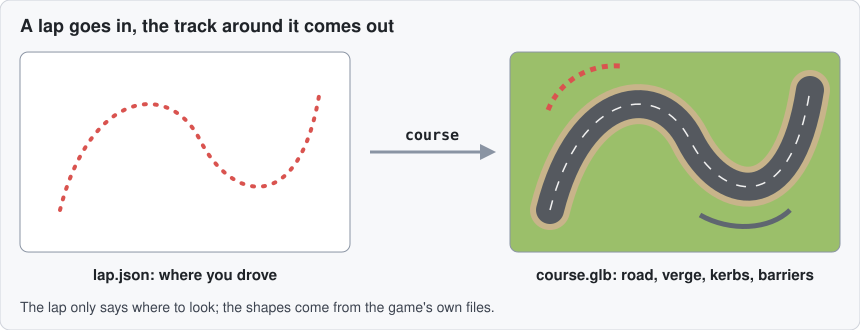
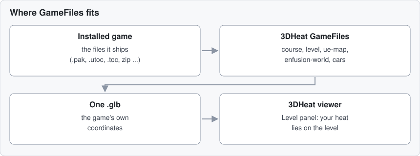
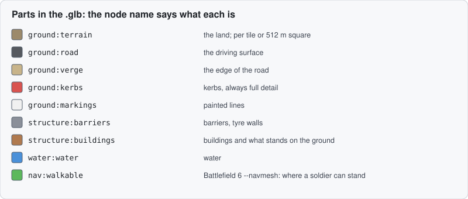

# 3DHeat GameFiles

**What is it?** A tool that builds a 3D model of a race track or a game level
from the files of a game you already have installed.

**Why would I use it?** The [3DHeat](https://github.com/Holdi601/3DHeat) viewer
paints where you drove or played as heat. With this tool it paints it on the real
track or level, not on empty space.

**Example:** give it a lap you drove, and it writes the track around that lap -
ground, road, kerbs, barriers - as one 3D file, `course.glb`:



**Documentation:** [holdi601.github.io/3DHeat-GameFiles](https://holdi601.github.io/3DHeat-GameFiles/) - one page per
command, step by step, with examples. Documentation in your language: open the
site and pick a language at the top. The viewer is documented at
[holdi601.github.io/3DHeat](https://holdi601.github.io/3DHeat/).



## What it is useful for

- **Drawing heat on the real track.** Record laps in Forza, BeamNG.drive or
  Assetto Corsa Rally, run `course` on one, and the viewer draws your laps on
  the course they were driven on - road, verge, kerbs, barriers - in the same
  coordinates as the telemetry.
- **Whole multiplayer levels.** Battlefield 6 levels, Unreal 5 World Partition
  maps and Arma Reforger worlds as one `.glb`, so position data from those
  games has its ground and buildings under it.
- **Cars in their own shape.** `cars` gives the viewer's Race analysis tab every Forza
  car at the game's own low detail and true size.
- **Looking inside a game's archives.** `identify`, `list` and `extract` say
  what a file is and take one entry out.

It is one of three ways to get a level into 3DHeat:

| Route | Needs | Gives |
|---|---|---|
| [3DHeat Unreal Exporter](https://github.com/Holdi601/3DHeat-UnrealExporter) | the Unreal project open in the editor | exact geometry |
| [3DHeat GameCapture](https://github.com/Holdi601/3DHeat-GameCapture) | a screen and a recording | an estimate |
| **3DHeat GameFiles** | **the installed game** | **exact geometry, no project** |

Engines it reads: **Unreal** (`.pak`, Unreal 5 IoStore `.utoc` + `.ucas`),
**Unity** (`SerializedFile`, bundles), **Frostbite** (`.toc` + `.cas`),
**Source 2** (`.vpk`), **ForzaTech** (`.minizip`, `.modelbin`, terrain),
**BeamNG** (level archives, `.cdae`, `.ter`) and **Enfusion** (`.pak`, terrain,
world files).

## The rules it keeps

- **It reads files; it breaks no locks.** It ships no keys and recovers none.
  An encrypted archive opens only with a key you already hold. Nothing searches
  a program for keys or reads another program's memory.
- **What you point it at is your responsibility.** Games carry their own licence
  terms; see [Rules and licences](https://holdi601.github.io/3DHeat-GameFiles/rules-and-licences.html).

## Install

New to the command line? Read [Before you start](https://holdi601.github.io/3DHeat-GameFiles/before-you-start.html) first.

You need **Python 3.10 or later** (developed on 3.13) on Windows: games are found
through Steam's library list and `%LOCALAPPDATA%`.

```
git clone https://github.com/Holdi601/3DHeat-GameFiles.git
cd 3DHeat-GameFiles
pip install -r requirements.txt
python -m heat3d_gamefiles --help
```

No git? Download the ZIP from the green **Code** button on GitHub, unpack it,
and open a terminal in the unpacked folder instead of the first two lines.

You should see: `usage: heat3d_gamefiles [-h]` and a list of verbs
(`identify`, `list`, `extract`, ... `cars`). Unreal content compressed with
Oodle needs an Oodle library already on the machine ([Oodle](https://holdi601.github.io/3DHeat-GameFiles/reader-oodle.html)).
Nothing else is downloaded.

## Using it

```
python -m heat3d_gamefiles identify <file>              # what is this?
python -m heat3d_gamefiles list     <archive> [--filter text]
python -m heat3d_gamefiles extract  <archive> <path inside> [--out file]
python -m heat3d_gamefiles meshes   <unity .assets>
python -m heat3d_gamefiles course   <lap file | lap folder | course name> [-o course.glb]
python -m heat3d_gamefiles courses  [-o folder] [--only name ...]   # every course in the library
python -m heat3d_gamefiles races    [-o folder] [--markdown file]   # every race a Forza defines
python -m heat3d_gamefiles terrain  <forza track folder> -o map.glb \
                                    (--box x0 z0 x1 z1 | --route lap.json)
python -m heat3d_gamefiles ue-maps  <game folder | Steam game folder name>
python -m heat3d_gamefiles ue-map   <game folder | Steam game folder name> <map> [-o map.glb]
python -m heat3d_gamefiles enfusion-worlds
python -m heat3d_gamefiles enfusion-world <world> [-o world.glb]
python -m heat3d_gamefiles levels   [--install folder]                 # Battlefield 6
python -m heat3d_gamefiles level    <level> [-o level.glb] [--textures] [--navmesh]
python -m heat3d_gamefiles cars     [-o forza.h3dcars] [--game folder] # every Forza car
```

Run every command in this folder (the one with `README.md` in it). `<...>` is a
placeholder: type your own value, without the angle brackets.

### Every option

| Verb | Options |
|---|---|
| `identify` | `<file>` |
| `list` | `<archive>`, `--filter TEXT`, `--limit N`, `--key HEX` (an AES-256 key you already hold; only an encrypted `.pak`) |
| `extract` | `<archive> <path inside>`, `--out FILE`, `--key HEX` |
| `meshes` | `<unity file>`, `--limit N` |
| `course` | `<lap file \| lap folder \| course name>`, `-o FILE`, `--game forza\|beamng\|acrally`, `--track FOLDER` (Forza), `--level NAME` and `--install FOLDER` (BeamNG, AC Rally), `--margin M` (80), `--texture-size 2048\|1024\|512`, `--no-textures`, `--season summer\|autumn\|winter\|spring`, `--no-placed`, `--trees`, `--detail-budget N` |
| `courses` | `-o FOLDER` (`./courses`), `--library FILE`, `--only NAME ...`, `--force`, `--track FOLDER`, `--margin M`, and the texture/season/placed/trees/budget options of `course` |
| `races` | `-o FOLDER` (`./courses`), `--library FILE`, `--track FOLDER`, `--markdown FILE` |
| `terrain` | `<forza track folder>`, `-o FILE`, `--box X0 Z0 X1 Z1` or `--route ROUTE.json`, `--margin M`, and the texture/season/placed/trees/budget options of `course` |
| `cars` | `-o FILE` (`./forza.h3dcars`), `--game FOLDER` |
| `levels` | `--install FOLDER` |
| `level` | `<level>`, `-o FILE`, `--install FOLDER`, `--textures [PIXELS]`, `--ground-texture [METRES]`, `--navmesh`, `--ground-spacing M` (4), `--detail-budget N`, `--skip TEXT`, `--by-mesh`, `--clamped-uvs` |
| `ue-maps` | `<game folder \| Steam folder name>` |
| `ue-map` | `<game> <map>`, `-o FILE`, `--ground-spacing M` (2), `--no-structures`, `--no-water` |
| `enfusion-worlds` | `--install FOLDER` |
| `enfusion-world` | `<world>`, `-o FILE`, `--install FOLDER`, `--ground-spacing M` (2), `--texture-size PIXELS` (4096; 0 for none), `--no-structures`, `--trees` |

Each verb is explained step by step, with its output, in the
[documentation](https://holdi601.github.io/3DHeat-GameFiles/commands.html).
Exit codes: 0 done, 1 the work failed, 2 a usage error.


The full `--help` of every verb is on the generated
[Command reference](https://holdi601.github.io/3DHeat-GameFiles/cli-reference.html).

### Output

Every export is one binary glTF (`.glb`): one node per part, in world space,
in the game's own coordinates and metres, so the game's telemetry lies on it.
The node name says what each part is - `ground:` (the surface the heat lies
on), `structure:` (what stands on it), `water:`, and `nav:walkable` for a
Battlefield 6 navigation mesh. No metadata about the game is written. Details:
[Output format](https://holdi601.github.io/3DHeat-GameFiles/output-format.html).



Load it in the 3DHeat viewer's Background / level panel. The match files the other 3DHeat
tools write are described in the viewer's
[One file a match: `.3dheat`](https://holdi601.github.io/3DHeat/container.html);
a match refers to its level by name and checksum, and the `.glb` stays beside
it.

`course` is the one to start with: give it a lap and it exports the track
around it - ground, road, kerbs, barriers, tyre walls, signs - as one textured
`.glb` for the viewer, with nothing else to supply. It reads which game the lap
is from out of the file (`heat3d-lap` files say; anything else is Forza's), finds
the installed game, the level or stage, and - for Assetto Corsa Rally - which
way round its axes are. See [ForzaTech](https://holdi601.github.io/3DHeat-GameFiles/course-forza-horizon.html),
[BeamNG](https://holdi601.github.io/3DHeat-GameFiles/course-beamng.html) and
[Assetto Corsa Rally](https://holdi601.github.io/3DHeat-GameFiles/course-assetto-corsa-rally.html).

```
python -m heat3d_gamefiles course <beamng or ac rally lap .json>   # all it needs
python -m heat3d_gamefiles course lap.json --level <name>         # name the level or stage
python -m heat3d_gamefiles course lap.json --install <game folder> # a game outside Steam
```

A lap from a game whose courses cannot be exported says why and what to do
instead.

`list` and `extract` take an Unreal `.pak` or IoStore `.utoc` (or the `.ucas`
beside it), a Source 2 `.vpk`, a ForzaTech `.minizip` and a zip - BeamNG's level
and content archives among them. The format is read from the bytes, not from the
extension or from a flag you have to pass. A `.minizip` stores no names, so its
entries are named by the `ChunkContentsMiniZip*.txt` beside it, or go by number
(`#12`) without one. A Unity container is read with `meshes`, and a Frostbite
level with `level`. A file that is none of these, or that cannot be opened -
an encrypted archive without `--key`, a `--key` that is not 64 hex digits - is
refused in one line with a non-zero exit code.

`identify` reads the file rather than trusting its extension - every format
above, plus a Unity bundle or `SerializedFile`, a Frostbite `.toc`, a ForzaTech
`.modelbin` and BeamNG's `.cdae` and `.ter` - so it is the right first step on
anything unfamiliar.

Most shipped Unreal content is Oodle-compressed. Oodle is proprietary and has no
redistributable build, so this finds a library instead of carrying one — any
installed game or engine that ships `oo2core_*.dll` has one, and
`HEAT3D_OODLE=<path>` points at it directly.

## How far each engine goes

Formats are undocumented, so "supported" means *checked against something the
format itself guarantees* (a checksum, a bounding box, a count), not *did not
crash*. One page per format:

| Engine | Reads | Page |
|---|---|---|
| Unreal | `.pak` lists and extracts (versions 8-12, Zlib and Oodle, encrypted with your key) | [Unreal .pak](https://holdi601.github.io/3DHeat-GameFiles/reader-unreal-pak.html) |
| Unreal 5 | IoStore containers, packages, static meshes, textures | [Unreal 5 IoStore](https://holdi601.github.io/3DHeat-GameFiles/reader-unreal-iostore.html) |
| Unity | objects and meshes, Unity 2020 to 6000 | [Unity](https://holdi601.github.io/3DHeat-GameFiles/reader-unity.html) |
| Source 2 | `.vpk` lists and extracts, checksum-checked | [Source 2 VPK](https://holdi601.github.io/3DHeat-GameFiles/reader-source2-vpk.html) |
| ForzaTech | a lap in, the course around it out | [Forza Horizon courses](https://holdi601.github.io/3DHeat-GameFiles/course-forza-horizon.html), [ForzaTech](https://holdi601.github.io/3DHeat-GameFiles/reader-forzatech.html) |
| Frostbite | a Battlefield 6 level: terrain, every placed mesh, textures | [Battlefield 6 levels](https://holdi601.github.io/3DHeat-GameFiles/level-battlefield.html), [Frostbite](https://holdi601.github.io/3DHeat-GameFiles/reader-frostbite.html) |
| BeamNG | a lap in, the level around it out | [BeamNG.drive courses](https://holdi601.github.io/3DHeat-GameFiles/course-beamng.html), [BeamNG](https://holdi601.github.io/3DHeat-GameFiles/reader-beamng.html) |
| Assetto Corsa Rally | a lap in, the stage around it out | [Assetto Corsa Rally courses](https://holdi601.github.io/3DHeat-GameFiles/course-assetto-corsa-rally.html) |
| Unreal 5 World Partition | a whole map: landscape, merged buildings, water | [Unreal 5 maps](https://holdi601.github.io/3DHeat-GameFiles/level-unreal-world-partition.html) |
| Enfusion | an Arma Reforger world: terrain, sea, buildings as boxes | [Arma Reforger worlds](https://holdi601.github.io/3DHeat-GameFiles/level-arma-reforger.html) |

## Tests

```
python -m pytest
```

Synthetic tests build an archive byte by byte and run anywhere. Tests against
installed games skip when the game is absent.

---

## Part of 3DHeat

3DHeat GameFiles is one of the free tools around the 3DHeat viewer. Each is its
own project, with its own releases and licence:

| Tool | What it does | Docs |
|---|---|---|
| [3DHeat](https://github.com/Holdi601/3DHeat) | the viewer: 3D heatmaps, race analysis and match review in the browser | [site](https://holdi601.github.io/3DHeat/) |
| [GameFiles](https://github.com/Holdi601/3DHeat-GameFiles) | courses and levels out of the files a game ships, as `.glb` | [site](https://holdi601.github.io/3DHeat-GameFiles/) |
| [GameCapture](https://github.com/Holdi601/3DHeat-GameCapture) | lap telemetry from racing games; levels rebuilt from gameplay video | [site](https://holdi601.github.io/3DHeat-GameCapture/) |
| [Unreal Exporter](https://github.com/Holdi601/3DHeat-UnrealExporter) | an Unreal Editor plugin that saves a level as `.glb` | [site](https://holdi601.github.io/3DHeat-UnrealExporter/) |
| [CS2](https://github.com/Holdi601/3DHeat-CS2) | Counter-Strike 2 demos into match files; maps into `.glb` | [site](https://holdi601.github.io/3DHeat-CS2/) |
| [Watcher](https://github.com/Holdi601/3DHeat-Watcher) | records your play in the background from what games publish | [site](https://holdi601.github.io/3DHeat-Watcher/) |
| [Ext-WarThunder](https://github.com/Holdi601/3DHeat-Ext-WarThunder) | War Thunder replays into match files | [site](https://holdi601.github.io/3DHeat-Ext-WarThunder/) |
| [Ext-WoT](https://github.com/Holdi601/3DHeat-Ext-WoT) | World of Tanks replays into match files | [site](https://holdi601.github.io/3DHeat-Ext-WoT/) |
| [Ext-WoWs](https://github.com/Holdi601/3DHeat-Ext-WoWs) | World of Warships replays into match files | [site](https://holdi601.github.io/3DHeat-Ext-WoWs/) |
| [Ext-Squad](https://github.com/Holdi601/3DHeat-Ext-Squad) | Squad server demos into match files | [site](https://holdi601.github.io/3DHeat-Ext-Squad/) |
| [Ext-DCS](https://github.com/Holdi601/3DHeat-Ext-DCS) | DCS World maps into `.glb` levels | [site](https://holdi601.github.io/3DHeat-Ext-DCS/) |
| [Ext-IL2](https://github.com/Holdi601/3DHeat-Ext-IL2) | IL-2 Sturmovik maps into `.glb` levels | [site](https://holdi601.github.io/3DHeat-Ext-IL2/) |

## Updates

3DHeat GameFiles checks this repository's releases when it starts (at most every
few hours, never holding it up for more than a few seconds), says when a newer
version is out, and offers to update: a clone with `git pull` when it has no
local changes, a downloaded copy by replacing its files from the release archive,
after checking the archive is the version it claims. Your own files - laps,
exports - are never touched. To update on request: `python -m heat3d_update`.
`HEAT3D_NO_UPDATE=1` switches the check off. Releases are tagged with the number
in [`VERSION`](VERSION); what changed is in [`CHANGELOG.md`](CHANGELOG.md).

## Licence

MIT - see [`LICENSE`](LICENSE), and [`LICENSES.md`](LICENSES.md) for the
third-party packages it uses and what the games it reads oblige.
