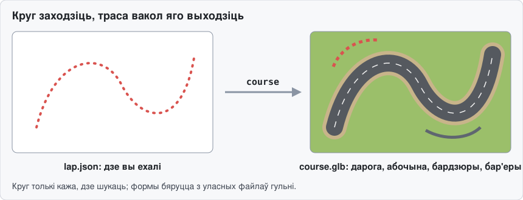
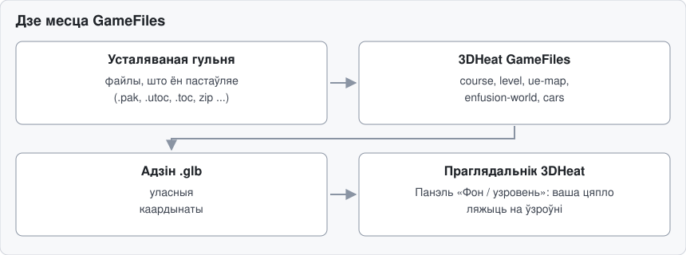

# 3DHeat GameFiles {#dheat-gamefiles}

**Што гэта?** Інструмент, які будуе 3D-мадэль гоначнай трасы або ўзроўню гульні
з файлаў гульні, якая ў вас ужо ўсталявана.

**Навошта гэта мне?** Праглядальнік 3DHeat малюе цеплавой фарбай, дзе вы ехалі або гулялі.
З гэтым інструментам ён малюе гэта на сапраўднай трасе або ўзроўні, а не ў пустаце.

**Прыклад:** вазьміце круг, які вы праехалі. Інструмент будуе дарогу і зямлю вакол яго
як адзін 3D-файл, каб праглядальнік мог намаляваць вашу хуткасць або аварыі на сапраўднай трасе:



Упершыню ў камандным радку? Пачніце з [Перад пачаткам](before-you-start.md).

Больш падрабязна: ён чытае даныя ўзроўняў з архіваў, якія пастаўляе гульня, і піша
іх як двайковы файл glTF (`.glb`). Яго галоўная задача — **экспарт трасы**: вы
даяце яму круг, і ён піша зямлю, дарогу, адрозную ад абочыны і
травы, а таксама бардзюры, агароджы, шыны-бар'еры, знакі і будынкі вакол яе.

Ён частка [3DHeat](https://github.com/Holdi601/3DHeat), праглядальніка
3D-цеплавых карт тэлеметрыі ў рэальным часе, аналізу гонак і разбору матчаў
([дакументацыя](https://holdi601.github.io/3DHeat/)). Файлы `.glb`, якія гэты
інструмент піша, — гэта ўзроўні, на якіх праглядальнік малюе цяпло.



Гэта адзін з трох спосабаў даставіць геаметрыю ўзроўню ў 3DHeat:

| Шлях | Што трэба | Што дае |
|---|---|---|
| 3DHeat Unreal Exporter | праект Unreal, адкрыты ў рэдактары | дакладную геаметрыю |
| 3DHeat GameCapture | экран і захоп | ацэнку |
| **3DHeat GameFiles** | **усталяваная гульня ў тым выглядзе, як яе пастаўляюць** | **дакладную геаметрыю, без праекта** |

Пакет Python: `heat3d_gamefiles`. Рэпазітарый:
[Holdi601/3DHeat-GameFiles](https://github.com/Holdi601/3DHeat-GameFiles). Ліцэнзія: MIT.

## Што ён умее {#what-it-can-do}

| Гульня або рухавік | Экспарт трасы (`course`) | Чытанне архіваў |
|---|---|---|
| Forza Horizon (ForzaTech) | так: рэльеф, дарога і абочына, тэкстура зямлі, размешчаныя мадэлі ў сваіх тэкстурах | `identify`, `list`, `extract` на `.minizip`; `identify` на `.modelbin`; мадэлі, рэльеф і тэкстуры праз `course` і `terrain` |
| BeamNG.drive | так: рэльеф, дэкалі дарогі, змадэляваныя трасы, размешчаныя мадэлі, вада | `identify`, `list`, `extract` на zip-файлах узроўняў; `identify` на `.ter`, `.cdae`; `.dae` праз `course` |
| Assetto Corsa Rally (Unreal 5.6) | так: плітки зямлі этапу, запечаны колер зямлі, размешчаныя мадэлі ў плоскіх колерах | `identify`, `list`, `extract` на IoStore `.utoc`/`.ucas`; zen-пакеты, статычныя меши, тэкстуры праз `course` |
| Unreal `.pak` (версіі 8-12) | не | `identify`, `list`, `extract` |
| Unity (фармат 22 і пазнейшы) | не | `identify`, `meshes` |
| Battlefield 6 (Frostbite `.toc`/`.cas`) | без круга; увесь узровень праз `level`: рэльеф, размешчаныя меши, іх карты колераў з `--textures` | `identify`, `levels`; пакеты, меши, рэльеф, тэкстуры і размяшчэнне праз `level` |
| Source 2 `.vpk` | не | `identify`, `list`, `extract` |
| гульні Unreal 5 з World Partition | без круга; уся карта праз `ue-map` (спіс праз `ue-maps`): ландшафт, будынкі і прадметы HLOD, вада | - |
| Arma Reforger (Enfusion) | без круга; увесь свет праз `enfusion-world` (спіс праз `enfusion-worlds`): рэльеф у сваіх колерах, мора, будынкі як скрынкі | - |
| Forza (аўтамабілі) | `cars`: кожны аўтамабіль з нізкай дэталізацыяй, для ўкладкі «Аналіз заездаў» праглядальніка | - |

Кругі з Assetto Corsa EVO і iRacing адхіляюцца з тлумачэннем прычыны. Гл.
[Абмежаванні і вядомыя прабелы](../limits-and-known-gaps.md).

## Усталёўка {#install}

Упершыню ў камандным радку? Спачатку прачытайце [Перад пачаткам](before-you-start.md).

Вам патрэбен **Python 3.10 або навейшы** (распрацоўваўся на 3.13) і пакеты з
[`requirements.txt`](https://github.com/Holdi601/3DHeat-GameFiles/blob/main/requirements.txt).

```
git clone https://github.com/Holdi601/3DHeat-GameFiles.git
cd 3DHeat-GameFiles
pip install -r requirements.txt
```

Потым праверце: `python -m heat3d_gamefiles --help`. Вы ўбачыце
`usage: heat3d_gamefiles [-h]` і спіс дзеясловаў. Выконвайце кожную каманду ў папцы
рэпазітарыя, як `python -m heat3d_gamefiles <verb>`.

| Пакет | Для чаго |
|---|---|
| numpy | усё, што расшыфроўвае геаметрыю |
| lz4 | архівы Forza (пераважна блокі LZ4), некаторыя пакеты Unity, блокі IoStore LZ4 |
| Pillow | расшыфроўка тэкстур BC1-BC7, запіс тэкстур JPEG у `.glb` |
| msgpack, zstandard | скампіляваныя формы BeamNG (`.cdae`) |
| cryptography | толькі для адкрыцця зашыфраванага `.pak` ключом, які ў вас ужо ёсць |
| pytest | тэсты |

Змесціву Unreal, сціснутаму **Oodle**, патрэбна бібліятэка Oodle, якая ўжо ёсць
на вашым кампутары. Яна ніколі не пастаўляецца з гэтым інструментам. Гл. [Oodle](../reader-oodle.md).

Інструмент напісаны для Windows. Ён знаходзіць гульні праз спіс бібліятэк Steam і
`%LOCALAPPDATA%` і загружае Oodle як DLL Windows. Іншыя платформы не
тэставаліся.

## Хуткі старт {#quick-start}

**Файл круга** — гэта запіс таго, куды ехала ваша машына: спіс кропак x, y, z.
Ён прыходзіць з [3DHeat GameCapture](https://github.com/Holdi601/3DHeat-GameCapture)
або з бібліятэкі кругоў праграмы FH Companion; CSV, набраны ўручную, таксама падыходзіць
([Уваходы кругоў](../lap-inputs.md)).

```
# Forza: a lap file, a lap folder, or a course name from the FH Companion library
python -m heat3d_gamefiles course "Example Circuit"
python -m heat3d_gamefiles course path\to\lap.json -o course.glb

# BeamNG.drive or Assetto Corsa Rally: a heat3d-lap file says which game it is from
python -m heat3d_gamefiles course my_lap.json

# Every course in the FH Companion library, one .glb each
python -m heat3d_gamefiles courses -o courses

# Battlefield 6: list the levels, then export one (a large file; see Commands)
python -m heat3d_gamefiles levels
python -m heat3d_gamefiles level <level> -o level.glb --textures

# Unreal 5 World Partition and Arma Reforger: list, then export
python -m heat3d_gamefiles ue-maps "<game>"
python -m heat3d_gamefiles ue-map "<game>" <map> -o map.glb
python -m heat3d_gamefiles enfusion-worlds
python -m heat3d_gamefiles enfusion-world <world> -o world.glb

# Every Forza car, for the viewer's race tab
python -m heat3d_gamefiles cars -o forza.h3dcars

# What is this file?
python -m heat3d_gamefiles identify some_archive.pak
```

Адкрыйце `.glb` у праглядальніку 3DHeat. Уласныя каардынаты свету гульні захоўваюцца
(гл. [Фармат вываду](../output-format.md)), таму запісаны круг супадае з трасай.

## Карта гэтай дакументацыі {#map-of-this-documentation}

- [Перад пачаткам](before-you-start.md): Python, тэрмінал, першая каманда.
- [Каманды](../commands.md): кожны дзеяслоў і опцыя, з прыкладамі.
- [Даведнік каманд](../cli-reference.md): `--help` кожнага дзеяслова, створаны з кода.
- [Агляд архіваў](../inspecting-archives.md): `identify`, `list`, `extract`, `meshes`, крок за крокам.
- [Экспарт трасы](../course-export.md): як круг становіцца трасай, для ўсіх гульняў.
  - [Forza Horizon](../course-forza-horizon.md)
  - [BeamNG.drive](../course-beamng.md)
  - [Assetto Corsa Rally](../course-assetto-corsa-rally.md)
  - [Узроўні дэталізацыі і бюджэт](../detail-budget.md)
- [Цэлыя ўзроўні](../whole-levels.md): узровень, карта або свет без круга.
  - [Узроўні Battlefield 6](../level-battlefield.md): `levels`, `level`
  - [Карты Unreal 5](../level-unreal-world-partition.md): `ue-maps`, `ue-map`
  - [Светы Arma Reforger](../level-arma-reforger.md): `enfusion-worlds`, `enfusion-world`
- [Аўтамабілі Forza](../forza-cars.md): `cars`, файл аўтамабіляў для ўкладкі «Аналіз заездаў» праглядальніка.
- [Уваходы кругоў](../lap-inputs.md): кожная форма файла круга, якую прымае інструмент.
- [Фармат вываду](../output-format.md): што ўнутры `.glb`.
- [Чытачы архіваў](../archive-readers.md): адна старонка на фармат кантэйнера, пра тое,
  што кожны чытае, чаго не чытае і чаму.
- [Абмежаванні і вядомыя прабелы](../limits-and-known-gaps.md)
- [Вырашэнне праблем](../troubleshooting.md): паведамленні пра памылкі і што рабіць.
- [Правілы і ліцэнзіі](../rules-and-licences.md): без ключоў, вашы ўласныя файлы, без пераразмеркавання.
- [Абнаўленні](../updates.md): праверка абнаўленняў і `heat3d_update`.
- [Распрацоўка](../development.md): карта модуляў і тэсты, у тым ліку тэсты, што ідуць на ўсталяваных гульнях.
- [Падтрымка](../maintaining.md): спіс для выпуску гэтых старонак.

## Частка 3DHeat {#part-of-3dheat}

3DHeat GameFiles — адзін з бясплатных інструментаў вакол праглядальніка 3DHeat:

| Інструмент | Што ён робіць | Дакументацыя |
|---|---|---|
| [3DHeat](https://github.com/Holdi601/3DHeat) | праглядальнік: 3D-цеплавыя карты, аналіз гонак і разбор матчаў у браўзеры | [сайт](https://holdi601.github.io/3DHeat/) |
| [GameFiles](https://github.com/Holdi601/3DHeat-GameFiles) | трасы і ўзроўні з файлаў, што пастаўляе гульня, як `.glb` | [сайт](https://holdi601.github.io/3DHeat-GameFiles/) |
| [GameCapture](https://github.com/Holdi601/3DHeat-GameCapture) | тэлеметрыя кругоў з гоначных гульняў; узроўні, узноўленыя з відэа гульні | [сайт](https://holdi601.github.io/3DHeat-GameCapture/) |
| [Unreal Exporter](https://github.com/Holdi601/3DHeat-UnrealExporter) | убудова Unreal Editor, што захоўвае ўзровень як `.glb` | [сайт](https://holdi601.github.io/3DHeat-UnrealExporter/) |
| [CS2](https://github.com/Holdi601/3DHeat-CS2) | дэма Counter-Strike 2 у файлы матчаў; карты ў `.glb` | [сайт](https://holdi601.github.io/3DHeat-CS2/) |
| [Watcher](https://github.com/Holdi601/3DHeat-Watcher) | запісвае вашу гульню ў фоне з таго, што гульні публікуюць | [сайт](https://holdi601.github.io/3DHeat-Watcher/) |
| [Ext-WarThunder](https://github.com/Holdi601/3DHeat-Ext-WarThunder) | рэплеі War Thunder у файлы матчаў | [сайт](https://holdi601.github.io/3DHeat-Ext-WarThunder/) |
| [Ext-WoT](https://github.com/Holdi601/3DHeat-Ext-WoT) | рэплеі World of Tanks у файлы матчаў | [сайт](https://holdi601.github.io/3DHeat-Ext-WoT/) |
| [Ext-WoWs](https://github.com/Holdi601/3DHeat-Ext-WoWs) | рэплеі World of Warships у файлы матчаў | [сайт](https://holdi601.github.io/3DHeat-Ext-WoWs/) |
| [Ext-Squad](https://github.com/Holdi601/3DHeat-Ext-Squad) | дэма сервераў Squad у файлы матчаў | [сайт](https://holdi601.github.io/3DHeat-Ext-Squad/) |
| [Ext-DCS](https://github.com/Holdi601/3DHeat-Ext-DCS) | карты DCS World ва ўзроўні `.glb` | [сайт](https://holdi601.github.io/3DHeat-Ext-DCS/) |
| [Ext-IL2](https://github.com/Holdi601/3DHeat-Ext-IL2) | карты IL-2 Sturmovik ва ўзроўні `.glb` | [сайт](https://holdi601.github.io/3DHeat-Ext-IL2/) |

Файлы матчаў праглядальніка апісаны ў
[Адзін файл на матч: `.3dheat`](https://holdi601.github.io/3DHeat/container.html);
узровень, зроблены тут, загружаецца побач з імі на панэлі «Фон / узровень» праглядальніка.
