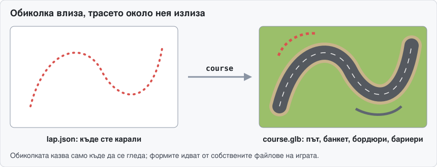
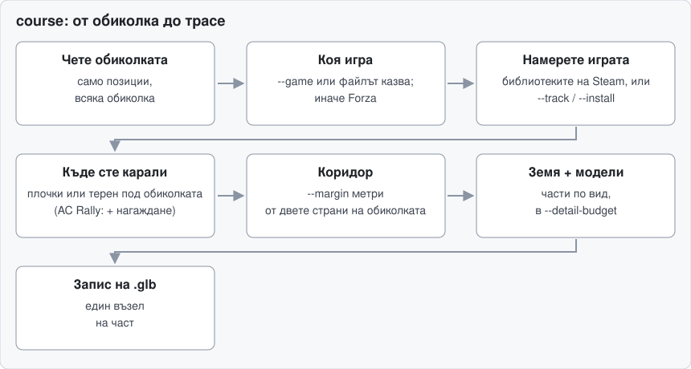

# Експорт на трасе {#course-export}

**Накратко:** карал си обиколка; това строи трасето, по което си карал, като 3D файл. Обиколката е само ред от точки; пътят, тревата и бордюрите идват от собствените файлове на играта.

`course` превръща обиколка в трасе: земята в пояс от двете страни на мястото, където е минала колата, и това, което стои върху земята, като един `.glb` за визуализатора. Тази страница описва онова, което трите поддържани игри имат общо. Страниците под нея описват какво е различно:

- [Forza Horizon](course-forza-horizon.md): архиви ForzaTech `.minizip`
- [BeamNG.drive](course-beamng.md): zip архиви, височинно поле на терена, компилирани форми
- [Assetto Corsa Rally](course-assetto-corsa-rally.md): Unreal 5 IoStore, етап World Partition
- [Нива на детайл и бюджетът](detail-budget.md): колко триъгълника получават разположените модели и кои копия остават

## Стъпките {#the-steps}

Думи, използвани по-долу: **рамка** е посоката на осите; **коридорът** е пояса земя от двете страни на обиколката; **плочка** е едно квадратно парче от терена на играта; **LOD** (ниво на детайл) е едно от по-простите копия на модел.

1. **Прочитане на обиколката.** Само позиции, от която и да е от формите в [Входни данни за обиколка](lap-inputs.md). Скоростта и управлението не се ползват. Обиколка с по-малко от две точки се отхвърля („holds no driving“).
2. **Определяне на играта.** `--game`, после полето `game` на файла с обиколката, после Forza (вижте [Команди](commands.md#which-game)).
3. **Намиране на инсталираната игра.** И трите търсят във всяка библиотека на Steam, изброена в `config\libraryfolders.vdf` на Steam. Forza търси и в `C:\XboxGames`. `--track` (Forza) или `--install` (BeamNG, AC Rally) пропуска търсенето.
4. **Намиране къде е карана обиколката.** Това никога не се решава само по съвпадение на име. Forza избира трасето, чиито плочки от терена покриват обиколката. BeamNG избира нивото, на чийто терен (или пътища) лежат точките на обиколката. AC Rally пробва всеки етап в осем ориентации на осите и избира тази, която слага най-голяма част от обиколката на път.
5. **Изрязване на коридор** с `--margin` метра от двете страни на шофирането (по-долу).
6. **Построяване на земята** в коридора, класирана като път, банкет, чакъл и пръст, терен, маркировка, следи от гуми или вода, и запичане на текстура на земята за всеки квадрат от 512 м.
7. **Разполагане на моделите**, които стоят в коридора, по категория, на ниво на детайл, избрано по разстояние и бюджет за триъгълници.
8. **Запис на `.glb`**: един именуван възел за всяка част. Вижте [Формат на изхода](output-format.md).

Какво извежда една пускане — тук на синтетична инсталация на BeamNG.drive, която тестовете строят, 50 м обиколка по права на път:

## Коридорът {#the-corridor}

Изрязването е пояс около начертаната линия на шофиране, а не граничната кутия на обиколката. При кръгова писта двете са почти еднакви. При спринт от точка до точка кутията е предимно хълм, покрай който никой не минава, и поясът може да е една десета от площта ѝ. Източник: [`corridor.py`](https://github.com/Holdi601/3DHeat-GameFiles/blob/main/heat3d_gamefiles/corridor.py).

Как е построен:

- Шофирането се проектира върху равнината на земята: x и z на обиколката (BeamNG: x и y в собствената рамка на играта).
- Растеризира се в решетка от клетки по **4 м** (`CELL`). Всяка клетка, която докосва шофирането, се разширява с диск с радиус `margin + 4 m` във всички посоки.
- Последователните точки, по-близо от **50 м** една до друга (`JOIN`), се свързват с точки на всеки 4 м, та поясът да няма празнини. Точките по-далеч една от друга се третират като отделни отсечки шофиране и не се свързват. Библиотечно трасе е много файлове с обиколки едно след друго, и финалът на един спринт и стартът на следващия не трябва да начертават пояс през картата.
- Триъгълник се пази, ако някой от ъглите, средната точка на някой ръб или центроидът му е в пояса. Средните точки улавят голям триъгълник, който минава през тесен пояс, с всичките си ъгли извън него.
- Височината никога не участва в изрязването. Кутия, която ограничава височината, би отрязала земята под хълм, по който пътят се катери.

Конзолата докладва площта на коридора, например
`cutting 80 m either side of the driving: 1.53 km2 of a 6,000 by 3,600 m box`.

BeamNG и AC Rally строят и по-широк коридор за **достъп** от `margin + 60 m`. Разположен модел се взима предвид, ако началото му е в коридора за достъп, и се рисува само ако основата му докосва истинския коридор. Така дълъг обект, чието начало е точно извън пояса, не се губи. BeamNG използва коридора за достъп и за избор на декалите по пътя, които да се нарисуват.

## От какво е направена земята {#what-the-ground-is-made-of}

Всеки експорт класира триъгълниците на земята в едни и същи видове, а всеки вид се записва като собствена част, за да може визуализаторът да я показва или скрива:

| Вид | Име на частта | Плосък цвят (линейно RGB) | Forza | BeamNG | AC Rally |
|---|---|---|---|---|---|
| път | `ground:road` | 0.22, 0.22, 0.23 | ленти на пътя: асфалтовата част | слоеве `ASPHALT`, декали на пътя, моделиран път | плочки от трасето (`/MeshesTrack/`) |
| банкет | `ground:verge` | 0.52, 0.47, 0.30 | ленти на пътя: банкетът | тротоари и модели на банкета | - |
| чакъл и пръст | `ground:gravel and dirt` | 0.50, 0.42, 0.30 | - | слоеве пръст, чакъл, пясък, кал и декали | - |
| терен | `ground:terrain` | 0.30, 0.44, 0.18 | всичко друго | всичко друго | плочки `_Terrain` и далечният терен |
| бордюри | `ground:kerbs` | 0.60, 0.12, 0.10 (Forza) | `road_gen_rum*` реквизит | модели на бордюри, ивици и вибрационни ленти | модели на бордюри и ивици |
| маркировка | `ground:markings` | 0.90, 0.90, 0.88 | подмрежи на декали, повдигнати с 5 см | нарисувана в текстурата | - |
| следи от гуми | `ground:tyre marks` | 0.20, 0.17, 0.16 | подмрежи на декали, повдигнати с 5 см | нарисувана в текстурата | - |
| вода | `water:water` | 0.16, 0.34, 0.48 | водни материали | морска равнина, водни блокове, реки | - |

Плоските цветове са избрани, за да се четат с един поглед, а не за да съвпадат с играта. Използват се за части без текстура и от визуализатори, които пренебрегват текстурите. Източник: [`surfaces.py`](https://github.com/Holdi601/3DHeat-GameFiles/blob/main/heat3d_gamefiles/surfaces.py).

Частите на земята се разделят по квадрати от 512 м, а всеки квадрат носи собственото си запечатано изображение, затова имената на частите носят квадрата:

| Игра | Име на частта на земята | Ключ на квадрата |
|---|---|---|
| Forza | `ground:road x-2046 z1023` | името на мрежата на плочката от терена (стъпки от 1023, вижте [Forza Horizon](course-forza-horizon.md)) |
| BeamNG | `ground:road 3_-2` | `floor(x / 512)`, `floor(y / 512)` в метри на BeamNG |
| AC Rally | `ground:road 1_-4` | `floor(x / 51200)`, `floor(y / 51200)` в сантиметри на Unreal |

## Какво стои върху нея {#what-stands-on-it}

Разположените модели се записват в части с име `structure:<категория>`, или `ground:kerbs` за бордюрите (и в трите игри). Когато част има собствена текстура, името на текстурата или на материала следва категорията, например `structure:barriers bar_armco_bclr`.

| Категория | Forza | BeamNG | AC Rally |
|---|---|---|---|
| прегради | да | да | да |
| реквизит | да | да | да |
| знаци | да | да | да |
| сгради | да (цели сгради като заместители там, където играта ги има) | да | да |
| инфраструктура | да | да | да |
| мостове | да | да | (класирани като инфраструктура) |
| скали | да | да | да |
| бордюри | да, като земя | да, като земя | да, като земя |
| дървета | с `--trees` | с `--trees` | с `--trees` |
| разрушаеми | с `--trees` | - | - |

Разпределянето на детайла е едно и също и в трите. Копията в рамките на 25 м от шофирането започват с пълен детайл, копията на 25-60 м са с едно ниво по-груби, а по-отдалечените — на най-грубото ниво. После най-скъпите модели слизат, докато се вмести бюджетът за триъгълници, а там, където дори най-грубите нива не се вмъкват в бюджет, който вие задавате, копията се пропускат. Бордюрите никога не се опростяват и не се пропускат. Вижте [Нива на детайл и бюджетът](detail-budget.md).

## Опции, които оформят резултата {#options-that-shape-the-result}

| Искате | Използвайте |
|---|---|
| по-малък файл | `--no-textures` (плоски цветове), `--texture-size 1024` или `512`, `--detail-budget N`, `--margin 40` |
| само земята | `--no-placed` |
| и декора | `--trees` |
| друг сезон (Forza) | `--season winter` |
| игра извън Steam | `--track` (Forza) или `--install` (BeamNG, AC Rally) |
| обиколка, която търсенето не намира | `--level` (BeamNG, AC Rally), `--track` (Forza) |

## Координати {#coordinates}

Всеки експорт записва метри с Y нагоре, в рамка, в която записана обиколка от същата игра се подрежда правилно:

| Игра | Записана рамка |
|---|---|
| Forza | собствените световни координати на играта, без промяна |
| BeamNG | `(x, z, -y)` от света на BeamNG с Z нагоре, което е завъртането, което прилага записвачът на телеметрията |
| AC Rally | рамката на обиколката, намерена по приспособяване: сантиметрите на Unreal стават метри, а X и Y на Unreal стават x и z на обиколката в една от осемте ориентации, която пасва |

Вижте [Формат на изхода](output-format.md).
