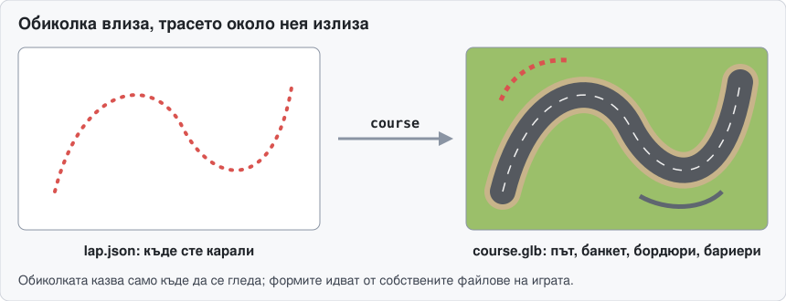
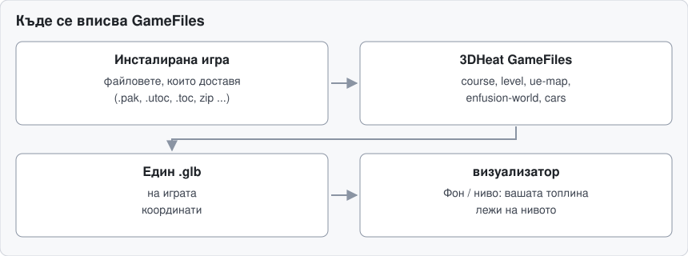

# 3DHeat GameFiles {#dheat-gamefiles}

**Какво е?** Инструмент, който изгражда триизмерен модел на трасе за състезания или на ниво
от игра от файловете на играта, която вече имате инсталирана.

**Защо да го използвам?** Визуализаторът 3DHeat рисува къде сте карали или играли като топлинна карта. С този инструмент я рисува върху истинското трасе или ниво, а не върху празно пространство.

**Пример:** вземете обиколка, която сте карали. Инструментът изгражда пътя и терена около нея
като един триизмерен файл, така че визуализаторът може да нарисува скоростта или катастрофите ви върху истинското трасе:



Нов ли сте в командния ред? Започнете с [Преди да започнете](before-you-start.md).

По-подробно: той чете данни за нивата от архивите, които играта доставя, и ги записва
като двоичен glTF (`.glb`). Основната му работа е **експортът на трасето**: давате му обиколка, а той записва
земята, пътя, отделен от банкета и тревата, и бордюрите, бариерите, гумените стени, табелите и сградите около него.

Той е част от [3DHeat](https://github.com/Holdi601/3DHeat), визуализатор за топлинни карти в реално време,
анализ на състезания и преглед на мача ([документация](https://holdi601.github.io/3DHeat/)). Файловете `.glb`, които
този инструмент записва, са нивата, върху които визуализаторът рисува топлината.



Той е един от трите начина да получите геометрията на ниво в 3DHeat:

| Път | Нужно е | Дава |
|---|---|---|
| 3DHeat Unreal Exporter | проектът на Unreal отворен в редактора | точна геометрия |
| 3DHeat GameCapture | екран и запис | приблизителна оценка |
| **3DHeat GameFiles** | **инсталираната, доставената игра** | **точна геометрия, без проект** |

Пакет на Python: `heat3d_gamefiles`. Хранилище:
[Holdi601/3DHeat-GameFiles](https://github.com/Holdi601/3DHeat-GameFiles). Лиценз: MIT.

## Какво може да прави {#what-it-can-do}

| Игра или двигател | Експорт на трасе (`course`) | Четене на архиви |
|---|---|---|
| Forza Horizon (ForzaTech) | да: терен, път и банкет, текстура на земята, поставени модели в собствените им текстури | `identify`, `list`, `extract` върху `.minizip`; `identify` върху `.modelbin`; модели, терен и текстури чрез `course` и `terrain` |
| BeamNG.drive | да: терен, декали на пътя, моделирани писти, поставени модели, вода | `identify`, `list`, `extract` върху zip архиви на нива; `identify` върху `.ter`, `.cdae`; `.dae` чрез `course` |
| Assetto Corsa Rally (Unreal 5.6) | да: плочки на терена на етапа, запечатан цвят на земята, поставени модели в плоски цветове | `identify`, `list`, `extract` върху IoStore `.utoc`/`.ucas`; zen пакети, статични мрежи, текстури чрез `course` |
| Unreal `.pak` (версии 8-12) | не | `identify`, `list`, `extract` |
| Unity (формат 22 и по-нов) | не | `identify`, `meshes` |
| Battlefield 6 (Frostbite `.toc`/`.cas`) | без трасе; цяло ниво с `level`: терен, поставени мрежи, техните цветови карти с `--textures` | `identify`, `levels`; пакети, мрежи, терен, текстури и поставяне чрез `level` |
| Source 2 `.vpk` | не | `identify`, `list`, `extract` |
| Unreal 5 игри с World Partition | без трасе; цяла карта с `ue-map` (изброена от `ue-maps`): ландшафт, сгради и предмети HLOD, вода | - |
| Arma Reforger (Enfusion) | без трасе; цял свят с `enfusion-world` (изброен от `enfusion-worlds`): терен в своите цветове, морето, сградите като кутии | - |
| Forza (коли) | `cars`: всяка кола в ниска подробност, за раздела Състезателен анализ на визуализатора | - |

Обиколки от Assetto Corsa EVO и iRacing се отказват с причина. Вижте
[Ограничения и известни празноти](limits-and-known-gaps.md).

## Инсталиране {#install}

Нов ли сте в командния ред? Първо прочетете [Преди да започнете](before-you-start.md).

Нужен е **Python 3.10 или по-нов** (разработено на 3.13) и пакетите от
[`requirements.txt`](https://github.com/Holdi601/3DHeat-GameFiles/blob/main/requirements.txt).

```
git clone https://github.com/Holdi601/3DHeat-GameFiles.git
cd 3DHeat-GameFiles
pip install -r requirements.txt
```

После проверете: `python -m heat3d_gamefiles --help`. Трябва да видите
`usage: heat3d_gamefiles [-h]` и списъка с командите. Пускайте всяка команда от
папката на хранилището, като `python -m heat3d_gamefiles <verb>`.

| Пакет | За какво |
|---|---|
| numpy | всичко, което декодира геометрия |
| lz4 | архивите на Forza (предимно блокове LZ4), някои пакети Unity, блокове LZ4 на IoStore |
| Pillow | декодиране на текстури BC1-BC7, записване на JPEG текстурите в `.glb` |
| msgpack, zstandard | компилираните форми на BeamNG (`.cdae`) |
| cryptography | само за отваряне на криптиран `.pak` с ключ, който вече имате |
| pytest | тестовете |

Съдържанието на Unreal, компресирано с **Oodle**, изисква библиотека Oodle, която вече е на вашата
машина. Такава никога не се доставя с този инструмент. Вижте [Oodle](reader-oodle.md).

Инструментът е написан за Windows. Намира игрите чрез списъка с библиотеки на Steam и
`%LOCALAPPDATA%`, а Oodle зарежда като DLL на Windows. Други платформи не са тествани.

## Бърз старт {#quick-start}

**Файл с обиколка** е запис къде е карал колата ви: списък с точки x, y, z.
Идва от [3DHeat GameCapture](https://github.com/Holdi601/3DHeat-GameCapture)
или от библиотеката с обиколки на приложението FH Companion; ръчно написан CSV също работи
([Входове за обиколки](lap-inputs.md)).

```
# Forza: файл с обиколка, папка с обиколки или име на трасе от библиотеката на FH Companion
python -m heat3d_gamefiles course "Example Circuit"
python -m heat3d_gamefiles course path\to\lap.json -o course.glb

# BeamNG.drive или Assetto Corsa Rally: файл heat3d-lap казва от коя игра е
python -m heat3d_gamefiles course my_lap.json

# Всяко трасе от библиотеката на FH Companion, по един .glb за всяко
python -m heat3d_gamefiles courses -o courses

# Battlefield 6: изброете нивата, после експортирайте едно (голям файл; вижте Команди)
python -m heat3d_gamefiles levels
python -m heat3d_gamefiles level <level> -o level.glb --textures

# Unreal 5 World Partition и Arma Reforger: изброяване, после експорт
python -m heat3d_gamefiles ue-maps "<game>"
python -m heat3d_gamefiles ue-map "<game>" <map> -o map.glb
python -m heat3d_gamefiles enfusion-worlds
python -m heat3d_gamefiles enfusion-world <world> -o world.glb

# Всяка кола на Forza, за раздела Състезателен анализ на визуализатора
python -m heat3d_gamefiles cars -o forza.h3dcars

# Какъв е този файл?
python -m heat3d_gamefiles identify some_archive.pak
```

Отворете `.glb` във визуализатора 3DHeat. Координатите на света на самата игра се пазят
(вижте [Формат на изхода](output-format.md)), така че записаната обиколка се подрежда по трасето.

## Карта на документацията {#map-of-this-documentation}

- [Преди да започнете](before-you-start.md): Python, терминал, първата команда.
- [Команди](commands.md): всеки глагол и опция, с примери.
- [Справка за командите](../cli-reference.md): `--help` на всеки глагол, генериран от кода.
- [Преглед на архиви](inspecting-archives.md): `identify`, `list`, `extract`, `meshes`, стъпка по стъпка.
- [Експорт на трасе](course-export.md): как една обиколка става трасе, за всички игри.
  - [Forza Horizon](course-forza-horizon.md)
  - [BeamNG.drive](course-beamng.md)
  - [Assetto Corsa Rally](course-assetto-corsa-rally.md)
  - [Нива на подробност и бюджетът](detail-budget.md)
- [Цели нива](whole-levels.md): ниво, карта или свят без обиколка.
  - [Нива на Battlefield 6](level-battlefield.md): `levels`, `level`
  - [Карти на Unreal 5](level-unreal-world-partition.md): `ue-maps`, `ue-map`
  - [Светове на Arma Reforger](level-arma-reforger.md): `enfusion-worlds`, `enfusion-world`
- [Коли на Forza](forza-cars.md): `cars`, файлът с коли за раздела Състезателен анализ на визуализатора.
- [Входове за обиколки](lap-inputs.md): всяка форма на файл с обиколка, която инструментът приема.
- [Формат на изхода](output-format.md): какво има в `.glb`.
- [Четци на архиви](archive-readers.md): по една страница за всеки формат на контейнер,
  какво чете, какво не, и защо.
- [Ограничения и известни празноти](limits-and-known-gaps.md)
- [Отстраняване на неизправности](troubleshooting.md): съобщенията за грешки и какво да направите.
- [Правила и лицензи](rules-and-licences.md): без ключове, собствените ви файлове, без препубликуване.
- [Обновления](updates.md): проверката за обновления и `heat3d_update`.
- [Разработка](development.md): карта на модулите и тестове, включително тестовете, които работят върху инсталирани игри.
- [Поддръжка](maintaining.md): списъкът за издаване на тези страници.

## Част от 3DHeat {#part-of-3dheat}

3DHeat GameFiles е един от безплатните инструменти около визуализатора 3DHeat:

| Инструмент | Какво прави | Документация |
|---|---|---|
| [3DHeat](https://github.com/Holdi601/3DHeat) | визуализаторът: триизмерни топлинни карти, анализ на състезания и преглед на мачове в браузъра | [сайт](https://holdi601.github.io/3DHeat/) |
| [GameFiles](https://github.com/Holdi601/3DHeat-GameFiles) | трасета и нива от файловете, които игрите доставят, като `.glb` | [сайт](https://holdi601.github.io/3DHeat-GameFiles/) |
| [GameCapture](https://github.com/Holdi601/3DHeat-GameCapture) | телеметрия от обиколки в състезателни игри; нива, възстановени от видеозапис на игра | [сайт](https://holdi601.github.io/3DHeat-GameCapture/) |
| [Unreal Exporter](https://github.com/Holdi601/3DHeat-UnrealExporter) | приставка за Unreal Editor, която записва ниво като `.glb` | [сайт](https://holdi601.github.io/3DHeat-UnrealExporter/) |
| [CS2](https://github.com/Holdi601/3DHeat-CS2) | демота на Counter-Strike 2 в файлове на мачове; карти в `.glb` | [сайт](https://holdi601.github.io/3DHeat-CS2/) |
| [Watcher](https://github.com/Holdi601/3DHeat-Watcher) | записва играта ви на заден план от това, което публикуват игрите | [сайт](https://holdi601.github.io/3DHeat-Watcher/) |
| [Ext-WarThunder](https://github.com/Holdi601/3DHeat-Ext-WarThunder) | повторения на War Thunder в файлове на мачове | [сайт](https://holdi601.github.io/3DHeat-Ext-WarThunder/) |
| [Ext-WoT](https://github.com/Holdi601/3DHeat-Ext-WoT) | повторения на World of Tanks в файлове на мачове | [сайт](https://holdi601.github.io/3DHeat-Ext-WoT/) |
| [Ext-WoWs](https://github.com/Holdi601/3DHeat-Ext-WoWs) | повторения на World of Warships в файлове на мачове | [сайт](https://holdi601.github.io/3DHeat-Ext-WoWs/) |
| [Ext-Squad](https://github.com/Holdi601/3DHeat-Ext-Squad) | демота от сървъри на Squad в файлове на мачове | [сайт](https://holdi601.github.io/3DHeat-Ext-Squad/) |
| [Ext-DCS](https://github.com/Holdi601/3DHeat-Ext-DCS) | карти на DCS World в `.glb` нива | [сайт](https://holdi601.github.io/3DHeat-Ext-DCS/) |
| [Ext-IL2](https://github.com/Holdi601/3DHeat-Ext-IL2) | карти на IL-2 Sturmovik в `.glb` нива | [сайт](https://holdi601.github.io/3DHeat-Ext-IL2/) |

Файловете на мачовете на визуализатора са описани в
[Един файл на мач: `.3dheat`](https://holdi601.github.io/3DHeat/container.html);
създаденото тук ниво се зарежда до тях в панела „Фон / ниво“ на визуализатора.
