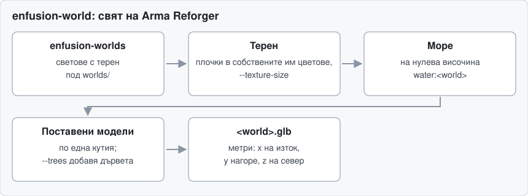

# Светове на Arma Reforger: `enfusion-worlds` и `enfusion-world` {#arma-reforger-worlds-enfusion-worlds-and-enfusion-world}

**Какво е?** Един цял свят на Arma Reforger като един 3D файл. **Защо?** За да има топлината от играта земята и сградите под себе си. (*Enfusion* е двигателят, с който е направена Arma Reforger; *свят* е това, което играта нарича карта.)

Експортира цял свят на Enfusion от инсталираната Arma Reforger: терена в цветовете на собствените си суператекстурни плочки, морето и всеки разположен модел като кутия, в метрите на самата игра.



## Стъпка по стъпка {#step-by-step}

1. **Изброяване на световете**, които имат терен:

   ```
   python -m heat3d_gamefiles enfusion-worlds
   python -m heat3d_gamefiles enfusion-worlds --install "D:\Games\Arma Reforger"
   ```

2. **Експорт на един**, по името на папката му в `worlds/`, както е изброено:

   ```
   python -m heat3d_gamefiles enfusion-world <свят> -o world.glb
   ```

3. **Варианти:**

   ```
   python -m heat3d_gamefiles enfusion-world <свят> --trees               # и растителността, като кутии
   python -m heat3d_gamefiles enfusion-world <свят> --texture-size 0      # плосък цвят, малък файл
   python -m heat3d_gamefiles enfusion-world <свят> --ground-spacing 4 --no-structures
   ```

4. **Отворете `world.glb`** в панела „Фон / ниво“ на визуализатора на 3DHeat ([зареждане на ниво](https://holdi601.github.io/3DHeat/levels.html)).

## Опции {#options}

| Опция | По подразбиране | Значение |
|---|---|---|
| `<свят>` | задължително | свят, какъвто го показва `enfusion-worlds` |
| `-o`, `--out ФАЙЛ` | `<свят>.glb` | файлът за запис |
| `--install ПАПКА` | библиотеката на Steam, в която е играта | папката на играта |
| `--ground-spacing МЕТРИ` | 2 (на самия терен) | разстоянието между върховете на терена във файла |
| `--texture-size ПИКСЕЛИ` | 4096 | по-голямата страна на изображението на цвета на земята; 0 за плосък цвят |
| `--no-structures` | | без разположените модели |
| `--trees` | изключено | включва и дърветата и другата растителност, като кутии |

## Примерен изход {#example-output}

```text
<свят> -> world.glb
  ground      <n> triangles, <w> x <h> m; <n> of <n> tile-edge vertices disagree; colour <w> x <h>
  structure   <n> boxes from <n> entities
  water       <n> triangles (the sea)
  left out    <what>: <n>, ...
```

## Частите {#the-parts}

`ground:<свят>` (теренът), `water:<свят>` (морето, на височина нула) и `structure:<свят>` (кутиите). Координатите са на самата игра: x на изток, y нагоре, z на север, в метри — каквото отчита запис от играта. Лявата координатна система на играта: *Обръщане на ос на света* във визуализатора я показва без огледало.

## Как се чете и проверява {#how-it-is-read-and-checked}

Не е нужен Workbench и нищо не е криптирано.

| Формат | Какво е | Проверено срещу |
|---|---|---|
| `.pak` | блок с данни и дърво на директории, записи без компресия или zlib | дървото изразходва точно своя блок; избрани записи zlib се разпаковат точно до обявения си размер |
| `.edds` | заглавка DDS, после за всяко мип ниво блокове `COPY` или `LZ4 ` | блоковите нива се декодират точно до размера си, като използват точно своите байтове |
| `.terr` / `.ttile` | заглавка и плочки с 16-битови височини | всеки общ ръб на две плочки съвпада точно |
| суператекстура | цветът на земята на всяка плочка, около метър на пиксел | съвпада с морето във височините; нито едно огледално или транспонирано четене не пасва по-добре |
| `.ent` | имена, GUID на ресурси, после обекти като типизирани стойности | файлът на света се парсира до последния си байт |
| `resourceDatabase.rdb` | GUID към път | почти всеки GUID, който света използва, сочи към съществуващ файл |

Обектите, отбелязани като стоящи на абсолютна височина, стоят в рамките на сантиметри от декодирания терен (при транспонирана решетка биха били метри встрани). Не се рисуват: собствените триъгълници на моделите, дърветата по подразбиране (`--trees` ги добавя като кутии), дъщерните обекти, езерата и реките, текстурите със заглавки преди DX10.

**Условия:** лицензът на играта позволява нетърговска употреба и забранява обратното инженерство на файловете на играта. Четенето на собствената ви инсталация е ваше решение по него; резултатът е за вашата собствена употреба и не се споделя.
