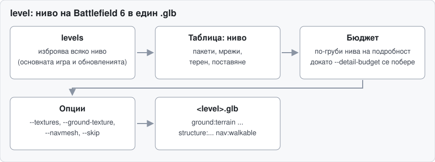

# Нива на Battlefield 6: `levels` и `level` {#battlefield-6-levels-levels-and-level}

**Какво е?** Едно цяло ниво на Battlefield 6 като един 3D файл. **Защо?** За да има топлината от мачовете ви земята и сградите под себе си. (*Frostbite* е двигателят, с който е направен Battlefield; *височинно поле* е теренът, записан като решетка от височини.)

Експортира цяло ниво на Frostbite от инсталираната игра: височинното поле на терена, всяка мрежа, която групите статични модели разполагат, обектите, разположени един по един, фона на терена около картата и при поискване цветовите карти на повърхностите, декалите на терена, запечени в земята, и повърхностите, по които могат да ходят войниците.



## Стъпка по стъпка {#step-by-step}

1. **Изброяване на нивата**, които играта има:

   ```
   python -m heat3d_gamefiles levels
   python -m heat3d_gamefiles levels --install "D:\Games\<папка на играта>"
   ```

   Всеки ред е таблица на ниво (`levels/<ниво>/<ниво>.toc`) с размера си и откъде идва: `Data` за основната игра, `Update/<пакет>` за обновление.

2. **Експорт на едно**, по името му, по уникална част от него или по пътя до `.toc` файла му. Започнете без текстури, за да видиш формата и размера:

   ```
   python -m heat3d_gamefiles level <ниво> -o level.glb
   ```

3. **Добави цвят**, когато изглежда както трябва:

   ```
   python -m heat3d_gamefiles level <ниво> -o level.glb --textures 512 --ground-texture 0.5
   ```

4. **Добави повърхностите, по които се ходи**, или намали файла:

   ```
   python -m heat3d_gamefiles level <ниво> --textures 512 --ground-texture 0.5 --navmesh
   python -m heat3d_gamefiles level <ниво> --textures 256 --detail-budget 3000000 --ground-spacing 8
   ```

5. **Отворете `level.glb`** в панела „Фон / ниво“ на визуализатора на 3DHeat ([зареждане на ниво](https://holdi601.github.io/3DHeat/levels.html)).

## Опции {#options}

| Опция | По подразбиране | Значение |
|---|---|---|
| `<ниво>` | задължително | име, каквото го показва `levels`, уникална част от име, или `.toc` на ниво |
| `-o`, `--out ФАЙЛ` | `<ниво>.glb` | файлът за запис |
| `--install ПАПКА` | намира се в библиотеките на Steam | папката на играта |
| `--textures [ПИКСЕЛИ]` | изключено; 512 без размер | цветната карта на всяка повърхност, до ПИКСЕЛИ по страна |
| `--ground-texture [МЕТРИ]` | изключено; 0.5 без размер | запича пътищата, площадките и маркировките в цвета на земята, МЕТРИ на пиксел |
| `--navmesh` | изключено | добавя навигационната мрежа на войника като `nav:walkable` |
| `--ground-spacing МЕТРИ` | 4 | най-фино разстояние на височинното поле; 0 го премахва |
| `--detail-budget N` | най-грубите копия плюс една четвърт, поне 1 500 000 | таван за триъгълниците (теренът никога не се огрубява) |
| `--skip ТЕКСТ` | | пропуска групи модели, чието име на дял съдържа ТЕКСТ; може да се повтаря |
| `--by-mesh` | изключено | по една част за всяка изходна мрежа и материал, за да се открие какво е една част |
| `--clamped-uvs` | изключено | за рендерери, които не могат да повтарят текстура |

Пълната таблица, с размерите, които да очакваш (цялото ниво е стотици MB), е в [Команди](commands.md#levels-and-level-frostbite). Как се четат таблиците, пакетите, мрежите и теренът е описано в [Frostbite](reader-frostbite.md).

## Примерен изход {#example-output}

Какво извежда `level`, в общи линии (редовете, както ги пише кодът; `<n>` и имената се различават според нивото):

```text
<n> copies of <n> meshes, from <n> static model groups
      <n>  <group>
      <n>  placed one by one (object and prefab references)
<n> meshes left out: <why>
<n> triangles, budget <n>; <n> meshes drawn at a coarser level to fit
           <n>  ground:terrain
           <n>  structure:buildings, <n> textures
           ...
<n> of <n> drawn sections carry their colour map; the rest are flat colours
Ground: <what the ground is>.
Navigation mesh: <tiles read>.
-> level.glb (<n> MB)
```

## Частите {#the-parts}

`ground:terrain` (височинното поле), `ground:terrain backdrop` и
`ground:terrain blend`, `structure:<вид>` за всеки вид мрежа (за всяка цветова карта при `--textures`, с ` (destructible)` за това, което може да се разруши по време на мач), и `nav:walkable` при `--navmesh`. Вижте [Формат на изхода](output-format.md).

Файлът съдържа съдържанието на играта: предназначен е за машината, на която е направен, а не за разпространение ([Правила и лицензи](rules-and-licences.md)).
