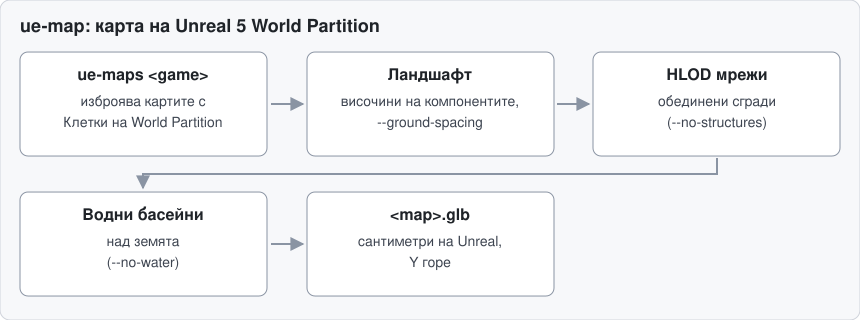

# Карти на Unreal 5 World Partition: `ue-maps` и `ue-map` {#unreal-5-world-partition-maps-ue-maps-and-ue-map}

**Какво е?** Цяла карта на игра с Unreal 5 като един 3D файл: земята, сградите и водата. **Защо?** За да има топлината от тази игра картата под себе си. (*World Partition* е начинът, по който Unreal 5 разделя голяма карта на парчета; *HLOD* е опростен заместител на група сгради, този, който играта рисува далеч.)

Експортира цяла карта на игра с Unreal 5, чиито карти са запечатани като клетки World Partition: ландшафта, сляните HLOD мрежи на картата (сградите и реквизитът ѝ, както играта ги рисува от разстояние) и водните ѝ тела. Не са нужни редактор и проект, само инсталираната игра.



## Стъпка по стъпка {#step-by-step}

1. **Изброяване на картите.** `<игра>` е папката на играта, нейният `Content/Paks` или името на папката ѝ в библиотека на Steam:

   ```
   python -m heat3d_gamefiles ue-maps "<име на папката на играта в Steam>"
   python -m heat3d_gamefiles ue-maps "D:\Games\<игра>"
   ```

   Всяка карта с запечатани клетки World Partition се извежда с пътя си в пакета.

2. **Експорт на една** по име или по уникална част от него:

   ```
   python -m heat3d_gamefiles ue-map "<игра>" <карта> -o map.glb
   ```

3. **Само земята или по-грубо:**

   ```
   python -m heat3d_gamefiles ue-map "<игра>" <карта> --no-structures --no-water
   python -m heat3d_gamefiles ue-map "<игра>" <карта> --ground-spacing 4
   ```

4. **Отворете `map.glb`** в панела „Фон / ниво“ на визуализатора на 3DHeat ([зареждане на ниво](https://holdi601.github.io/3DHeat/levels.html)).

## Опции {#options}

| Опция | По подразбиране | Значение |
|---|---|---|
| `<игра>` | задължително | папката на играта, нейният `Content/Paks` или името ѝ в Steam |
| `<карта>` | задължително | име, каквото го показва `ue-maps`, или уникална част от него |
| `-o`, `--out ФАЙЛ` | `<карта>.glb` | файлът за запис |
| `--ground-spacing МЕТРИ` | 2 | разстоянието между върховете на ландшафта, закръглено до цяло число от собствените му четириъгълници |
| `--no-structures` | | без HLOD сградите и реквизита |
| `--no-water` | | без водните тела |

Съдържанието, компресирано с Oodle, изисква библиотека на Oodle, която вече е на машината (вижте [Oodle](reader-oodle.md)).

## Примерен изход {#example-output}

```text
<карта> -> map.glb
  ground      <n> triangles from <n> landscape components; <n> of <n> vertices stored twice disagree
  structure   <n> triangles in <n> HLOD meshes
  water       <n> triangles from <n> water bodies
```

Броят на несъвпаденията е самопроверка: съседните компоненти на ландшафта записват общия си ръб два пъти, и двата записа трябва да съвпадат. Карта от 3 км при 2 м е около 4,6 милиона триъгълника на земята.

## Частите {#the-parts}

`ground:<карта>` (ландшафтът), `structure:<карта>` (HLOD мрежите) и
`water:<карта>` (водата над земята).

**Мерни единици:** това е единственият експорт, който **не е в метри**: сантиметри на Unreal, с разменени Y и Z (Y нагоре), рамката, която записва Unreal Exporter на 3DHeat. Телеметрията от същата игра ползва същата рамка, затова легне върху картата.

## Как се чете и проверява {#how-it-is-read-and-checked}

| Част | Чете се от | Проверено срещу |
|---|---|---|
| земя | 16-битовата височинна карта на всеки компонент на ландшафта, поставена по базата на секцията върху трансформацията на ландшафта | всеки връх, записан два пъти (на шев или на ръб на компонент), трябва да съвпада; несъвпаденията се броят и се извеждат, а не се изглаждат |
| структури | сляните HLOD мрежи на картата, построени от двигателя в световното пространство | мрежа се пази само ако границите, които компонентът ѝ кешира, описват собствените ѝ върхове |
| вода | мрежата на всяко водно тяло, положена върху мрежата на земята и пазена там, където стои над земята | водата е на няколко метра над земята под нея, както река е над речното си легло |

Свойствата на ландшафта се намират по форма, а не по номер на слот (слотовете се местят между версиите на двигателя). Структурите са опростените заместители, а не пълноценните модели. Растителността, декалите и материалите на ландшафта не се експортират; земята е без текстура и се засенчва от визуализатора. Подробности за архивите: [Unreal 5 IoStore](reader-unreal-iostore.md).

**Условия:** лицензите на игрите обикновено позволяват лична нетърговска употреба и забраняват обратното инженерство "to the extent that such actions cannot be prohibited by law". Четенето на собствената ви инсталация е ваше решение по тях; резултатът е за вашата собствена употреба и не се споделя.
