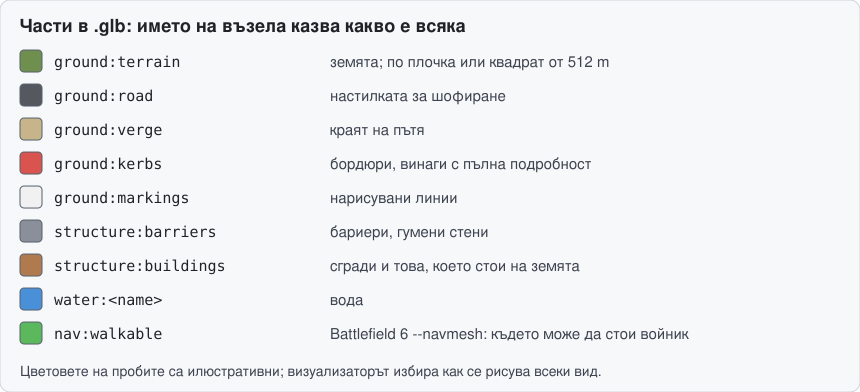

# Формат на изхода {#output-format}

`.glb` е един 3D файл: земята, сградите и водата на трасе или ниво, които отваряте в
панела „Фон / ниво“ на визуализатора на 3DHeat.

Всеки експорт (`course`, `courses`, `terrain`, `level`, `ue-map`, `enfusion-world`) записва един
файл **binary glTF 2.0** (`.glb`). Той е нарочно малък и плосък и е подреден така, както
визуализаторът на 3DHeat чете ниво. Източник:
[`glb.py`](https://github.com/Holdi601/3DHeat-GameFiles/blob/main/heat3d_gamefiles/glb.py).

## Структура {#structure}

```
scene 0
 ├─ node "ground:terrain x-2046 z1023"  -> mesh 0 -> 1 primitive, material 0
 ├─ node "ground:road x-2046 z1023"     -> mesh 1 -> 1 primitive, material 1
 ├─ node "ground:markings"               -> mesh 2 -> ...
 ├─ node "ground:kerbs road_gen_rum_..." -> ...
 ├─ node "structure:barriers bar_armco_bclr"
 └─ ...
```

- **По един възел за всяка част**, всички в корена на сцената, **без трансформации**. Цялата
  геометрия вече е в световното пространство.
- Всеки възел има собствена мрежа с **един примитив** и собствен материал. Възелът, мрежата и
  материалът носят името на частта.
- Всеки примитив има **собствени компактни масиви от върхове**, само върховете, които частта
  използва. Споделен масив от върхове е законен glTF, но четец, който разгъва акцесорите на
  всеки примитив, би държал всеки връх по веднъж за всяка част.
- `asset.generator` е `heat3d_gamefiles`.
- **Малко `extras`**, и никакво име на трасе, игра или проект:
  - част от разрушаема мрежа на Battlefield 6 носи `{"destructible": true}` във възела си;
  - трасе на Forza казва какво съдържа в `asset.extras` (версия на формата, съвпадналия
    идентификатор на маршрут, колко копия от собствения слой на състезанието, места; вижте
    [Трасета на Forza Horizon](course-forza-horizon.md#writing-the-file)), а включените му части
    носят слоя си във възела: `{"layer": "event", "route": <id>}` за собствения слой на
    състезанието, `{"layer": "layer"}` за друг включен слой, `{"layer": "venue"}` за земята на място.

  Всичко останало, от което се нуждае визуализаторът, е в имената на възлите.

## Имена на възлите: класификацията {#node-names-the-classification}



Визуализаторът взема класа на частта от името на **възела** (а при липса - от името на
мрежата), и само когато то съвпада с

```
^(ground|structure|water)\s*[:|]
```

Всичко друго се класифицира по евристика, написана за ландшафти на Unreal. Затова всяка част,
която експортьорът записва, започва с един от тези префикси или с `nav:` (по-долу):

| Префикс | Значение | Записани части |
|---|---|---|
| `ground:` | повърхността за шофиране и земята | `ground:road`, `ground:verge`, `ground:terrain`, `ground:gravel and dirt`, `ground:kerbs`, `ground:markings`, `ground:tyre marks`, `ground:venue`, `ground:plinths` |
| `structure:` | това, което стои върху нея | `structure:barriers`, `structure:props`, `structure:signs`, `structure:buildings`, `structure:infrastructure`, `structure:bridges`, `structure:rocks`, `structure:smashables`, `structure:trees`; слоевете на Forza `structure:event_<category>` и `structure:layer_<category>` |
| `water:` | вода | `water:water`; `water:<map>` (`ue-map`), `water:<world>` (`enfusion-world`) |
| `nav:` | къде може да върви войник (Battlefield 6, само с `--navmesh`) | `nav:walkable` |

`nav:` не съвпада с горния шаблон на визуализатора, затова визуализаторът го сортира по
евристиката си; това е отделна част, за да може да се показва или скрива сама.
`ue-map` записва `ground:<map>`, `structure:<map>` и `water:<map>`;
`enfusion-world` записва `ground:<world>`, `structure:<world>` и `water:<world>`.

След вида идва, според играта:

| Пример | Значение |
|---|---|
| `ground:road x-2046 z1023` | земя на Forza в плочката на терена `x-2046 z1023` (мрежови единици, 1023 на 512 m) |
| `ground:road 3_-2` | земя на BeamNG в квадрат от 512 m (3, -2) |
| `ground:road 3_-2 asphalt_light` | моделирана повърхност за шофиране на BeamNG с материал `asphalt_light` в този квадрат |
| `ground:road 1_-4` | земя на AC Rally в квадрат от 512 m (1, -4) в пространството на Unreal |
| `structure:barriers bar_armco_bclr` | поставени модели на Forza с обща текстура (името им без GUID) |
| `structure:barriers` | поставени модели без текстура (Forza, AC Rally) |
| `structure:event_barriers bar_example_bclr` | Forza: това, което съвпадналото състезание извежда за себе си, отделно от свободния свят (допълнителни данни на възела `{"layer": "event", "route": <id>}`) |
| `structure:layer_props` | Forza: слой, който играта включва за нещо друго, а не за това състезание (дейност, събираем предмет, слой за време на игра) |
| `ground:venue`, `ground:plinths` | Forza: модели, които вече са в световни координати - собствената земя на място (подът на стадион) и земя, с която улица е украсена |
| `structure:barriers armco_metal` | поставени модели на BeamNG от един материал |
| `ground:markings`, `water:water` | плоски части, по една за целия файл |
| `ground:terrain` (Battlefield 6) | височинното поле; `ground:terrain backdrop` - далечните мрежи на терена, `ground:terrain blend` - мрежи, които се сливат с терена |
| `nav:walkable` (Battlefield 6, `--navmesh`) | навигационната мрежа на нивото за войник: където може да се стои, плоско зелено |
| `ground:terrain x-512 z-512` (Battlefield 6, `--ground-texture`) | височинното поле под една изпечена плочка от декали, именувана по долния ѝ ъгъл в метри |
| `structure:buildings t_concreteclean_01_cs` (Battlefield 6, `--textures`) | всяка повърхност от този вид, показваща тази цветна карта; без `--textures` - по една част за вид, без наставка |
| `structure:buildings t_concreteclean_01_cs (destructible)` (Battlefield 6) | същото, за мрежи, които мач може да унищожи: тези с ресурс за разрушаване със собственото им име (стени, къщи, реквизит). Възелът носи и допълнителните данни на glTF `{"destructible": true}`. Разрушените им състояния не се експортират |

Визуализаторът може да филтрира по тези имена. Например "само състезателната повърхност" е
`ground:road` заедно с `ground:kerbs`, и в трите игри, а "светът без собствения реквизит на
състезанието" е всичко без `structure:event_*`. Префиксът определя и как визуализаторът
рисува частта: земята като повърхността, върху която лежи топлината, а структурата - като
това, което стои върху нея.

## Единици, оси и рамка {#units-axes-and-frame}

- **Метри, Y нагоре**, конвенцията на glTF, за всеки експорт, освен `ue-map`. Нищо не се
  мащабира и не се центрира наново: числата са световните координати на играта, а това е и
  смисълът на четенето на архива вместо реконструкция.
- **Карти на Unreal 5 (`ue-map`): сантиметри**, собствената единица на Unreal, със сменени Y и Z,
  така че Y е нагоре - рамката, която записва 3DHeat Unreal Exporter, и която използва
  телеметрията на играта. Единственият експорт, който не е в метри.
- **Arma Reforger (`enfusion-world`):** метрите на самата игра, x на изток, y нагоре,
  z на север. Лявата система на играта; опцията на визуализатора *Обръщане на ос на света* показва
  това без огледално изображение.
- **Forza:** световните координати на играта (x, y нагоре, z), без промяна. Същите като
  телеметрията ѝ, така че записана обиколка лежи върху трасето.
- **BeamNG.drive:** `(x, z, -y)` от Z-нагоре света на BeamNG, което е завъртането, което
  прилага записващият телеметрията. Завъртане, не огледало.
- **Battlefield 6:** световните координати на играта (x, y нагоре, z), без промяна: трансформациите
  на инстанциите на нивото, приложени към всяка мрежа, както са записани. Огледалните копия се
  навиват наново, така че нормалите им сочат навън.
- **Assetto Corsa Rally:** рамката на обиколката. Сантиметрите на Unreal стават метри, Z на Unreal
  става y, а X и Y на Unreal стават x и z в една от осемте ориентации, в която се е вписала
  обиколката (вижте
  [Assetto Corsa Rally](course-assetto-corsa-rally.md#which-stage-and-which-way-round)).
  Триъгълниците се навиват наново там, където картографирането огледално обръща.

Всеки експорт запазва осите, които използва телеметрията му, така че записът и нивото споделят
рамка. Дали тази рамка е лява или дясна система във всяка игра, не е проверено.

## Данни за върховете {#vertex-data}

По подразбиране е **квантуваната** форма (`quantize=True`). Тя изисква разширението
`KHR_mesh_quantization`, което е изброено както в `extensionsUsed`, така и в `extensionsRequired`.

| Атрибут | Квантувана (по подразбиране) | Пълна точност (`quantize=False`) |
|---|---|---|
| `POSITION` | float32 VEC3, с min/max | float32 VEC3 |
| `NORMAL` | int8 VEC3 нормализиран, подплатен до 4 байта (стъпка 4) | float32 VEC3 |
| `TEXCOORD_0` (само текстурирани части) | uint16 VEC2 нормализиран, ограничен до 0-1; float32 VEC2, където текстурите се повтарят (Battlefield 6) | float32 VEC2 |
| `COLOR_0` (нетекстурирани части, когато някоя част има цвят) | uint8 VEC3 нормализиран, подплатен до 4 байта | float32 VEC3 |
| индекси | uint16, когато частта има най-много 65 535 върха, иначе uint32 | uint32 |

Връх е 20 байта вместо 32 (24 вместо 44 с цвят). Това маха една трета от всеки файл и е разликата
между град, който се зарежда в браузър, и такъв, който не се зарежда. Цената е под половин градус
нормала и 1/65 535 от UV (една петнадесета от тексел при 4 096 px). Командният ред винаги записва
квантуваната форма. `write_glb(..., quantize=False)` в Python записва другата.

Нормалите идват от играта, където тя ги съхранява (терен и модели на Forza, форми и терен на BeamNG).
В противен случай се изчисляват като гладки нормали, претеглени по площ, от триъгълниците.
Нормалите на AC Rally винаги се изчисляват.

## Материали, цветове и текстури {#materials-colours-and-textures}

- Всеки материал е `metallicFactor 0`, `roughnessFactor 1`.
- **Текстурирана част:** `baseColorTexture` с изображението на частта, UV и без цвят на върха.
  glTF умножава двете, така че повърхността би излязла затъмнена два пъти.
- **Нетекстурирана част:** цвят на върха `COLOR_0` с плоския цвят на частта и бял `baseColorFactor`.
  Ако никоя част във файла няма цвят, няма `COLOR_0`. Когато частите споделят върхове, цветът
  на по-късната част печели, затова плоските части се записват в ред на нарастваща важност.
- **Изображенията** са вградени във двоичния блок като **JPEG**, качество 90, без подвзаимане
  на цветността, само RGB (алфата се отхвърля) - освен картата на изрязвания на Battlefield 6
  (листа, огради), която е **PNG** с алфата си, на материал с `alphaMode` MASK, `alphaCutoff` 0,5
  и `doubleSided` (вижте [Frostbite](reader-frostbite.md#textures-and-materials)). Визуализаторът
  на 3DHeat отхвърля тексели под прага. Текстура от 2048 px на земя с трева и корони на дървета е
  шум за безгубковия кодек: няколко мегабайта на плочка като PNG, под един като JPEG. Изображение,
  споделено от няколко части, се записва веднъж.
- **Един семплер за всички текстури:** линейно увеличение, линейно-mipmap-linear намаляване и
  **clamp to edge** по двете оси, за експортите на трасета, чиито текстури покриват
  повърхностите си веднъж. BeamNG рисува повтарящите се текстури на модели като плоски цветове
  (вижте [BeamNG.drive](course-beamng.md#placed-models)).
- Експорт на Battlefield 6 с `--textures`, чиито материали се подреждат в плочки, записва
  собствените UV координати на играта, без ограничение, като float32 `TEXCOORD_0` дори в
  квантуваната форма, със семплер, който **се повтаря** по двете оси (`write_glb(..., repeat=True)`):
  тухлена стена е един чифт триъгълници, чиято UV стига от 0 до 40. Визуализаторът на 3DHeat
  увива такава текстура в атласа си (вижте страницата му *Model levels*). За рендерер, който не
  може да повтаря текстура, `level --clamped-uvs` (`write_level(..., clamped=True)`) разрязва всеки
  триъгълник по линиите, където текстурата се повтаря, и премества всяко парче в 0..1: същите
  пиксели върху същата повърхност, около една пета повече триъгълници. Триъгълниците, през
  които текстурата се повтаря повече от 16 пъти, запазват координатите си. Триъгълник, който
  разрязването на текстурата би разделило на повече от 4 парчета - кората, която се повтаря по
  всеки клон на дърво, което разрязване е превърнало 1 099 триъгълника на едно дърво в
  51 735 - отива в собствена част, `<part> (average colour)`, в средния цвят на текстурата;
  `level` казва колко са.

| Текстура | Размер | Покрива |
|---|---|---|
| земя (всички игри без Battlefield 6) | `--texture-size`: 2048, 1024 или 512 px | един квадрат от 512 m: 25, 50 или 100 см на пиксел |
| Battlefield 6 височинно поле | най-голямото mip ниво на цветната карта на фона в нивото, изрязано | квадратът на терена: 32 m на пиксел в проверяваното ниво |
| Battlefield 6 повърхности | `--textures`: най-много толкова px по страна | собствената текстура на повърхността, веднъж за парче (изрязана там, където се повтаря) |
| Battlefield 6 изпечена земя | `--ground-texture`: метри на пиксел, плочки от най-много 4 096 px | една плочка от обхвата на декалите: 2 048 m при 0,5 m на пиксел |
| поставен модел на Forza | най-много 256 px | собственото UV разположение на модела |
| поставен модел на BeamNG | най-много 256 px | собственото UV разположение на модела, само където не се повтаря |
| поставен модел на AC Rally | няма | плоски цветове |

## Какво отказва записващият {#what-the-writer-refuses}

`write_glb` вдига грешка, вместо да запише файл, който визуализатор би отворил и показал
погрешно:

| Отказва се | Защото |
|---|---|
| позиции, които не са N x 3, или не са крайни | счупена мрежа |
| индекс извън списъка с върхове | се рисува като шум |
| текстурирана част, когато файлът няма UV | се рисува като един размазан пиксел |
| никакви триъгълници | се рисува като нищо |
| масив за нормали, цвят или UV с грешна дължина, или не са крайни | нужен е по един на връх |

## Четене и с други програми {#reading-it-elsewhere}

Всеки glTF 2.0 визуализатор, който поддържа `KHR_mesh_quantization`, трябва да отваря тези
файлове. Проверен е само визуализаторът на 3DHeat; другите визуализатори не са проверени. Четец
без разширението отказва файла, защото то е маркирано като задължително. Файловете могат да са
големи: около 80 MB за трасе в провинцията, до няколкостотин MB за градско трасе с автоматичния
бюджет.

## В 3DHeat {#in-3dheat}

Заредете `.glb` в панела „Фон / ниво“ на [3DHeat](https://github.com/Holdi601/3DHeat)
визуализатора; телеметрията, която записвате в същата игра, лежи върху него, защото и двете
пазят координатите на играта. Собствената документация на визуализатора
([holdi601.github.io/3DHeat](https://holdi601.github.io/3DHeat/)) описва панела „Фон / ниво“
и файловете с мачове, които записват другите инструменти
([One file a match: `.3dheat`](https://holdi601.github.io/3DHeat/container.html)).
Ниво не се съхранява във всеки файл `.3dheat`: мач назовава нивото в `references`
(`kind: "level"`, име и sha256), а `.glb` остава до мачовете.
