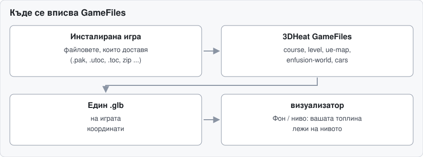

# Цели нива {#whole-levels}

**С прости думи:** за шутъри и други игри без обиколки инструментът записва цялата карта като един 3D файл, така че визуализаторът може да нарисува къде са се движили играчите по нея.

`course` изрязва терена около обиколка. За игри без обиколки инструментът експортира цяло ниво, карта или свят наведнъж:

| Игра или енджин | Списък | Експорт | Страница |
|---|---|---|---|
| Battlefield 6 (Frostbite) | `levels` | `level <level>` | [Нива на Battlefield 6](level-battlefield.md) |
| Игри с Unreal 5 World Partition | `ue-maps <game>` | `ue-map <game> <map>` | [Карти на Unreal 5](level-unreal-world-partition.md) |
| Arma Reforger (Enfusion) | `enfusion-worlds` | `enfusion-world <world>` | [Светове на Arma Reforger](level-arma-reforger.md) |

Всяка двойка работи по един и същ начин: първата команда изброява какво има инсталираната игра, а втората записва една от тях като един `.glb` файл в собствените световни координати на играта, така че позициите, записани в тази игра, лягат върху него. Частите се наименуват `ground:`, `structure:` и `water:` както всеки друг експорт (вижте [Формат на изхода](output-format.md)); заредете файла в панела **Фон / ниво** на визуализатора 3DHeat.

