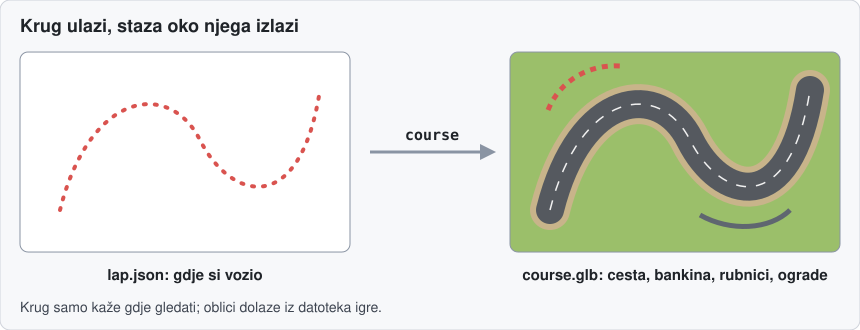
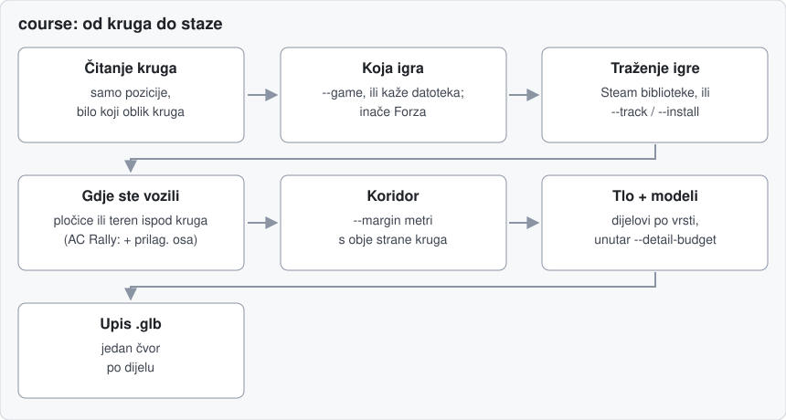

# Izvoz staze {#course-export}

**Prostim riječima:** vozili ste krug; ovo gradi stazu kojom ste vozili, kao 3D
datoteku. Krug je samo linija tačaka; cesta, trava i ivičnjaci dolaze iz
vlastitih datoteka igre.

`course` pretvara krug u stazu: tlo u pojasu s obje strane puta kojim je auto
prošao i ono što stoji na tom tlu, kao jedan `.glb` za preglednik. Ova stranica
pokriva ono što dijele sve tri podržane igre. Stranice ispod nje pokrivaju ono
što se razlikuje:

- [Forza Horizon](course-forza-horizon.md): ForzaTech `.minizip` arhive
- [BeamNG.drive](course-beamng.md): zip arhive, visinsko polje terena, kompilirani oblici
- [Assetto Corsa Rally](course-assetto-corsa-rally.md): Unreal 5 IoStore, etapa World Partition
- [Nivoi detalja i budžet](detail-budget.md): koliko trouglova dobijaju postavljeni modeli i koje kopije ostaju

## Koraci {#the-steps}

Riječi korištene ispod: **okvir** (frame) je smjer u koji pokazuju ose;
**koridor** je pojas tla s obje strane kruga; **pločica** (tile) je jedan
kvadratni komad terena igre; **LOD** (nivo detalja) je jedna od jednostavnijih
kopija modela.

1. **Pročitajte krug.** Samo pozicije, iz bilo kojeg oblika navedenog u
   [Ulazi kruga](lap-inputs.md). Brzina i komande se ne koriste. Krug s manje od
   dva uzorka se odbija ("holds no driving").
2. **Odlučite o igri.** `--game`, zatim vlastito polje `game` datoteke kruga, zatim
   Forza (pogledajte [Komande](commands.md#which-game)).
3. **Pronađite instaliranu igru.** Sve tri pretražuju svaku Steam biblioteku
   navedenu u Steamovom `config\libraryfolders.vdf`. Forza pretražuje i
   `C:\XboxGames`. `--track` (Forza) ili `--install` (BeamNG, AC Rally) preskače
   pretragu.
4. **Pronađite gdje je krug vožen.** Ovo se nikad ne odlučuje samo podudaranjem
   imena. Forza bira stazu čije pločice terena pokrivaju krug. BeamNG bira nivo
   na čijem terenu (ili cestama) leže uzorci kruga. AC Rally isprobava svaku
   etapu u osam orijentacija osa i bira onu koja stavlja najviše kruga na cestu.
5. **Izrežite koridor** `--margin` metara s obje strane vožnje (ispod).
6. **Izgradite tlo** unutar koridora, razvrstano na cestu, bankinu, šljunak i
   zemlju, teren, oznake, tragove guma ili vodu, i ispecite teksturu tla za svaki
   kvadrat od 512 m.
7. **Postavite modele** koji stoje u koridoru, po kategorijama, na nivou detalja
   odabranom po udaljenosti i budžetu trouglova.
8. **Napišite `.glb`**: jedan imenovani čvor po dijelu. Pogledajte [Format izlaza](output-format.md).

Šta ispisuje jedno pokretanje - ovdje na sintetičkoj BeamNG.drive instalaciji
koju grade testovi, krug od 50 m niz traku ceste:

## Koridor {#the-corridor}

Rez je pojas oko vožene linije, a ne granična kutija kruga. Za stazu u krugu to
je gotovo isto. Za sprint od tačke do tačke kutija je uglavnom padina kojom niko
ne prolazi, a pojas može biti desetina njene površine. Izvor:
[`corridor.py`](https://github.com/Holdi601/3DHeat-GameFiles/blob/main/heat3d_gamefiles/corridor.py).

Kako se gradi:

- Vožnja se projicira na ravan tla: x i z kruga
  (BeamNG: x i y vlastitog okvira igre).
- Rasterizira se na mreži ćelija od **4 m** (`CELL`). Svaka ćelija koje se vožnja
  dotakne proširuje se diskom polumjera `margin + 4 m` u svim smjerovima.
- Uzastopni uzorci udaljeni manje od **50 m** (`JOIN`) spajaju se tačkama svakih
  4 m, pa pojas nema rupa. Uzorci udaljeniji od toga smatraju se odvojenim
  dionicama vožnje i ne spajaju se. Biblioteka staza je mnogo datoteka krugova
  jedna za drugom, a cilj jednog sprinta i start sljedećeg ne smiju povući pojas
  preko mape.
- Trougao se zadržava ako bilo koji ugao, sredina bilo koje ivice ili njegovo
  težište leži u pojasu. Središnje tačke hvataju veliki trougao koji leži preko
  uskog pojasa sa svim uglovima vani.
- Visina nikad nije dio reza. Kutija koja bi ograničavala visinu odsjekla bi tlo
  ispod brda uz koje cesta ide.

Konzola prijavljuje površinu koridora, na primjer
`cutting 80 m either side of the driving: 1.53 km2 of a 6,000 by 3,600 m box`.

BeamNG i AC Rally grade i širi koridor **dosega** od `margin + 60 m`. Postavljeni
model se razmatra ako mu ishodište leži u koridoru dosega, a crta se samo ako
njegov otisak dodiruje pravi koridor. Tako se dugačak objekat čije je ishodište
tik izvan pojasa ne gubi. BeamNG koristi koridor dosega i za odabir koje decale
ceste treba oslikati.

## Od čega je tlo napravljeno {#what-the-ground-is-made-of}

Svaki izvoz razvrstava trouglove tla u iste vrste, a svaka vrsta se piše kao
vlastiti dio da je preglednik može prikazati ili sakriti:

| Vrsta | Ime dijela | Ravna boja (linearni RGB) | Forza | BeamNG | AC Rally |
|---|---|---|---|---|---|
| cesta | `ground:road` | 0.22, 0.22, 0.23 | trake ceste: dio asfalta | slojevi tipa `ASPHALT`, decali ceste, modelirana cesta | pločice staze (`/MeshesTrack/`) |
| bankina | `ground:verge` | 0.52, 0.47, 0.30 | trake ceste: ivica ceste | trotoari i modeli bankine | - |
| šljunak i zemlja | `ground:gravel and dirt` | 0.50, 0.42, 0.30 | - | slojevi i decali zemlje, šljunka, pijeska, blata | - |
| teren | `ground:terrain` | 0.30, 0.44, 0.18 | sve ostalo | sve ostalo | pločice `_Terrain` i daleki teren |
| ivičnjaci | `ground:kerbs` | 0.60, 0.12, 0.10 (Forza) | `road_gen_rum*` rekviziti | modeli ivičnjaka (kerb, curb) i rumble traka | modeli ivičnjaka (kerb i curb) |
| oznake | `ground:markings` | 0.90, 0.90, 0.88 | podmreže decala, podignute 5 cm | oslikano u teksturu | - |
| tragovi guma | `ground:tyre marks` | 0.20, 0.17, 0.16 | podmreže decala, podignute 5 cm | oslikano u teksturu | - |
| voda | `water:water` | 0.16, 0.34, 0.48 | materijali vode | morska ravan, blokovi vode, rijeke | - |

Ravne boje su odabrane da se čitaju na prvi pogled, a ne da odgovaraju igri.
Koriste se za dijelove bez teksture i u preglednicima koji ignoriraju teksture.
Izvor:
[`surfaces.py`](https://github.com/Holdi601/3DHeat-GameFiles/blob/main/heat3d_gamefiles/surfaces.py).

Dijelovi tla dijele se po kvadratu od 512 m, a svaki kvadrat nosi vlastitu
pečenu sliku, pa imena dijelova nose kvadrat:

| Igra | Ime dijela tla | Ključ kvadrata |
|---|---|---|
| Forza | `ground:road x-2046 z1023` | ime mreže pločice terena (koraci od 1023, pogledajte [Forza Horizon](course-forza-horizon.md)) |
| BeamNG | `ground:road 3_-2` | `floor(x / 512)`, `floor(y / 512)` u BeamNG metrima |
| AC Rally | `ground:road 1_-4` | `floor(x / 51200)`, `floor(y / 51200)` u Unreal centimetrima |

## Šta stoji na njemu {#what-stands-on-it}

Postavljeni modeli pišu se u dijelove imenovane `structure:<category>`, ili
`ground:kerbs` za ivičnjake (u sve tri igre). Kad dio ima vlastitu teksturu, ime
teksture ili materijala slijedi kategoriju, na primjer
`structure:barriers bar_armco_bclr`.

| Kategorija | Forza | BeamNG | AC Rally |
|---|---|---|---|
| ograde | da | da | da |
| rekviziti | da | da | da |
| znakovi | da | da | da |
| zgrade | da (zamjene za cijele zgrade gdje ih igra ima) | da | da |
| infrastruktura | da | da | da |
| mostovi | da | da | (razvrstano kao infrastruktura) |
| stijene | da | da | da |
| ivičnjaci | da, kao tlo | da, kao tlo | da, kao tlo |
| drveće | s `--trees` | s `--trees` | s `--trees` |
| razbijivi objekti | s `--trees` | - | - |

Način raspodjele detalja isti je u sve tri. Kopije unutar 25 m od vožnje počinju
s punim detaljem, kopije 25-60 m udaljene jedan nivo grublje, a dalje kopije na
najgrubljem nivou. Zatim najskuplji modeli silaze nivo niže dok budžet trouglova
ne stane, a gdje ni najgrublji nivoi ne stanu u budžet koji date, kopije se
izostavljaju. Ivičnjaci se nikad ne pojednostavljuju niti izostavljaju.
Pogledajte [Nivoi detalja i budžet](detail-budget.md).

## Opcije koje oblikuju rezultat {#options-that-shape-the-result}

| Želite | Koristite |
|---|---|
| manju datoteku | `--no-textures` (ravne boje), `--texture-size 1024` ili `512`, `--detail-budget N`, `--margin 40` |
| samo tlo | `--no-placed` |
| i okolinu | `--trees` |
| drugo godišnje doba (Forza) | `--season winter` |
| igru izvan Steama | `--track` (Forza) ili `--install` (BeamNG, AC Rally) |
| krug koji pretraga ne smjesti | `--level` (BeamNG, AC Rally), `--track` (Forza) |

## Koordinate {#coordinates}

Svaki izvoz piše metre sa Y prema gore, u okviru s kojim se poravnava snimljen
krug iste igre:

| Igra | Napisani okvir |
|---|---|
| Forza | vlastite svjetske koordinate igre, nepromijenjene |
| BeamNG | `(x, z, -y)` BeamNG-ovog svijeta sa Z prema gore, što je rotacija koju primjenjuje snimač telemetrije |
| AC Rally | okvir kruga, pronađen fitovanjem: Unreal centimetri postaju metri, a Unreal X i Y postaju x i z kruga u onoj od osam orijentacija koja se uklapa |

Pogledajte [Format izlaza](output-format.md).
