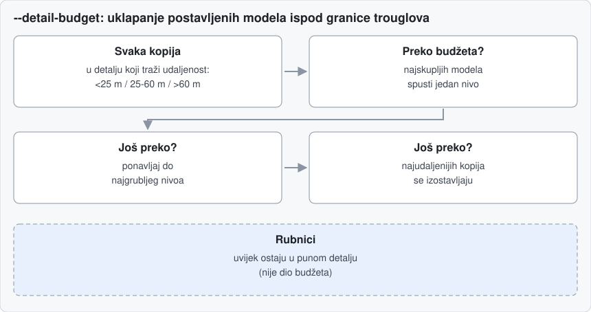

# Nivoi detalja i budžet {#levels-of-detail-and-the-budget}

**Trougao** je sićušan ravan komad 3D modela. Više trouglova znači veću, sporiju
datoteku. **Budžet** je ograničenje koliko ih smije biti. **Nivo detalja** je
jednostavnija kopija modela, koja se koristi kad je daleko.

Najfiniji nivo svega što je postavljeno oko staze iznosi nekoliko miliona
trouglova. Na primjer, stotine segmenata zaštitne ograde i hrpa guma, svaki sa
oko hiljadu trouglova. Gradski koridor sadrži preko stotinu hiljada kopija. Zato
svaki izvoz staze postavljenim modelima daje **budžet trouglova** i odlučuje, po
modelu, na kojem se nivou detalja crta, i, ako treba, koje kopije izostaviti.

Šema je napisana za Forzu
([`forzaplacement.py`](https://github.com/Holdi601/3DHeat-GameFiles/blob/main/heat3d_gamefiles/forzaplacement.py):
`choose_levels`, `auto_budget`, `_fit`), a BeamNG i AC Rally ponovo koriste njene
dijelove. Teren se ne računa u budžet.

## Pojasevi udaljenosti {#distance-bands}

Udaljenost svake kopije od vožnje mjeri se u ravni tla, do najbližeg uzorka
kruga. Krug se prvo prorijedi na najviše 1.000 tačaka, što košta nekoliko metara
preciznosti i ništa što ovdje važi. Kopije zatim padaju u tri pojasa, a svaki par
(model, pojas) budžetira se zasebno:

| Pojas | Udaljenost | Počinje na |
|---|---|---|
| blizu | manje od 25 m (`NEAR`) | najfinijem nivou |
| sredina | 25-60 m (`FAR`) | jedan nivo grublje |
| daleko | 60 m i više | najgrubljem nivou |

Bez rute (Forza `terrain --box`), udaljenost se mjeri do sredine kutije.

## Silazak da stane {#stepping-down-to-fit}



Cijena unosa (model, pojas) je kopije x trouglovi na njegovom trenutnom nivou.
Dok je ukupno iznad budžeta, unos koji najviše košta silazi jedan nivo niže, i to
se ponavlja dok ukupno ne stane ili dok se ništa ne može dalje spustiti.
Prikvačeni unosi nikad ne silaze:

| Igra | Prikvačeno na punom detalju |
|---|---|
| Forza | ivičnjaci (`road_gen_rum*`) |
| BeamNG | ivičnjaci i svaki oblik koji nosi površinu za vožnju |
| AC Rally | ivičnjaci |

Sažetak Forze ovo prijavljuje kao
`N of M models drawn at a coarser level to fit the budget`.

## Automatski budžet {#the-automatic-budget}

Bez `--detail-budget`, budžet se sam određuje tako da **nijedna kopija nije
izostavljena**:

```
budget = max(1,500,000, 1.25 x sum(copies x coarsest level))
```

Prikvačeni unosi se računaju na svom najfinijem nivou. Tih 25% (`HEADROOM`)
omogućava da stvari pored ceste zadrže nešto detalja. Na seoskoj stazi to je
donja granica od 1,5 miliona (`DEFAULT_BUDGET`). Na gradskoj stazi, gdje koridor
sadrži preko stotinu hiljada kopija, naraste na preko deset miliona, a datoteka
na nekoliko stotina MB. Preglednik to učitava.

## Budžet koji date {#a-budget-you-give}

`--detail-budget N` je **gornja granica**. Nivoi silaze kao gore. Ako ni najgrublji
nivoi ne stanu, kopije se izostavljaju:

| Igra | Redoslijed izostavljanja kopija |
|---|---|
| Forza | prvo sve što je 25 m ili više od vožnje, zatim ono što stoji pored ceste; unutar svake grupe prvo ono što s ceste izgleda najmanje: najveća udaljenost / veličina (veličina = dijagonala granične kutije modela puta njegova najveća skala, najmanje 0,25 m) |
| BeamNG | prvo najudaljenije od vožnje |
| AC Rally | prvo najudaljenije od vožnje, kao BeamNG |
| Battlefield 6 | prvo najmanje: dijagonala granične kutije puta skala |

Ivičnjaci (a za BeamNG modeli površine za vožnju) nikad se ne izostavljaju, pa
budžet manji od onoga što oni sami koštaju prekoračuju oni i ništa drugo.

Alat koristi udaljenost kroz veličinu za Forzu jer bi, kad bi se poredalo samo po
udaljenosti, klima-uređaj na zidu devet metara daleko nadživio fasadu od dvadeset
metara na kojoj visi, dvanaest metara daleko. Stvari pored ceste idu zadnje bez
obzira na veličinu, jer je ograda od tri metra pet metara od linije rub staze,
dok je zgrada od pedeset metara šezdeset metara dalje kulisa.

Sažetak prijavljuje
`N of M copies left out to fit the budget, the smallest and furthest from the driving first (--detail-budget raises it)`
(Forza), ili `N copies left out to fit the budget, the furthest from the driving first (--detail-budget raises it)`
(BeamNG, AC Rally).

## Cijele zgrade (Forza) {#whole-buildings-forza}

Zamjena za cijelu zgradu računa se kao jedna kopija, na udaljenosti mjerenoj do
najbliže ivice zgrade. Zadržava se ili izostavlja kao cjelina. Modularni dijelovi
koje zamjenjuje uopće se ne budžetiraju. Pogledajte
[Forza Horizon](course-forza-horizon.md#buildings-drawn-whole).

## Šta je nivo detalja, po igri {#what-a-level-of-detail-is-per-game}

| Igra | Nivoi dolaze iz |
|---|---|
| Forza | maske nivoa po trouglu podmreža `Mesh` modela (bit `level + 1`); `0xFFFF` samo lomljivi dijelovi za model bez označenog nivoa |
| BeamNG | `details` oblika `.cdae` s nenegativnom veličinom, najveći prvi; za `.dae`, završni broj u imenima čvorova mreže (`barrier75`, `barrier40`) |
| AC Rally | pohranjeni nivoi detalja statičke mreže, najfiniji prvi |
| Battlefield 6 | nivoi detalja MeshSeta, najfiniji prvi, računajući samo crtane sekcije (ne kopije samo za sjenu i dubinu), i ne posljednji nivo koji je zamjena za pogled izdaleka (materijali `M_LastLod`, `M_Billboard`, `M_Vista`: rešetka pilona postaje puni šiljak) |

`level` za Battlefield 6 nema krug, pa nema pojaseva udaljenosti: svaka mreža je
jedan unos, svaka kopija na istom nivou. Automatski budžet je gornja formula s
prikvačenom pozadinom terena; visinsko polje je izvan budžeta i određuje se
opcijom `--ground-spacing`. Pod budžetom koji date, kad je svaka mreža na
svom najgrubljem nivou, kopije se izostavljaju prvo najmanje, pri čemu je veličina
dijagonala granične kutije mreže puta skala kopije, jer nema vožnje od koje bi se
mjerila udaljenost. Pozadina terena se nikad ne izostavlja. Nivo automatski
dosegne oko deset miliona trouglova.

## Biranje broja {#choosing-a-number}

| Želite | Probajte |
|---|---|
| sve, pun detalj blizu ceste | ostavite automatski |
| datoteku nekoliko puta manju | `--detail-budget 500000` uz `--texture-size 1024` |
| samo tlo | `--no-placed` (budžet nije uključen) |
