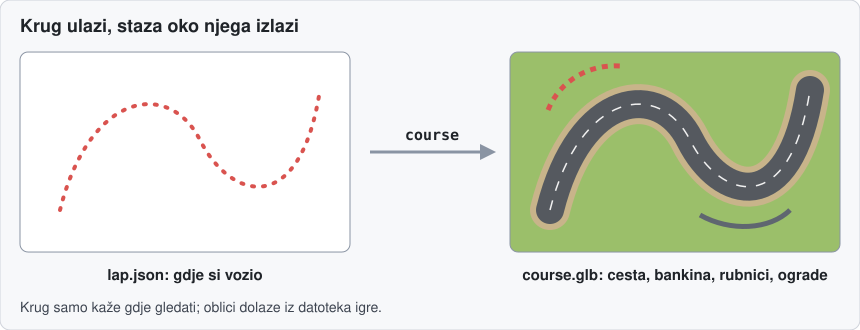
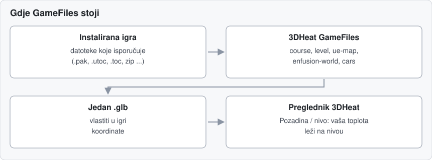

# 3DHeat GameFiles {#dheat-gamefiles}

**Šta je to?** Alat koji gradi 3D model trkaće staze ili nivoa igre iz
datoteka igre koju već imate instaliranu.

**Zašto bih ga koristio?** Preglednik 3DHeat boji kao toplotu gdje ste vozili ili igrali.
Uz ovaj alat boji to na stvarnoj stazi ili nivou, a ne u praznom prostoru.

**Primjer:** uzmite krug koji ste vozili. Alat gradi cestu i tlo oko njega
kao jednu 3D datoteku, pa preglednik može obojiti vašu brzinu ili sudare na stvarnoj stazi:



Je li vam komandna linija nova? Počnite s [Prije nego počnete](before-you-start.md).

Detaljnije: čita podatke nivoa iz arhiva koje igra isporučuje i piše
ih kao binarnu glTF (`.glb`) datoteku. Glavni posao je **izvoz staze (course)**: daš
mu krug, a on piše tlo, cestu razlikovanu od bankine i
trave, te rubnike, ograde, zidove od guma, znakove i zgrade oko nje.

To je dio projekta [3DHeat](https://github.com/Holdi601/3DHeat), preglednika za
3D toplotne mape telemetrije u stvarnom vremenu, analizu utrka i pregled mečeva
([dokumentacija](https://holdi601.github.io/3DHeat/)). `.glb` datoteke koje ovaj
alat piše su nivoi na koje preglednik crta toplotu.



To je jedan od tri načina da geometrija nivoa dospije u 3DHeat:

| Put | Treba | Daje |
|---|---|---|
| 3DHeat Unreal Exporter | Unreal projekat otvoren u editoru | tačnu geometriju |
| 3DHeat GameCapture | ekran i snimak | procjenu |
| **3DHeat GameFiles** | **instaliranu, isporučenu igru** | **tačnu geometriju, bez projekta** |

Python paket: `heat3d_gamefiles`. Repozitorij:
[Holdi601/3DHeat-GameFiles](https://github.com/Holdi601/3DHeat-GameFiles). Licenca: MIT.

## Šta može {#what-it-can-do}

| Igra ili engine | Izvoz staze (`course`) | Čitanje arhiva |
|---|---|---|
| Forza Horizon (ForzaTech) | da: teren, cesta i bankina, tekstura tla, postavljeni modeli u vlastitim teksturama | `identify`, `list`, `extract` na `.minizip`; `identify` na `.modelbin`; modeli, teren i teksture preko `course` i `terrain` |
| BeamNG.drive | da: teren, naljepnice ceste, modelirani krugovi, postavljeni modeli, voda | `identify`, `list`, `extract` na zip-ovima nivoa; `identify` na `.ter`, `.cdae`; `.dae` preko `course` |
| Assetto Corsa Rally (Unreal 5.6) | da: pločice tla etape, pečena boja tla, postavljeni modeli u jednolikim bojama | `identify`, `list`, `extract` na IoStore `.utoc`/`.ucas`; zen paketi, statične mreže, teksture preko `course` |
| Unreal `.pak` (verzije 8-12) | ne | `identify`, `list`, `extract` |
| Unity (format 22 i noviji) | ne | `identify`, `meshes` |
| Battlefield 6 (Frostbite `.toc`/`.cas`) | bez kruga; cijeli nivo pomoću `level`: teren, postavljene mreže, njihove mape boja uz `--textures` | `identify`, `levels`; bundle-ovi, mreže, teren, teksture i postavljanje preko `level` |
| Source 2 `.vpk` | ne | `identify`, `list`, `extract` |
| Unreal 5 World Partition igre | bez kruga; cijela mapa pomoću `ue-map` (popis daje `ue-maps`): krajolik, HLOD zgrade i rekviziti, voda | - |
| Arma Reforger (Enfusion) | bez kruga; cijeli svijet pomoću `enfusion-world` (popis daje `enfusion-worlds`): teren u svojim bojama, more, zgrade kao kutije | - |
| Forza (automobili) | `cars`: svaki automobil u niskom detalju, za karticu Analiza utrke preglednika | - |

Krugovi iz Assetto Corsa EVO i iRacinga se odbijaju uz razlog. Pogledajte
[Ograničenja i poznate praznine](limits-and-known-gaps.md).

## Instalacija {#install}

Je li vam komandna linija nova? Prvo pročitajte [Prije nego počnete](before-you-start.md).

Trebate **Python 3.10 ili noviji** (razvijano na 3.13) i paketi iz
[`requirements.txt`](https://github.com/Holdi601/3DHeat-GameFiles/blob/main/requirements.txt).

```
git clone https://github.com/Holdi601/3DHeat-GameFiles.git
cd 3DHeat-GameFiles
pip install -r requirements.txt
```

Zatim provjerite: `python -m heat3d_gamefiles --help`. Trebali biste vidjeti
`usage: heat3d_gamefiles [-h]` i popis komandi. Svaku komandu pokrenite iz
foldera repozitorija, kao `python -m heat3d_gamefiles <verb>`.

| Paket | Koristi se za |
|---|---|
| numpy | sve što dekodira geometriju |
| lz4 | Forza arhive (uglavnom LZ4 blokovi), neki Unity bundle-ovi, IoStore LZ4 blokovi |
| Pillow | dekodiranje BC1-BC7 tekstura, pisanje JPEG tekstura u `.glb` |
| msgpack, zstandard | BeamNG-ovi kompajlirani oblici (`.cdae`) |
| cryptography | samo za otvaranje šifriranog `.pak` ključem koji već imate |
| pytest | testovi |

Unreal sadržaj komprimiran **Oodleom** treba Oodle biblioteku koja je već
na tvom računaru. Nijedna se nikad ne isporučuje s ovim alatom. Pogledajte [Oodle](reader-oodle.md).

Alat je pisan za Windows. Igre pronalazi preko Steamovog popisa biblioteka i
`%LOCALAPPDATA%`, a Oodle učitava kao Windows DLL. Druge platforme nisu
testirane.

## Brzi početak {#quick-start}

**Datoteka kruga (lap file)** je snimak gdje je vaš automobil išao: popis x, y, z tačaka.
Dolazi iz [3DHeat GameCapture](https://github.com/Holdi601/3DHeat-GameCapture)
ili iz biblioteke krugova aplikacije FH Companion; radi i ručno ukucan CSV
([Ulazi kruga](lap-inputs.md)).

```
# Forza: a lap file, a lap folder, or a course name from the FH Companion library
python -m heat3d_gamefiles course "Example Circuit"
python -m heat3d_gamefiles course path\to\lap.json -o course.glb

# BeamNG.drive or Assetto Corsa Rally: a heat3d-lap file says which game it is from
python -m heat3d_gamefiles course my_lap.json

# Every course in the FH Companion library, one .glb each
python -m heat3d_gamefiles courses -o courses

# Battlefield 6: list the levels, then export one (a large file; see Commands)
python -m heat3d_gamefiles levels
python -m heat3d_gamefiles level <level> -o level.glb --textures

# Unreal 5 World Partition and Arma Reforger: list, then export
python -m heat3d_gamefiles ue-maps "<game>"
python -m heat3d_gamefiles ue-map "<game>" <map> -o map.glb
python -m heat3d_gamefiles enfusion-worlds
python -m heat3d_gamefiles enfusion-world <world> -o world.glb

# Every Forza car, for the viewer's race tab
python -m heat3d_gamefiles cars -o forza.h3dcars

# What is this file?
python -m heat3d_gamefiles identify some_archive.pak
```

Otvorite `.glb` u pregledniku 3DHeat. Vlastite svjetske koordinate igre se čuvaju
(pogledajte [Format izlaza](output-format.md)), pa se snimljeni krug poravna sa stazom.

## Karta ove dokumentacije {#map-of-this-documentation}

- [Prije nego počnete](before-you-start.md): Python, terminal, prva komanda.
- [Komande](commands.md): svaka komanda i opcija, s primjerima.
- [Referenca komandi](../cli-reference.md): `--help` svake komande, generiran iz koda.
- [Pregled arhiva](inspecting-archives.md): `identify`, `list`, `extract`, `meshes`, korak po korak.
- [Izvoz staze](course-export.md): kako krug postaje staza, za sve igre.
  - [Forza Horizon](course-forza-horizon.md)
  - [BeamNG.drive](course-beamng.md)
  - [Assetto Corsa Rally](course-assetto-corsa-rally.md)
  - [Nivoi detalja i budžet](detail-budget.md)
- [Cijeli nivoi](whole-levels.md): nivo, mapa ili svijet bez kruga.
  - [Battlefield 6 nivoi](level-battlefield.md): `levels`, `level`
  - [Unreal 5 mape](level-unreal-world-partition.md): `ue-maps`, `ue-map`
  - [Arma Reforger svjetovi](level-arma-reforger.md): `enfusion-worlds`, `enfusion-world`
- [Forza automobili](forza-cars.md): `cars`, datoteka automobila za karticu Analiza utrke preglednika.
- [Ulazi kruga](lap-inputs.md): svaki oblik datoteke kruga koji alat prihvata.
- [Format izlaza](output-format.md): šta je unutar `.glb`.
- [Čitači arhiva](archive-readers.md): jedna stranica po formatu spremnika, o tome
  šta svaki čita, šta ne čita i zašto.
- [Ograničenja i poznate praznine](limits-and-known-gaps.md)
- [Rješavanje problema](troubleshooting.md): poruke o greškama i šta učiniti.
- [Pravila i licence](rules-and-licences.md): bez ključeva, vaše vlastite datoteke, bez redistribucije.
- [Ažuriranja](updates.md): provjera ažuriranja i `heat3d_update`.
- [Razvoj](development.md): mapa modula i testovi, uključujući testove koji rade na instaliranim igrama.
- [Održavanje](maintaining.md): lista za provjeru pri izdanju ovih stranica.

## Dio 3DHeat-a {#part-of-3dheat}

3DHeat GameFiles je jedan od besplatnih alata oko preglednika 3DHeat:

| Alat | Šta radi | Dokumentacija |
|---|---|---|
| [3DHeat](https://github.com/Holdi601/3DHeat) | preglednik: 3D toplotne mape, analiza utrka i pregled mečeva u pregledniku | [stranica](https://holdi601.github.io/3DHeat/) |
| [GameFiles](https://github.com/Holdi601/3DHeat-GameFiles) | staze i nivoi iz datoteka koje igra isporučuje, kao `.glb` | [stranica](https://holdi601.github.io/3DHeat-GameFiles/) |
| [GameCapture](https://github.com/Holdi601/3DHeat-GameCapture) | telemetrija krugova iz trkaćih igara; nivoi rekonstruirani iz video snimka igranja | [stranica](https://holdi601.github.io/3DHeat-GameCapture/) |
| [Unreal Exporter](https://github.com/Holdi601/3DHeat-UnrealExporter) | dodatak za Unreal Editor koji sprema nivo kao `.glb` | [stranica](https://holdi601.github.io/3DHeat-UnrealExporter/) |
| [CS2](https://github.com/Holdi601/3DHeat-CS2) | Counter-Strike 2 demoi u datoteke mečeva; mape u `.glb` | [stranica](https://holdi601.github.io/3DHeat-CS2/) |
| [Watcher](https://github.com/Holdi601/3DHeat-Watcher) | bilježi vaše igranje u pozadini iz onoga što igre objavljuju | [stranica](https://holdi601.github.io/3DHeat-Watcher/) |
| [Ext-WarThunder](https://github.com/Holdi601/3DHeat-Ext-WarThunder) | War Thunder snimci u datoteke mečeva | [stranica](https://holdi601.github.io/3DHeat-Ext-WarThunder/) |
| [Ext-WoT](https://github.com/Holdi601/3DHeat-Ext-WoT) | World of Tanks snimci u datoteke mečeva | [stranica](https://holdi601.github.io/3DHeat-Ext-WoT/) |
| [Ext-WoWs](https://github.com/Holdi601/3DHeat-Ext-WoWs) | World of Warships snimci u datoteke mečeva | [stranica](https://holdi601.github.io/3DHeat-Ext-WoWs/) |
| [Ext-Squad](https://github.com/Holdi601/3DHeat-Ext-Squad) | Squad serverski demoi u datoteke mečeva | [stranica](https://holdi601.github.io/3DHeat-Ext-Squad/) |
| [Ext-DCS](https://github.com/Holdi601/3DHeat-Ext-DCS) | DCS World mape u `.glb` nivoe | [stranica](https://holdi601.github.io/3DHeat-Ext-DCS/) |
| [Ext-IL2](https://github.com/Holdi601/3DHeat-Ext-IL2) | IL-2 Sturmovik mape u `.glb` nivoe | [stranica](https://holdi601.github.io/3DHeat-Ext-IL2/) |

Svaki čitač igre je zaseban mali projekat sa vlastitom datotekom licence, vlastitim izdanjima i vlastitim sistemom prijava, pa se može instalirati, ažurirati, održavati - ili povući na zahtjev nosioca prava - zasebno, bez uticaja na preglednik i ostale alate.

Datoteke mečeva preglednika opisane su u
[Jedna datoteka po meču: `.3dheat`](https://holdi601.github.io/3DHeat/container.html);
nivo napravljen ovdje učitava se pored njih u panelu Pozadina / nivo preglednika.
