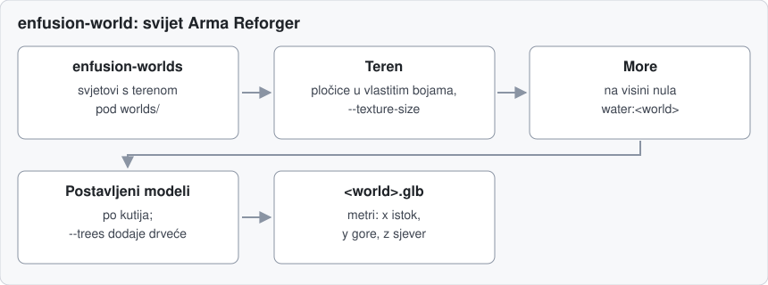

# Arma Reforger svjetovi: `enfusion-worlds` i `enfusion-world` {#arma-reforger-worlds-enfusion-worlds-and-enfusion-world}

**Šta je to?** Cijeli Arma Reforger svijet kao jedna 3D datoteka. **Zašto?** Da
toplotna mapa iz igre ima tlo i zgrade ispod sebe. (*Enfusion* je engine u kojem
je Arma Reforger napravljen; *svijet* (world) je ono što igra naziva mapom.)

Izvozi cijeli Enfusion svijet instalirane igre Arma Reforger: teren u bojama
njegovih vlastitih pločica supertekstura, more i svaki postavljeni model kao
kutiju, u vlastitim metrima igre.



## Korak po korak {#step-by-step}

1. **Navedite svjetove** koji imaju teren:

   ```
   python -m heat3d_gamefiles enfusion-worlds
   python -m heat3d_gamefiles enfusion-worlds --install "D:\Games\Arma Reforger"
   ```

2. **Izvezite jedan**, po imenu njegovog foldera pod `worlds/` kako je navedeno:

   ```
   python -m heat3d_gamefiles enfusion-world <world> -o world.glb
   ```

3. **Varijacije:**

   ```
   python -m heat3d_gamefiles enfusion-world <world> --trees               # vegetation too, as boxes
   python -m heat3d_gamefiles enfusion-world <world> --texture-size 0      # flat colour, small file
   python -m heat3d_gamefiles enfusion-world <world> --ground-spacing 4 --no-structures
   ```

4. **Otvorite `world.glb`** u panelu Pozadina / nivo u 3DHeat pregledniku ([učitavanje nivoa](https://holdi601.github.io/3DHeat/levels.html)).

## Opcije {#options}

| Opcija | Zadano | Značenje |
|---|---|---|
| `<world>` | obavezno | svijet kako ga ispisuje `enfusion-worlds` |
| `-o`, `--out FILE` | `<world>.glb` | datoteka koja se piše |
| `--install FOLDER` | Steam biblioteka koja drži igru | folder igre |
| `--ground-spacing METRES` | 2 (vlastito terenu) | razmak vrhova terena u datoteci |
| `--texture-size PIXELS` | 4096 | veća strana slike boje tla; 0 za ravnu boju |
| `--no-structures` | | izostavlja postavljene modele |
| `--trees` | isključeno | postavlja i drveće i drugu vegetaciju, kao kutije |

## Primjer izlaza {#example-output}

```text
<world> -> world.glb
  ground      <n> triangles, <w> x <h> m; <n> of <n> tile-edge vertices disagree; colour <w> x <h>
  structure   <n> boxes from <n> entities
  water       <n> triangles (the sea)
  left out    <what>: <n>, ...
```

## Dijelovi {#the-parts}

`ground:<world>` (teren), `water:<world>` (more, na visini nula) i
`structure:<world>` (kutije). Koordinate su vlastite igri: x istok, y gore,
z sjever, u metrima - ono što prijavljuje snimak u igri. Okvir igre je lijevi
(left-handed); *Obrni osu svijeta* u pregledniku prikazuje ga nezrcaljenog.

## Kako se čita i provjerava {#how-it-is-read-and-checked}

Workbench nije potreban i ništa nije šifrirano.

| Format | Šta je | Provjereno naspram |
|---|---|---|
| `.pak` | blok podataka i stablo direktorija, unosi pohranjeni ili zlib | stablo tačno iskoristi svoj blok; uzorkovani zlib unosi se raspakuju tačno na svoju navedenu veličinu |
| `.edds` | DDS zaglavlje, zatim po mip nivou chunkovi `COPY` ili `LZ4 ` | nivoi u chunkovima dekodiraju se na tačno svoju veličinu koristeći tačno svoje bajtove |
| `.terr` / `.ttile` | zaglavlje i pločice 16-bitnih visina | svaka zajednička ivica pločice slaže se tačno |
| supertekstura | boja tla svake pločice, oko metar po pikselu | podudara se s morem u visinama; nijedan flip ili transponiranje ne pristaje jednako dobro |
| `.ent` | imena, GUID-ovi resursa, zatim entiteti kao tipizirane vrijednosti | datoteka svijeta parsira se do posljednjeg bajta |
| `resourceDatabase.rdb` | GUID u putanju | gotovo svaki GUID koji svijet koristi imenuje datoteku koja postoji |

Objekti označeni kao da stoje na apsolutnoj visini nalaze se unutar centimetara od
dekodiranog terena (s transponiranom mrežom bili bi metrima daleko). Nije
nacrtano: vlastiti trouglovi modela, drveće zadano (`--trees` ga dodaje kao
kutije), podređeni entiteti, jezera i rijeke, teksture sa zaglavljima prije DX10.

**Uslovi:** licenca igre dozvoljava nekomercijalnu upotrebu i zabranjuje obrnuti
inženjering datoteka igre. Čitanje vlastite instalacije je vaša odluka u okviru
nje; izlaz je za vašu vlastitu upotrebu i ne dijeli se.
