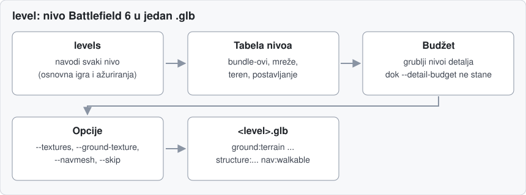

# Battlefield 6 nivoi: `levels` i `level` {#battlefield-6-levels-levels-and-level}

**Šta je to?** Cijeli Battlefield 6 nivo kao jedna 3D datoteka. **Zašto?** Da
toplotna mapa iz vaših mečeva ima tlo i zgrade ispod sebe. (*Frostbite* je engine
u kojem je Battlefield napravljen; *visinsko polje* (heightfield) je tlo
pohranjeno kao mreža visina.)

Izvozi cijeli Frostbite nivo instalirane igre: visinsko polje terena, svaku mrežu
koju postavljaju njegove grupe statičkih modela, objekte postavljene jedan po
jedan, pozadinu terena oko mape, a na zahtjev i mape boje površina, decale terena
pečene u tlo i površine po kojima vojnici mogu hodati.



## Korak po korak {#step-by-step}

1. **Navedite nivoe** koje igra isporučuje:

   ```
   python -m heat3d_gamefiles levels
   python -m heat3d_gamefiles levels --install "D:\Games\<game folder>"
   ```

   Svaki red je tablica nivoa (`levels/<level>/<level>.toc`) s njenom veličinom i
   odakle dolazi: `Data` za osnovnu igru, `Update/<pack>` za ažuriranje.

2. **Izvezite jedan**, po njegovom imenu, jedinstvenom dijelu imena ili putanji
   `.toc`. Počnite bez tekstura da vidite oblik i veličinu:

   ```
   python -m heat3d_gamefiles level <level> -o level.glb
   ```

3. **Dodajte boju** kad izgleda ispravno:

   ```
   python -m heat3d_gamefiles level <level> -o level.glb --textures 512 --ground-texture 0.5
   ```

4. **Dodajte površine za hodanje**, ili smanjite datoteku:

   ```
   python -m heat3d_gamefiles level <level> --textures 512 --ground-texture 0.5 --navmesh
   python -m heat3d_gamefiles level <level> --textures 256 --detail-budget 3000000 --ground-spacing 8
   ```

5. **Otvorite `level.glb`** u panelu Pozadina / nivo u 3DHeat pregledniku ([učitavanje nivoa](https://holdi601.github.io/3DHeat/levels.html)).

## Opcije {#options}

| Opcija | Zadano | Značenje |
|---|---|---|
| `<level>` | obavezno | ime kako ga ispisuje `levels`, jedinstveni dio imena, ili `.toc` nivoa |
| `-o`, `--out FILE` | `<level>.glb` | datoteka koja se piše |
| `--install FOLDER` | pronađeno u Steam bibliotekama | folder igre |
| `--textures [PIXELS]` | isključeno; 512 bez veličine | mapa boje svake površine, najviše PIXELS po strani |
| `--ground-texture [METRES]` | isključeno; 0,5 bez veličine | peče ceste, platoe i oznake u boju tla, METRES po pikselu |
| `--navmesh` | isključeno | dodaje vojnikovu navigacijsku mrežu kao `nav:walkable` |
| `--ground-spacing METRES` | 4 | najfiniji razmak visinskog polja; 0 ga izostavlja |
| `--detail-budget N` | najgrublje kopije plus četvrtina, najmanje 1.500.000 | gornja granica trouglova (teren se nikad ne grubi) |
| `--skip TEXT` | | izostavlja grupe modela čije ime particije sadrži TEXT; može se ponavljati |
| `--by-mesh` | isključeno | jedan dio po izvornoj mreži i materijalu, za pronalaženje šta je dio |
| `--clamped-uvs` | isključeno | za renderere koji ne mogu ponavljati teksturu |

Cijela tablica, s veličinama koje treba očekivati (cijeli nivo ima stotine MB),
nalazi se na stranici [Komande](commands.md#levels-and-level-frostbite). Kako se
čitaju tablice, bundlovi, mreže i teren, opisano je na stranici [Frostbite](reader-frostbite.md).

## Primjer izlaza {#example-output}

Šta `level` ispisuje, ukratko (redovi kako ih kod piše; `<n>` i imena variraju
po nivou):

```text
<n> copies of <n> meshes, from <n> static model groups
      <n>  <group>
      <n>  placed one by one (object and prefab references)
<n> meshes left out: <why>
<n> triangles, budget <n>; <n> meshes drawn at a coarser level to fit
           <n>  ground:terrain
           <n>  structure:buildings, <n> textures
           ...
<n> of <n> drawn sections carry their colour map; the rest are flat colours
Ground: <what the ground is>.
Navigation mesh: <tiles read>.
-> level.glb (<n> MB)
```

## Dijelovi {#the-parts}

`ground:terrain` (visinsko polje), `ground:terrain backdrop` i
`ground:terrain blend`, `structure:<kind>` po vrsti mreže (po mapi boje
s `--textures`, s ` (destructible)` za ono što meč može uništiti), i
`nav:walkable` s `--navmesh`. Pogledajte [Format izlaza](output-format.md).

Datoteka sadrži sadržaj igre: namijenjena je računaru na kojem je napravljena, a
ne dijeljenju ([Pravila i licence](rules-and-licences.md)).
