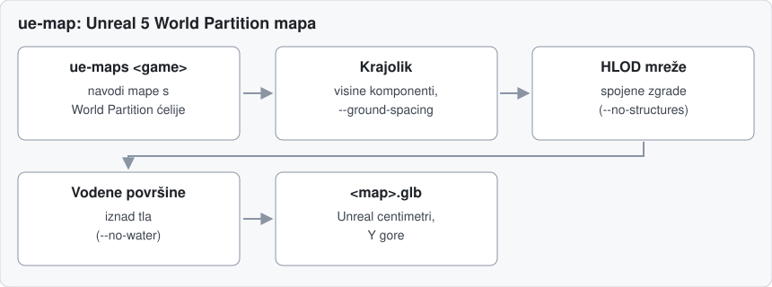

# Unreal 5 World Partition mape: `ue-maps` i `ue-map` {#unreal-5-world-partition-maps-ue-maps-and-ue-map}

**Šta je to?** Cijela mapa igre na Unreal 5 kao jedna 3D datoteka: tlo, zgrade i
voda. **Zašto?** Da toplotna mapa iz te igre ima mapu ispod sebe. (*World
Partition* je način na koji Unreal 5 dijeli veliku mapu na dijelove; *HLOD* je
pojednostavljena zamjena za grupu zgrada, ona koju igra crta izdaleka.)

Izvozi cijelu mapu igre na Unreal 5 čije su mape pečene kao World Partition
ćelije: landscape, spojene HLOD mreže mape (njene zgrade i rekviziti onako kako
ih igra crta izdaleka) i njena vodena tijela. Nisu potrebni ni editor ni projekat,
samo instalirana igra.



## Korak po korak {#step-by-step}

1. **Navedite mape.** `<game>` je folder igre, njen `Content/Paks`, ili ime
   njenog foldera u Steam biblioteci:

   ```
   python -m heat3d_gamefiles ue-maps "<Steam game folder name>"
   python -m heat3d_gamefiles ue-maps "D:\Games\<game>"
   ```

   Ispisuje se svaka mapa s pečenim World Partition ćelijama, s putanjom paketa.

2. **Izvezite jednu** po imenu ili jedinstvenom dijelu imena:

   ```
   python -m heat3d_gamefiles ue-map "<game>" <map> -o map.glb
   ```

3. **Samo tlo, ili grublje:**

   ```
   python -m heat3d_gamefiles ue-map "<game>" <map> --no-structures --no-water
   python -m heat3d_gamefiles ue-map "<game>" <map> --ground-spacing 4
   ```

4. **Otvorite `map.glb`** u panelu Pozadina / nivo u 3DHeat pregledniku
   ([učitavanje nivoa](https://holdi601.github.io/3DHeat/levels.html)).

## Opcije {#options}

| Opcija | Zadano | Značenje |
|---|---|---|
| `<game>` | obavezno | folder igre, njen `Content/Paks`, ili ime njenog Steam foldera |
| `<map>` | obavezno | ime kako ga ispisuje `ue-maps`, ili jedinstveni dio imena |
| `-o`, `--out FILE` | `<map>.glb` | datoteka koja se piše |
| `--ground-spacing METRES` | 2 | razmak vrhova landscapea, zaokružen na cijeli broj njegovih vlastitih kvadova |
| `--no-structures` | | izostavlja HLOD zgrade i rekvizite |
| `--no-water` | | izostavlja vodena tijela |

Sadržaj komprimiran Oodleom treba Oodle biblioteku koja je već na računaru
(pogledajte [Oodle](reader-oodle.md)).

## Primjer izlaza {#example-output}

```text
<map> -> map.glb
  ground      <n> triangles from <n> landscape components; <n> of <n> vertices stored twice disagree
  structure   <n> triangles in <n> HLOD meshes
  water       <n> triangles from <n> water bodies
```

Broj neslaganja je samoprovjera: susjedne komponente landscapea pohranjuju svoju
zajedničku ivicu dvaput, i ta dva moraju biti jednaka. Mapa od 3 km na 2 m je
oko 4,6 miliona trouglova tla.

## Dijelovi {#the-parts}

`ground:<map>` (landscape), `structure:<map>` (HLOD mreže) i
`water:<map>` (voda koja stoji iznad tla).

**Jedinice:** ovo je jedini izvoz **koji nije u metrima**: Unreal centimetri, sa
zamijenjenim Y i Z (Y gore), okvir koji piše 3DHeat Unreal Exporter. Telemetrija
iz iste igre koristi isti okvir, pa leži na mapi.

## Kako se čita i provjerava {#how-it-is-read-and-checked}

| Dio | Čita se iz | Provjereno naspram |
|---|---|---|
| tlo | 16-bitna heightmapa svake komponente landscapea, postavljena njenom bazom sekcije na transformaciju landscapea | svaki vrh pohranjen dvaput (na šavu ili ivici komponente) mora se slagati; neslaganja se broje i ispisuju, ne zaglađuju |
| građevine | spojene HLOD mreže mape, koje engine gradi u svjetskom prostoru | mreža se zadržava samo ako granice koje njena komponenta kešira opisuju njene vlastite vrhove |
| voda | mreža svakog vodenog tijela, položena na mrežu tla, zadržana gdje stoji iznad tla | voda je nekoliko metara iznad tla ispod nje, kao rijeka iznad svog korita |

Svojstva landscapea pronalaze se po obliku, a ne po broju slota (slotovi se
pomjeraju između verzija enginea). Građevine su pojednostavljene zamjene, a ne
modeli pune detaljnosti. Raslinje, decali i materijali landscapea se ne izvoze;
tlo je bez teksture, a sjenčanje radi preglednik. Detalji o arhivi:
[Unreal 5 IoStore](reader-unreal-iostore.md).

**Vaše vlastite datoteke:** mapa se čita iz igre instalirane na vašem računaru i
upisuje na vaš disk za vašu vlastitu analizu; ništa iz igre ne isporučuje se s ovim
alatom.
