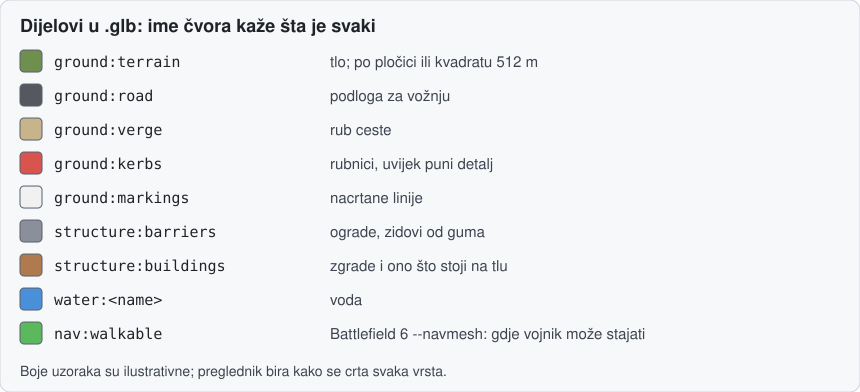

# Format izlaza {#output-format}

`.glb` je jedna 3D datoteka: tlo, zgrade i voda staze ili
nivoa, koji otvarate u panelu Pozadina / nivo 3DHeat preglednika.

Svaki izvoz (`course`, `courses`, `terrain`, `level`, `ue-map`, `enfusion-world`) upisuje jednu **binarnu glTF 2.0**
datoteku (`.glb`). Namjerno je malen i ravan, i raspoređen onako kako ga 3DHeat
preglednik čita kao nivo. Izvor:
[`glb.py`](https://github.com/Holdi601/3DHeat-GameFiles/blob/main/heat3d_gamefiles/glb.py).

## Struktura {#structure}

```
scene 0
 ├─ node "ground:terrain x-2046 z1023"  -> mesh 0 -> 1 primitive, material 0
 ├─ node "ground:road x-2046 z1023"     -> mesh 1 -> 1 primitive, material 1
 ├─ node "ground:markings"               -> mesh 2 -> ...
 ├─ node "ground:kerbs road_gen_rum_..." -> ...
 ├─ node "structure:barriers bar_armco_bclr"
 └─ ...
```

- **Jedan čvor po dijelu**, svi u korijenu scene, **bez transformacija**. Sva
  geometrija je već u svjetskom prostoru.
- Svaki čvor ima vlastitu mrežu s **jednim primitivom** i vlastiti materijal. Čvor,
  mreža i materijal nose ime dijela.
- Svaki primitiv ima **vlastite kompaktne nizove vrhova**, samo vrhove koje
  taj dio koristi. Zajednički niz vrhova je legalan glTF, ali čitač koji proširuje
  accessore svakog primitiva tada bi držao svaki vrh jednom po dijelu.
- `asset.generator` je `heat3d_gamefiles`.
- **Malo `extras`**, i nikakvo ime kruga, igre ili staze:
  - Battlefield 6 dio destruktivne mreže nosi `{"destructible": true}` na svom čvoru;
  - Forza staza kaže šta sadrži u `asset.extras` (verzija formata, id povezane
    rute, koliko kopija vlastitog sloja utrke, lokacije; pogledajte
    [Forza Horizon staze](course-forza-horizon.md#writing-the-file)), a njeni
    uključeni dijelovi nose svoj sloj na čvoru: `{"layer": "event", "route": <id>}`
    za vlastiti sloj utrke, `{"layer": "layer"}` za drugi uključeni sloj,
    `{"layer": "venue"}` za tlo lokacije.

  Sve ostalo što preglednik treba nalazi se u imenima čvorova.

## Imena čvorova: klasifikacija {#node-names-the-classification}



Preglednik uzima klasu dijela iz imena **čvora** (uz povratak na ime mreže),
i to samo kad se poklopi s

```
^(ground|structure|water)\s*[:|]
```

Sve ostalo se razvrstava heuristikom napisanom za Unreal krajolike. Zato
svaki dio koji izvoznik upisuje počinje jednim od ovih prefiksa, ili s
`nav:` (niže):

| Prefiks | Značenje | Upisani dijelovi |
|---|---|---|
| `ground:` | površina za vožnju i zemljište | `ground:road`, `ground:verge`, `ground:terrain`, `ground:gravel and dirt`, `ground:kerbs`, `ground:markings`, `ground:tyre marks`, `ground:venue`, `ground:plinths` |
| `structure:` | ono što stoji na njemu | `structure:barriers`, `structure:props`, `structure:signs`, `structure:buildings`, `structure:infrastructure`, `structure:bridges`, `structure:rocks`, `structure:smashables`, `structure:trees`; Forza slojevi `structure:event_<category>` i `structure:layer_<category>` |
| `water:` | voda | `water:water`; `water:<map>` (`ue-map`), `water:<world>` (`enfusion-world`) |
| `nav:` | gdje vojnik može hodati (Battlefield 6, samo `--navmesh`) | `nav:walkable` |

`nav:` ne odgovara gornjem uzorku preglednika, pa ga preglednik razvrstava svojom
heuristikom; to je poseban dio da ga možete prikazati ili sakriti zasebno.
`ue-map` upisuje `ground:<map>`, `structure:<map>` i `water:<map>`;
`enfusion-world` upisuje `ground:<world>`, `structure:<world>` i `water:<world>`.

Poslije vrste dolazi, zavisno od igre:

| Primjer | Značenje |
|---|---|
| `ground:road x-2046 z1023` | Forza tlo u pločici terena nazvanoj `x-2046 z1023` (jedinice mreže, 1023 na 512 m) |
| `ground:road 3_-2` | BeamNG tlo u kvadratu od 512 m (3, -2) |
| `ground:road 3_-2 asphalt_light` | BeamNG modelirana površina za vožnju materijala `asphalt_light` u tom kvadratu |
| `ground:road 1_-4` | AC Rally tlo u kvadratu od 512 m (1, -4) Unreal prostora |
| `structure:barriers bar_armco_bclr` | Forza postavljeni modeli koji dijele jednu teksturu (njeno ime bez GUID-a) |
| `structure:barriers` | postavljeni modeli bez teksture (Forza, AC Rally) |
| `structure:event_barriers bar_example_bclr` | Forza: ono što povezana utrka postavlja za sebe, odvojeno od svijeta slobodnog vožnjenja (extras čvora `{"layer": "event", "route": <id>}`) |
| `structure:layer_props` | Forza: sloj koji igra uključuje za nešto drugo osim ove utrke (aktivnost, kolekcionarski predmet, runtime sloj) |
| `ground:venue`, `ground:plinths` | Forza: modeli već u svjetskim koordinatama - vlastito tlo lokacije (pod stadiona), i tlo kojim je ulica uređena |
| `structure:barriers armco_metal` | BeamNG postavljeni modeli jednog materijala |
| `ground:markings`, `water:water` | ravni dijelovi, jedan za cijelu datoteku |
| `ground:terrain` (Battlefield 6) | heightfield; `ground:terrain backdrop` udaljene mreže terena, `ground:terrain blend` mreže koje se stapaju u teren |
| `nav:walkable` (Battlefield 6, `--navmesh`) | navigacijska mreža nivoa za vojnika: gdje se može stajati, ravno zelena |
| `ground:terrain x-512 z-512` (Battlefield 6, `--ground-texture`) | heightfield ispod jedne pečene pločice decala, imenovane donjim uglom pločice u metrima |
| `structure:buildings t_concreteclean_01_cs` (Battlefield 6, `--textures`) | svaka površina te vrste koja prikazuje tu mapu boja; bez `--textures`, jedan dio po vrsti, bez sufiksa |
| `structure:buildings t_concreteclean_01_cs (destructible)` (Battlefield 6) | isto, za mreže koje meč može uništiti: one s asset-om uništenja vlastitog imena (zidovi, kuće, rekviziti). Čvor nosi i glTF extras `{"destructible": true}`. Njihova uništena stanja se ne izvoze |

Preglednik može filtrirati po ovim imenima. Na primjer, "samo površina za utrkivanje" je
`ground:road` zajedno s `ground:kerbs`, u sve tri igre, a "svijet
bez rekvizita same utrke" je sve osim `structure:event_*`. Prefiks je i
način na koji preglednik crta dio: tlo kao površinu na kojoj leži toplotna mapa (heat), strukture kao
ono što stoji na njemu.

## Jedinice, ose i okvir {#units-axes-and-frame}

- **Metri, Y gore**, glTF konvencija, za svaki izvoz osim `ue-map`. Ništa
  se ne skalira niti centrira: brojevi su svjetske koordinate igre, što
  je smisao čitanja arhive umjesto rekonstrukcije.
- **Unreal 5 mape (`ue-map`): centimetri**, Unrealova vlastita jedinica, sa zamijenjenim Y i Z
  tako da je Y gore - okvir koji piše 3DHeat Unreal Exporter i koji koristi
  telemetrija igre. Jedini izvoz koji nije u metrima.
- **Arma Reforger (`enfusion-world`):** vlastiti metri igre, x istok, y gore,
  z sjever. Okvir igre je lijevoruk; *Obrni osu svijeta* u pregledniku
  ga prikazuje nezrcaljenog.
- **Forza:** vlastite svjetske koordinate igre (x, y gore, z), nepromijenjene. Isto kao
  njena telemetrija, pa snimljeni krug leži na stazi.
- **BeamNG.drive:** `(x, z, -y)` BeamNG-ovog svijeta s Z gore, što je rotacija koju primjenjuje
  snimač telemetrije. Rotacija, a ne zrcaljenje.
- **Battlefield 6:** vlastite svjetske koordinate igre (x, y gore, z), nepromijenjene:
  transformacije instanci nivoa primijenjene na svaku mrežu kako je pohranjena. Zrcaljene
  kopije se ponovo namotavaju tako da njihove normale gledaju prema van.
- **Assetto Corsa Rally:** okvir kruga. Unreal centimetri postaju metri,
  Unreal Z postaje y, a Unreal X i Y postaju x i z u kojoj god od osam
  orijentacija se krug uklopio (pogledajte
  [Assetto Corsa Rally](course-assetto-corsa-rally.md#which-stage-and-which-way-round)).
  Trouglovi se ponovo namotavaju gdje to preslikavanje zrcali.

Svaki izvoz zadržava ose koje koristi njegova telemetrija, pa snimak i nivo
dijele okvir. Je li taj okvir lijevoruk ili desnoruk u svakoj igri
nije provjereno.

## Podaci vrhova {#vertex-data}

Zadani je **kvantizirani** oblik (`quantize=True`). Treba mu
ekstenzija `KHR_mesh_quantization`, koja je navedena i u `extensionsUsed` i u
`extensionsRequired`.

| Atribut | Kvantizirano (zadano) | Puna preciznost (`quantize=False`) |
|---|---|---|
| `POSITION` | float32 VEC3, s min/max | float32 VEC3 |
| `NORMAL` | int8 VEC3 normalizirano, dopunjeno na 4 bajta (stride 4) | float32 VEC3 |
| `TEXCOORD_0` (samo teksturirani dijelovi) | uint16 VEC2 normalizirano, ograničeno na 0-1; float32 VEC2 gdje se teksture ponavljaju (Battlefield 6) | float32 VEC2 |
| `COLOR_0` (neteksturirani dijelovi, kad bilo koji dio ima boju) | uint8 VEC3 normalizirano, dopunjeno na 4 bajta | float32 VEC3 |
| indeksi | uint16 kad dio ima najviše 65.535 vrhova, inače uint32 | uint32 |

Vrh je 20 bajta umjesto 32 (24 umjesto 44 s bojom). To skida trećinu
sa svake datoteke i razlika je između toga da se gradska staza učitava u
kartici preglednika ili ne. Cijena je manje od pola stepena normale i 1/65.535
UV-a (petnaestina teksela na 4.096 px). Komandna linija uvijek piše
kvantizirani oblik. `write_glb(..., quantize=False)` u Pythonu piše drugi.

Normale dolaze iz igre gdje ih pohranjuje (Forza teren i modeli, BeamNG
oblici i teren). Inače se računaju kao glatke normale otežane površinom
iz trouglova. AC Rally normale se uvijek računaju.

## Materijali, boje i teksture {#materials-colours-and-textures}

- Svaki materijal je `metallicFactor 0`, `roughnessFactor 1`.
- **Teksturiran dio:** `baseColorTexture` sa slikom dijela, UV-ovima, i bez boje vrhova.
  glTF množi to dvoje, pa bi se površina zatamnila dvaput.
- **Neteksturiran dio:** boja vrhova `COLOR_0` s ravnom bojom dijela i
  bijeli `baseColorFactor`. Ako nijedan dio u datoteci nema boju, nema ni
  `COLOR_0`. Gdje dijelovi dijele vrhove, pobjeđuje boja kasnijeg dijela, pa se
  ravni dijelovi upisuju redom rastuće važnosti.
- **Slike** su ugrađene u binarni dio kao **JPEG**, kvaliteta 90, bez poduzorkovanja
  hrome, samo RGB (alfa se odbacuje) - osim Battlefield 6 cut-out mape
  (lišće, ograde), koja je **PNG** sa svojom alfom, na materijalu s
  `alphaMode` MASK, `alphaCutoff` 0.5 i `doubleSided` (pogledajte
  [Frostbite](reader-frostbite.md#textures-and-materials)). 3DHeat preglednik
  odbacuje teksele ispod praga. Tlo od 2048 px s travom i krošnjama drveća
  je šum za koder bez gubitaka: nekoliko megabajta po pločici kao PNG, ispod jednog
  kao JPEG. Slika koju dijeli više dijelova pohranjuje se jednom.
- Jedan uzorkivač za sve teksture: linearno povećanje, linear-mipmap-linear
  smanjenje, **clamp to edge** na obje ose, za izvoze staza, čije
  teksture pokrivaju njihove površine jednom. BeamNG crta ponavljajuće teksture modela kao
  ravne boje (pogledajte [BeamNG.drive](course-beamng.md#placed-models)).
- Battlefield 6 izvoz s `--textures`, čiji se materijali ponavljaju (tile), piše
  vlastite koordinate teksture igre, neograničene, kao float32 `TEXCOORD_0` čak i u
  kvantiziranom obliku, s uzorkivačem koji se **ponavlja** na obje ose
  (`write_glb(..., repeat=True)`): zid od cigli je jedan par trouglova čiji
  UV ide od 0 do 40. 3DHeat preglednik omata takvu teksturu unutar svog atlasa (pogledajte
  njegovu stranicu *Nivoi modela*). Za renderer koji ne može ponavljati teksturu,
  `level --clamped-uvs` (`write_level(..., clamped=True)`) siječe svaki trougao
  duž linija gdje se njegova tekstura ponavlja i pomiče svaki komad u 0..1:
  isti pikseli na istoj površini, otprilike petina više trouglova. Trouglovi
  preko kojih se tekstura ponavlja više od 16 puta zadržavaju svoje koordinate. Trougao
  koji bi njegova tekstura isjekla na više od 4 komada - kora koja se ponavlja niz
  svaku granu drveta, što je sječenjem pretvorilo 1.099 trouglova jednog drveta u
  51.735 - ide u vlastiti dio, `<part> (average colour)`, u
  prosječnoj boji teksture; `level` kaže koliko ih je.

| Tekstura | Veličina | Pokriva |
|---|---|---|
| tlo (sve igre osim Battlefield 6) | `--texture-size`: 2048, 1024 ili 512 px | jedan kvadrat od 512 m: 25, 50 ili 100 cm po pikselu |
| Battlefield 6 heightfield | najveći mip mape boja pozadine u nivou, isječen | kvadrat terena: 32 m po pikselu u provjerenom nivou |
| Battlefield 6 površine | `--textures`: najviše toliko px po strani | vlastita tekstura površine, jednom po komadu (siječena gdje se ponavlja) |
| Battlefield 6 pečeno tlo | `--ground-texture`: metara po pikselu, pločice od najviše 4.096 px | jedna pločica opsega decala: 2.048 m pri 0,5 m po pikselu |
| Forza postavljeni model | najviše 256 px | vlastiti UV raspored modela |
| BeamNG postavljeni model | najviše 256 px | vlastiti UV raspored modela, samo gdje se ne ponavlja |
| AC Rally postavljeni model | nema | ravne boje |

## Šta pisač odbija {#what-the-writer-refuses}

`write_glb` baca grešku umjesto da upiše datoteku koju bi preglednik otvorio i prikazao
pogrešno:

| Odbijeno | Zato što |
|---|---|
| pozicije koje nisu N x 3, ili nisu konačne | pokvarena mreža |
| indeks poslije kraja liste vrhova | prikazuje se kao šum |
| teksturiran dio kad datoteka nema UV-ove | prikazuje se kao jedan razmazan piksel |
| nijedan trougao | prikazuje se kao ništa |
| niz normala, boja ili UV-ova pogrešne dužine, ili nekonačan | treba jedan po vrhu |

## Čitanje drugdje {#reading-it-elsewhere}

Svaki glTF 2.0 preglednik koji podržava `KHR_mesh_quantization` trebao bi otvoriti ove
datoteke. Provjeren je samo 3DHeat preglednik; ostali preglednici nisu provjereni. Čitač
bez ekstenzije odbija datoteku, jer je označena kao obavezna. Datoteke mogu biti velike: oko 80 MB za
seosku stazu, do nekoliko stotina MB za gradsku stazu s automatskim
budžetom.

## U 3DHeat {#in-3dheat}

Učitajte `.glb` u panelu Pozadina / nivo [3DHeat](https://github.com/Holdi601/3DHeat) preglednika;
telemetrija koju snimi u istoj igri leži na njemu, jer oboje
zadržavaju koordinate igre. Vlastita dokumentacija preglednika
([holdi601.github.io/3DHeat](https://holdi601.github.io/3DHeat/)) pokriva
panel Pozadina / nivo i datoteke meča koje pišu ostali alati
([Jedna datoteka po meču: `.3dheat`](https://holdi601.github.io/3DHeat/container.html)).
Nivo nije pohranjen u svakoj `.3dheat` datoteci: meč ga imenuje u svojim
`references` (`kind: "level"`, ime i sha256), a `.glb` ostaje pored
mečeva.
