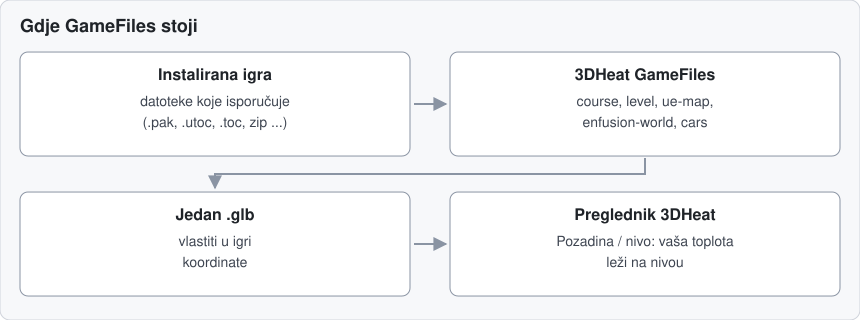

# Cijeli nivoi {#whole-levels}

**Jednostavno rečeno:** za pucačine i druge igre bez krugova, alat sprema
cijelu mapu kao jednu 3D datoteku, tako da preglednik može nacrtati kuda su igrači išli po njoj.

`course` izrezuje tlo oko kruga. Za igre bez krugova alat izvozi
cijeli nivo, mapu ili svijet odjednom:

| Igra ili engine | Ispis | Izvoz | Stranica |
|---|---|---|---|
| Battlefield 6 (Frostbite) | `levels` | `level <level>` | [Battlefield 6 nivoi](level-battlefield.md) |
| Unreal 5 World Partition igre | `ue-maps <game>` | `ue-map <game> <map>` | [Unreal 5 mape](level-unreal-world-partition.md) |
| Arma Reforger (Enfusion) | `enfusion-worlds` | `enfusion-world <world>` | [Arma Reforger svjetovi](level-arma-reforger.md) |

Svaki par radi na isti način: prvi glagol ispisuje šta instalirana igra
sadrži, drugi upisuje jedan od tih sadržaja kao jedan `.glb` u vlastitim
svjetskim koordinatama igre, tako da pozicije snimljene u toj igri leže na njemu. Dijelovi su
imenovani `ground:`, `structure:` i `water:` kao i svaki drugi izvoz (pogledajte
[Format izlaza](output-format.md)); učitajte datoteku u panel Pozadina / nivo
3DHeat preglednika.

