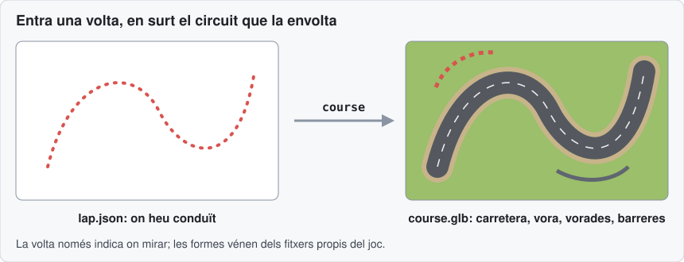
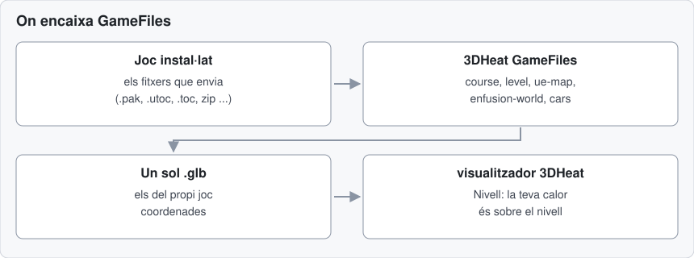

# 3DHeat GameFiles {#dheat-gamefiles}

**Què és?** Una eina que construeix un model 3D d'un circuit de carreres o d'un nivell de joc
a partir dels fitxers d'un joc que ja tens instal·lat.

**Per a què la faria servir?** El visualitzador de 3DHeat pinta com a calor per on has conduït o
jugat. Amb aquesta eina ho pinta sobre el circuit o el nivell real, no sobre un espai buit.

**Exemple:** agafi una volta que has conduït. L'eina construeix la carretera i el terreny del
voltant com un únic fitxer 3D, de manera que el visualitzador pot pintar la teva velocitat o els
teves accidents sobre el circuit real:



Si ets nou amb la línia d'ordres, comença per [Abans de començar](before-you-start.md).

Amb més detall: llegeix dades de nivell dels arxius que envia un joc i les escriu com a fitxer
glTF binari (`.glb`). La seva tasca principal és l'**exportació del circuit**: li dona una volta,
i escriu el terreny, la carretera (diferenciada de la vora i de la herba), i les vorades, les barreres,
els murs de pneumàtics, els senyals i els edificis del voltant.

Forma part de [3DHeat](https://github.com/Holdi601/3DHeat), un visualitzador de mapes de calor 3D
de telemetria en temps real, d'anàlisi de curses i de revisió de partides
([documentació](https://holdi601.github.io/3DHeat/)). Els fitxers `.glb` que escriu aquesta
eina són els nivells sobre els quals el visualitzador dibuixa la calor.



És una de les tres maneres d'obtenir la geometria d'un nivell dins de 3DHeat:

| Via | Necessita | Dona |
|---|---|---|
| 3DHeat Unreal Exporter | el projecte d'Unreal obert a l'editor | geometria exacta |
| 3DHeat GameCapture | una pantalla i una captura | una estimació |
| **3DHeat GameFiles** | **el joc instal·lat, tal com es distribueix** | **geometria exacta, sense projecte** |

Paquet de Python: `heat3d_gamefiles`. Repositori:
[Holdi601/3DHeat-GameFiles](https://github.com/Holdi601/3DHeat-GameFiles). Llicència: MIT.

## Què pot fer {#what-it-can-do}

| Joc o motor | Exportació de circuits (`course`) | Lectura d'arxius |
|---|---|---|
| Forza Horizon (ForzaTech) | sí: terreny, carretera i vora, textura del terreny, models col·locats amb les seves pròpies textures | `identify`, `list`, `extract` sobre un `.minizip`; `identify` sobre un `.modelbin`; models, terreny i textures mitjançant `course` i `terrain` |
| BeamNG.drive | sí: terreny, calcomanies de carretera, circuits modelats, models col·locats, aigua | `identify`, `list`, `extract` sobre zips de nivells; `identify` sobre `.ter`, `.cdae`; `.dae` mitjançant `course` |
| Assetto Corsa Rally (Unreal 5.6) | sí: rajoles del terreny de l'etapa, color del terreny cuit, models col·locats en colors plans | `identify`, `list`, `extract` sobre IoStore `.utoc`/`.ucas`; paquets zen, malles estàtiques, textures mitjançant `course` |
| Unreal `.pak` (versions 8-12) | no | `identify`, `list`, `extract` |
| Unity (format 22 i posteriors) | no | `identify`, `meshes` |
| Battlefield 6 (Frostbite `.toc`/`.cas`) | cap volta; un nivell sencer amb `level`: terreny, malles col·locades, els seus mapes de color amb `--textures` | `identify`, `levels`; paquets, malles, terreny, textures i col·locació mitjançant `level` |
| `.vpk` de Source 2 | no | `identify`, `list`, `extract` |
| Jocs Unreal 5 amb World Partition | cap volta; un mapa sencer amb `ue-map` (llistat per `ue-maps`): paisatge, edificis HLOD i objectes, aigua | - |
| Arma Reforger (Enfusion) | cap volta; un món sencer amb `enfusion-world` (llistat per `enfusion-worlds`): terreny en els seus colors, el mar, edificis com a caixes | - |
| Forza (cotxes) | `cars`: cada cotxe a baix detall, per a la pestanya de Curses del visualitzador | - |

Les voltes d'Assetto Corsa EVO i d'iRacing es refusen amb un motiu. Mira
[Límits i buits coneguts](../limits-and-known-gaps.md).

## Instal·lació {#install}

Si ets nou amb la línia d'ordres, llegeix primer [Abans de començar](before-you-start.md).

Cal **Python 3.10 o posterior** (desenvolupat amb la 3.13) i els paquets que hi ha a
[`requirements.txt`](https://github.com/Holdi601/3DHeat-GameFiles/blob/main/requirements.txt).

```
git clone https://github.com/Holdi601/3DHeat-GameFiles.git
cd 3DHeat-GameFiles
pip install -r requirements.txt
```

Després comprova-ho: `python -m heat3d_gamefiles --help`. Hauries de veure
`usage: heat3d_gamefiles [-h]` i la llista de verbs. Executa cada ordre des de la
carpeta del repositori, com `python -m heat3d_gamefiles <verb>`.

| Paquet | Per a què serveix |
|---|---|
| numpy | tot el que descodifica geometria |
| lz4 | arxius de Forza (sobretot blocs LZ4), alguns paquets de Unity, blocs LZ4 de IoStore |
| Pillow | descodificar textures BC1-BC7, escriure les textures JPEG al `.glb` |
| msgpack, zstandard | les formes compilades de BeamNG (`.cdae`) |
| cryptography | només per obrir un `.pak` xifrat amb una clau que ja tens |
| pytest | les proves |

El contingut d'Unreal comprimit amb **Oodle** necessita una biblioteca Oodle que ja sigui
a la teva màquina. Mai no s'envia amb aquesta eina. Mira [Oodle](../reader-oodle.md).

L'eina està escrita per a Windows. Troba els jocs a través de la llista de biblioteques de Steam i
de `%LOCALAPPDATA%`, i carrega Oodle com a DLL de Windows. Les altres plataformes no s'han
provat.

## Inici ràpid {#quick-start}

Un **fitxer de volta** és un registre de on ha anat el teu cotxe: una llista de punts x, y, z.
Ve de [3DHeat GameCapture](https://github.com/Holdi601/3DHeat-GameCapture)
o de la biblioteca de voltes de l'aplicació FH Companion; un CSV escrit a mà també serveix
([Entrades de voltes](../lap-inputs.md)).

```
# Forza: un fitxer de volta, una carpeta de voltes, o un nom de circuit de la biblioteca de FH Companion
python -m heat3d_gamefiles course "Example Circuit"
python -m heat3d_gamefiles course path\to\lap.json -o course.glb

# BeamNG.drive o Assetto Corsa Rally: un fitxer heat3d-lap indica de quin joc és
python -m heat3d_gamefiles course my_lap.json

# Cada circuit de la biblioteca de FH Companion, un .glb per a cadascun
python -m heat3d_gamefiles courses -o courses

# Battlefield 6: llista els nivells, i després exporta'n un (un fitxer gran; mira Ordres)
python -m heat3d_gamefiles levels
python -m heat3d_gamefiles level <level> -o level.glb --textures

# Unreal 5 World Partition i Arma Reforger: llistar, i després exportar
python -m heat3d_gamefiles ue-maps "<game>"
python -m heat3d_gamefiles ue-map "<game>" <map> -o map.glb
python -m heat3d_gamefiles enfusion-worlds
python -m heat3d_gamefiles enfusion-world <world> -o world.glb

# Cada cotxe de Forza, per a la pestanya de curses del visualitzador
python -m heat3d_gamefiles cars -o forza.h3dcars

# Què és aquest fitxer?
python -m heat3d_gamefiles identify some_archive.pak
```

Obre el `.glb` al visualitzador de 3DHeat. Les coordenades del mateix món del joc es conserven
(mira [Format de sortida](../output-format.md)), de manera que una volta gravada s'alinea amb el circuit.

## Mapa d'aquesta documentació {#map-of-this-documentation}

- [Abans de començar](before-you-start.md): Python, una terminal, la primera ordre.
- [Ordres](../commands.md): cada verb i cada opció, amb exemples.
- [Referència de l'ordre](../cli-reference.md): el `--help` de cada verb, generat a partir del codi.
- [Inspecció d'arxius](../inspecting-archives.md): `identify`, `list`, `extract`, `meshes`, pas a pas.
- [Exportació de circuits](../course-export.md): com una volta es converteix en un circuit, per a tots els jocs.
  - [Forza Horizon](../course-forza-horizon.md)
  - [BeamNG.drive](../course-beamng.md)
  - [Assetto Corsa Rally](../course-assetto-corsa-rally.md)
  - [Nivells de detall i el pressupost](../detail-budget.md)
- [Nivells sencers](../whole-levels.md): un nivell, mapa o món sense volta.
  - [Nivells de Battlefield 6](../level-battlefield.md): `levels`, `level`
  - [Mapes d'Unreal 5](../level-unreal-world-partition.md): `ue-maps`, `ue-map`
  - [Mundes d'Arma Reforger](../level-arma-reforger.md): `enfusion-worlds`, `enfusion-world`
- [Cotxes de Forza](../forza-cars.md): `cars`, el fitxer de cotxes per a la pestanya de curses del visualitzador.
- [Entrades de voltes](../lap-inputs.md): cada forma de fitxer de volta que accepta l'eina.
- [Format de sortida](../output-format.md): què hi ha dins del `.glb`.
- [Lectors d'arxius](../archive-readers.md): una pàgina per cada format de contenidor, que cobreix
  què llegeix cada un, què no, i per què.
- [Límits i buits coneguts](../limits-and-known-gaps.md)
- [Resolució de problemes](../troubleshooting.md): els missatges d'error i què fer.
- [Regles i llicències](../rules-and-licences.md): cap clau, els teus propis fitxers, cap redistribució.
- [Actualitzacions](../updates.md): la comprovació d'actualitzacions i `heat3d_update`.
- [Desenvolupament](../development.md): mapa de mòduls i proves, incloses les proves que s'executen sobre jocs instal·lats.
- [Manteniment](../maintaining.md): la llista de comprovació de publicació d'aquestes pàgines.

## Part de 3DHeat {#part-of-3dheat}

3DHeat GameFiles és una de les eines lliures que envolten el visualitzador de 3DHeat:

| Eina | Què fa | Documentació |
|---|---|---|
| [3DHeat](https://github.com/Holdi601/3DHeat) | el visualitzador: mapes de calor 3D, anàlisi de curses i revisió de partides al navegador | [lloc](https://holdi601.github.io/3DHeat/) |
| [GameFiles](https://github.com/Holdi601/3DHeat-GameFiles) | circuits i nivells a partir dels fitxers que envien els jocs, com a `.glb` | [lloc](https://holdi601.github.io/3DHeat-GameFiles/) |
| [GameCapture](https://github.com/Holdi601/3DHeat-GameCapture) | telemetria de voltes de jocs de carreres; nivells reconstruïts a partir de vídeo de joc | [lloc](https://holdi601.github.io/3DHeat-GameCapture/) |
| [Unreal Exporter](https://github.com/Holdi601/3DHeat-UnrealExporter) | un connector per a l'editor d'Unreal que desa un nivell com a `.glb` | [lloc](https://holdi601.github.io/3DHeat-UnrealExporter/) |
| [CS2](https://github.com/Holdi601/3DHeat-CS2) | demos de Counter-Strike 2 en fitxers de partida; mapes en `.glb` | [lloc](https://holdi601.github.io/3DHeat-CS2/) |
| [Watcher](https://github.com/Holdi601/3DHeat-Watcher) | registra la teva partida en segon pla a partir del que publiquen els jocs | [lloc](https://holdi601.github.io/3DHeat-Watcher/) |
| [Ext-WarThunder](https://github.com/Holdi601/3DHeat-Ext-WarThunder) | repeticions de War Thunder en fitxers de partida | [lloc](https://holdi601.github.io/3DHeat-Ext-WarThunder/) |
| [Ext-WoT](https://github.com/Holdi601/3DHeat-Ext-WoT) | repeticions de World of Tanks en fitxers de partida | [lloc](https://holdi601.github.io/3DHeat-Ext-WoT/) |
| [Ext-WoWs](https://github.com/Holdi601/3DHeat-Ext-WoWs) | repeticions de World of Warships en fitxers de partida | [lloc](https://holdi601.github.io/3DHeat-Ext-WoWs/) |
| [Ext-Squad](https://github.com/Holdi601/3DHeat-Ext-Squad) | demos de servidors de Squad en fitxers de partida | [lloc](https://holdi601.github.io/3DHeat-Ext-Squad/) |
| [Ext-DCS](https://github.com/Holdi601/3DHeat-Ext-DCS) | mapes de DCS World en nivells `.glb` | [lloc](https://holdi601.github.io/3DHeat-Ext-DCS/) |
| [Ext-IL2](https://github.com/Holdi601/3DHeat-Ext-IL2) | mapes d'IL-2 Sturmovik en nivells `.glb` | [lloc](https://holdi601.github.io/3DHeat-Ext-IL2/) |

Els fitxers de partida del visualitzador es descriuen a
[Un fitxer per partida: `.3dheat`](https://holdi601.github.io/3DHeat/container.html);
un nivell fet aquí es carrega al costat d'ells al panell Fons / nivell del visualitzador.
