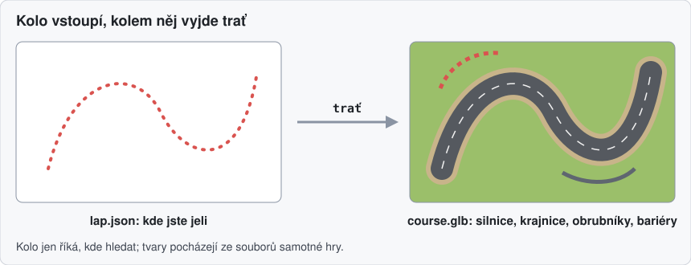
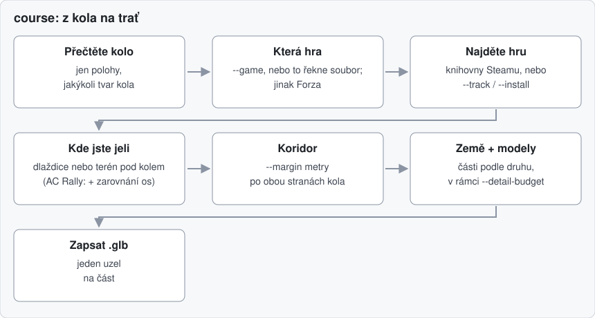

# Export trati {#course-export}

**Stručně:** najeli jste kolo; tohle z něj postaví 3D soubor trati, po které jste
jeli. Kolo je jen řada bodů; silnice, tráva a obruby pocházejí ze souborů hry.

`course` přemění kolo na trať: povrch v pásu po obou stranách místa, kudy auto
jelo, a to, co na tom povrchu stojí, jako jeden `.glb` pro prohlížeč. Tato stránka
popisuje to, co sdílí všechny tři podporované hry. Stránky pod ní popisují, v čem
se liší:

- [Forza Horizon](course-forza-horizon.md): archivy ForzaTech `.minizip`
- [BeamNG.drive](course-beamng.md): zip archivy, výškové pole terénu, zkompilované tvary
- [Assetto Corsa Rally](course-assetto-corsa-rally.md): Unreal 5 IoStore, etapa World Partition
- [Úrovně detailu a rozpočet](detail-budget.md): kolik trojúhelníků dostanou umístěné modely a které kopie zůstanou

## Kroky {#the-steps}

Použitá slova: **soustava** je to, kam ukazují osy; **koridor** je pás terénu po
obou stranách kola; **dlaždice** je jeden čtvercový kus terénu hry; **LOD**
(úroveň detailu) je jedna z jednodušších kopií modelu.

1. **Načtení kola.** Jen pozice z libovolného tvaru uvedeného v
   [Vstupy kola](lap-inputs.md). Rychlost a ovládání se nepoužívají. Kolo s méně
   než dvěma vzorky se odmítne ("holds no driving").
2. **Určení hry.** `--game`, potom pole `game` v souboru kola, potom Forza (viz
   [Příkazy](commands.md#which-game)).
3. **Nalezení nainstalované hry.** Všechny tři prohledají každou knihovnu Steamu
   uvedenou v `config\libraryfolders.vdf` ve Steamu. Forza navíc prohledá
   `C:\XboxGames`. `--track` (Forza) nebo `--install` (BeamNG, AC Rally) hledání
   přeskočí.
4. **Nalezení místa, kde se jelo.** Nikdy se nerozhoduje jen podle shody názvu.
   Forza vybere trať, jejíž dlaždice terénu pokrývají kolo. BeamNG vybere úroveň,
   na jejímž terénu (nebo silnicích) leží vzorky kola. AC Rally zkusí každou etapu
   v osmi osových orientacích a vybere tu, která na silnici položí nejvíc kola.
5. **Vyříznutí koridoru** `--margin` metrů na obě strany jízdy (níže).
6. **Vytvoření terénu** uvnitř koridoru, roztříděného na silnici, krajnici, štěrk
   a hlínu, terén, značení, stopy pneumatik nebo vodu, a zapečení textury terénu
   pro každý čtverec 512 m.
7. **Umístění modelů** stojících v koridoru, podle kategorie, na úrovni detailu
   zvolené podle vzdálenosti a rozpočtu trojúhelníků.
8. **Zápis `.glb`**: jeden pojmenovaný uzel na každou část. Viz [Formát výstupu](output-format.md).

Co běh vypíše, zde na syntetické instalaci BeamNG.drive, kterou vytvářejí testy,
kolo dlouhé 50 m po pásu silnice:

## Koridor {#the-corridor}

Řez je pás kolem projeté čáry, ne ohraničující kvádr kola. U okruhu jsou ty dva
skoro stejné. U sprintu z bodu A do bodu B je kvádr hlavně svah, kolem kterého
nikdo nejede, a pás může mít jen desetinu jeho plochy. Zdroj:
[`corridor.py`](https://github.com/Holdi601/3DHeat-GameFiles/blob/main/heat3d_gamefiles/corridor.py).

Jak se staví:

- Jízda se promítne na rovinu terénu: x a z kola (BeamNG: x a y vlastní soustavy
  hry).
- Rastruje se na mřížce buněk **4 m** (`CELL`). Každá buňka, které se jízda dotkne,
  se rozšíří kruhem o poloměru `margin + 4 m` na všechny strany.
- Po sobě jdoucí vzorky vzdálené méně než **50 m** (`JOIN`) se spojí body po 4 m,
  takže pás nemá mezery. Vzorky dál od sebe se berou jako oddělené úseky jízdy a
  nespojují se. Knihovní trať je mnoho souborů kol za sebou a cíl jednoho sprintu
  a start dalšího nesmí kreslit pás přes celou mapu.
- Trojúhelník se ponechá, pokud nějaký roh, střed hrany nebo jeho těžiště leží v
  pásu. Střední body chytí velký trojúhelník, který leží přes úzký pás, když jsou
  všechny jeho rohy mimo.
- Výška se do řezu nikdy nepočítá. Kvádr, který by omezoval nadmořskou výšku, by
  vyřízl zemi pod kopcem, na který silnice vystupuje.

Konzole vypíše plochu koridoru, například
`cutting 80 m either side of the driving: 1.53 km2 of a 6,000 by 3,600 m box`.

BeamNG a AC Rally navíc staví širší **dosah** koridoru o `margin + 60 m`. Umístěný
model se bere v úvahu, když jeho počátek leží v koridoru dosahu, a vykreslí se jen
tehdy, když jeho půdorys zasahuje do skutečného koridoru. Tak se nepřijde o dlouhý
objekt, jehož počátek leží těsně mimo pás. BeamNG koridor dosahu používá také k
výběru dekorací silnice, které se namalují.

## Z čeho je terén {#what-the-ground-is-made-of}

Každý export řadí trojúhelníky terénu do stejných druhů a každý druh se zapíše
jako vlastní část, aby ji prohlížeč mohl zobrazit nebo skrýt:

| Druh | Název části | Plochá barva (lineární RGB) | Forza | BeamNG | AC Rally |
|---|---|---|---|---|---|
| silnice | `ground:road` | 0,22, 0,22, 0,23 | pásy silnice: část asfaltu | vrstvy typu `ASPHALT`, dekorace silnice, modelovaná silnice | dlaždice trati (`/MeshesTrack/`) |
| krajnice | `ground:verge` | 0,52, 0,47, 0,30 | pásy silnice: rameno | chodníky a modely krajnic | - |
| štěrk a hlína | `ground:gravel and dirt` | 0,50, 0,42, 0,30 | - | vrstvy hlíny, štěrku, písku a bahna a dekorace | - |
| terén | `ground:terrain` | 0,30, 0,44, 0,18 | všechno ostatní | všechno ostatní | dlaždice `_Terrain` a vzdálený terén |
| obruby | `ground:kerbs` | 0,60, 0,12, 0,10 (Forza) | rekvizity `road_gen_rum*` | modely obrub, krajníků a vibračních pásů | modely obrub a krajníků |
| značení | `ground:markings` | 0,90, 0,90, 0,88 | podsítě dekorací, zvednuté o 5 cm | namalované do textury | - |
| stopy pneumatik | `ground:tyre marks` | 0,20, 0,17, 0,16 | podsítě dekorací, zvednuté o 5 cm | namalované do textury | - |
| voda | `water:water` | 0,16, 0,34, 0,48 | vodní materiály | rovina moře, vodní bloky, řeky | - |

Ploché barvy jsou zvolené tak, aby se daly přečíst na první pohled, ne aby
odpovídaly hře. Používají se u částí bez textury a v prohlížečích, které textury
ignorují. Zdroj:
[`surfaces.py`](https://github.com/Holdi601/3DHeat-GameFiles/blob/main/heat3d_gamefiles/surfaces.py).

Části terénu se dělí podle čtverců 512 m a každý čtverec nese vlastní zapečený
obrázek, takže názvy částí nesou čtverec:

| Hra | Název části terénu | Klíč čtverce |
|---|---|---|
| Forza | `ground:road x-2046 z1023` | název mřížky dlaždice terénu (kroky po 1023, viz [Forza Horizon](course-forza-horizon.md)) |
| BeamNG | `ground:road 3_-2` | `floor(x / 512)`, `floor(y / 512)` v metrech BeamNG |
| AC Rally | `ground:road 1_-4` | `floor(x / 51200)`, `floor(y / 51200)` v centimetrech Unreal |

## Co na tom stojí {#what-stands-on-it}

Umístěné modely se zapisují do částí pojmenovaných `structure:<category>`, nebo
`ground:kerbs` pro obruby (ve všech třech hrách). Když má část vlastní texturu,
název textury nebo materiálu následuje kategorii, například
`structure:barriers bar_armco_bclr`.

| Kategorie | Forza | BeamNG | AC Rally |
|---|---|---|---|
| svodidla | ano | ano | ano |
| rekvizity | ano | ano | ano |
| značky | ano | ano | ano |
| budovy | ano (celé budovy jako náhrady, kde je hra mají) | ano | ano |
| infrastruktura | ano | ano | ano |
| mosty | ano | ano | (zařazeny jako infrastruktura) |
| skály | ano | ano | ano |
| obruby | ano, jako terén | ano, jako terén | ano, jako terén |
| stromy | s `--trees` | s `--trees` | s `--trees` |
| rozbitné předměty | s `--trees` | - | - |

Rozdělení detailu je ve všech třech stejné. Kopie do 25 m od jízdy začínají na
plném detailu, kopie 25 až 60 m daleko o jednu úroveň hrubší a kopie dál na
nejhrubší úrovni. Pak se nejdražší modely zjednoduší, dokud se nevejdou do
rozpočtu trojúhelníků, a tam, kde nevejdou ani nejhrubší úrovně do rozpočtu, který
zadáte, se kopie vynechají. Obruby se nikdy nezjednodušují ani nevynechávají. Viz
[Úrovně detailu a rozpočet](detail-budget.md).

## Volby, které výsledek ovlivní {#options-that-shape-the-result}

| Chci | Použijte |
|---|---|
| menší soubor | `--no-textures` (ploché barvy), `--texture-size 1024` nebo `512`, `--detail-budget N`, `--margin 40` |
| jen terén | `--no-placed` |
| i scenérii | `--trees` |
| jiné roční období (Forza) | `--season winter` |
| hru mimo Steam | `--track` (Forza) nebo `--install` (BeamNG, AC Rally) |
| kolo, které hledání nenajde | `--level` (BeamNG, AC Rally), `--track` (Forza) |

## Souřadnice {#coordinates}

Každý export zapisuje metry s Y nahoru, v soustavě, do které se zaznamenané kolo
stejné hry trefí:

| Hra | Zapsaná soustava |
|---|---|
| Forza | vlastní světové souřadnice hry, beze změny |
| BeamNG | `(x, z, -y)` světa BeamNG se Z nahoru, což je rotace, kterou aplikuje záznamník telemetrie |
| AC Rally | soustava kola, nalezená přizpůsobením: centimetry Unreal se stanou metry a osy X a Y Unreal se stanou x a z kola v té z osmi orientací, která sedí |

Viz [Formát výstupu](output-format.md).
