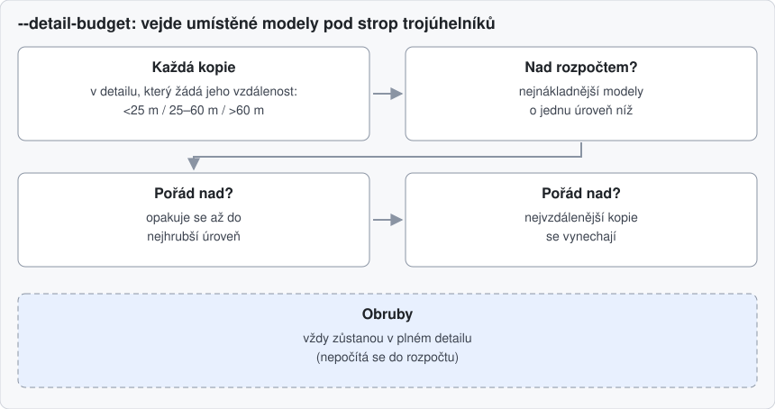

# Úrovně detailu a rozpočet {#levels-of-detail-and-the-budget}

**Trojúhelník** je malý plochý kousek 3D modelu. Čím víc trojúhelníků, tím větší a
pomalejší soubor. **Rozpočet** je limit, kolik jich smí být. **Úroveň detailu** je
jednodušší kopie modelu, která se použije, když je daleko.

Nejjemnější úroveň všeho, co se umísťuje kolem okruhu, má několik milionů
trojúhelníků. Například stovky segmentů svodidel a hromady pneumatik po zhruba
tisíci trojúhelnících každá. Městský koridor drží přes sto tisíc kopií. Proto každý
export trati dává umístěným modelům **rozpočet trojúhelníků** a pro každý model
rozhoduje, na které úrovni detailu se kreslí, a v případě potřeby které kopie
vynechat.

Schéma bylo napsáno pro Forzu
([`forzaplacement.py`](https://github.com/Holdi601/3DHeat-GameFiles/blob/main/heat3d_gamefiles/forzaplacement.py):
`choose_levels`, `auto_budget`, `_fit`) a BeamNG a AC Rally používají jeho části.
Terén se do rozpočtu nepočítá.

## Pásma vzdálenosti {#distance-bands}

Vzdálenost každé kopie od jízdy se měří v rovině terénu, k nejbližšímu vzorku kola.
Kolo se nejdřív zředí na nejvýše 1 000 bodů, což stojí pár metrů přesnosti a nic
podstatného. Kopie pak spadnou do tří pásem a každá dvojice (model, pásmo) se
rozpočítá zvlášť:

| Pásmo | Vzdálenost | Začíná na |
|---|---|---|
| blízko | pod 25 m (`NEAR`) | nejjemnější úrovni |
| střed | 25-60 m (`FAR`) | o jednu úroveň hrubší |
| daleko | 60 m a víc | nejhrubší úrovni |

Bez trasy (Forza `terrain --box`) se vzdálenost měří ke středu boxu.

## Snižování, aby se to vešlo {#stepping-down-to-fit}



Cena položky (model, pásmo) je počet kopií krát trojúhelníky na jejich aktuální
úrovni. Dokud je součet nad rozpočtem, položka, která stojí nejvíc, klesne o jednu
úroveň, a to se opakuje, dokud se součet nevejde, nebo dokud nejde klesnout dál.
Připnuté položky se nikdy nesnižují:

| Hra | Připnuto na plném detailu |
|---|---|
| Forza | obruby (`road_gen_rum*`) |
| BeamNG | obruby a každý tvar, který nese jízdní plochu |
| AC Rally | obruby |

Shrnutí Forzy to hlásí jako
`N of M models drawn at a coarser level to fit the budget`.

## Automatický rozpočet {#the-automatic-budget}

Bez `--detail-budget` si rozpočet nastaví sám tak, aby se **žádná kopie nevynechala**:

```
budget = max(1,500,000, 1.25 x sum(copies x coarsest level))
```

Připnuté položky se počítají na jejich nejjemnější úrovni. Těch 25 % (`HEADROOM`)
nechá věcem vedle silnice něco detailu. U venkovského okruhu je to dolní hranice
1,5 milionu (`DEFAULT_BUDGET`). U městské trati, kde koridor drží přes sto tisíc
kopií, vyroste přes deset milionů a soubor na několik set MB. Prohlížeč ho načte.

## Rozpočet, který zadáte {#a-budget-you-give}

`--detail-budget N` je **strop**. Úrovně se snižují jak je popsáno výše. Pokud se
nevejdou ani nejhrubší úrovně, kopie se vynechají:

| Hra | Pořadí, ve kterém se kopie vynechávají |
|---|---|
| Forza | nejdřív všechno 25 m a víc od jízdy, potom to, co stojí vedle silnice; uvnitř každé skupiny nejdřív to, co z silnice vypadá nejmenší: největší vzdálenost / velikost (velikost = úhlopříčka ohraničujícího kvádru modelu krát jeho největší měřítko, nejméně 0,25 m) |
| BeamNG | nejdál od jízdy nejdřív |
| AC Rally | nejdál od jízdy nejdřív, jako BeamNG |
| Battlefield 6 | nejmenší nejdřív: úhlopříčka ohraničujícího kvádru krát měřítko |

Obruby (a u BeamNG modely jízdní plochy) se nikdy nevynechávají, takže rozpočet
menší než jejich vlastní cena překročí jen ony a nic jiného.

Nástroj pro Forzu používá vzdálenost ku velikosti, protože podle samotné vzdálenosti
by klimatizační jednotka na zdi devět metrů daleko přežila fasádu dvacet metrů
vysokou, na které visí, dvanáct metrů daleko. Věci vedle silnice jdou na řadu
poslední bez ohledu na velikost, protože tři metry vysoké svodidlo pět metrů od
čáry je okraj trati, kdežto padesátimetrová budova šedesát metrů za ní je kulisa.

Shrnutí hlásí
`N of M copies left out to fit the budget, the smallest and furthest from the driving first (--detail-budget raises it)`
(Forza), nebo `N copies left out to fit the budget, the furthest from the driving first (--detail-budget raises it)`
(BeamNG, AC Rally).

## Celé budovy (Forza) {#whole-buildings-forza}

Náhrada celé budovy se počítá jako jedna kopie, se vzdáleností měřenou k nejbližší
hraně budovy. Ponechá se nebo vynechá jako celek. Modulární kusy, které nahrazuje,
se do rozpočtu vůbec nepočítají. Viz
[Forza Horizon](course-forza-horizon.md#buildings-drawn-whole).

## Co je úroveň detailu, podle hry {#what-a-level-of-detail-is-per-game}

| Hra | Úrovně pocházejí z |
|---|---|
| Forza | maska úrovní na trojúhelník u podsítí `Mesh` modelu (bit `level + 1`); `0xFFFF` rozbitné kusy jen u modelu bez označené úrovně |
| BeamNG | `details` tvaru `.cdae` s nezápornou velikostí, od největší; u `.dae` koncové číslo v názvech sítí uzlů (`barrier75`, `barrier40`) |
| AC Rally | uložené úrovně detailu statické sítě, od nejjemnější |
| Battlefield 6 | úrovně detailu MeshSet, od nejjemnější, počítají se jen vykreslované sekce (ne kopie pro stíny a hloubku), a nepočítá se poslední úroveň, která je náhradou pro vzdálený pohled (materiály `M_LastLod`, `M_Billboard`, `M_Vista`: mřížka stožáru by se stala plným hrotem) |

Úroveň `level` u Battlefieldu 6 nemá jízdu, takže nejsou žádná pásma vzdálenosti:
každá síť je jedna položka a každá kopie je na stejné úrovni. Automatický rozpočet
je výše uvedený vzorec s připnutou kulisou terénu; výškové pole je mimo rozpočet a
určuje ho `--ground-spacing`. Pod rozpočtem, který zadáte, když je každá síť na
nejhrubší úrovni, se kopie vynechávají od nejmenší, přičemž velikost je úhlopříčka
ohraničujícího kvádru sítě krát měřítko kopie, protože není jízda, od které by se
měřila vzdálenost. Kulisa terénu se nikdy nevynechá. Úroveň zabere automaticky asi
deset milionů trojúhelníků.

## Volba čísla {#choosing-a-number}

| Chcete | Zkuste |
|---|---|
| všechno, plný detail u silnice | nechat automaticky |
| soubor několikrát menší | `--detail-budget 500000` s `--texture-size 1024` |
| jen terén | `--no-placed` (rozpočet se nepoužije) |
