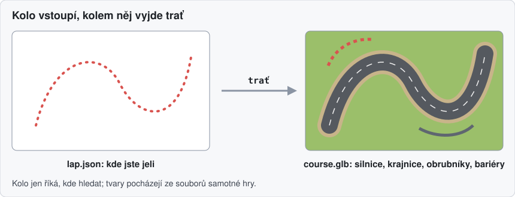
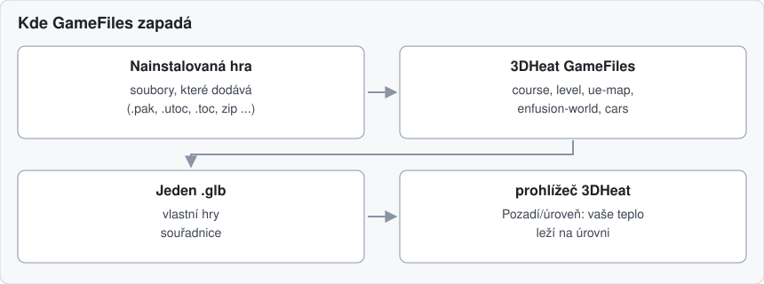

# 3DHeat GameFiles {#dheat-gamefiles}

**Co to je?** Nástroj, který sestaví 3D model závodní trati nebo herní úrovně
ze souborů hry, kterou už máte nainstalovanou.

**Proč ho používat?** Prohlížeč 3DHeat maluje, kde jste jeli nebo hráli, jako teplotní
mapu. S tímto nástrojem ji maluje na skutečnou trať nebo úroveň, ne do prázdného prostoru.

**Příklad:** vezměte kolo, které jste projeli. Nástroj kolem něj postaví silnici a terén
jako jeden 3D soubor, takže prohlížeč může malovat vaši rychlost nebo nehody na skutečné trati:



Nikdy jste nepracovali s příkazovým řádkem? Začněte na stránce [Než začnete](before-you-start.md).

Podrobněji: čte data úrovní z archivů, které hra přináší, a zapisuje je jako binární
glTF (`.glb`) soubor. Jeho hlavní úkol je **export trati**: dáte mu kolo a on zapíše
terén, silnici odlišenou od krajnice a trávy, a obrubníky, bariéry, pneumatikové zdi,
značky a budovy kolem ní.

Je součástí [3DHeat](https://github.com/Holdi601/3DHeat), prohlížeče
pro 3D telemetrické teplotní mapy v reálném čase, analýzu závodů a přehled zápasů
([dokumentace](https://holdi601.github.io/3DHeat/)). Soubory `.glb`, které tento
nástroj zapisuje, jsou úrovně, na které prohlížeč maluje teplotní mapu.



Je to jeden ze tří způsobů, jak dostat geometrii úrovně do 3DHeat:

| Cesta | Potřebuje | Dává |
|---|---|---|
| 3DHeat Unreal Exporter | projekt Unreal otevřený v editoru | přesnou geometrii |
| 3DHeat GameCapture | obrazovku a záznam | odhad |
| **3DHeat GameFiles** | **nainstalovanou, dodanou hru** | **přesnou geometrii, bez projektu** |

Python balíček: `heat3d_gamefiles`. Repozitář:
[Holdi601/3DHeat-GameFiles](https://github.com/Holdi601/3DHeat-GameFiles). Licence: MIT.

## Co umí {#what-it-can-do}

| Hra nebo engine | Export trati (`course`) | Čtení archivů |
|---|---|---|
| Forza Horizon (ForzaTech) | ano: terén, silnice a krajnice, textura země, umístěné modely ve vlastních texturách | `identify`, `list`, `extract` u `.minizip`; `identify` u `.modelbin`; modely, terén a textury přes `course` a `terrain` |
| BeamNG.drive | ano: terén, dekaly silnic, modelované okruhy, umístěné modely, voda | `identify`, `list`, `extract` u zipů úrovní; `identify` u `.ter`, `.cdae`; `.dae` přes `course` |
| Assetto Corsa Rally (Unreal 5.6) | ano: dlaždice terénu etapy, zapečená barva země, umístěné modely v plochých barvách | `identify`, `list`, `extract` u IoStore `.utoc`/`.ucas`; balíčky zen, statické sítě, textury přes `course` |
| Unreal `.pak` (verze 8–12) | ne | `identify`, `list`, `extract` |
| Unity (formát 22 a novější) | ne | `identify`, `meshes` |
| Battlefield 6 (Frostbite `.toc`/`.cas`) | bez tratě; celou úroveň přes `level`: terén, umístěné sítě, jejich barevné mapy s `--textures` | `identify`, `levels`; balíčky, sítě, terén, textury a umístění přes `level` |
| Source 2 `.vpk` | ne | `identify`, `list`, `extract` |
| Hry Unreal 5 s World Partition | bez tratě; celou mapu přes `ue-map` (vypisuje ji `ue-maps`): krajina, budovy HLOD a rekvizity, voda | - |
| Arma Reforger (Enfusion) | bez tratě; celý svět přes `enfusion-world` (vypisuje ho `enfusion-worlds`): terén v jeho barvách, moře, budovy jako krabice | - |
| Forza (auta) | `cars`: každé auto v nízkém detailu pro záložku Analýza závodu prohlížeče | - |

Kola z Assetto Corsa EVO a iRacing se odmítnou s uvedením důvodu. Viz
[Omezení a známé mezery](../limits-and-known-gaps.md).

## Instalace {#install}

Nikdy jste nepracovali s příkazovým řádkem? Nejdřív si přečtěte [Než začnete](before-you-start.md).

Potřebujete **Python 3.10 nebo novější** (vyvíjeno na 3.13) a balíčky z
[`requirements.txt`](https://github.com/Holdi601/3DHeat-GameFiles/blob/main/requirements.txt).

```
git clone https://github.com/Holdi601/3DHeat-GameFiles.git
cd 3DHeat-GameFiles
pip install -r requirements.txt
```

Pak ověřte: `python -m heat3d_gamefiles --help`. Měli byste vidět
`usage: heat3d_gamefiles [-h]` a seznam příkazů. Každý příkaz spouštějte ze složky
repozitáře jako `python -m heat3d_gamefiles <příkaz>`.

| Balíček | K čemu slouží |
|---|---|
| numpy | všechno, co dekóduje geometrii |
| lz4 | archivy Forza (většinou bloky LZ4), některé balíčky Unity, bloky LZ4 IoStore |
| Pillow | dekódování textur BC1–BC7, zápis JPEG textur do `.glb` |
| msgpack, zstandard | zkompilované tvary BeamNG (`.cdae`) |
| cryptography | jen pro otevření zašifrovaného `.pak` klíčem, který už máte |
| pytest | testy |

Obsah Unreal komprimovaný pomocí **Oodle** potřebuje knihovnu Oodle, která je už na vašem
počítači. Tento nástroj ji nikdy neobsahuje. Viz [Oodle](../reader-oodle.md).

Nástroj je psaný pro Windows. Hry hledá v seznamu knihoven Steamu a v `%LOCALAPPDATA%`
a Oodle načítá jako DLL pro Windows. Jiné platformy nebyly testovány.

## Rychlý start {#quick-start}

**Soubor kola** je záznam toho, kam jel váš vůz: seznam bodů x, y, z.
Pochází z [3DHeat GameCapture](https://github.com/Holdi601/3DHeat-GameCapture)
nebo z knihovny kol aplikace FH Companion; funguje i CSV psané ručně
([Vstupy kol](../lap-inputs.md)).

```
# Forza: soubor kola, složka kol, nebo název trati z knihovny FH Companion
python -m heat3d_gamefiles course "Example Circuit"
python -m heat3d_gamefiles course path\to\lap.json -o course.glb

# BeamNG.drive nebo Assetto Corsa Rally: soubor heat3d-lap říká, z které hry je
python -m heat3d_gamefiles course my_lap.json

# Každá trať z knihovny FH Companion, jeden .glb na trať
python -m heat3d_gamefiles courses -o courses

# Battlefield 6: vypište úrovně a pak exportujte jednu (velký soubor; viz Příkazy)
python -m heat3d_gamefiles levels
python -m heat3d_gamefiles level <level> -o level.glb --textures

# Unreal 5 s World Partition a Arma Reforger: vypište, pak exportujte
python -m heat3d_gamefiles ue-maps "<game>"
python -m heat3d_gamefiles ue-map "<game>" <map> -o map.glb
python -m heat3d_gamefiles enfusion-worlds
python -m heat3d_gamefiles enfusion-world <world> -o world.glb

# Každé auto Forza, pro záložku Analýza závodu prohlížeče
python -m heat3d_gamefiles cars -o forza.h3dcars

# Co je tento soubor?
python -m heat3d_gamefiles identify some_archive.pak
```

Otevřete `.glb` v prohlížeči 3DHeat. Souřadnice světa hry se zachovávají
(viz [Formát výstupu](../output-format.md)), takže zaznamenané kolo sedí na trati.

## Přehled dokumentace {#map-of-this-documentation}

- [Než začnete](before-you-start.md): Python, terminál, první příkaz.
- [Příkazy](../commands.md): každý příkaz a možnost, s příklady.
- [Přehled příkazů](../cli-reference.md): `--help` každého příkazu, vygenerováno z kódu.
- [Prohlížení archivů](../inspecting-archives.md): `identify`, `list`, `extract`, `meshes`, krok za krokem.
- [Export trati](../course-export.md): jak se kolo změní na trať, pro všechny hry.
  - [Forza Horizon](../course-forza-horizon.md)
  - [BeamNG.drive](../course-beamng.md)
  - [Assetto Corsa Rally](../course-assetto-corsa-rally.md)
  - [Úrovně detailu a rozpočet](../detail-budget.md)
- [Celé úrovně](../whole-levels.md): úroveň, mapa nebo svět bez kola.
  - [Úrovně Battlefield 6](../level-battlefield.md): `levels`, `level`
  - [Mapy Unreal 5](../level-unreal-world-partition.md): `ue-maps`, `ue-map`
  - [Světy Arma Reforger](../level-arma-reforger.md): `enfusion-worlds`, `enfusion-world`
- [Auta Forza](../forza-cars.md): `cars`, soubor aut pro záložku Analýza závodu prohlížeče.
- [Vstupy kol](../lap-inputs.md): každý tvar souboru kola, který nástroj přijímá.
- [Formát výstupu](../output-format.md): co je uvnitř `.glb`.
- [Čtečky archivů](../archive-readers.md): jedna stránka na každý kontejnerový formát, co čte,
  co nečte a proč.
- [Omezení a známé mezery](../limits-and-known-gaps.md)
- [Řešení potíží](../troubleshooting.md): chybová hlášení a co s nimi dělat.
- [Pravidla a licence](../rules-and-licences.md): žádné klíče, vaše vlastní soubory, žádné šíření.
- [Aktualizace](../updates.md): kontrola aktualizací a `heat3d_update`.
- [Vývoj](../development.md): přehled modulů a testy, včetně testů, které běží na nainstalovaných hrách.
- [Údržba](../maintaining.md): kontrolní seznam vydání těchto stránek.

## Součást 3DHeat {#part-of-3dheat}

3DHeat GameFiles je jeden z bezplatných nástrojů kolem prohlížeče 3DHeat:

| Nástroj | Co dělá | Dokumentace |
|---|---|---|
| [3DHeat](https://github.com/Holdi601/3DHeat) | prohlížeč: 3D teplotní mapy, analýza závodů a přehled zápasů v prohlížeči | [web](https://holdi601.github.io/3DHeat/) |
| [GameFiles](https://github.com/Holdi601/3DHeat-GameFiles) | tratě a úrovně ze souborů, které hra přináší, jako `.glb` | [web](https://holdi601.github.io/3DHeat-GameFiles/) |
| [GameCapture](https://github.com/Holdi601/3DHeat-GameCapture) | telemetrie kol ze závodních her; úrovně postavené z videa hry | [web](https://holdi601.github.io/3DHeat-GameCapture/) |
| [Unreal Exporter](https://github.com/Holdi601/3DHeat-UnrealExporter) | zásuvný modul pro Unreal Editor, který uloží úroveň jako `.glb` | [web](https://holdi601.github.io/3DHeat-UnrealExporter/) |
| [CS2](https://github.com/Holdi601/3DHeat-CS2) | dema Counter-Strike 2 do souborů zápasů; mapy do `.glb` | [web](https://holdi601.github.io/3DHeat-CS2/) |
| [Watcher](https://github.com/Holdi601/3DHeat-Watcher) | na pozadí zaznamenává vaši hru z toho, co hry zveřejňují | [web](https://holdi601.github.io/3DHeat-Watcher/) |
| [Ext-WarThunder](https://github.com/Holdi601/3DHeat-Ext-WarThunder) | replaye War Thunder do souborů zápasů | [web](https://holdi601.github.io/3DHeat-Ext-WarThunder/) |
| [Ext-WoT](https://github.com/Holdi601/3DHeat-Ext-WoT) | replaye World of Tanks do souborů zápasů | [web](https://holdi601.github.io/3DHeat-Ext-WoT/) |
| [Ext-WoWs](https://github.com/Holdi601/3DHeat-Ext-WoWs) | replaye World of Warships do souborů zápasů | [web](https://holdi601.github.io/3DHeat-Ext-WoWs/) |
| [Ext-Squad](https://github.com/Holdi601/3DHeat-Ext-Squad) | dema serverů Squad do souborů zápasů | [web](https://holdi601.github.io/3DHeat-Ext-Squad/) |
| [Ext-DCS](https://github.com/Holdi601/3DHeat-Ext-DCS) | mapy DCS World do úrovní `.glb` | [web](https://holdi601.github.io/3DHeat-Ext-DCS/) |
| [Ext-IL2](https://github.com/Holdi601/3DHeat-Ext-IL2) | mapy IL-2 Sturmovik do úrovní `.glb` | [web](https://holdi601.github.io/3DHeat-Ext-IL2/) |

Soubory zápasů prohlížeče jsou popsány na stránce
[Jeden soubor na zápas: `.3dheat`](https://holdi601.github.io/3DHeat/container.html);
úroveň vytvořená tady se načte vedle nich v panelu Pozadí / úroveň prohlížeče.
