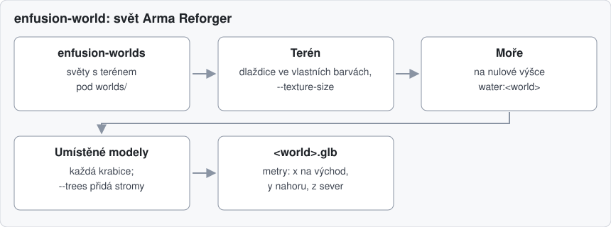

# Světy Arma Reforger: `enfusion-worlds` a `enfusion-world` {#arma-reforger-worlds-enfusion-worlds-and-enfusion-world}

**Co to je?** Celý svět Arma Reforger jako jeden 3D soubor. **Proč?** Aby teplo
z hry mělo pod sebou terén a budovy. (*Enfusion* je engine, ve kterém je Arma
Reforger vyrobena; *svět* je to, čemu hra říká mapa.)

Exportuje celý svět Enfusion nainstalované hry Arma Reforger: terén v barvách
vlastních dlaždic supertextury, moře a každý umístěný model jako kvádr, v metrech
hry.



## Krok za krokem {#step-by-step}

1. **Vypište světy**, které mají terén:

   ```
   python -m heat3d_gamefiles enfusion-worlds
   python -m heat3d_gamefiles enfusion-worlds --install "D:\Games\Arma Reforger"
   ```

2. **Exportujte jeden**, podle jeho názvu složky pod `worlds/`, jak je vypsán:

   ```
   python -m heat3d_gamefiles enfusion-world <world> -o world.glb
   ```

3. **Varianty:**

   ```
   python -m heat3d_gamefiles enfusion-world <world> --trees               # vegetation too, as boxes
   python -m heat3d_gamefiles enfusion-world <world> --texture-size 0      # flat colour, small file
   python -m heat3d_gamefiles enfusion-world <world> --ground-spacing 4 --no-structures
   ```

4. **Otevřete `world.glb`** v panelu Pozadí / úroveň prohlížeče 3DHeat ([načtení úrovně](https://holdi601.github.io/3DHeat/levels.html)).

## Volby {#options}

| Volba | Výchozí | Význam |
|---|---|---|
| `<world>` | povinné | svět, jak ho vypíše `enfusion-worlds` |
| `-o`, `--out FILE` | `<world>.glb` | soubor, který se zapíše |
| `--install FOLDER` | knihovna Steamu, která hru obsahuje | složka hry |
| `--ground-spacing METRES` | 2 (vlastní hodnota terénu) | rozestup vrcholů terénu v souboru |
| `--texture-size PIXELS` | 4096 | větší strana obrázku barvy povrchu; 0 pro ploché barvy |
| `--no-structures` | | nezahrnout umístěné modely |
| `--trees` | vypnuto | umístit i stromy a jinou vegetaci, jako kvádry |

## Příklad výstupu {#example-output}

```text
<world> -> world.glb
  ground      <n> triangles, <w> x <h> m; <n> of <n> tile-edge vertices disagree; colour <w> x <h>
  structure   <n> boxes from <n> entities
  water       <n> triangles (the sea)
  left out    <what>: <n>, ...
```

## Části {#the-parts}

`ground:<world>` (terén), `water:<world>` (moře, ve výšce nula) a
`structure:<world>` (kvádry). Souřadnice jsou hry vlastní: x na východ, y nahoru,
z na sever, v metrech, tedy co hlásí záznam přímo ve hře. Soustava hry je
levotočivá; *Převrátit osu světa* v prohlížeči ukáže, že se nezrcadlí.

## Jak se čte a kontroluje {#how-it-is-read-and-checked}

Není třeba Workbench a nic není šifrované.

| Formát | Co je to | Kontrolováno vůči |
|---|---|---|
| `.pak` | datový blok a stromový adresář, položky uložené nebo zlib | strom spotřebuje svůj blok přesně; vzorkované položky zlib se rozbalí přesně na uvedenou velikost |
| `.edds` | hlavička DDS, potom pro každou úroveň mipu bloky `COPY` nebo `LZ4 ` | rozdělené úrovně se dekódují přesně na svou velikost a spotřebují přesně svoje bajty |
| `.terr` / `.ttile` | hlavička a dlaždice 16bitových výšek | každá sdílená hrana dlaždic souhlasí přesně |
| supertextura | barva povrchu každé dlaždice, zhruba metr na pixel | sedí na moře ve výškách; žádné převrácení ani transpozice nesedí lépe |
| `.ent` | názvy, GUID zdrojů, potom entity jako typované hodnoty | soubor světa se naparsuje až do posledního bajtu |
| `resourceDatabase.rdb` | GUID na cestu | skoro každé GUID, které svět používá, jmenuje existující soubor |

Objekty označené jako stojící v absolutní výšce sedí do centimetrů na dekódovaném
terénu (s prohozenou mřížkou by byly o metry mimo). Nekreslí se: trojúhelníky
samotných modelů, stromy ve výchozím nastavení (`--trees` je přidá jako kvádry),
podřízené entity, jezera a řeky, textury s hlavičkami před DX10.

**Podmínky:** licence hry povoluje nekomerční použití a zakazuje reverzní
inženýrství herních souborů. Čtení vlastní instalace je vaše vlastní rozhodnutí podle
ní; výstup je pro vaše vlastní použití a nesdílí se.
