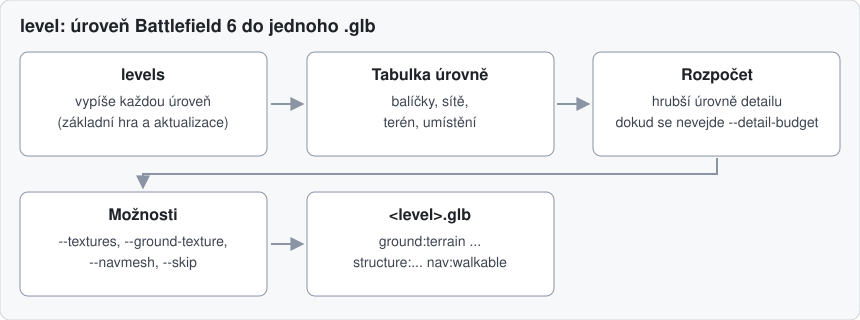

# Úrovně Battlefield 6: `levels` a `level` {#battlefield-6-levels-levels-and-level}

**Co to je?** Celá úroveň Battlefield 6 jako jeden 3D soubor. **Proč?** Aby teplo
z vašich zápasů mělo pod sebou terén a budovy. (*Frostbite* je engine, ve kterém
se Battlefield vyrábí; *výškové pole* je terén uložený jako mřížka výšek.)

Exportuje celou úroveň Frostbite nainstalované hry: výškové pole terénu, každou
síť, kterou její statické skupiny modelů umisťují, objekty umístěné jeden po
druhém, kulisu terénu kolem mapy a na přání barevné mapy povrchů, dekorace terénu
zapečené do země a choditelné povrchy vojáků.



## Krok za krokem {#step-by-step}

1. **Vypište úrovně**, které hra obsahuje:

   ```
   python -m heat3d_gamefiles levels
   python -m heat3d_gamefiles levels --install "D:\Games\<game folder>"
   ```

   Každý řádek je tabulka úrovně (`levels/<level>/<level>.toc`) s velikostí a
   odkud pochází: `Data` pro základní hru, `Update/<pack>` pro aktualizaci.

2. **Exportujte jednu** podle jejího názvu, jedinečné části názvu, nebo její cesty
   `.toc`. Začněte bez textur, abyste uviděli tvar a velikost:

   ```
   python -m heat3d_gamefiles level <level> -o level.glb
   ```

3. **Přidejte barvu**, až to bude vypadat správně:

   ```
   python -m heat3d_gamefiles level <level> -o level.glb --textures 512 --ground-texture 0.5
   ```

4. **Přidejte choditelné povrchy**, nebo zmenšete soubor:

   ```
   python -m heat3d_gamefiles level <level> --textures 512 --ground-texture 0.5 --navmesh
   python -m heat3d_gamefiles level <level> --textures 256 --detail-budget 3000000 --ground-spacing 8
   ```

5. **Otevřete `level.glb`** v panelu Pozadí / úroveň prohlížeče 3DHeat ([načtení úrovně](https://holdi601.github.io/3DHeat/levels.html)).

## Volby {#options}

| Volba | Výchozí | Význam |
|---|---|---|
| `<level>` | povinné | název, jak ho vypíše `levels`, jedinečná část názvu, nebo `.toc` úrovně |
| `-o`, `--out FILE` | `<level>.glb` | soubor, který se zapíše |
| `--install FOLDER` | nalezeno v knihovnách Steamu | složka hry |
| `--textures [PIXELS]` | vypnuto; bez velikosti 512 | barevná mapa každého povrchu, nejvýše PIXELS na stranu |
| `--ground-texture [METRES]` | vypnuto; bez velikosti 0,5 | zapéct silnice, plochy a značení do barvy země, METRES na pixel |
| `--navmesh` | vypnuto | přidat navigační síť vojáka jako `nav:walkable` |
| `--ground-spacing METRES` | 4 | nejjemnější rozestup výškového pole; 0 ho vynechá |
| `--detail-budget N` | nejhrubší kopie plus čtvrtina, nejméně 1 500 000 | strop trojúhelníků (terén se nikdy nezhrubne) |
| `--skip TEXT` | | vynechat skupiny modelů, jejichž název oddílu obsahuje TEXT; lze opakovat |
| `--by-mesh` | vypnuto | jedna část na zdrojovou síť a materiál, pro zjištění, co část je |
| `--clamped-uvs` | vypnuto | pro renderery, které neumějí textury opakovat |

Úplná tabulka s velikostmi, které čekat (celá úroveň má stovky MB), je na
[Příkazy](commands.md#levels-and-level-frostbite). Jak se čtou tabulky, bundly,
sítě a terén, je na [Frostbite](reader-frostbite.md).

## Příklad výstupu {#example-output}

Co vypíše `level`, v hrubých rysech (řádky tak, jak je zapisuje kód; `<n>` a názvy
se u úrovní liší):

```text
<n> copies of <n> meshes, from <n> static model groups
      <n>  <group>
      <n>  placed one by one (object and prefab references)
<n> meshes left out: <why>
<n> triangles, budget <n>; <n> meshes drawn at a coarser level to fit
           <n>  ground:terrain
           <n>  structure:buildings, <n> textures
           ...
<n> of <n> drawn sections carry their colour map; the rest are flat colours
Ground: <what the ground is>.
Navigation mesh: <tiles read>.
-> level.glb (<n> MB)
```

## Části {#the-parts}

`ground:terrain` (výškové pole), `ground:terrain backdrop` a
`ground:terrain blend`, `structure:<kind>` pro každý druh sítě (pro každou barevnou
mapu s `--textures`, s ` (destructible)` u toho, co může zápas zničit), a
`nav:walkable` s `--navmesh`. Viz [Formát výstupu](output-format.md).

Soubor obsahuje obsah hry: je určen pro počítač, na kterém vznikl, a ne pro
předávání dál ([Pravidla a licence](rules-and-licences.md)).
