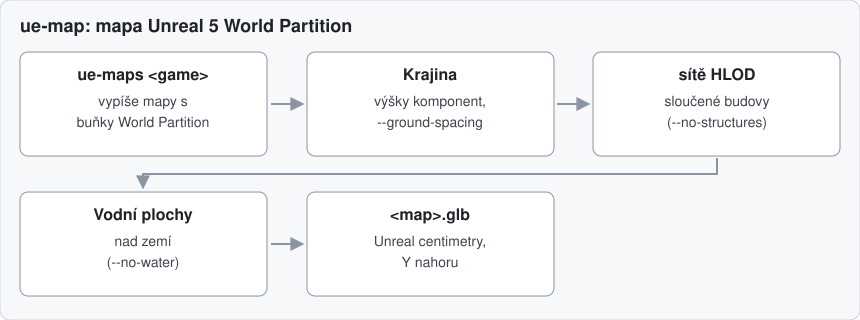

# Mapy Unreal 5 World Partition: `ue-maps` a `ue-map` {#unreal-5-world-partition-maps-ue-maps-and-ue-map}

**Co to je?** Celá mapa hry Unreal 5 jako jeden 3D soubor: terén, budovy a voda.
**Proč?** Aby teplo z té hry mělo pod sebou mapu. (*World Partition* je způsob, jak
Unreal 5 rozdělí velkou mapu na kusy; *HLOD* je zjednodušená náhrada za skupinu
budov, kterou hra kreslí zdaleka.)

Exportuje celou mapu hry Unreal 5, jejíž mapy jsou zapečeny jako buňky World
Partition: krajinu, sloučené sítě HLOD mapy (její budovy a rekvizity tak, jak je
hra kreslí zdaleka) a její vodní plochy. Nepotřebujete editor ani projekt, jen
nainstalovanou hru.



## Krok za krokem {#step-by-step}

1. **Vypište mapy.** `<game>` je složka hry, její `Content/Paks`, nebo název její
   složky v knihovně Steamu:

   ```
   python -m heat3d_gamefiles ue-maps "<Steam game folder name>"
   python -m heat3d_gamefiles ue-maps "D:\Games\<game>"
   ```

   Každá mapa se zapečenými buňkami World Partition se vypíše s cestou k balíčku.

2. **Exportujte jednu** podle jejího názvu nebo jedinečné části názvu:

   ```
   python -m heat3d_gamefiles ue-map "<game>" <map> -o map.glb
   ```

3. **Jen země, nebo hrubší:**

   ```
   python -m heat3d_gamefiles ue-map "<game>" <map> --no-structures --no-water
   python -m heat3d_gamefiles ue-map "<game>" <map> --ground-spacing 4
   ```

4. **Otevřete `map.glb`** v panelu Pozadí / úroveň prohlížeče 3DHeat
   ([načtení úrovně](https://holdi601.github.io/3DHeat/levels.html)).

## Volby {#options}

| Volba | Výchozí | Význam |
|---|---|---|
| `<game>` | povinné | složka hry, její `Content/Paks`, nebo název její složky Steamu |
| `<map>` | povinné | název, jak ho vypíše `ue-maps`, nebo jedinečná část názvu |
| `-o`, `--out FILE` | `<map>.glb` | soubor, který se zapíše |
| `--ground-spacing METRES` | 2 | rozestup vrcholů krajiny, zaokrouhlený na celý počet jejích vlastních čtverců |
| `--no-structures` | | vynechat budovy a rekvizity HLOD |
| `--no-water` | | vynechat vodní plochy |

Obsah komprimovaný Oodle potřebuje knihovnu Oodle, která už je v počítači (viz
[Oodle](reader-oodle.md)).

## Příklad výstupu {#example-output}

```text
<map> -> map.glb
  ground      <n> triangles from <n> landscape components; <n> of <n> vertices stored twice disagree
  structure   <n> triangles in <n> HLOD meshes
  water       <n> triangles from <n> water bodies
```

Počet nesouhlasů je vlastní kontrola: sousední komponenty krajiny ukládají svou
společnou hranu dvakrát a obě kopie se musí shodovat. Mapa 3 km při 2 m má zhruba
4,6 milionu trojúhelníků terénu.

## Části {#the-parts}

`ground:<map>` (krajina), `structure:<map>` (sítě HLOD) a `water:<map>` (voda nad
terénem).

**Jednotky:** toto je jediný export **ne v metrech**: centimetry Unreal, s prohozenými
osami Y a Z (Y nahoru), soustava, kterou zapisuje 3DHeat Unreal Exporter.
Telemetrie ze stejné hry používá stejnou soustavu, takže sedí na mapě.

## Jak se čte a kontroluje {#how-it-is-read-and-checked}

| Část | Čte se z | Kontrolováno vůči |
|---|---|---|
| terén | 16bitová výšková mapa každé komponenty krajiny, umístěná podle základu její sekce na transformaci krajiny | každý vrchol uložený dvakrát (na švu nebo hraně komponenty) se musí shodovat; nesouhlasy se počítají a vypisují, nevyhlazují se |
| struktury | sloučené sítě HLOD mapy, které motor postaví ve světových souřadnicích | síť se ponechá jen tehdy, když hranice, které její komponenta uchovává, popisují její vlastní vrcholy |
| voda | síť každé vodní plochy, položená na mřížku terénu, ponechaná tam, kde stojí nad terénem | voda leží několik metrů nad terénem pod ní, jako řeka nad svým korytem |

Vlastnosti krajiny se hledají podle tvaru, ne podle čísla slotu (sloty se mezi
verzemi enginu posouvají). Struktury jsou zjednodušené náhrady, ne plné modely.
Vegetace, dekorace a materiály krajiny se neexportují; země je bez textury a
stínuje ji prohlížeč. Podrobnosti o archivech:
[Unreal 5 IoStore](reader-unreal-iostore.md).

**Vlastní soubory:** mapa se čte ze hry nainstalované ve vašem počítači a zapisuje
se na váš disk pro vaši vlastní analýzu; nic ze hry se s tímto nástrojem nedodává.
