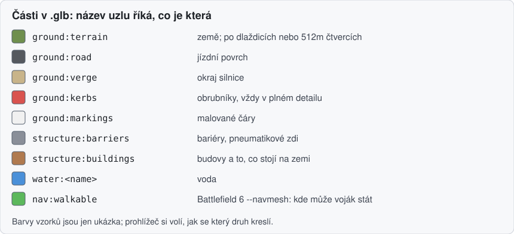

# Výstupní formát {#output-format}

Soubor `.glb` je jeden 3D soubor: země, budovy a voda trati nebo herní úrovně, který otevřete v panelu Pozadí / úroveň prohlížeče 3DHeat.

Každý export (`course`, `courses`, `terrain`, `level`, `ue-map`, `enfusion-world`) zapíše jeden soubor **binární glTF 2.0** (`.glb`). Je záměrně malý a plochý a uspořádaný tak, jak prohlížeč 3DHeat čte úroveň. Zdroj:
[`glb.py`](https://github.com/Holdi601/3DHeat-GameFiles/blob/main/heat3d_gamefiles/glb.py).

## Struktura {#structure}

```
scene 0
 ├─ node "ground:terrain x-2046 z1023"  -> mesh 0 -> 1 primitive, material 0
 ├─ node "ground:road x-2046 z1023"     -> mesh 1 -> 1 primitive, material 1
 ├─ node "ground:markings"               -> mesh 2 -> ...
 ├─ node "ground:kerbs road_gen_rum_..." -> ...
 ├─ node "structure:barriers bar_armco_bclr"
 └─ ...
```

- **Jeden uzel na část**, všechny v kořeni scény, **bez transformací**. Veškerá geometrie je už ve světových souřadnicích.
- Každý uzel má vlastní mesh s **jedním primitivem** a vlastní materiál. Uzel, mesh i materiál nesou název části.
- Každé primitivum má **vlastní kompaktní pole vrcholů**, jen ty vrcholy, které část používá. Sdílené pole vrcholů je v glTF legální, ale čtečka, která rozbaluje přístupy každého primitiva, by pak držela každý vrchol tolikrát, kolik částí ho používá.
- `asset.generator` je `heat3d_gamefiles`.
- **Málo `extras`** a žádný název hry, tratě ani trasy:
  - část rozbitného meshe Battlefield 6 nese na svém uzlu `{"destructible": true}`;
  - trať Forzy říká, co obsahuje, v `asset.extras` (číslo formátu, id odpovídající trasy, kolik kopií vlastní vrstvy závodu, místa konání; viz [Trati Forza Horizon](course-forza-horizon.md#writing-the-file)), a její zapnuté části nesou svou vrstvu na uzlu: `{"layer": "event", "route": <id>}` pro vlastní vrstvu závodu, `{"layer": "layer"}` pro jinou zapnutou vrstvu, `{"layer": "venue"}` pro zemi místa konání.

  Všechno ostatní, co prohlížeč potřebuje, je v názvech uzlů.

## Klasifikace názvů uzlů {#node-names-the-classification}



Prohlížeč bere třídu části z **názvu uzlu** (jinak z názvu meshe) a jen tehdy, když odpovídá

```
^(ground|structure|water)\s*[:|]
```

Cokoli jiného se třídí heuristikou napsanou pro krajiny Unreal. Každá část, kterou exportér zapíše, proto začíná jednou z těchto předpon, nebo `nav:` (níže):

| Předpona | Význam | Zapsané části |
|---|---|---|
| `ground:` | povrch jízdy a země | `ground:road`, `ground:verge`, `ground:terrain`, `ground:gravel and dirt`, `ground:kerbs`, `ground:markings`, `ground:tyre marks`, `ground:venue`, `ground:plinths` |
| `structure:` | to, co na tom stojí | `structure:barriers`, `structure:props`, `structure:signs`, `structure:buildings`, `structure:infrastructure`, `structure:bridges`, `structure:rocks`, `structure:smashables`, `structure:trees`; vrstvy Forzy `structure:event_<category>` a `structure:layer_<category>` |
| `water:` | voda | `water:water`; `water:<map>` (`ue-map`), `water:<world>` (`enfusion-world`) |
| `nav:` | kam může voják jít (Battlefield 6, jen `--navmesh`) | `nav:walkable` |

`nav:` neodpovídá výše uvedenému vzoru prohlížeče, takže ho prohlížeč zařadí podle své heuristiky. Je to samostatná část, abyste ji mohli ukázat nebo skrýt zvlášť. `ue-map` zapisuje `ground:<map>`, `structure:<map>` a `water:<map>`; `enfusion-world` zapisuje `ground:<world>`, `structure:<world>` a `water:<world>`.

Za druhem následuje podle hry:

| Příklad | Význam |
|---|---|
| `ground:road x-2046 z1023` | země Forzy v dlaždici terénu `x-2046 z1023` (jednotky mřížky, 1023 na 512 m) |
| `ground:road 3_-2` | země BeamNG ve čtverci 512 m (3, -2) |
| `ground:road 3_-2 asphalt_light` | modelovaný povrch jízdy BeamNG materiálu `asphalt_light` v tom čtverci |
| `ground:road 1_-4` | země AC Rally ve čtverci 512 m (1, -4) v prostoru Unreal |
| `structure:barriers bar_armco_bclr` | umístěné modely Forzy sdílející jednu texturu (jejich název bez GUID) |
| `structure:barriers` | umístěné modely bez textury (Forza, AC Rally) |
| `structure:event_barriers bar_example_bclr` | Forza: co pro sebe vydává odpovídající závod, odděleně od volného světa (extras uzlu `{"layer": "event", "route": <id>}`) |
| `structure:layer_props` | Forza: vrstva, kterou hra zapíná pro něco jiného než tento závod (aktivita, sběratelský předmět, běhová vrstva) |
| `ground:venue`, `ground:plinths` | Forza: modely už ve světových souřadnicích: vlastní země místa konání (podlaha stadionu) a země, kterou je ulice ozdobena |
| `structure:barriers armco_metal` | modely BeamNG jednoho materiálu |
| `ground:markings`, `water:water` | ploché části, jedna pro celý soubor |
| `ground:terrain` (Battlefield 6) | výšková mapa; `ground:terrain backdrop` vzdálené terénní meshe, `ground:terrain blend` meshe, které splývají s terénem |
| `nav:walkable` (Battlefield 6, `--navmesh`) | navigační mesh úrovně pro vojáka: kde lze stát, plochá zelená |
| `ground:terrain x-512 z-512` (Battlefield 6, `--ground-texture`) | výšková mapa pod jednou zapečenou dlaždicí dekálů, pojmenovaná podle jejího nízkého rohu v metrech |
| `structure:buildings t_concreteclean_01_cs` (Battlefield 6, `--textures`) | každý povrch tohoto druhu, který ukazuje tuto barevnou mapu; bez `--textures` jedna část na druh, bez přípony |
| `structure:buildings t_concreteclean_01_cs (destructible)` (Battlefield 6) | totéž, pro meshe, které může zápas zničit: ty s destrukčním assetem vlastního názvu (zdi, domy, rekvizity). Uzel také nese extras glTF `{"destructible": true}`. Jejich zničené stavy se neexportují |

Prohlížeč může názvy filtrovat. Například „jen závodní povrch“ je `ground:road` spolu s `ground:kerbs`, ve všech třech hrách, a „svět bez rekvizit vlastního závodu“ je všechno kromě `structure:event_*`. Předpona je také to, jak prohlížeč kreslí část: země jako povrch, na kterém leží teplo, a struktury jako to, co na něm stojí.

## Jednotky, osy a rámec {#units-axes-and-frame}

- **Metry, Y nahoru**, konvence glTF, pro každý export kromě `ue-map`. Nic se nepřeškáluje ani nepřesouvá: čísla jsou světové souřadnice hry, což je smysl čtení archivu místo rekonstrukce.
- **Mapy Unreal 5 (`ue-map`): centimetry**, vlastní jednotka Unreal, s prohozenými osami Y a Z, takže Y je nahoru. Je to rámec, který zapisuje 3DHeat Unreal Exporter, a který používá telemetrie hry. Jediný export, který není v metrech.
- **Arma Reforger (`enfusion-world`):** vlastní metry hry, x na východ, y nahoru, z na sever. Herní rámec je levotočivý; prohlížečová volba *Převrátit osu světa* ukáže, že obraz není zrcadlově převrácený.
- **Forza:** vlastní světové souřadnice hry (x, y nahoru, z), beze změny. Stejné jako telemetrie, takže zaznamenané kolo leží na trati.
- **BeamNG.drive:** `(x, z, -y)` světa BeamNG s osou Z nahoru, což je otočení, které použije nahrávač telemetrie. Otočení, ne zrcadlení.
- **Battlefield 6:** vlastní světové souřadnice hry (x, y nahoru, z), beze změny: transformace instancí úrovně použité na každý mesh tak, jak je uložen. Zrcadlené kopie se znovu navinou, aby jejich normály směřovaly ven.
- **Assetto Corsa Rally:** rámec kola. Centimetry Unreal se stanou metry, Z Unreal se stane y, a X a Y Unreal se stanou x a z v té z osmi orientací, do které kolo sedlo (viz [Assetto Corsa Rally](course-assetto-corsa-rally.md#which-stage-and-which-way-round)). Trojúhelníky se znovu navinou tam, kde toto mapování zrcadlí.

Každý export zachovává osy, které používá jeho telemetrie, takže záznam a úroveň sdílejí rámec. Zda je rámec v každé hře levotočivý, nebo pravotočivý, nebylo ověřeno.

## Data vrcholů {#vertex-data}

Výchozí je **kvantizovaná** podoba (`quantize=True`). Potřebuje rozšíření `KHR_mesh_quantization`, které je uvedeno jak v `extensionsUsed`, tak v `extensionsRequired`.

| Atribut | Kvantizovaný (výchozí) | Plná přesnost (`quantize=False`) |
|---|---|---|
| `POSITION` | float32 VEC3, s min/max | float32 VEC3 |
| `NORMAL` | int8 VEC3 normalizovaný, doplněný na 4 bajty (krok 4) | float32 VEC3 |
| `TEXCOORD_0` (jen texturované části) | uint16 VEC2 normalizovaný, oříznutý na 0-1; float32 VEC2 tam, kde se textury opakují (Battlefield 6) | float32 VEC2 |
| `COLOR_0` (netexturované části, pokud nějaká část barvu má) | uint8 VEC3 normalizovaný, doplněný na 4 bajty | float32 VEC3 |
| indexy | uint16, pokud část má nejvýš 65,535 vrcholů, jinak uint32 | uint32 |

Vrchol má 20 bajtů místo 32 (24 místo 44 s barvou). Soubor je tím o třetinu menší pro každou scénu, a je to rozdíl mezi tím, že se městský okruh načte v záložce prohlížeče, a tím, že se nenačte. Cena je méně než půl stupně normály a 1/65,535 UV (patnáctina texelu na 4,096 px). Příkazová řádka vždy zapisuje kvantizovanou podobu. `write_glb(..., quantize=False)` v Pythonu zapíše tu druhou.

Normály pocházejí od hry tam, kde je hra ukládá (terén a modely Forzy, tvary a terén BeamNG). Jinak se počítají jako hladké normály vážené plochou z trojúhelníků. Normály AC Rally se vždy počítají.

## Materiály, barvy a textury {#materials-colours-and-textures}

- Každý materiál má `metallicFactor 0`, `roughnessFactor 1`.
- **Texturovaná část:** `baseColorTexture` s obrázkem části, UV a bez barvy vrcholu. glTF je vynásobí, takže by povrch vyšel dvakrát ztmavený.
- **Netexturovaná část:** barva vrcholu `COLOR_0` s plnou barvou části a bílý `baseColorFactor`. Pokud žádná část v souboru nemá barvu, `COLOR_0` není. Kde části sdílejí vrcholy, vyhrává barva pozdější části, takže ploché části se zapisují v pořadí rostoucí důležitosti.
- **Obrázky** jsou vložené do binárního bloku jako **JPEG**, kvalita 90, bez podvzorkování chrominance, jen RGB (alfa se zahodí). Výjimkou je výřezová mapa Battlefield 6 (listí, ploty), která je **PNG** s alfou, na materiálu s `alphaMode` MASK, `alphaCutoff` 0.5 a `doubleSided` (viz [Frostbite](reader-frostbite.md#textures-and-materials)). Prohlížeč 3DHeat zahazuje texely pod prahem. Zemní textura 2048 px s trávou a korunami stromů je pro bezeztrátový kodek šum: několik megabajtů na dlaždici jako PNG, pod jeden jako JPEG. Obrázek sdílený více částmi se uloží jednou.
- Jeden vzorkovač pro všechny textury: lineární zvětšování, lineárně-mipmapové zmenšování, **ořez na okraj** na obou osách, pro exporty tratí, jejichž textury pokrývají povrchy jednou. BeamNG kreslí opakující se modelové textury jako plné barvy (viz [BeamNG.drive](course-beamng.md#placed-models)).
- Battlefield 6 export s `--textures`, jehož materiály se dlaždí, zapíše vlastní souřadnice textury hry, neořezané, jako float32 `TEXCOORD_0` i v kvantizované podobě, se vzorkovačem, který se **opakuje** na obou osách (`write_glb(..., repeat=True)`): cihlová zeď je jeden pár trojúhelníků, jehož UV běží od 0 do 40. Prohlížeč 3DHeat takovou texturu zabalí do svého atlasu (viz jeho stránka *Model levels*). Pro renderer, který texturu opakovat neumí, `level --clamped-uvs` (`write_level(..., clamped=True)`) rozřeže každý trojúhelník podél čar, kde se jeho textura opakuje, a přesune každý kus do 0..1: stejné pixely na stejném povrchu, asi o pětinu více trojúhelníků. Trojúhelníky, přes které se textura opakuje víc než 16krát, si nechají své souřadnice. Trojúhelník, který by jeho textura rozřezala na víc než 4 kusy (kůra, která se opakuje podél každé větve stromu; řez proměnil 1,099 trojúhelníků jednoho stromu v 51,735), jde do vlastní části `<part> (average colour)` v průměrné barvě textury; `level` říká, kolik jich je.

| Textura | Velikost | Pokrývá |
|---|---|---|
| země (všechny hry kromě Battlefield 6) | `--texture-size`: 2048, 1024 nebo 512 px | jeden čtverec 512 m: 25, 50 nebo 100 cm na pixel |
| Battlefield 6 výšková mapa | největší mip barevné mapy pozadí v úrovni, oříznutý | čtverec terénu: 32 m na pixel u kontrolované úrovně |
| Battlefield 6 povrchy | `--textures`: nejvýš tolik px na stranu | vlastní textura povrchu, jednou na kus (řezaná tam, kde se opakuje) |
| Battlefield 6 zapečená země | `--ground-texture`: metry na pixel, dlaždice nejvýš 4,096 px | jedna dlaždice rozsahu dekálů: 2,048 m při 0.5 m na pixel |
| Forza umístěný model | nejvýš 256 px | vlastní rozložení UV modelu |
| BeamNG umístěný model | nejvýš 256 px | vlastní rozložení UV modelu, jen kde se neopakuje |
| AC Rally umístěný model | žádná | plné barvy |

## Co zapisovač odmítá {#what-the-writer-refuses}

`write_glb` vyvolá chybu, místo aby zapsal soubor, který by prohlížeč otevřel a ukázal špatně:

| Odmítnuto | Protože |
|---|---|
| pozice nejsou N x 3, nebo nejsou konečné | rozbitý mesh |
| index za koncem seznamu vrcholů | vykreslí se jako šum |
| texturovaná část, když soubor nemá UV | vykreslí se jako jeden rozmazaný pixel |
| žádné trojúhelníky | vykreslí se jako nic |
| pole normál, barev nebo UV se špatnou délkou, nebo nekonečné | potřebuje se jedno na vrchol |

## Čtení jinde {#reading-it-elsewhere}

Každý prohlížeč glTF 2.0, který podporuje `KHR_mesh_quantization`, by tyto soubory měl otevřít. Ověřen je jen prohlížeč 3DHeat; ostatní prohlížeče nejsou ověřené. Čtečka bez tohoto rozšíření soubor odmítne, protože je označen jako vyžadovaný. Soubory mohou být velké: asi 80 MB pro okruh v zemi, až několik set MB pro městskou trať s automatickým rozpočtem.

## V 3DHeat {#in-3dheat}

Načtěte `.glb` v panelu Pozadí / úroveň prohlížeče [3DHeat](https://github.com/Holdi601/3DHeat); telemetrie, kterou nahrajete ve stejné hře, na něm leží, protože obě strany zachovávají souřadnice hry. Vlastní dokumentace prohlížeče
([holdi601.github.io/3DHeat](https://holdi601.github.io/3DHeat/)) popisuje panel Pozadí / úroveň a soubory záznamů, které zapisují ostatní nástroje
([One file a match: `.3dheat`](https://holdi601.github.io/3DHeat/container.html)).
Úroveň se neukládá do každého souboru `.3dheat`: záznam ji pojmenuje ve svém `references` (`kind: "level"`, název a sha256) a `.glb` zůstává vedle záznamů.
