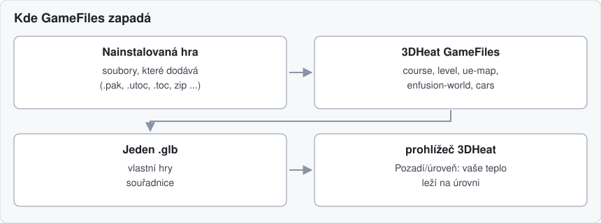

# Celé úrovně {#whole-levels}

**Stručně:** u střílecích her a dalších her bez kol nástroj uloží celou mapu jako jeden 3D soubor, aby prohlížeč mohl ukázat, kde hráči chodili.

`course` vyřízne zem kolem kola. U her bez kol nástroj exportuje celou úroveň, mapu nebo svět najednou:

| Hra nebo engine | Seznam | Export | Stránka |
|---|---|---|---|
| Battlefield 6 (Frostbite) | `levels` | `level <level>` | [Úrovně Battlefield 6](level-battlefield.md) |
| Hry Unreal 5 s World Partition | `ue-maps <game>` | `ue-map <game> <map>` | [Mapy Unreal 5](level-unreal-world-partition.md) |
| Arma Reforger (Enfusion) | `enfusion-worlds` | `enfusion-world <world>` | [Světy Arma Reforger](level-arma-reforger.md) |

Každá dvojice funguje stejně: první příkaz vypíše, co nainstalovaná hra obsahuje. Druhý zapíše jednu z nich jako jediný `.glb` ve vlastních světových souřadnicích hry, takže pozice zaznamenané v té hře na něm leží. Části se jmenují `ground:`, `structure:` a `water:`, jako každý jiný export (viz [Formát výstupu](output-format.md)). Soubor načtěte v panelu **Pozadí / úroveň** vieweru 3DHeat.

