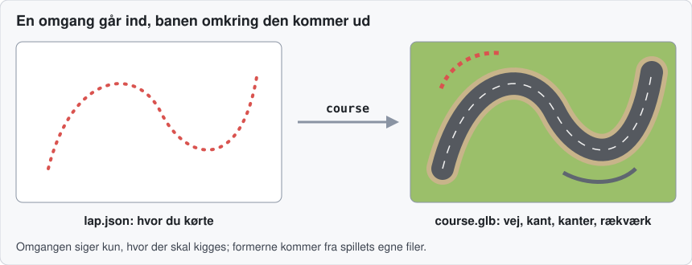
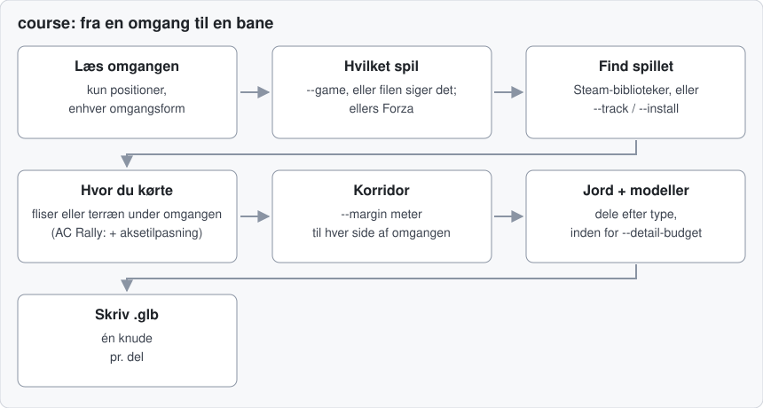

# Course-eksport {#course-export}

**Med almindelige ord:** du kørte en runde; det her bygger den bane, du kørte på, som en 3D-fil. Runden er kun en linje af punkter; vejen, græsset og kantstenene kommer fra spillets egne filer.

`course` gør en runde til en bane: jorden i et bælte på hver side af, hvor bilen kørte, og det, der står på jorden, som én `.glb` til viewer'en. Denne side dækker det, alle tre understøttede spil har tilfælles. Siderne under den dækker det, der adskiller dem:

- [Forza Horizon](course-forza-horizon.md): ForzaTech `.minizip`-arkiver
- [BeamNG.drive](course-beamng.md): zip-arkiver, et højdefelt for terrænet, kompilerede former
- [Assetto Corsa Rally](course-assetto-corsa-rally.md): Unreal 5 IoStore, en World Partition-etape
- [Detaljeniveauer og budgettet](detail-budget.md): hvor mange trekanter de placerede modeller får, og hvilke kopier der bliver

## Trinene {#the-steps}

Ord brugt herunder: en **frame** er, hvilken vej akserne peger; **korridoren** er bæltet af jord på hver side af runden; en **flise** er ét kvadratisk stykke af et spils terræn; et **LOD** (detaljeniveau) er en af en models enklere kopier.

1. **Læs runden.** Kun positioner, fra en af formerne i [Rundeinput](lap-inputs.md). Hastighed og input bruges ikke. En runde med færre end to punkter afvises ("holds no driving").
2. **Bestem spillet.** `--game`, derefter rundefilens egen `game`, derefter Forza (se [Kommandoer](commands.md#which-game)).
3. **Find det installerede spil.** Alle tre søger i hvert Steam-bibliotek, der er angivet i Steams `config\libraryfolders.vdf`. Forza søger også i `C:\XboxGames`. `--track` (Forza) eller `--install` (BeamNG, AC Rally) springer søgningen over.
4. **Find hvor runden blev kørt.** Det afgøres aldrig af et navnematch alene. Forza vælger den bane, hvis terrænfliser dækker runden. BeamNG vælger det niveau, hvis terræn (eller veje) rundens punkter ligger på. AC Rally prøver hver etape i otte akseretninger og vælger den, der lægger mest af runden på vejen.
5. **Skær en korridor** på `--margin` meter til hver side af kørslen (nedenfor).
6. **Byg jorden** inde i korridoren, klassificeret som vej, kant, grus og jord, terræn, markeringer, dækspor eller vand, og bag en jordtekstur for hvert 512 m kvadrat.
7. **Placer modellerne**, der står i korridoren, efter kategori, på et detaljeniveau valgt efter afstand og et trekantbudget.
8. **Skriv `.glb`-filen**: én navngivet node pr. del. Se [Outputformat](output-format.md).

Hvad en kørsel skriver - her på en syntetisk BeamNG.drive-installation, som testene bygger, en 50 m runde ned ad et vejstykke:

## Korridoren {#the-corridor}

Udskæringen er et bælte omkring den kørte linje, ikke rundens afgrænsningsboks. På en rundbane er de to næsten ens. På en sprint fra punkt til punkt er boksen for det meste skråning, som ingen kører forbi, og bæltet kan være en tiendedel af dens areal. Kilde: [`corridor.py`](https://github.com/Holdi601/3DHeat-GameFiles/blob/main/heat3d_gamefiles/corridor.py).

Sådan bygges det:

- Kørslen projiceres til jordplanet: rundens x og z (BeamNG: spillets egne x og y).
- Den rasteriseres på et gitter af **4 m** celler (`CELL`). Hver celle, kørslen rører, udvides med en skive med radius `margin + 4 m` i alle retninger.
- Punkter, der ligger mindre end **50 m** fra hinanden (`JOIN`), forbindes med punkter hver 4. m, så bæltet ingen huller har. Punkter længere fra hinanden behandles som adskilte stykker kørsel og forbindes ikke. Et bibliotek af baner er mange rundefiler ende mod ende, og målet for én sprint og starten på den næste må ikke tegne et bælte hen over kortet.
- En trekant beholdes, hvis et hjørne, midten af en kant eller dens tyngdepunkt ligger i bæltet. Midtpunkterne fanger en stor trekant, der går tværs over et smalt bælte, med alle sine hjørner udenfor.
- Højde indgår aldrig i udskæringen. En boks, der afgrænsede højden, ville skære jorden væk under en bakke, vejen kører op ad.

Konsollen rapporterer korridorens areal, fx `cutting 80 m either side of the driving: 1.53 km2 of a 6,000 by 3,600 m box`.

BeamNG og AC Rally bygger også en bredere **rækkevidde**-korridor på `margin + 60 m`. En placeret model tages med, hvis dens origo ligger i rækkeviddekorridoren, og tegnes kun, hvis dens fodaftryk rører den rigtige korridor. Sådan går et langt objekt, hvis origo lige ligger uden for bæltet, ikke tabt. BeamNG bruger også rækkeviddekorridoren til at vælge, hvilke vejdecals der males.

## Hvad jorden består af {#what-the-ground-is-made-of}

Hver eksport sorterer sine jordtrekanter i de samme typer, og hver type skrives som sin egen del, så viewer'en kan vise eller skjule den:

| Type | Delnavn | Flad farve (lineær RGB) | Forza | BeamNG | AC Rally |
|---|---|---|---|---|---|
| vej | `ground:road` | 0.22, 0.22, 0.23 | vejstrimler: asfaltdelen | `ASPHALT`-typelag, vejdecals, modelleret vej | banefliser (`/MeshesTrack/`) |
| kant | `ground:verge` | 0.52, 0.47, 0.30 | vejstrimler: skulderen | fortove og kantmodeller | - |
| grus og jord | `ground:gravel and dirt` | 0.50, 0.42, 0.30 | - | jord-, grus-, sand- og mudderlag og decals | - |
| terræn | `ground:terrain` | 0.30, 0.44, 0.18 | alt andet | alt andet | `_Terrain`-fliser og fjernt terræn |
| kantsten | `ground:kerbs` | 0.60, 0.12, 0.10 (Forza) | `road_gen_rum*`-rekvisitter | kantsten-, rabat- og rumble-modeller | kantsten- og rabatmodeller |
| markeringer | `ground:markings` | 0.90, 0.90, 0.88 | decal-undermeshes, løftet 5 cm | malet ind i teksturen | - |
| dækspor | `ground:tyre marks` | 0.20, 0.17, 0.16 | decal-undermeshes, løftet 5 cm | malet ind i teksturen | - |
| vand | `water:water` | 0.16, 0.34, 0.48 | vandmaterialer | havplan, vandblokke, floder | - |

De flade farver er valgt, så de er lette at se, ikke for at ligne spillet. De bruges til dele uden tekstur og af viewere, der ignorerer teksturer. Kilde: [`surfaces.py`](https://github.com/Holdi601/3DHeat-GameFiles/blob/main/heat3d_gamefiles/surfaces.py).

Jorddele deles op pr. 512 m kvadrat, og hvert kvadrat har sit eget indbagte billede, så delnavnene bærer kvadratet:

| Spil | Jorddelnavn | Kvadratnøgle |
|---|---|---|
| Forza | `ground:road x-2046 z1023` | terrænflisens gitternavn (trin på 1023, se [Forza Horizon](course-forza-horizon.md)) |
| BeamNG | `ground:road 3_-2` | `floor(x / 512)`, `floor(y / 512)` i BeamNG-meter |
| AC Rally | `ground:road 1_-4` | `floor(x / 51200)`, `floor(y / 51200)` i Unreal-centimeter |

## Hvad der står på den {#what-stands-on-it}

Placerede modeller skrives i dele kaldet `structure:<kategori>`, eller `ground:kerbs` for kantsten (i alle tre spil). Når en del har sin egen tekstur, følger tekstur- eller materialenavnet kategorien, fx `structure:barriers bar_armco_bclr`.

| Kategori | Forza | BeamNG | AC Rally |
|---|---|---|---|
| barrierer | ja | ja | ja |
| rekvisitter | ja | ja | ja |
| skilte | ja | ja | ja |
| bygninger | ja (stand-ins for hele bygninger, hvor spillet har dem) | ja | ja |
| infrastruktur | ja | ja | ja |
| broer | ja | ja | (regnes som infrastruktur) |
| klipper | ja | ja | ja |
| kantsten | ja, som jord | ja, som jord | ja, som jord |
| træer | med `--trees` | med `--trees` | med `--trees` |
| knusbare ting | med `--trees` | - | - |

Detaljen fordeles ens i alle tre. Kopier inden for 25 m fra kørslen starter i fuld detalje, kopier 25-60 m væk ét niveau grovere, og kopier længere ude på det groveste niveau. Derefter trapper de dyreste modeller ned, indtil et trekantbudget passer, og hvor selv de groveste niveauer ikke passer i et budget, du angiver, udelades kopier. Kantsten forenkles eller udelades aldrig. Se [Detaljeniveauer og budgettet](detail-budget.md).

## Valgmuligheder, der former resultatet {#options-that-shape-the-result}

| Du vil have | Brug |
|---|---|
| en mindre fil | `--no-textures` (flade farver), `--texture-size 1024` eller `512`, `--detail-budget N`, `--margin 40` |
| kun jorden | `--no-placed` |
| scenografien også | `--trees` |
| en anden årstid (Forza) | `--season winter` |
| et spil uden for Steam | `--track` (Forza) eller `--install` (BeamNG, AC Rally) |
| en runde søgningen ikke placerer | `--level` (BeamNG, AC Rally), `--track` (Forza) |

## Koordinater {#coordinates}

Hver eksport skriver meter med Y op, i et koordinatsystem, som en optaget runde fra samme spil passer præcist ind i:

| Spil | Skrevet koordinatsystem |
|---|---|
| Forza | spillets egne verdenskoordinater, uændrede |
| BeamNG | `(x, z, -y)` i BeamNGs Z-op-verden, den rotation telemetri-optageren anvender |
| AC Rally | rundens koordinatsystem, fundet ved tilpasning: Unreal-centimeter bliver meter, og Unreal X og Y bliver rundens x og z i den af de otte orienteringer, der passer |

Se [Outputformat](output-format.md).
