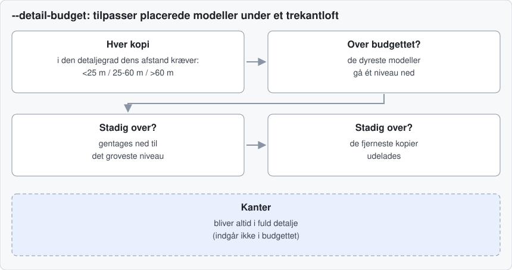

# Detaljeniveauer og budgettet {#levels-of-detail-and-the-budget}

En **trekant** er et lille fladt stykke af en 3D-model. Flere trekanter betyder en større og langsommere fil. **Budgettet** er en grænse for, hvor mange. Et **detaljeniveau** er en enklere kopi af en model, brugt når den er langt væk.

Det fineste niveau af alt, der er placeret rundt om en rundbane, er flere millioner trekanter. For eksempel hundredvis af autoværnssektioner og dækstabler på ca. tusind trekanter hver. En bykorridor rummer over hundrede tusind kopier. Derfor giver hver course-eksport de placerede modeller et **trekantbudget** og afgør for hver model, på hvilket detaljeniveau den tegnes, og om nødvendigt hvilke kopier der udelades.

Ordningen blev skrevet til Forza ([`forzaplacement.py`](https://github.com/Holdi601/3DHeat-GameFiles/blob/main/heat3d_gamefiles/forzaplacement.py):
`choose_levels`, `auto_budget`, `_fit`), og BeamNG og AC Rally genbruger dens dele. Terrænet tæller ikke med i budgettet.

## Afstandsbånd {#distance-bands}

Hver kopis afstand til kørslen måles i jordplanet til det nærmeste rundepunkt. Runden tyndes først til højst 1.000 punkter, hvilket koster et par meters præcision og intet, der betyder noget her. Kopier falder derefter i tre bånd, og hvert (model, bånd)-par budgetteres for sig:

| Bånd | Afstand | Starter ved |
|---|---|---|
| nær | under 25 m (`NEAR`) | det fineste niveau |
| mellem | 25-60 m (`FAR`) | ét niveau grovere |
| fjern | 60 m og mere | det groveste niveau |

Uden en rute (Forza `terrain --box`) måles afstanden til midten af boksen.

## Trappes ned for at passe {#stepping-down-to-fit}



Omkostningen for et (model, bånd)-element er kopier gange trekanter på dets nuværende niveau. Så længe summen er over budgettet, trappes elementet med den største omkostning ned ét niveau, og det gentages, indtil summen passer, eller intet kan trappes længere ned. Fastlåste elementer trappes aldrig ned:

| Spil | Fastlåst i fuld detalje |
|---|---|
| Forza | kantsten (`road_gen_rum*`) |
| BeamNG | kantsten, og enhver form, der bærer kørselsflade |
| AC Rally | kantsten |

Forza-opsummeringen melder dette som `N of M models drawn at a coarser level to fit the budget`.

## Det automatiske budget {#the-automatic-budget}

Uden `--detail-budget` tilpasser budgettet sig selv, så **ingen kopi udelades**:

```
budget = max(1,500,000, 1.25 x sum(copies x coarsest level))
```

Fastlåste elementer tælles med deres fineste niveau. De 25 % (`HEADROOM`) lader ting ved siden af vejen beholde noget detalje. På en landbane er det gulvet på 1,5 millioner (`DEFAULT_BUDGET`). På en bane i by, hvor korridoren rummer over hundrede tusind kopier, vokser det til over ti millioner, og filen til flere hundrede MB. Viewer'en indlæser den.

## Et budget du angiver {#a-budget-you-give}

`--detail-budget N` er et **loft**. Niveauer trappes ned som ovenfor. Hvis selv de groveste niveauer ikke passer, udelades kopier:

| Spil | Rækkefølge kopier udelades i |
|---|---|
| Forza | først alt 25 m eller mere fra kørslen, derefter det, der står ved siden af vejen; inden for hver gruppe det, der ser mindst ud fra vejen først: størst afstand / størrelse (størrelse = modellens bounding box-diagonal gange dens største skala, mindst 0,25 m) |
| BeamNG | længst fra kørslen først |
| AC Rally | længst fra kørslen først, som BeamNG |
| Battlefield 6 | mindst først: bounding box-diagonal gange skala |

Kantsten (og for BeamNG kørselsflade-modeller) udelades aldrig, så et budget mindre end det, de koster alene, overskrides af dem og af intet andet.

Værktøjet bruger afstand over størrelse for Forza, for ordnet efter afstand alene overlever en aircondition-enhed på en væg ni meter væk den 20 meter store facade, den hænger på, tolv meter væk. Ting ved siden af vejen går sidst, uanset størrelse, for en tre meter høj barriere fem meter fra linjen er kanten af banen, mens en 50 meter stor bygning seksti meter tilbage er kulisse.

Opsummeringen melder `N of M copies left out to fit the budget, the smallest and furthest from the driving first (--detail-budget raises it)` (Forza), eller `N copies left out to fit the budget, the furthest from the driving first (--detail-budget raises it)` (BeamNG, AC Rally).

## Hele bygninger (Forza) {#whole-buildings-forza}

En stand-in for en hel bygning tæller som én kopi, med en afstand målt til bygningens nærmeste kant. Den beholdes eller udelades som en enhed. De modulære dele, den erstatter, budgetteres slet ikke. Se [Forza Horizon](course-forza-horizon.md#buildings-drawn-whole).

## Hvad et detaljeniveau er, pr. spil {#what-a-level-of-detail-is-per-game}

| Spil | Niveauerne kommer fra |
|---|---|
| Forza | niveaumasken pr. trekant på modellens `Mesh`-undermeshes (bit `level + 1`); `0xFFFF` for knusbare dele, kun for en model uden markeret niveau |
| BeamNG | formens `details` i `.cdae` med en størrelse på nul eller mere, største først; for `.dae` tallet til sidst i mesh-nodenavnene (`barrier75`, `barrier40`) |
| AC Rally | den statiske meshes gemte detaljeniveauer, fineste først |
| Battlefield 6 | MeshSet'ens detaljeniveauer, fineste først, og kun de tegnede sektioner tælles (ikke skygge- og kun-dybde-kopierne), og ikke et sidste niveau, der er en stand-in for fjernvisning (materialerne `M_LastLod`, `M_Billboard`, `M_Vista`: et master-gitter bliver til en massiv spids) |

Battlefield 6's `level` har ingen runde, så der er ingen afstandsbånd: hver mesh er ét element, og hver kopi er på samme niveau. Det automatiske budget er formlen ovenfor med terrænets baggrund fastlåst; højdefeltet ligger uden for budgettet og dimensioneres af `--ground-spacing`. Under et budget du angiver, og når hver mesh er på sit groveste, udelades kopier mindst først, hvor størrelsen er meshens bounding box-diagonal gange kopiens skala, da der ingen kørsel er at måle afstand fra. Terrænets baggrund udelades aldrig. Et niveau kommer automatisk op på omkring ti millioner trekanter.

## At vælge et tal {#choosing-a-number}

| Du vil have | Prøv |
|---|---|
| alt, fuld detalje ved vejen | lad det være automatisk |
| en fil et par gange mindre | `--detail-budget 500000` med `--texture-size 1024` |
| kun jord | `--no-placed` (intet budget involveret) |
