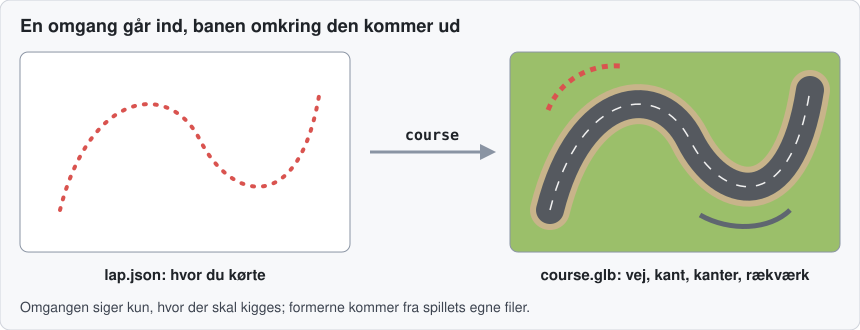
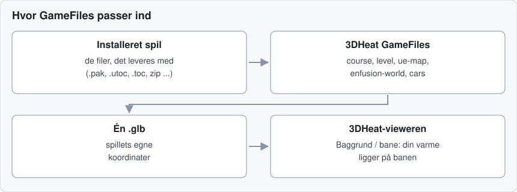

# 3DHeat GameFiles {#dheat-gamefiles}

**Hvad er det?** Et værktøj, der bygger en 3D-model af en løbsbane eller et spilbane
ud fra filerne i et spil, du allerede har installeret.

**Hvorfor skulle jeg bruge det?** 3DHeat-vieweren maler, hvor du kørte eller spillede, som
varme. Med dette værktøj maler den det på den rigtige løbsbane eller spilbane, ikke på tom plads.

**Eksempel:** tag en omgang, du kørte. Værktøjet bygger vejen og terrænet omkring den
som én 3D-fil, så vieweren kan male din fart eller dine styrt på den rigtige bane:



Ny til kommandolinjen? Start med [Før du går i gang](before-you-start.md).

Mere detaljeret: det læser banedata ud af de arkiver, et spil leveres med, og skriver
dem som en binær glTF-fil (`.glb`). Dets vigtigste opgave er **banegenereringen**: du
giver den en omgang, og den skriver jorden, vejen adskilt fra kantbanen og græsset, og
kanterne, rækværkerne, dækvæggene, skiltene og bygningerne omkring den.

Det er en del af [3DHeat](https://github.com/Holdi601/3DHeat), en viewer til
realtids-3D-telemetriens varmekort, løbsanalyse og kampgennemgang
([dokumentation](https://holdi601.github.io/3DHeat/)). De `.glb`-filer, dette
værktøj skriver, er de baner, vieweren tegner varmen på.



Det er en af tre måder at få en banes geometri ind i 3DHeat:

| Rute | Kræver | Giver |
|---|---|---|
| 3DHeat Unreal Exporter | Unreal-projektet åbent i editoren | nøjagtig geometri |
| 3DHeat GameCapture | en skærm og en optagelse | et estimat |
| **3DHeat GameFiles** | **det installerede, leverede spil** | **nøjagtig geometri, intet projekt** |

Python-pakke: `heat3d_gamefiles`. Repository:
[Holdi601/3DHeat-GameFiles](https://github.com/Holdi601/3DHeat-GameFiles). Licens: MIT.

## Hvad det kan {#what-it-can-do}

| Spil eller motor | Banegenerering (`course`) | Arkivlæsning |
|---|---|---|
| Forza Horizon (ForzaTech) | ja: terræn, vej og kant, jordtekstur, placerede modeller i deres egne teksturer | `identify`, `list`, `extract` på en `.minizip`; `identify` på en `.modelbin`; modeller, terræn og teksturer gennem `course` og `terrain` |
| BeamNG.drive | ja: terræn, vejdekaler, modellerede baner, placerede modeller, vand | `identify`, `list`, `extract` på banezip; `identify` på `.ter`, `.cdae`; `.dae` gennem `course` |
| Assetto Corsa Rally (Unreal 5.6) | ja: etapens jordfliser, indbagt jordfarve, placerede modeller i flade farver | `identify`, `list`, `extract` på IoStore `.utoc`/`.ucas`; zen-pakker, statiske meshes, teksturer gennem `course` |
| Unreal `.pak` (version 8-12) | nej | `identify`, `list`, `extract` |
| Unity (format 22 og nyere) | nej | `identify`, `meshes` |
| Battlefield 6 (Frostbite `.toc`/`.cas`) | ingen omgang; en hel bane med `level`: terræn, placerede meshes, deres farvekort med `--textures` | `identify`, `levels`; bundles, meshes, terræn, teksturer og placering gennem `level` |
| Source 2 `.vpk` | nej | `identify`, `list`, `extract` |
| Unreal 5 World Partition-spil | ingen omgang; et helt kort med `ue-map` (listet af `ue-maps`): landskab, HLOD-bygninger og rekvisitter, vand | - |
| Arma Reforger (Enfusion) | ingen omgang; en hel verden med `enfusion-world` (listet af `enfusion-worlds`): terræn i dets farver, havet, bygninger som kasser | - |
| Forza (biler) | `cars`: hver bil i lav detaljegrad, til viewerens Løbsanalyse-fanen | - |

Omgange fra Assetto Corsa EVO og iRacing afvises med en grund. Se
[Begrænsninger og kendte huller](limits-and-known-gaps.md).

## Installation {#install}

Ny til kommandolinjen? Læs [Før du går i gang](before-you-start.md) først.

Du har brug for **Python 3.10 eller nyere** (udviklet på 3.13) og pakkerne i
[`requirements.txt`](https://github.com/Holdi601/3DHeat-GameFiles/blob/main/requirements.txt).

```
git clone https://github.com/Holdi601/3DHeat-GameFiles.git
cd 3DHeat-GameFiles
pip install -r requirements.txt
```

Tjek derefter: `python -m heat3d_gamefiles --help`. Du bør se
`usage: heat3d_gamefiles [-h]` og listen over verber. Kør hver kommando fra
repository-mappen, som `python -m heat3d_gamefiles <verb>`.

| Pakke | Bruges til |
|---|---|
| numpy | alt, der afkoder geometri |
| lz4 | Forza-arkiver (for det meste LZ4-blokke), nogle Unity-bundles, IoStore LZ4-blokke |
| Pillow | afkodning af BC1-BC7-teksturer, skrivning af JPEG-teksturerne i `.glb` |
| msgpack, zstandard | BeamNGs kompilerede former (`.cdae`) |
| cryptography | kun til at åbne en krypteret `.pak` med en nøgle, du allerede har |
| pytest | testene |

Unreal-indhold komprimeret med **Oodle** kræver et Oodle-bibliotek, der allerede er på
din maskine. Et sådant leveres aldrig med dette værktøj. Se [Oodle](reader-oodle.md).

Værktøjet er skrevet til Windows. Det finder spil via Steams biblioteksliste og
`%LOCALAPPDATA%`, og indlæser Oodle som en Windows-DLL. Andre platforme er ikke
testet.

## Hurtig start {#quick-start}

En **lap-fil** er en optagelse af, hvor din bil kørte: en liste af x-, y- og z-punkter.
Den kommer fra [3DHeat GameCapture](https://github.com/Holdi601/3DHeat-GameCapture)
eller FH Companion-appens omgangsbibliotek; en CSV, du skriver selv, virker også
([Lap-input](lap-inputs.md)).

```
# Forza: a lap file, a lap folder, or a course name from the FH Companion library
python -m heat3d_gamefiles course "Example Circuit"
python -m heat3d_gamefiles course path\to\lap.json -o course.glb

# BeamNG.drive or Assetto Corsa Rally: a heat3d-lap file says which game it is from
python -m heat3d_gamefiles course my_lap.json

# Every course in the FH Companion library, one .glb each
python -m heat3d_gamefiles courses -o courses

# Battlefield 6: list the levels, then export one (a large file; see Commands)
python -m heat3d_gamefiles levels
python -m heat3d_gamefiles level <level> -o level.glb --textures

# Unreal 5 World Partition and Arma Reforger: list, then export
python -m heat3d_gamefiles ue-maps "<game>"
python -m heat3d_gamefiles ue-map "<game>" <map> -o map.glb
python -m heat3d_gamefiles enfusion-worlds
python -m heat3d_gamefiles enfusion-world <world> -o world.glb

# Every Forza car, for the viewer's race tab
python -m heat3d_gamefiles cars -o forza.h3dcars

# What is this file?
python -m heat3d_gamefiles identify some_archive.pak
```

Åbn `.glb`-filen i 3DHeat-vieweren. Spillets egne verdenskoordinater bevares
(se [Outputformat](output-format.md)), så en optaget omgang flugter med banen.

## Dokumentationens kort {#map-of-this-documentation}

- [Før du går i gang](before-you-start.md): Python, en terminal, den første kommando.
- [Kommandoer](commands.md): hvert verbum og hver valgmulighed, med eksempler.
- [Kommandoreference](../cli-reference.md): hvert verbums `--help`, genereret ud fra koden.
- [Undersøg arkiver](inspecting-archives.md): `identify`, `list`, `extract`, `meshes`, trin for trin.
- [Banegenerering](course-export.md): hvordan en omgang bliver til en bane, for alle spil.
  - [Forza Horizon](course-forza-horizon.md)
  - [BeamNG.drive](course-beamng.md)
  - [Assetto Corsa Rally](course-assetto-corsa-rally.md)
  - [Detaljeniveauer og budgettet](detail-budget.md)
- [Hele baner](whole-levels.md): en bane, et kort eller en verden uden en omgang.
  - [Battlefield 6-baner](level-battlefield.md): `levels`, `level`
  - [Unreal 5-kort](level-unreal-world-partition.md): `ue-maps`, `ue-map`
  - [Arma Reforger-verdener](level-arma-reforger.md): `enfusion-worlds`, `enfusion-world`
- [Forza-biler](forza-cars.md): `cars`, bilfilen til viewerens Løbsanalyse-fanen.
- [Lap-input](lap-inputs.md): hver lap-filform, værktøjet accepterer.
- [Outputformat](output-format.md): hvad der er inde i `.glb`.
- [Arkivlæsere](archive-readers.md): én side pr. containerformat, der dækker
  hvad hver læser, hvad den ikke læser, og hvorfor.
- [Begrænsninger og kendte huller](limits-and-known-gaps.md)
- [Fejlfinding](troubleshooting.md): fejlmeddelelserne, og hvad du gør.
- [Regler og licenser](rules-and-licences.md): ingen nøgler, dine egne filer, ingen videredistribution.
- [Opdateringer](updates.md): opdateringstjekket og `heat3d_update`.
- [Udvikling](development.md): modulkort og tests, inklusive testene, der kører mod installerede spil.
- [Vedligeholdelse](maintaining.md): udgivelsestjeklisten for disse sider.

## Del af 3DHeat {#part-of-3dheat}

3DHeat GameFiles er et af de gratis værktøjer omkring 3DHeat-vieweren:

| Værktøj | Hvad det gør | Dokumentation |
|---|---|---|
| [3DHeat](https://github.com/Holdi601/3DHeat) | vieweren: 3D-varmekort, løbsanalyse og kampgennemgang i browseren | [site](https://holdi601.github.io/3DHeat/) |
| [GameFiles](https://github.com/Holdi601/3DHeat-GameFiles) | baner og kort ud af de filer, et spil leverer, som `.glb` | [site](https://holdi601.github.io/3DHeat-GameFiles/) |
| [GameCapture](https://github.com/Holdi601/3DHeat-GameCapture) | omgangstelemetri fra løbsspil; baner genskabt ud fra spilvideo | [site](https://holdi601.github.io/3DHeat-GameCapture/) |
| [Unreal Exporter](https://github.com/Holdi601/3DHeat-UnrealExporter) | et Unreal Editor-plugin, der gemmer en bane som `.glb` | [site](https://holdi601.github.io/3DHeat-UnrealExporter/) |
| [CS2](https://github.com/Holdi601/3DHeat-CS2) | Counter-Strike 2-demoer til kampfiler; kort til `.glb` | [site](https://holdi601.github.io/3DHeat-CS2/) |
| [Watcher](https://github.com/Holdi601/3DHeat-Watcher) | optager dit spil i baggrunden ud fra det, spil udgiver | [site](https://holdi601.github.io/3DHeat-Watcher/) |
| [Ext-WarThunder](https://github.com/Holdi601/3DHeat-Ext-WarThunder) | War Thunder-replays til kampfiler | [site](https://holdi601.github.io/3DHeat-Ext-WarThunder/) |
| [Ext-WoT](https://github.com/Holdi601/3DHeat-Ext-WoT) | World of Tanks-replays til kampfiler | [site](https://holdi601.github.io/3DHeat-Ext-WoT/) |
| [Ext-WoWs](https://github.com/Holdi601/3DHeat-Ext-WoWs) | World of Warships-replays til kampfiler | [site](https://holdi601.github.io/3DHeat-Ext-WoWs/) |
| [Ext-Squad](https://github.com/Holdi601/3DHeat-Ext-Squad) | Squad-serverdemoer til kampfiler | [site](https://holdi601.github.io/3DHeat-Ext-Squad/) |
| [Ext-DCS](https://github.com/Holdi601/3DHeat-Ext-DCS) | DCS World-kort til `.glb`-baner | [site](https://holdi601.github.io/3DHeat-Ext-DCS/) |
| [Ext-IL2](https://github.com/Holdi601/3DHeat-Ext-IL2) | IL-2 Sturmovik-kort til `.glb`-baner | [site](https://holdi601.github.io/3DHeat-Ext-IL2/) |

Viewerens kampfiler beskrives i
[Én fil pr. kamp: `.3dheat`](https://holdi601.github.io/3DHeat/container.html);
en bane lavet her indlæses ved siden af dem i viewerens Baggrund / bane-panel.
