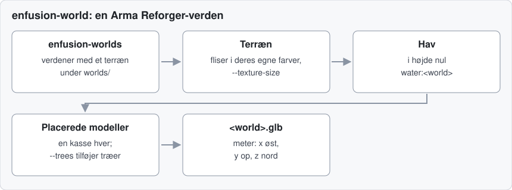

# Arma Reforger-verdener: `enfusion-worlds` og `enfusion-world` {#arma-reforger-worlds-enfusion-worlds-and-enfusion-world}

**Hvad er det?** En hel Arma Reforger-verden som én 3D-fil. **Hvorfor?** Så varmedata fra spillet har jorden og bygningerne under sig. (*Enfusion* er motoren, Arma Reforger er lavet med; en *verden* er det, spillet kalder et kort.)

Eksporterer en hel Enfusion-verden af den installerede Arma Reforger: terrænet i farverne fra dets egne supertextur-fliser, havet og hver placeret model som en boks, i spillets egne meter.



## Trin for trin {#step-by-step}

1. **List de verdener**, der har et terræn:

   ```
   python -m heat3d_gamefiles enfusion-worlds
   python -m heat3d_gamefiles enfusion-worlds --install "D:\Games\Arma Reforger"
   ```

2. **Eksportér én** under dens mappenavn i `worlds/`, som listet:

   ```
   python -m heat3d_gamefiles enfusion-world <world> -o world.glb
   ```

3. **Variationer:**

   ```
   python -m heat3d_gamefiles enfusion-world <world> --trees               # vegetation too, as boxes
   python -m heat3d_gamefiles enfusion-world <world> --texture-size 0      # flat colour, small file
   python -m heat3d_gamefiles enfusion-world <world> --ground-spacing 4 --no-structures
   ```

4. **Åbn `world.glb`** i 3DHeat-viewerens Baggrund / bane-panel ([indlæsning af et niveau](https://holdi601.github.io/3DHeat/levels.html)).

## Valgmuligheder {#options}

| Valg | Standard | Betydning |
|---|---|---|
| `<world>` | påkrævet | en verden, som `enfusion-worlds` viser |
| `-o`, `--out FILE` | `<world>.glb` (i `$HEAT3D_LEVELS/<game>/`, når den er sat) | filen, der skrives |
| `--install FOLDER` | Steam-biblioteket, der har spillet | spillets mappe |
| `--ground-spacing METRES` | 2 (terrænets egen) | terrænets vertex-afstand i filen |
| `--texture-size PIXELS` | 4096 | jordfarvebilledets længste side; 0 for flad farve |
| `--no-structures` | | udelad de placerede modeller |
| `--trees` | fra | medtag også træer og anden vegetation, som bokse |

## Eksempel på output {#example-output}

```text
<world> -> world.glb
  ground      <n> triangles, <w> x <h> m; <n> of <n> tile-edge vertices disagree; colour <w> x <h>
  structure   <n> boxes from <n> entities
  water       <n> triangles (the sea)
  left out    <what>: <n>, ...
```

## Delene {#the-parts}

`ground:<world>` (terrænet), `water:<world>` (havet, ved højde nul) og `structure:<world>` (boksene). Koordinaterne er spillets egne: x mod øst, y op, z mod nord, i meter - det en optagelse i spillet rapporterer. Spillets koordinatsystem er venstrehåndet; *invert world axis* i viewer'en viser det uspejlet.

## Sådan læses og tjekkes det {#how-it-is-read-and-checked}

Ingen Workbench er nødvendig, og intet er krypteret.

| Format | Hvad det er | Tjekket mod |
|---|---|---|
| `.pak` | en datachunk og et mappetræ, poster gemt eller zlib | træet bruger præcis sin chunk op; stikprøvede zlib-poster pakkes ud til præcis deres angivne størrelse |
| `.edds` | en DDS-header, derefter pr. mip-niveau `COPY`- eller `LZ4 `-chunks | chunkede niveauer afkodes til præcis deres størrelse ved præcis deres bytes |
| `.terr` / `.ttile` | en header og fliser med 16-bit-højder | hver delt flisekant passer præcist |
| supertextur | hver flises jordfarve, ca. en meter pr. pixel | den passer til havet i højderne; ingen spejling eller transponering passer lige så godt |
| `.ent` | navne, ressource-GUID'er, derefter entiteter som typede værdier | en verdensfil parses til sidste byte |
| `resourceDatabase.rdb` | GUID til sti | næsten hver GUID, en verden bruger, navngiver en fil, der findes |

Objekter markeret som stående i en absolut højde sidder inden for centimeter af det afkodede terræn (med gitteret transponeret ville de være meter ude). Ikke tegnet: modellernes egne trekanter, træer som standard (`--trees` tilføjer dem som bokse), underentiteter, søer og floder, teksturer med DX10-forud headers.

**Vilkår:** spillets licens tillader ikke-kommerciel brug og forbyder reverse engineering af spillets filer. At læse din egen installation er din beslutning under den; resultatet er til din egen brug og må ikke deles.
