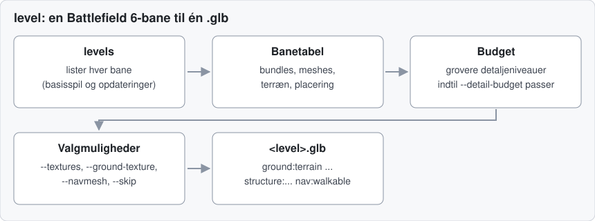

# Battlefield 6-niveauer: `levels` og `level` {#battlefield-6-levels-levels-and-level}

**Hvad er det?** Et helt Battlefield 6-niveau som én 3D-fil. **Hvorfor?** Så varmedata fra dine kampe har jorden og bygningerne under sig. (*Frostbite* er motoren, Battlefield er lavet med; et *højdefelt* er jorden gemt som et gitter af højder.)

Eksporterer et helt Frostbite-niveau af det installerede spil: terrænets højdefelt, hver mesh dets statiske modelgrupper placerer, objekterne placeret ét for ét, terrænets baggrund rundt om kortet og efter ønske fladernes farvekort, terræn-decals indbagt i jorden og soldaternes gangbare flader.



## Trin for trin {#step-by-step}

1. **List de niveauer**, spillet indeholder:

   ```
   python -m heat3d_gamefiles levels
   python -m heat3d_gamefiles levels --install "D:\Games\<game folder>"
   ```

   Hver linje er en niveautabel (`levels/<level>/<level>.toc`) med sin størrelse og hvor den kommer fra: `Data` for grundspillet, `Update/<pack>` for en opdatering.

2. **Eksportér ét** efter dets navn, en unik del af det, eller dets `.toc`-sti. Start uden tekstur for at se form og størrelse:

   ```
   python -m heat3d_gamefiles level <level> -o level.glb
   ```

3. **Tilføj farve**, når det ser rigtigt ud:

   ```
   python -m heat3d_gamefiles level <level> -o level.glb --textures 512 --ground-texture 0.5
   ```

4. **Tilføj de gangbare flader**, eller gør filen mindre:

   ```
   python -m heat3d_gamefiles level <level> --textures 512 --ground-texture 0.5 --navmesh
   python -m heat3d_gamefiles level <level> --textures 256 --detail-budget 3000000 --ground-spacing 8
   ```

5. **Åbn `level.glb`** i 3DHeat-viewerens Baggrund / bane-panel ([indlæsning af et niveau](https://holdi601.github.io/3DHeat/levels.html)).

## Valgmuligheder {#options}

| Valg | Standard | Betydning |
|---|---|---|
| `<level>` | påkrævet | et navn som `levels` viser, en unik del af et, eller et niveaus `.toc` |
| `-o`, `--out FILE` | `<level>.glb` (i `$HEAT3D_LEVELS/<game>/`, når den er sat) | filen, der skrives |
| `--install FOLDER` | fundet i Steam-bibliotekerne | spillets mappe |
| `--textures [PIXELS]` | fra; 512 uden størrelse | hver flades farvekort, højst PIXELS på hver side |
| `--ground-texture [METRES]` | fra; 0.5 uden størrelse | bag veje, pladser og markeringer ind i jordens farve, METRES pr. pixel |
| `--navmesh` | fra | tilføj soldatens navigationsmesh som `nav:walkable` |
| `--ground-spacing METRES` | 4 | højdefeltets fineste afstand; 0 udelader det |
| `--detail-budget N` | groveste kopier plus en fjerdedel, mindst 1.500.000 | et loft for trekanter (terrænet gøres aldrig grovere) |
| `--skip TEXT` | | udelad modelgrupper, hvis partitionsnavn indeholder TEXT; kan gentages |
| `--by-mesh` | fra | én del pr. kilde-mesh og materiale, til at finde ud af, hvad en del er |
| `--clamped-uvs` | fra | til renderere, der ikke kan gentage en tekstur |

Den fulde tabel, med de størrelser du kan forvente (et helt niveau er hundredvis af MB), står under [Kommandoer](commands.md#levels-and-level-frostbite). Hvordan tabellerne, bundles, meshes og terrænet læses, står under [Frostbite](reader-frostbite.md).

## Eksempel på output {#example-output}

Hvad `level` skriver, i grove træk (linjerne, som koden skriver dem; `<n>` og navnene varierer efter niveau):

```text
<n> copies of <n> meshes, from <n> static model groups
      <n>  <group>
      <n>  placed one by one (object and prefab references)
<n> meshes left out: <why>
<n> triangles, budget <n>; <n> meshes drawn at a coarser level to fit
           <n>  ground:terrain
           <n>  structure:buildings, <n> textures
           ...
<n> of <n> drawn sections carry their colour map; the rest are flat colours
Ground: <what the ground is>.
Navigation mesh: <tiles read>.
-> level.glb (<n> MB)
```

## Delene {#the-parts}

`ground:terrain` (højdefeltet), `ground:terrain backdrop` og `ground:terrain blend`, `structure:<kind>` pr. slags mesh (pr. farvekort med `--textures`, med ` (destructible)` for det, en kamp kan ødelægge), og `nav:walkable` med `--navmesh`. Se [Outputformat](output-format.md).

Filen indeholder spillets indhold: den er til den maskine, den blev lavet på, ikke til at sende rundt ([Regler og licenser](rules-and-licences.md)).
