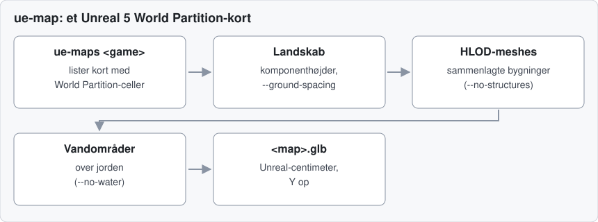

# Unreal 5 World Partition-kort: `ue-maps` og `ue-map` {#unreal-5-world-partition-maps-ue-maps-and-ue-map}

**Hvad er det?** Et helt kort fra et Unreal 5-spil som én 3D-fil: jorden, bygningerne og vandet. **Hvorfor?** Så varmedata fra det spil har kortet under sig. (*World Partition* er den måde, Unreal 5 deler et stort kort op i stykker; *HLOD* er en forenklet stand-in for en gruppe bygninger, den, spillet tegner langt væk.)

Eksporterer et helt kort fra et Unreal 5-spil, hvis kort er bagt som World Partition-celler: landskabet, kortets sammenlagte HLOD-meshes (dets bygninger og rekvisitter, som spillet tegner dem på afstand) og dets vandområder. Hverken editor eller projekt er nødvendige, kun det installerede spil.



## Trin for trin {#step-by-step}

1. **List kortene.** `<game>` er spillets mappe, dens `Content/Paks`, eller navnet på dens mappe i et Steam-bibliotek:

   ```
   python -m heat3d_gamefiles ue-maps "<Steam game folder name>"
   python -m heat3d_gamefiles ue-maps "D:\Games\<game>"
   ```

   Hvert kort med bagte World Partition-celler udskrives med sin pakkesti.

2. **Eksportér ét** efter navn eller en unik del af det:

   ```
   python -m heat3d_gamefiles ue-map "<game>" <map> -o map.glb
   ```

3. **Kun jord, eller grovere:**

   ```
   python -m heat3d_gamefiles ue-map "<game>" <map> --no-structures --no-water
   python -m heat3d_gamefiles ue-map "<game>" <map> --ground-spacing 4
   ```

4. **Åbn `map.glb`** i 3DHeat-viewerens Baggrund / bane-panel ([indlæsning af et niveau](https://holdi601.github.io/3DHeat/levels.html)).

## Valgmuligheder {#options}

| Valg | Standard | Betydning |
|---|---|---|
| `<game>` | påkrævet | spillets mappe, dens `Content/Paks`, eller dens Steam-mappenavn |
| `<map>` | påkrævet | et navn som `ue-maps` viser, eller en unik del af et |
| `-o`, `--out FILE` | `<map>.glb` (i `$HEAT3D_LEVELS/<game>/`, når den er sat) | filen, der skrives |
| `--ground-spacing METRES` | 2 | landskabets vertex-afstand, rundet til et helt antal af dets egne quads |
| `--no-structures` | | udelad HLOD-bygningerne og rekvisitterne |
| `--no-water` | | udelad vandområderne |

Indhold komprimeret med Oodle kræver et Oodle-bibliotek, der allerede er på maskinen (se [Oodle](reader-oodle.md)).

## Eksempel på output {#example-output}

```text
<map> -> map.glb
  ground      <n> triangles from <n> landscape components; <n> of <n> vertices stored twice disagree
  structure   <n> triangles in <n> HLOD meshes
  water       <n> triangles from <n> water bodies
```

Antallet af uenigheder er et selvtjek: naboliggende landskabskomponenter gemmer deres fælles kant to gange, og de to skal passe sammen. Et 3 km kort ved 2 m er ca. 4,6 millioner jordtrekanter.

## Delene {#the-parts}

`ground:<map>` (landskabet), `structure:<map>` (HLOD-meshes) og `water:<map>` (vand, der står over jorden).

**Enheder:** dette er den ene eksport, der **ikke er i meter**: Unreal-centimeter, med Y og Z byttet om (Y op), det koordinatsystem 3DHeat Unreal Exporter skriver. Telemetri fra samme spil bruger samme koordinatsystem, så den ligger på kortet.

## Sådan læses og tjekkes det {#how-it-is-read-and-checked}

| Del | Læst fra | Tjekket mod |
|---|---|---|
| jord | hver landskabskomponents 16-bit højdekort, placeret efter sin sektionsbase på landskabets transformation | hver vertex gemt to gange (på en søm eller en komponentkant) skal passe; uenigheder tælles og udskrives, de udglattes ikke |
| struktur | kortets sammenlagte HLOD-meshes, bygget af motoren i verdensrum | en mesh beholdes kun, hvis de grænser, dens komponent gemmer, beskriver dens egne vertices |
| vand | hvert vandområdes mesh, lagt på jordgitteret, beholdt hvor den står over jorden | vand ligger et par meter over jorden under det, ligesom en flod over sit leje |

Landskabets egenskaber findes efter form, ikke efter pladsnummer (pladser flytter sig mellem motorversioner). Strukturerne er de forenklede stand-ins, ikke modellerne i fuld detalje. Bevoksning, decals og landskabsmaterialer eksporteres ikke; jorden er utextureret og skygges af viewer'en. Detaljer om arkiverne: [Unreal 5 IoStore](reader-unreal-iostore.md).

**Vilkår:** spillicenser tillader typisk personlig, ikke-kommerciel brug og forbyder reverse engineering "i det omfang, sådanne handlinger ikke kan forbydes ved lov". At læse din egen installation er din beslutning under dem; resultatet er til din egen brug og må ikke deles.
