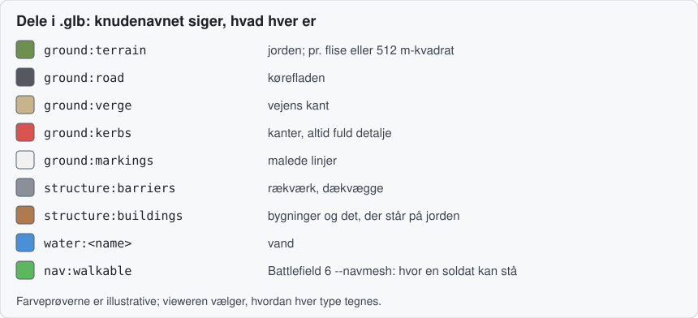

# Outputformat {#output-format}

En `.glb` er én 3D-fil: jorden, bygningerne og vandet i en bane eller et kort, som du åbner i 3DHeat-viewerens panel Baggrund / bane.

Hver eksport (`course`, `courses`, `terrain`, `level`, `ue-map`, `enfusion-world`) skriver én **binær glTF 2.0**-fil (`.glb`). Den er bevidst lille og flad, og lagt op sådan som 3DHeat-vieweren læser en bane. Kilde:
[`glb.py`](https://github.com/Holdi601/3DHeat-GameFiles/blob/main/heat3d_gamefiles/glb.py).

## Struktur {#structure}

```
scene 0
 ├─ node "ground:terrain x-2046 z1023"  -> mesh 0 -> 1 primitive, material 0
 ├─ node "ground:road x-2046 z1023"     -> mesh 1 -> 1 primitive, material 1
 ├─ node "ground:markings"               -> mesh 2 -> ...
 ├─ node "ground:kerbs road_gen_rum_..." -> ...
 ├─ node "structure:barriers bar_armco_bclr"
 └─ ...
```

- **Én node pr. del**, alle i scenens rod, **uden transformationer**. Al geometri er allerede i verdenskoordinater.
- Hver node har sit eget mesh med **én primitive** og sit eget materiale. Noden, meshet og materialet bærer alle delens navn.
- Hver primitive har **sine egne kompakte vertex-arrays**, kun de vertices delen bruger. Et delt vertex-array er gyldig glTF, men en læser der udvider hver primitives accessors ville så holde hver vertex én gang pr. del.
- `asset.generator` er `heat3d_gamefiles`.
- **Få `extras`**, og intet omgangs-, spil- eller banenavn:
  - en Battlefield 6-del af et destruerbart mesh bærer `{"destructible": true}` på sin node;
  - en Forza-bane siger hvad den holder i `asset.extras` (formatversion, matchet rute-id, hvor mange kopier af løbets eget lag, venues; se
    [Forza Horizon-baner](course-forza-horizon.md#writing-the-file)), og dens tændte dele bærer deres lag på noden: `{"layer": "event", "route": <id>}`
    for løbets eget lag, `{"layer": "layer"}` for et andet tændt lag, `{"layer": "venue"}` for et venues jord.

  Alt andet vieweren har brug for, står i nodenavnene.

## Nodenavne: klassifikationen {#node-names-the-classification}



Vieweren tager en dels klasse fra **node**-navnet (med reserve i mesh-navnet), og kun når det matcher

```
^(ground|structure|water)\s*[:|]
```

Alt andet klassificeres af en heuristik skrevet til Unreal-landskaber. Så hver del eksportøren skriver, begynder med et af disse præfikser, eller med `nav:` (nedenfor):

| Præfiks | Betydning | Dele der skrives |
|---|---|---|
| `ground:` | kørselsfladen og landet | `ground:road`, `ground:verge`, `ground:terrain`, `ground:gravel and dirt`, `ground:kerbs`, `ground:markings`, `ground:tyre marks`, `ground:venue`, `ground:plinths` |
| `structure:` | det der står på den | `structure:barriers`, `structure:props`, `structure:signs`, `structure:buildings`, `structure:infrastructure`, `structure:bridges`, `structure:rocks`, `structure:smashables`, `structure:trees`; Forza-lagene `structure:event_<category>` og `structure:layer_<category>` |
| `water:` | vand | `water:water`; `water:<map>` (`ue-map`), `water:<world>` (`enfusion-world`) |
| `nav:` | hvor en soldat kan gå (Battlefield 6, kun med `--navmesh`) | `nav:walkable` |

`nav:` matcher ikke viewerens mønster ovenfor, så vieweren sorterer den efter sin heuristik; det er en egen del, så du kan vise eller skjule den alene. `ue-map` skriver `ground:<map>`, `structure:<map>` og `water:<map>`; `enfusion-world` skriver `ground:<world>`, `structure:<world>` og `water:<world>`.

Efter typen kommer, afhængigt af spillet:

| Eksempel | Betydning |
|---|---|
| `ground:road x-2046 z1023` | Forza-jord i terrainflisen `x-2046 z1023` (gitterenheder, 1023 pr. 512 m) |
| `ground:road 3_-2` | BeamNG-jord i 512 m-kvadrat (3, -2) |
| `ground:road 3_-2 asphalt_light` | BeamNG-modelleret kørselsflade af materialet `asphalt_light` i det kvadrat |
| `ground:road 1_-4` | AC Rally-jord i 512 m-kvadrat (1, -4) i Unreal-rummet |
| `structure:barriers bar_armco_bclr` | Forza-placerede modeller der deler én tekstur (dens navn uden GUID'en) |
| `structure:barriers` | placerede modeller uden tekstur (Forza, AC Rally) |
| `structure:event_barriers bar_example_bclr` | Forza: det det matchede løb sender ud for sig selv, adskilt fra den frie verden (node-extras `{"layer": "event", "route": <id>}`) |
| `structure:layer_props` | Forza: et lag spillet tænder for noget andet end dette løb (en aktivitet, et samleobjekt, et runtime-lag) |
| `ground:venue`, `ground:plinths` | Forza: modeller allerede i verdenskoordinater - et venues egen jord (et stadions gulv), og jord en gade er pyntet med |
| `structure:barriers armco_metal` | BeamNG-placerede modeller af ét materiale |
| `ground:markings`, `water:water` | flade dele, én for hele filen |
| `ground:terrain` (Battlefield 6) | højdefeltet; `ground:terrain backdrop` de fjerne terrainmeshes, `ground:terrain blend` meshes der flyder over i terrænet |
| `nav:walkable` (Battlefield 6, `--navmesh`) | banens navigationsmesh for en soldat: hvor man kan stå, flad grøn |
| `ground:terrain x-512 z-512` (Battlefield 6, `--ground-texture`) | højdefeltet under én bagt dekalflise, navngivet efter flisens lave hjørne i meter |
| `structure:buildings t_concreteclean_01_cs` (Battlefield 6, `--textures`) | hver overflade af den slags der viser det farvekort; uden `--textures` én del pr. slags, uden suffiks |
| `structure:buildings t_concreteclean_01_cs (destructible)` (Battlefield 6) | det samme, for meshes en kamp kan ødelægge: dem med et destruktionsaktiv under deres eget navn (vægge, huse, rekvisitter). Noden bærer også glTF-extras `{"destructible": true}`. Deres ødelagte tilstande eksporteres ikke |

Vieweren kan filtrere på disse navne. For eksempel er "kun racerfladen" `ground:road` sammen med `ground:kerbs`, i alle tre spil, og "verdenen uden løbets egne rekvisitter" er alt undtagen `structure:event_*`. Præfikset er også hvordan vieweren tegner en del: jord som den overflade varmen ligger på, struktur som det der står på den.

## Enheder, akser og koordinatsystem {#units-axes-and-frame}

- **Meter, Y op**, glTF's konvention, for alle eksporter undtagen `ue-map`. Intet er omskaleret eller centreret: tallene er spillets egne verdenskoordinater, og det er pointen med at læse arkivet i stedet for at rekonstruere det.
- **Unreal 5-kort (`ue-map`): centimeter**, Unreals egen enhed, med Y og Z byttet om, så Y er op - det koordinatsystem 3DHeat Unreal Exporter skriver og spillets telemetri bruger. Den eneste eksport der ikke er i meter.
- **Arma Reforger (`enfusion-world`):** spillets egne meter, x mod øst, y op, z mod nord. Spillets koordinatsystem er venstrehåndet; viewerens *invert world axis* viser det uden spejlvending.
- **Forza:** spillets egne verdenskoordinater (x, y op, z), uændrede. Det samme som dens telemetri, så en optaget omgang ligger på banen.
- **BeamNG.drive:** `(x, z, -y)` af BeamNGs Z-op-verden, som er den rotation telemetrioptageren anvender. En rotation, ikke en spejling.
- **Battlefield 6:** spillets egne verdenskoordinater (x, y op, z), uændrede: banens instanstransformationer anvendt på hvert mesh som de er gemt. Spejlede kopier vikles om, så deres normaler peger udad.
- **Assetto Corsa Rally:** omgangens koordinatsystem. Unreal-centimeter bliver til meter, Unreal Z bliver til y, og Unreal X og Y bliver til x og z i hvilken af de otte orienteringer omgangen passede (se
  [Assetto Corsa Rally](course-assetto-corsa-rally.md#which-stage-and-which-way-round)). Trekanter vikles om hvor afbildningen spejler.

Hver eksport beholder de akser dens telemetri bruger, så optagelsen og banen deler koordinatsystem. Om det koordinatsystem er venstre- eller højrehåndet i hvert spil, er ikke kontrolleret.

## Vertexdata {#vertex-data}

Standarden er den **kvantiserede** form (`quantize=True`). Den kræver udvidelsen `KHR_mesh_quantization`, som står i både `extensionsUsed` og `extensionsRequired`.

| Attribut | Kvantiseret (standard) | Fuld præcision (`quantize=False`) |
|---|---|---|
| `POSITION` | float32 VEC3, med min/max | float32 VEC3 |
| `NORMAL` | int8 VEC3 normaliseret, udfyldt til 4 bytes (stride 4) | float32 VEC3 |
| `TEXCOORD_0` (kun teksturerede dele) | uint16 VEC2 normaliseret, klemt til 0-1; float32 VEC2 hvor teksturer gentages (Battlefield 6) | float32 VEC2 |
| `COLOR_0` (ikke-teksturerede dele, når en del har en farve) | uint8 VEC3 normaliseret, udfyldt til 4 bytes | float32 VEC3 |
| indekser | uint16 når delen har højst 65.535 vertices, ellers uint32 | uint32 |

En vertex er 20 bytes i stedet for 32 (24 i stedet for 44 med farve). Det tager en tredjedel af hver fil, og det er forskellen på om en bybane kan indlæses i en browserfane eller ej. Prisen er under en halv grad normal og 1/65.535 af en UV (en femtendedel af en texel ved 4.096 px). Kommandolinjen skriver altid den kvantiserede form. `write_glb(..., quantize=False)` i Python skriver den anden.

Normaler kommer fra spillet hvor det gemmer dem (Forza-jord og -modeller, BeamNG-shapes og -terræn). Ellers beregnes de som areal-vægtede glatte normaler ud fra trekanterne. AC Rally-normaler beregnes altid.

## Materialer, farver og teksturer {#materials-colours-and-textures}

- Hvert materiale er `metallicFactor 0`, `roughnessFactor 1`.
- **Teksturet del:** `baseColorTexture` med delens billede, UV'er og ingen vertexfarve. glTF ganger de to, så en flade ville blive mørkere to gange.
- **Ikke-teksturet del:** vertexfarve `COLOR_0` med delens flade farve, og en hvid `baseColorFactor`. Hvis ingen del i filen har en farve, findes der ingen `COLOR_0`. Hvor dele deler vertices, vinder den senere dels farve, så flade dele skrives i stigende vigtighed.
- **Billeder** indlejres i den binære chunk som **JPEG**, kvalitet 90, ingen chroma-undersampling, kun RGB (alfa droppes) - undtagen et Battlefield 6-udklipskort (blade, hegn), som er **PNG** med sin alfa, på et materiale med `alphaMode` MASK, `alphaCutoff` 0,5 og `doubleSided` (se [Frostbite](reader-frostbite.md#textures-and-materials)). 3DHeat-vieweren kasserer texels under grænseværdien. En 2048 px jord af græs og trækroner er støj for en tabsfri koder: flere megabytes pr. flise som PNG, under én som JPEG. Et billede som flere dele deler, gemmes én gang.
- **Én sampler for alle teksturer**: lineær forstørrelse, lineær-mipmap-lineær formindskelse, **clamp to edge** på begge akser, for banernes eksporter, hvis teksturer dækker deres flader én gang. BeamNG tegner gentagende modeltekstureer som flade farver (se [BeamNG.drive](course-beamng.md#placed-models)).
- En Battlefield 6-eksport med `--textures`, hvor materialerne fliser, skriver spillets egne teksturkoordinater, uklemte, som float32 `TEXCOORD_0` selv i den kvantiserede form, med en sampler der **gentager** på begge akser (`write_glb(..., repeat=True)`): en murstensvæg er et par trekanter hvis UV løber fra 0 til 40. 3DHeat-vieweren pakker en sådan tekstur ind i sin atlas (se dens *Model levels*-side). For en renderer der ikke kan gentage en tekstur, skærer `level --clamped-uvs` (`write_level(..., clamped=True)`) hver trekant langs de linjer hvor dens tekstur gentages og flytter hvert stykke ind i 0..1: de samme pixels på den samme flade, omkring en femtedel flere trekanter. Trekanter hvor en tekstur gentages mere end 16 gange, beholder deres koordinater. En trekant som dens tekstur ville skære i mere end 4 stykker - bark der gentages ned ad hver gren på et træ, hvilket skæring gjorde til 51.735 trekanter ud af ét træs 1.099 - går i en del af sin egen, `<part> (average colour)`, i teksturens gennemsnitsfarve; `level` siger hvor mange der er.

| Tekstur | Størrelse | Dækker |
|---|---|---|
| jord (alle spil undtagen Battlefield 6) | `--texture-size`: 2048, 1024 eller 512 px | én 512 m-kvadrat: 25, 50 eller 100 cm pr. pixel |
| Battlefield 6-højdefelt | baggrundens farvekorts største mip i banen, beskåret | terrænkvadratet: 32 m pr. pixel i den kontrollerede bane |
| Battlefield 6-flader | `--textures`: højst så mange px på en side | fladens egen tekstur, én gang pr. stykke (skåret hvor den gentages) |
| Battlefield 6 bagt jord | `--ground-texture`: meter pr. pixel, fliser på højst 4.096 px | én flise af dekalernes udstrækning: 2.048 m ved 0,5 m pr. pixel |
| Forza placeret model | højst 256 px | modellens egen UV-layout |
| BeamNG placeret model | højst 256 px | modellens egen UV-layout, kun hvor den ikke gentages |
| AC Rally placeret model | ingen | flade farver |

## Hvad skriveren afviser {#what-the-writer-refuses}

`write_glb` rejser en fejl hellere end at skrive en fil en viewer ville åbne og vise forkert:

| Afvist | Fordi |
|---|---|
| positioner der ikke er N x 3, eller ikke er endelige | et ødelagt mesh |
| et indeks der ligger ud over vertexlisten | tegnes som støj |
| en teksturet del når filen ikke har UV'er | tegnes som én udtværet pixel |
| ingen trekanter overhovedet | tegnes som intet |
| et normal-, farve- eller UV-array med forkert længde, eller som ikke er endeligt | der skal være én pr. vertex |

## Læse den andetsteds {#reading-it-elsewhere}

Enhver glTF 2.0-viewer der understøtter `KHR_mesh_quantization`, bør åbne disse filer. Kun 3DHeat-vieweren er kontrolleret; andre viewere er ikke verificeret. En læser uden udvidelsen afviser filen, fordi den er markeret som påkrævet. Filerne kan være store: omkring 80 MB for en landevejsbane, op til flere hundrede MB for en bybane med det automatiske budget.

## I 3DHeat {#in-3dheat}

Indlæs `.glb`-filen i [3DHeat](https://github.com/Holdi601/3DHeat)-viewerens panel Baggrund / bane; telemetrien du optager i det samme spil, ligger på den, fordi begge beholder spillets koordinater. Viewerens egen dokumentation
([holdi601.github.io/3DHeat](https://holdi601.github.io/3DHeat/)) dækker panelet Baggrund / bane og matchfilerne de andre værktøjer skriver
([One file a match: `.3dheat`](https://holdi601.github.io/3DHeat/container.html)).
En bane gemmes ikke i hver `.3dheat`-fil: en match navngiver den i sine `references` (`kind: "level"`, navn og sha256), og `.glb`-filen bliver liggende ved siden af matchene.
