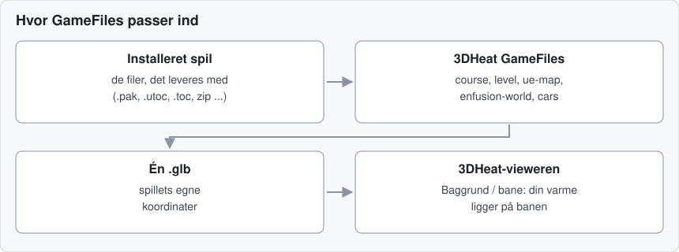

# Hele baner {#whole-levels}

**Med egne ord:** til skydespil og andre spil uden omgange gemmer værktøjet hele kortet
som én 3D-fil, så vieweren kan tegne, hvor spillerne bevægede sig på det.

`course` skærer terrænet omkring en omgang ud. For spil uden omgange eksporterer værktøjet
en hel bane, et kort eller en verden på én gang:

| Spil eller motor | Liste | Eksport | Side |
|---|---|---|---|
| Battlefield 6 (Frostbite) | `levels` | `level <level>` | [Battlefield 6-baner](level-battlefield.md) |
| Unreal 5 World Partition-spil | `ue-maps <game>` | `ue-map <game> <map>` | [Unreal 5-kort](level-unreal-world-partition.md) |
| Arma Reforger (Enfusion) | `enfusion-worlds` | `enfusion-world <world>` | [Arma Reforger-verdener](level-arma-reforger.md) |

Hvert par virker på samme måde: det første verbum lister, hvad det installerede spil
indeholder, og det andet skriver en af dem som en enkelt `.glb` i spillets egne
verdenskoordinater, så positioner optaget i det spil ligger rigtigt på den. Delene
hedder `ground:`, `structure:` og `water:` ligesom alle andre eksporter (se
[Outputformat](output-format.md)); indlæs filen i 3DHeat-vieweren's Bane-panel.

