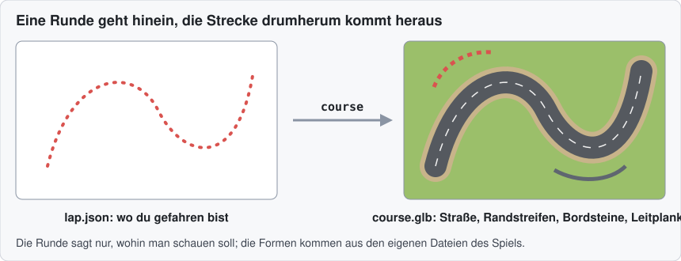
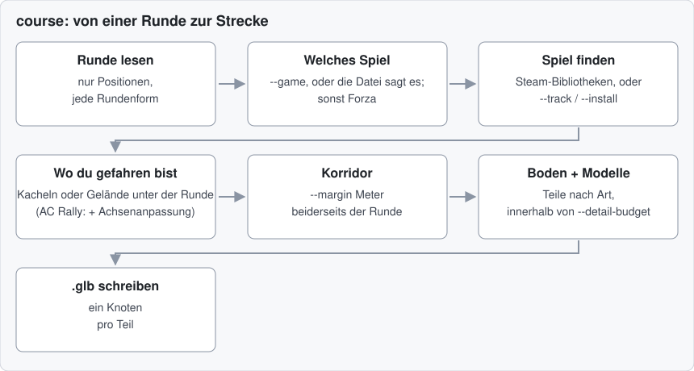

# Streckenexport {#course-export}

**Einfach gesagt:** Du bist eine Runde gefahren. Dieser Befehl baut die Strecke,
die du gefahren bist, als 3D-Datei. Die Runde ist nur eine Reihe von Punkten. Die
Straße, das Gras und die Randsteine kommen aus den eigenen Dateien des Spiels.

`course` macht aus einer Runde eine Strecke: den Boden in einem Streifen links und
rechts von der Fahrlinie und das, was auf diesem Boden steht, als eine `.glb`-Datei
für den Viewer. Diese Seite behandelt, was alle drei unterstützten Spiele gemeinsam
haben. Die Seiten darunter behandeln, was sich unterscheidet:

- [Forza Horizon](course-forza-horizon.md): ForzaTech-`.minizip`-Archive
- [BeamNG.drive](course-beamng.md): Zip-Archive, ein Höhenfeld des Geländes, kompilierte Formen
- [Assetto Corsa Rally](course-assetto-corsa-rally.md): Unreal 5 IoStore, eine World-Partition-Etappe
- [Detailstufen und Budget](detail-budget.md): wie viele Dreiecke die platzierten Modelle bekommen und welche Kopien bleiben

## Die Schritte {#the-steps}

Begriffe, die unten vorkommen: ein **Frame** ist die Ausrichtung der Achsen; der
**Korridor** ist der Streifen Boden links und rechts der Runde; eine **Kachel** ist
ein quadratisches Stück des Geländes eines Spiels; eine **LOD** (Detailstufe) ist
eine vereinfachte Kopie eines Modells.

1. **Die Runde lesen.** Nur Positionen, aus jeder der Formen in
   [Rundeneingaben](lap-inputs.md). Geschwindigkeit und Eingaben werden nicht
   verwendet. Eine Runde mit weniger als zwei Punkten wird abgelehnt ("holds no driving").
2. **Das Spiel bestimmen.** Zuerst `--game`, dann das Feld `game` der Rundendatei,
   sonst Forza (siehe [Befehle](commands.md#which-game)).
3. **Das installierte Spiel finden.** Alle drei durchsuchen jede Steam-Bibliothek,
   die in `config\libraryfolders.vdf` von Steam steht. Forza durchsucht außerdem
   `C:\XboxGames`. Mit `--track` (Forza) oder `--install` (BeamNG, AC Rally) entfällt
   die Suche.
4. **Finden, wo die Runde gefahren wurde.** Das wird nie allein über einen
   Namensvergleich entschieden. Forza wählt die Strecke, deren Geländekacheln die
   Runde abdecken. BeamNG wählt die Ebene, auf deren Gelände (oder Straßen) die
   Punkte der Runde liegen. AC Rally probiert jede Etappe in acht
   Achsenausrichtungen und nimmt die, die den größten Teil der Runde auf die Straße
   legt.
5. **Einen Korridor ausschneiden**, `--margin` Meter auf jeder Seite der Fahrt
   (unten).
6. **Den Boden bauen** innerhalb des Korridors, eingeteilt in Fahrbahn, Seitenstreifen,
   Schotter und Erde, Gelände, Markierungen, Reifenspuren oder Wasser, und für jedes
   512-m-Quadrat eine Bodentextur backen.
7. **Die Modelle platzieren**, die im Korridor stehen, nach Kategorie, mit einer
   Detailstufe, die nach Entfernung und einem Dreiecksbudget gewählt wird.
8. **Die `.glb` schreiben**: ein benannter Knoten je Teil. Siehe [Ausgabeformat](output-format.md).

Was ein Lauf ausgibt, hier an einem synthetischen BeamNG.drive-Install, den die
Tests bauen, einer 50-m-Runde auf einem Straßenstreifen:

## Der Korridor {#the-corridor}

Der Ausschnitt ist ein Band um die gefahrene Linie, nicht die Begrenzungsbox der
Runde. Bei einer Rundstrecke sind beide fast gleich. Bei einem Sprint von A nach B
besteht die Box größtenteils aus Hängen, an denen niemand vorbeifährt, und das Band
kann nur ein Zehntel der Fläche haben. Quelle:
[`corridor.py`](https://github.com/Holdi601/3DHeat-GameFiles/blob/main/heat3d_gamefiles/corridor.py).

So wird er gebaut:

- Die Fahrt wird auf die Bodenebene projiziert: x und z der Runde (BeamNG: x und y
  des eigenen Bezugssystems des Spiels).
- Sie wird auf ein Raster aus Zellen zu **4 m** gerastert (`CELL`). Jede Zelle, die
  die Fahrt berührt, wird in alle Richtungen um eine Scheibe mit dem Radius
  `margin + 4 m` verbreitert.
- Aufeinanderfolgende Punkte, die weniger als **50 m** auseinanderliegen (`JOIN`),
  werden durch Punkte alle 4 m verbunden, damit das Band keine Lücken hat. Weiter
  auseinanderliegende Punkte gelten als getrennte Teile der Fahrt und werden nicht
  verbunden. Eine Bibliotheksstrecke besteht aus vielen Rundendateien hintereinander,
  und das Ziel der einen Fahrt und der Start der nächsten dürfen kein Band quer über
  die Karte ziehen.
- Ein Dreieck bleibt erhalten, wenn eine Ecke, die Mitte einer Kante oder sein
  Schwerpunkt im Band liegt. Die Mittelpunkte fangen ein großes Dreieck ein, das quer
  über einem schmalen Band liegt, während alle seine Ecken außerhalb liegen.
- Die Höhe spielt beim Ausschnitt nie eine Rolle. Eine Box, die die Höhe begrenzt,
  würde den Boden unter einem Hügel abschneiden, den die Straße hinaufführt.

Die Konsole meldet die Fläche des Korridors, zum Beispiel
`cutting 80 m either side of the driving: 1.53 km2 of a 6,000 by 3,600 m box`.

BeamNG und AC Rally bauen außerdem einen breiteren **Reichweiten**-Korridor mit
`margin + 60 m`. Ein platziertes Modell wird berücksichtigt, wenn sein Ursprung im
Reichweitenkorridor liegt, und nur gezeichnet, wenn seine Grundfläche den echten
Korridor berührt. So geht ein langes Objekt nicht verloren, dessen Ursprung knapp
außerhalb des Bandes liegt. BeamNG verwendet den Reichweitenkorridor außerdem, um
zu wählen, welche Straßen-Decals gemalt werden.

## Woraus der Boden besteht {#what-the-ground-is-made-of}

Jeder Export ordnet seine Bodendreiecke in dieselben Arten ein. Jede Art wird als
eigener Teil geschrieben, damit der Viewer sie ein- und ausblenden kann:

| Art | Teilname | Einfarbige Fläche (lineares RGB) | Forza | BeamNG | AC Rally |
|---|---|---|---|---|---|
| Fahrbahn | `ground:road` | 0,22, 0,22, 0,23 | Straßenstreifen: Asphaltteil | Schichten vom Typ `ASPHALT`, Straßen-Decals, modellierte Straße | Streckenkacheln (`/MeshesTrack/`) |
| Seitenstreifen | `ground:verge` | 0,52, 0,47, 0,30 | Straßenstreifen: der Randstreifen | Bürgersteige und Modelle der Seitenstreifen | - |
| Schotter und Erde | `ground:gravel and dirt` | 0,50, 0,42, 0,30 | - | Schichten und Decals für Erde, Schotter, Sand und Schlamm | - |
| Gelände | `ground:terrain` | 0,30, 0,44, 0,18 | alles Übrige | alles Übrige | `_Terrain`-Kacheln und fernes Gelände |
| Randsteine | `ground:kerbs` | 0,60, 0,12, 0,10 (Forza) | `road_gen_rum*`-Requisiten | Modelle für Randstein, Bordstein und Rumble | Modelle für Randstein und Bordstein |
| Markierungen | `ground:markings` | 0,90, 0,90, 0,88 | Decal-Teilmeshes, 5 cm angehoben | in die Textur gemalt | - |
| Reifenspuren | `ground:tyre marks` | 0,20, 0,17, 0,16 | Decal-Teilmeshes, 5 cm angehoben | in die Textur gemalt | - |
| Wasser | `water:water` | 0,16, 0,34, 0,48 | Wassermaterialien | Meeresfläche, Wasserblöcke, Flüsse | - |

Die einfarbigen Flächen sind so gewählt, dass man sie auf einen Blick erkennt, nicht
so, dass sie zum Spiel passen. Sie werden für Teile ohne Textur verwendet und von
Viewern, die Texturen ignorieren. Quelle:
[`surfaces.py`](https://github.com/Holdi601/3DHeat-GameFiles/blob/main/heat3d_gamefiles/surfaces.py).

Bodenteile werden je 512-m-Quadrat aufgeteilt, und jedes Quadrat trägt sein eigenes
eingebackenes Bild, deshalb steht das Quadrat im Teilnamen:

| Spiel | Name des Bodenteils | Schlüssel des Quadrats |
|---|---|---|
| Forza | `ground:road x-2046 z1023` | der Rastername der Geländekachel (Schritte von 1023, siehe [Forza Horizon](course-forza-horizon.md)) |
| BeamNG | `ground:road 3_-2` | `floor(x / 512)`, `floor(y / 512)` in BeamNG-Metern |
| AC Rally | `ground:road 1_-4` | `floor(x / 51200)`, `floor(y / 51200)` in Unreal-Zentimetern |

## Was auf dem Boden steht {#what-stands-on-it}

Platzierte Modelle werden in Teile namens `structure:<category>` geschrieben, oder
als `ground:kerbs` für Randsteine (in allen drei Spielen). Hat ein Teil eine eigene
Textur, folgt dem Kategorienamen der Name der Textur oder des Materials, zum Beispiel
`structure:barriers bar_armco_bclr`.

| Kategorie | Forza | BeamNG | AC Rally |
|---|---|---|---|
| Absperrungen | ja | ja | ja |
| Requisiten | ja | ja | ja |
| Schilder | ja | ja | ja |
| Gebäude | ja (ganze Gebäude als Stellvertreter, wo das Spiel sie hat) | ja | ja |
| Infrastruktur | ja | ja | ja |
| Brücken | ja | ja | (als Infrastruktur eingeordnet) |
| Felsen | ja | ja | ja |
| Randsteine | ja, als Boden | ja, als Boden | ja, als Boden |
| Bäume | mit `--trees` | mit `--trees` | mit `--trees` |
| zerstörbare Objekte | mit `--trees` | - | - |

Die Verteilung der Detailstufen ist in allen drei gleich. Kopien innerhalb von 25 m
zur Fahrt beginnen mit voller Detailstufe, Kopien 25 bis 60 m entfernt eine Stufe
gröber, und weiter entfernte Kopien in der gröbsten Stufe. Danach werden die
teuersten Modelle herabgestuft, bis ein Dreiecksbudget passt. Reicht selbst die
gröbste Stufe für ein Budget, das du vorgibst, nicht aus, werden Kopien
weggelassen. Randsteine werden nie vereinfacht oder weggelassen. Siehe
[Detailstufen und Budget](detail-budget.md).

## Optionen, die das Ergebnis formen {#options-that-shape-the-result}

| Wunsch | Option |
|---|---|
| eine kleinere Datei | `--no-textures` (einfarbige Flächen), `--texture-size 1024` oder `512`, `--detail-budget N`, `--margin 40` |
| nur den Boden | `--no-placed` |
| auch die Szenerie | `--trees` |
| eine andere Jahreszeit (Forza) | `--season winter` |
| ein Spiel außerhalb von Steam | `--track` (Forza) oder `--install` (BeamNG, AC Rally) |
| eine Runde, die die Suche nicht findet | `--level` (BeamNG, AC Rally), `--track` (Forza) |

## Koordinaten {#coordinates}

Jeder Export schreibt Meter mit Y nach oben, in einem Bezugssystem, mit dem eine
aufgezeichnete Runde desselben Spiels übereinstimmt:

| Spiel | Geschriebenes Bezugssystem |
|---|---|
| Forza | die eigenen Weltkoordinaten des Spiels, unverändert |
| BeamNG | `(x, z, -y)` des Z-nach-oben-Weltsystems von BeamNG, also die Drehung, die der Telemetrie-Recorder anwendet |
| AC Rally | das Bezugssystem der Runde, durch Anpassung gefunden: Unreal-Zentimeter werden zu Metern, und Unreal-X und -Y werden zu x und z der Runde in einer von acht passenden Ausrichtungen |

Siehe [Ausgabeformat](output-format.md).
