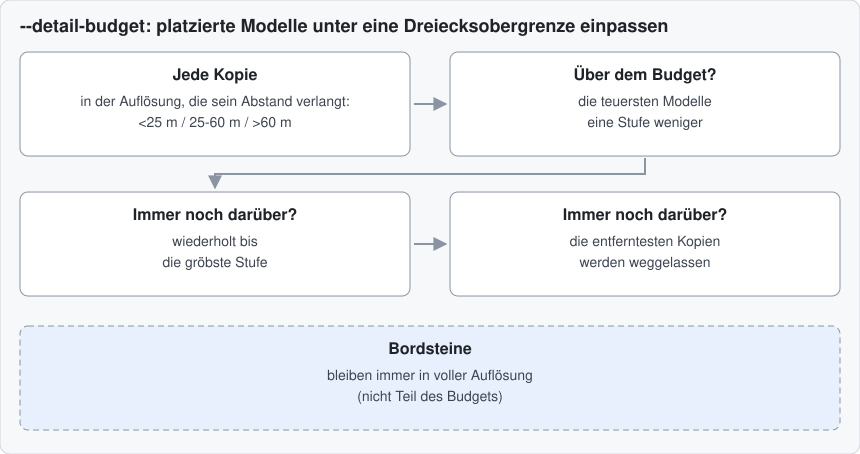

# Detailstufen und Budget {#levels-of-detail-and-the-budget}

Ein **Dreieck** ist ein winziges flaches Stück eines 3D-Modells. Mehr Dreiecke
bedeuten eine größere, langsamere Datei. Das **Budget** ist eine Grenze dafür, wie
viele es sein dürfen. Eine **Detailstufe** (LOD) ist eine einfachere Kopie eines
Modells, die verwendet wird, wenn es weit weg ist.

Die feinste Stufe von allem, was um eine Rundstrecke herum platziert ist, sind
mehrere Millionen Dreiecke. Zum Beispiel: Hunderte Leitplankensegmente und
Reifenstapel mit je etwa tausend Dreiecken. Ein Stadtkorridor enthält über
hunderttausend Kopien. Deshalb gibt jeder Streckenexport den platzierten Modellen ein
**Dreiecksbudget** und entscheidet für jedes Modell, in welcher Detailstufe es
gezeichnet wird und, falls nötig, welche Kopien weggelassen werden.

Das Verfahren wurde für Forza geschrieben
([`forzaplacement.py`](https://github.com/Holdi601/3DHeat-GameFiles/blob/main/heat3d_gamefiles/forzaplacement.py):
`choose_levels`, `auto_budget`, `_fit`), und BeamNG und AC Rally verwenden seine
Teile wieder. Das Gelände zählt nicht gegen das Budget.

## Entfernungsbänder {#distance-bands}

Die Entfernung jeder Kopie zur Fahrt wird in der Bodenebene gemessen, bis zum
nächsten Punkt der Runde. Die Runde wird zuerst auf höchstens 1.000 Punkte
ausgedünnt. Das kostet ein paar Meter Genauigkeit und nichts, worauf es hier
ankommt. Die Kopien fallen dann in drei Bänder, und jedes Paar (Modell, Band) wird
getrennt budgetiert:

| Band | Entfernung | Beginnt bei |
|---|---|---|
| nah | unter 25 m (`NEAR`) | der feinsten Stufe |
| mittel | 25-60 m (`FAR`) | eine Stufe gröber |
| fern | 60 m und mehr | der gröbsten Stufe |

Ohne Route (Forza `terrain --box`) wird die Entfernung bis zur Mitte der Box gemessen.

## Herabstufen, bis es passt {#stepping-down-to-fit}



Die Kosten eines Eintrags (Modell, Band) sind Kopien mal Dreiecke auf seiner
aktuellen Stufe. Solange die Summe über dem Budget liegt, wird der Eintrag mit den
höchsten Kosten um eine Stufe herabgestuft. Das wiederholt sich, bis die Summe passt
oder nichts mehr weiter herabgestuft werden kann. Festgesetzte Einträge werden nie
herabgestuft:

| Spiel | Immer auf voller Detailstufe |
|---|---|
| Forza | Randsteine (`road_gen_rum*`) |
| BeamNG | Randsteine und jede Form, die Fahrfläche trägt |
| AC Rally | Randsteine |

Die Forza-Zusammenfassung meldet das als
`N of M models drawn at a coarser level to fit the budget`.

## Das automatische Budget {#the-automatic-budget}

Ohne `--detail-budget` bestimmt sich das Budget selbst, sodass **keine Kopie
weggelassen wird**:

```
budget = max(1,500,000, 1.25 x sum(copies x coarsest level))
```

Festgesetzte Einträge zählen auf ihrer feinsten Stufe. Die 25 % (`HEADROOM`) lassen
Dinge neben der Straße einen Teil ihrer Detailtiefe behalten. Bei einer
Landstrecke ist das die Untergrenze von 1,5 Millionen (`DEFAULT_BUDGET`). Bei einem
Stadtkurs, wo der Korridor über hunderttausend Kopien enthält, wächst es auf über
zehn Millionen, und die Datei auf mehrere hundert MB. Der Viewer lädt das.

## Ein Budget, das du vorgibst {#a-budget-you-give}

`--detail-budget N` ist eine **Obergrenze**. Die Stufen werden wie oben
herabgestuft. Reicht selbst die gröbste Stufe nicht, werden Kopien weggelassen:

| Spiel | Reihenfolge, in der Kopien weggelassen werden |
|---|---|
| Forza | zuerst alles 25 m oder weiter von der Fahrt entfernt, dann, was neben der Straße steht; innerhalb jeder Gruppe zuerst, was von der Straße aus am kleinsten wirkt: größte Entfernung / Größe (Größe = die Diagonale der Bounding Box des Modells mal seine größte Skalierung, mindestens 0,25 m) |
| BeamNG | am weitesten von der Fahrt entfernte zuerst |
| AC Rally | am weitesten von der Fahrt entfernte zuerst, wie BeamNG |
| Battlefield 6 | kleinste zuerst: Diagonale der Bounding Box mal Skalierung |

Randsteine (und bei BeamNG die Modelle der Fahrfläche) werden nie weggelassen. Ein
Budget, das kleiner ist als ihre eigenen Kosten, wird also nur durch sie
überschritten, durch nichts anderes.

Das Verfahren nimmt bei Forza Entfernung geteilt durch Größe, weil eine Ordnung nur
nach Entfernung eine Klimaanlage an einer Wand, neun Meter entfernt, länger
überleben ließe als die Fassade, an der sie hängt: zwanzig Meter groß und zwölf Meter
entfernt. Dinge
neben der Straße kommen unabhängig von ihrer Größe zuletzt, denn eine drei Meter
hohe Absperrung fünf Meter von der Linie ist der Rand der Strecke, während ein
fünfzig Meter großes Gebäude sechzig Meter zurückliegt und Kulisse ist.

Die Zusammenfassung meldet
`N of M copies left out to fit the budget, the smallest and furthest from the driving first (--detail-budget raises it)`
(Forza) oder `N copies left out to fit the budget, the furthest from the driving first (--detail-budget raises it)`
(BeamNG, AC Rally).

## Ganze Gebäude (Forza) {#whole-buildings-forza}

Ein Stellvertreter für ein ganzes Gebäude zählt als eine Kopie, mit einer Entfernung
bis zur nächsten Kante des Gebäudes gemessen. Es wird als Einheit behalten oder
weggelassen. Die modularen Teile, die es ersetzt, werden gar nicht budgetiert. Siehe
[Forza Horizon](https://holdi601.github.io/3DHeat-Ext-Forza/course-forza-horizon.html#buildings-drawn-whole).

## Was eine Detailstufe ist, je Spiel {#what-a-level-of-detail-is-per-game}

| Spiel | Die Stufen kommen aus |
|---|---|
| Forza | der Detailstufen-Maske pro Dreieck der `Mesh`-Teilmeshes des Modells (Bit `level + 1`); `0xFFFF` für zerbrechliche Teile nur bei einem Modell ohne markierte Stufe |
| BeamNG | den `details` der `.cdae`-Form mit nicht negativer Größe, größte zuerst; bei `.dae` die Zahl am Ende der Meshknotennamen (`barrier75`, `barrier40`) |
| AC Rally | den gespeicherten Detailstufen des statischen Meshes, feinste zuerst |
| Battlefield 6 | den Detailstufen des MeshSet, feinste zuerst, und zwar nur die gezeichneten Abschnitte (nicht die Kopien für Schatten und reine Tiefe) und nicht eine letzte Stufe, die ein Stellvertreter für die Fernsicht ist (Materialien `M_LastLod`, `M_Billboard`, `M_Vista`: aus einem Gittermast würde sonst ein massiver Dorn) |

Die `level` von Battlefield 6 hat keine Fahrt, deshalb gibt es keine Entfernungsbänder:
Jedes Mesh ist ein Eintrag, und jede Kopie steht auf derselben Stufe. Das automatische
Budget ist die Formel oben, mit festgesetztem Geländehintergrund. Das Höhenfeld steht
außerhalb des Budgets und richtet sich nach `--ground-spacing`. Unter einem Budget,
das du vorgibst, werden, sobald jedes Mesh auf seiner gröbsten Stufe steht, Kopien
kleinste zuerst weggelassen. Die Größe ist die Diagonale der Bounding Box des Meshes
mal Skalierung der Kopie, weil es keine Fahrt gibt, von der aus man die Entfernung
messen könnte. Der Geländehintergrund wird nie weggelassen. Ein Level kommt
automatisch auf etwa zehn Millionen Dreiecke.

## Eine Zahl wählen {#choosing-a-number}

| Du willst | Probier |
|---|---|
| alles, volle Detailtiefe nahe der Straße | automatisch lassen |
| eine Datei, die einige Male kleiner ist | `--detail-budget 500000` mit `--texture-size 1024` |
| nur den Boden | `--no-placed` (kein Budget beteiligt) |
