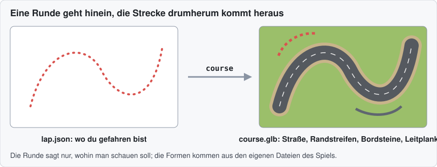
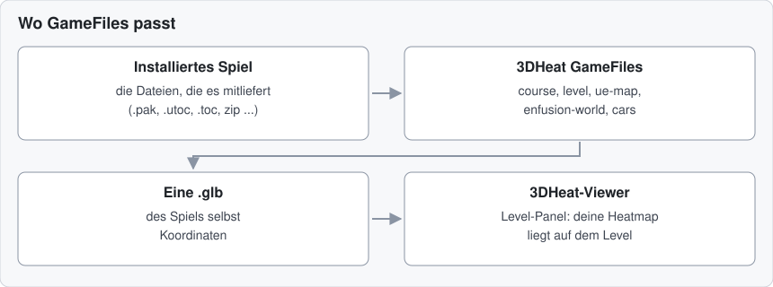

# 3DHeat GameFiles {#dheat-gamefiles}

**Was ist das?** Ein Werkzeug, das aus den Dateien eines Spiels, das du bereits installiert hast, ein
3D-Modell einer Rennstrecke oder eines Spiel-Levels baut.

**Wozu brauche ich das?** Der 3DHeat-Viewer malt, wo du gefahren oder gespielt hast, als Heatmap. Mit diesem
Werkzeug malt er es auf die echte Strecke oder das echte Level, nicht auf leeren Raum.

**Beispiel:** Nimm eine Runde, die du gefahren bist. Das Werkzeug baut die Straße und das Gelände drumherum
als eine 3D-Datei, sodass der Viewer deine Geschwindigkeit oder Unfälle auf der echten Strecke malen kann:



Neu in der Kommandozeile? Fang mit [Bevor du anfängst](before-you-start.md) an.

Genauer: Es liest Leveldaten aus den Archiven, die ein Spiel mitliefert, und schreibt sie als binäre
glTF-Datei (`.glb`). Seine Hauptaufgabe ist der **Strecken-Export**: Du gibst ihm eine Runde, und es schreibt
den Boden, die Straße (unterschieden von Randstreifen und Gras) sowie die Bordsteine, Leitplanken, Reifenwände,
Schilder und Gebäude drumherum.

Es ist Teil von [3DHeat](https://github.com/Holdi601/3DHeat), einem Viewer für Echtzeit-3D-Telemetrie-Heatmaps,
Rennanalyse und Match-Auswertung ([Dokumentation](https://holdi601.github.io/3DHeat/)). Die `.glb`-Dateien, die
dieses Werkzeug schreibt, sind die Levels, auf die der Viewer die Heatmap zeichnet.



Es ist einer von drei Wegen, die Geometrie eines Levels in 3DHeat zu bekommen:

| Weg | Braucht | Liefert |
|---|---|---|
| 3DHeat Unreal Exporter | das Unreal-Projekt im Editor geöffnet | exakte Geometrie |
| 3DHeat GameCapture | einen Bildschirm und eine Aufnahme | eine Schätzung |
| **3DHeat GameFiles** | **das installierte, ausgelieferte Spiel** | **exakte Geometrie, kein Projekt nötig** |

Python-Paket: `heat3d_gamefiles`. Repository:
[Holdi601/3DHeat-GameFiles](https://github.com/Holdi601/3DHeat-GameFiles). Lizenz: MIT.

## Was es kann {#what-it-can-do}

| Spiel oder Engine | Strecken-Export (`course`) | Archive lesen |
|---|---|---|
| Forza Horizon (ForzaTech) | ja: Gelände, Straße und Randstreifen, Bodentextur, platzierte Modelle mit ihren eigenen Texturen | `identify`, `list`, `extract` auf einer `.minizip`; `identify` auf einer `.modelbin`; Modelle, Gelände und Texturen über `course` und `terrain` |
| BeamNG.drive | ja: Gelände, Straßen-Decals, modellierte Rennstrecken, platzierte Modelle, Wasser | `identify`, `list`, `extract` auf Level-ZIPs; `identify` auf `.ter`, `.cdae`; `.dae` über `course` |
| Assetto Corsa Rally (Unreal 5.6) | ja: Etappen-Bodenkacheln, eingebrannte Bodenfarbe, platzierte Modelle in einfachen Farben | `identify`, `list`, `extract` auf IoStore `.utoc`/`.ucas`; Zen-Pakete, statische Netze, Texturen über `course` |
| Unreal `.pak` (Versionen 8-12) | nein | `identify`, `list`, `extract` |
| Unity (Format 22 und neuer) | nein | `identify`, `meshes` |
| Battlefield 6 (Frostbite `.toc`/`.cas`) | keine Runde; ein ganzes Level mit `level`: Gelände, platzierte Netze, ihre Farbkarten mit `--textures` | `identify`, `levels`; Bundles, Netze, Gelände, Texturen und Platzierung über `level` |
| Source-2-`.vpk` | nein | `identify`, `list`, `extract` |
| Unreal-5-World-Partition-Spiele | keine Runde; eine ganze Karte mit `ue-map` (aufgelistet mit `ue-maps`): Landschaft, HLOD-Gebäude und Requisiten, Wasser | - |
| Arma Reforger (Enfusion) | keine Runde; eine ganze Welt mit `enfusion-world` (aufgelistet mit `enfusion-worlds`): Gelände in seinen Farben, das Meer, Gebäude als Boxen | - |
| Forza (Autos) | `cars`: jedes Auto in niedriger Auflösung, für den Rennanalyse-Reiter des Viewers | - |

Runden aus Assetto Corsa EVO und iRacing werden mit einem Grund abgelehnt. Siehe
[Grenzen und bekannte Lücken](limits-and-known-gaps.md).

## Installation {#install}

Neu in der Kommandozeile? Lies zuerst [Bevor du anfängst](before-you-start.md).

Du brauchst **Python 3.10 oder neuer** (entwickelt mit 3.13) und die Pakete aus
[`requirements.txt`](https://github.com/Holdi601/3DHeat-GameFiles/blob/main/requirements.txt).

```
git clone https://github.com/Holdi601/3DHeat-GameFiles.git
cd 3DHeat-GameFiles
pip install -r requirements.txt
```

Prüfe dann: `python -m heat3d_gamefiles --help`. Du solltest `usage: heat3d_gamefiles [-h]` und die Liste
der Befehle sehen. Führe jeden Befehl aus dem Ordner des Repositorys aus, als `python -m heat3d_gamefiles <verb>`.

| Paket | Wofür |
|---|---|
| numpy | alles, was Geometrie dekodiert |
| lz4 | Forza-Archive (meist LZ4-Blöcke), manche Unity-Bundles, IoStore-LZ4-Blöcke |
| Pillow | Dekodieren von BC1-BC7-Texturen, Schreiben der JPEG-Texturen in die `.glb` |
| msgpack, zstandard | die kompilierten Formen von BeamNG (`.cdae`) |
| cryptography | nur zum Öffnen einer verschlüsselten `.pak` mit einem Schlüssel, den du schon hast |
| pytest | die Tests |

Unreal-Inhalte, die mit **Oodle** komprimiert sind, brauchen eine Oodle-Bibliothek, die schon auf deinem
Rechner liegt. Eine solche wird mit diesem Werkzeug nie mitgeliefert. Siehe [Oodle](reader-oodle.md).

Das Werkzeug ist für Windows geschrieben. Es findet Spiele über die Bibliotheksliste von Steam und
`%LOCALAPPDATA%` und lädt Oodle als Windows-DLL. Andere Plattformen wurden nicht getestet.

## Schnellstart {#quick-start}

Eine **Rundendatei** ist eine Aufnahme, wohin dein Auto gefahren ist: eine Liste von x-, y-, z-Punkten.
Sie kommt von [3DHeat GameCapture](https://github.com/Holdi601/3DHeat-GameCapture) oder aus der
Rundenbibliothek der FH-Companion-App; eine von Hand getippte CSV funktioniert auch
([Rundeneingaben](lap-inputs.md)).

```
# Forza: a lap file, a lap folder, or a course name from the FH Companion library
python -m heat3d_gamefiles course "Example Circuit"
python -m heat3d_gamefiles course path\to\lap.json -o course.glb

# BeamNG.drive or Assetto Corsa Rally: a heat3d-lap file says which game it is from
python -m heat3d_gamefiles course my_lap.json

# Every course in the FH Companion library, one .glb each
python -m heat3d_gamefiles courses -o courses

# Battlefield 6: list the levels, then export one (a large file; see Commands)
python -m heat3d_gamefiles levels
python -m heat3d_gamefiles level <level> -o level.glb --textures

# Unreal 5 World Partition and Arma Reforger: list, then export
python -m heat3d_gamefiles ue-maps "<game>"
python -m heat3d_gamefiles ue-map "<game>" <map> -o map.glb
python -m heat3d_gamefiles enfusion-worlds
python -m heat3d_gamefiles enfusion-world <world> -o world.glb

# Every Forza car, for the viewer's race tab
python -m heat3d_gamefiles cars -o forza.h3dcars

# What is this file?
python -m heat3d_gamefiles identify some_archive.pak
```

Öffne die `.glb` im 3DHeat-Viewer. Die Weltkoordinaten des Spiels bleiben erhalten
(siehe [Ausgabeformat](output-format.md)), sodass eine aufgenommene Runde mit der Strecke übereinstimmt.

## Karte dieser Dokumentation {#map-of-this-documentation}

- [Bevor du anfängst](before-you-start.md): Python, ein Terminal, der erste Befehl.
- [Befehle](commands.md): jeder Befehl und jede Option, mit Beispielen.
- [Befehlsreferenz](../cli-reference.md): das `--help` jedes Befehls, aus dem Code erzeugt.
- [Archive untersuchen](inspecting-archives.md): `identify`, `list`, `extract`, `meshes`, Schritt für Schritt.
- [Streckenexport](course-export.md): wie eine Runde zu einer Strecke wird, für alle Spiele.
  - [Forza Horizon](course-forza-horizon.md)
  - [BeamNG.drive](course-beamng.md)
  - [Assetto Corsa Rally](course-assetto-corsa-rally.md)
  - [Detailstufen und Budget](detail-budget.md)
- [Ganze Levels](whole-levels.md): ein Level, eine Karte oder eine Welt ohne Runde.
  - [Battlefield-6-Levels](level-battlefield.md): `levels`, `level`
  - [Unreal-5-Karten](level-unreal-world-partition.md): `ue-maps`, `ue-map`
  - [Arma-Reforger-Welten](level-arma-reforger.md): `enfusion-worlds`, `enfusion-world`
- [Forza-Autos](forza-cars.md): `cars`, die Autodatei für den Rennanalyse-Reiter des Viewers.
- [Rundeneingaben](lap-inputs.md): jede Form von Rundendatei, die das Werkzeug annimmt.
- [Ausgabeformat](output-format.md): was in der `.glb` steckt.
- [Archivleser](archive-readers.md): eine Seite pro Containerformat, mit dem, was jeder liest, was nicht,
  und warum.
- [Grenzen und bekannte Lücken](limits-and-known-gaps.md)
- [Fehlersuche](troubleshooting.md): die Fehlermeldungen und was zu tun ist.
- [Regeln und Lizenzen](rules-and-licences.md): keine Schlüssel, deine eigenen Dateien, keine Weitergabe.
- [Updates](updates.md): die Update-Prüfung und `heat3d_update`.
- [Entwicklung](development.md): Modulübersicht und Tests, einschließlich der Tests, die gegen installierte Spiele laufen.
- [Pflege](maintaining.md): die Release-Checkliste für diese Seiten.

## Teil von 3DHeat {#part-of-3dheat}

3DHeat GameFiles ist eines der kostenlosen Werkzeuge rund um den 3DHeat-Viewer:

| Werkzeug | Was es tut | Doku |
|---|---|---|
| [3DHeat](https://github.com/Holdi601/3DHeat) | der Viewer: 3D-Heatmaps, Rennanalyse und Match-Auswertung im Browser | [Seite](https://holdi601.github.io/3DHeat/) |
| [GameFiles](https://github.com/Holdi601/3DHeat-GameFiles) | Strecken und Levels aus den Dateien, die Spiele mitliefern, als `.glb` | [Seite](https://holdi601.github.io/3DHeat-GameFiles/) |
| [GameCapture](https://github.com/Holdi601/3DHeat-GameCapture) | Rundentelemetrie aus Rennspielen; Levels aus Spielvideos nachgebaut | [Seite](https://holdi601.github.io/3DHeat-GameCapture/) |
| [Unreal Exporter](https://github.com/Holdi601/3DHeat-UnrealExporter) | ein Unreal-Editor-Plugin, das ein Level als `.glb` speichert | [Seite](https://holdi601.github.io/3DHeat-UnrealExporter/) |
| [CS2](https://github.com/Holdi601/3DHeat-CS2) | Counter-Strike-2-Demos in Match-Dateien; Karten in `.glb` | [Seite](https://holdi601.github.io/3DHeat-CS2/) |
| [Watcher](https://github.com/Holdi601/3DHeat-Watcher) | nimmt dein Spiel im Hintergrund auf, aus dem, was Spiele veröffentlichen | [Seite](https://holdi601.github.io/3DHeat-Watcher/) |
| [Ext-WarThunder](https://github.com/Holdi601/3DHeat-Ext-WarThunder) | War-Thunder-Replays in Match-Dateien | [Seite](https://holdi601.github.io/3DHeat-Ext-WarThunder/) |
| [Ext-WoT](https://github.com/Holdi601/3DHeat-Ext-WoT) | World-of-Tanks-Replays in Match-Dateien | [Seite](https://holdi601.github.io/3DHeat-Ext-WoT/) |
| [Ext-WoWs](https://github.com/Holdi601/3DHeat-Ext-WoWs) | World-of-Warships-Replays in Match-Dateien | [Seite](https://holdi601.github.io/3DHeat-Ext-WoWs/) |
| [Ext-Squad](https://github.com/Holdi601/3DHeat-Ext-Squad) | Squad-Server-Demos in Match-Dateien | [Seite](https://holdi601.github.io/3DHeat-Ext-Squad/) |
| [Ext-DCS](https://github.com/Holdi601/3DHeat-Ext-DCS) | DCS-World-Karten in `.glb`-Levels | [Seite](https://holdi601.github.io/3DHeat-Ext-DCS/) |
| [Ext-IL2](https://github.com/Holdi601/3DHeat-Ext-IL2) | IL-2-Sturmovik-Karten in `.glb`-Levels | [Seite](https://holdi601.github.io/3DHeat-Ext-IL2/) |

Die Match-Dateien des Viewers sind beschrieben in
[Eine Datei pro Match: `.3dheat`](https://holdi601.github.io/3DHeat/container.html);
ein hier erstelltes Level wird neben ihnen im Panel „Hintergrund / Level“ des Viewers geladen.
