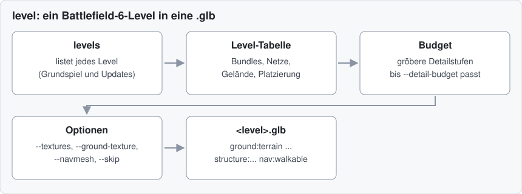

# Battlefield-6-Level: `levels` und `level` {#battlefield-6-levels-levels-and-level}

**Was ist das?** Ein ganzes Battlefield-6-Level als eine 3D-Datei. **Warum?** Damit
die Hitze aus deinen Partien das Gelände und die Gebäude darunter hat. (*Frostbite* ist
die Engine, mit der Battlefield gemacht ist; ein *Höhenfeld* ist das Gelände als
Raster aus Höhen gespeichert.)

Exportiert ein ganzes Frostbite-Level des installierten Spiels: das Höhenfeld des
Geländes, jedes Mesh, das seine statischen Modellgruppen platzieren, die einzeln
platzierten Objekte, den Geländehintergrund um die Karte und auf Wunsch die
Farbkarten der Oberflächen, die in den Boden eingebackenen Gelände-Decals und die
begehbaren Flächen der Soldaten.



## Schritt für Schritt {#step-by-step}

1. **Die Levels auflisten**, die das Spiel mitbringt:

   ```
   python -m heat3d_gamefiles levels
   python -m heat3d_gamefiles levels --install "D:\Games\<game folder>"
   ```

   Jede Zeile ist eine Level-Tabelle (`levels/<level>/<level>.toc`) mit ihrer Größe
   und ihrer Herkunft: `Data` für das Grundspiel, `Update/<pack>` für ein Update.

2. **Eines exportieren**, unter seinem Namen, einem eindeutigen Teil davon oder seinem
   `.toc`-Pfad. Beginne ohne Farbe, um Form und Größe zu sehen:

   ```
   python -m heat3d_gamefiles level <level> -o level.glb
   ```

3. **Farbe hinzufügen**, sobald es richtig aussieht:

   ```
   python -m heat3d_gamefiles level <level> -o level.glb --textures 512 --ground-texture 0.5
   ```

4. **Die begehbaren Flächen hinzufügen** oder die Datei verkleinern:

   ```
   python -m heat3d_gamefiles level <level> --textures 512 --ground-texture 0.5 --navmesh
   python -m heat3d_gamefiles level <level> --textures 256 --detail-budget 3000000 --ground-spacing 8
   ```

5. **`level.glb` öffnen** im Bereich Hintergrund / Level des 3DHeat-Viewers
   ([Level laden](https://holdi601.github.io/3DHeat/levels.html)).

## Optionen {#options}

| Option | Vorgabe | Bedeutung |
|---|---|---|
| `<level>` | Pflicht | ein Name, so wie `levels` ihn ausgibt, ein eindeutiger Teil davon oder die `.toc` eines Levels |
| `-o`, `--out FILE` | `<level>.glb` | die zu schreibende Datei |
| `--install FOLDER` | in den Steam-Bibliotheken gefunden | der Spielordner |
| `--textures [PIXELS]` | aus; ohne Größe 512 | die Farbkarte jeder Oberfläche, höchstens PIXELS an einer Seite |
| `--ground-texture [METRES]` | aus; ohne Größe 0,5 | Straßen, Vorfelder und Markierungen in die Bodenfarbe einbacken, METRES pro Pixel |
| `--navmesh` | aus | das Navigationsmesh der Soldaten als `nav:walkable` hinzufügen |
| `--ground-spacing METRES` | 4 | der feinste Abstand des Höhenfeldes; 0 lässt es weg |
| `--detail-budget N` | die gröbsten Kopien plus ein Viertel, mindestens 1.500.000 | eine Obergrenze für Dreiecke (das Gelände wird nie vergröbert) |
| `--skip TEXT` | | Modellgruppen auslassen, deren Partitionsname TEXT enthält; wiederholbar |
| `--by-mesh` | aus | ein Teil je Quell-Mesh und Material, um zu finden, was ein Teil ist |
| `--clamped-uvs` | aus | für Renderer, die eine Textur nicht wiederholen können |

Die vollständige Tabelle mit den zu erwartenden Größen (ein ganzes Level sind
hunderte MB) steht unter [Befehle](commands.md#levels-and-level-frostbite). Wie die
Tabellen, Bundles, Meshes und das Gelände gelesen werden, steht unter [Frostbite](reader-frostbite.md).

## Beispielausgabe {#example-output}

Was `level` ausgibt, im Überblick (die Zeilen so, wie der Code sie schreibt; `<n>`
und die Namen unterscheiden sich je Level):

```text
<n> copies of <n> meshes, from <n> static model groups
      <n>  <group>
      <n>  placed one by one (object and prefab references)
<n> meshes left out: <why>
<n> triangles, budget <n>; <n> meshes drawn at a coarser level to fit
           <n>  ground:terrain
           <n>  structure:buildings, <n> textures
           ...
<n> of <n> drawn sections carry their colour map; the rest are flat colours
Ground: <what the ground is>.
Navigation mesh: <tiles read>.
-> level.glb (<n> MB)
```

## Die Teile {#the-parts}

`ground:terrain` (das Höhenfeld), `ground:terrain backdrop` und
`ground:terrain blend`, `structure:<kind>` je Art von Mesh (je Farbkarte mit
`--textures`, mit ` (destructible)` für das, was ein Match zerstören kann), und
`nav:walkable` mit `--navmesh`. Siehe [Ausgabeformat](output-format.md).

Die Datei enthält die Inhalte des Spiels: Sie ist für den Rechner gedacht, auf dem
sie entstanden ist, nicht zum Weitergeben ([Regeln und Lizenzen](rules-and-licences.md)).
