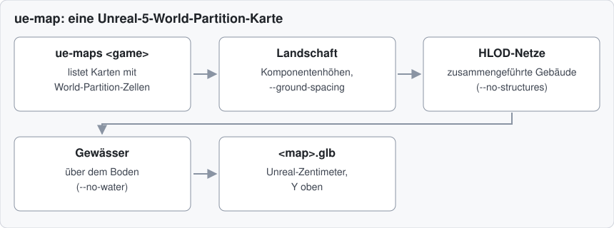

# Unreal-5-World-Partition-Karten: `ue-maps` und `ue-map` {#unreal-5-world-partition-maps-ue-maps-and-ue-map}

**Was ist das?** Eine ganze Karte eines Unreal-5-Spiels als eine 3D-Datei: das
Gelände, die Gebäude und das Wasser. **Warum?** Damit die Hitze aus diesem Spiel die
Karte darunter hat. (*World Partition* ist die Art, wie Unreal 5 eine große Karte in
Teile zerlegt; *HLOD* ist ein vereinfachter Stellvertreter für eine Gruppe von
Gebäuden, den das Spiel in der Ferne zeichnet.)

Exportiert eine ganze Karte eines Unreal-5-Spiels, dessen Karten als World-Partition-Zellen
aufbereitet sind: die Landschaft, die zusammengeführten HLOD-Meshes der Karte (ihre
Gebäude und Requisiten, so wie das Spiel sie in der Ferne zeichnet) und ihre
Wasserkörper. Kein Editor und kein Projekt sind nötig, nur das installierte Spiel.



## Schritt für Schritt {#step-by-step}

1. **Die Karten auflisten.** `<game>` ist der Spielordner, sein `Content/Paks` oder der
   Name seines Ordners in einer Steam-Bibliothek:

   ```
   python -m heat3d_gamefiles ue-maps "<Steam game folder name>"
   python -m heat3d_gamefiles ue-maps "D:\Games\<game>"
   ```

   Jede Karte mit aufbereiteten World-Partition-Zellen wird mit ihrem Paketpfad ausgegeben.

2. **Eine exportieren**, unter ihrem Namen oder einem eindeutigen Teil davon:

   ```
   python -m heat3d_gamefiles ue-map "<game>" <map> -o map.glb
   ```

3. **Nur der Boden oder gröber:**

   ```
   python -m heat3d_gamefiles ue-map "<game>" <map> --no-structures --no-water
   python -m heat3d_gamefiles ue-map "<game>" <map> --ground-spacing 4
   ```

4. **`map.glb` öffnen** im Panel Hintergrund / Level des 3DHeat-Viewers
   ([Level laden](https://holdi601.github.io/3DHeat/levels.html)).

## Optionen {#options}

| Option | Vorgabe | Bedeutung |
|---|---|---|
| `<game>` | Pflicht | der Spielordner, sein `Content/Paks` oder sein Steam-Ordnername |
| `<map>` | Pflicht | ein Name, so wie `ue-maps` ihn ausgibt, oder ein eindeutiger Teil davon |
| `-o`, `--out FILE` | `<map>.glb` | die zu schreibende Datei |
| `--ground-spacing METRES` | 2 | der Abstand der Landschaftspunkte, auf eine ganze Zahl eigener Vierecke gerundet |
| `--no-structures` | | die HLOD-Gebäude und Requisiten weglassen |
| `--no-water` | | die Wasserkörper weglassen |

Inhalte, die mit Oodle komprimiert sind, brauchen eine Oodle-Bibliothek, die schon auf
dem Rechner liegt (siehe [Oodle](reader-oodle.md)).

## Beispielausgabe {#example-output}

```text
<map> -> map.glb
  ground      <n> triangles from <n> landscape components; <n> of <n> vertices stored twice disagree
  structure   <n> triangles in <n> HLOD meshes
  water       <n> triangles from <n> water bodies
```

Die Zahl der Abweichungen ist eine Selbstprüfung: Benachbarte Landschaftskomponenten
speichern ihre gemeinsame Kante zweimal, und beide müssen übereinstimmen. Eine Karte
von 3 km bei 2 m hat etwa 4,6 Millionen Bodendreiecke.

## Die Teile {#the-parts}

`ground:<map>` (die Landschaft), `structure:<map>` (die HLOD-Meshes) und
`water:<map>` (Wasser über dem Boden).

**Einheiten:** Dies ist der einzige Export **nicht in Metern**: Unreal-Zentimeter, mit
vertauschten Y- und Z-Achsen (Y nach oben), das Bezugssystem, das der 3DHeat Unreal
Exporter schreibt. Telemetrie aus demselben Spiel verwendet dasselbe, deshalb liegt
sie auf der Karte.

## Wie es gelesen und geprüft wird {#how-it-is-read-and-checked}

| Teil | Gelesen aus | Geprüft gegen |
|---|---|---|
| Boden | die 16-Bit-Höhenkarte jeder Landschaftskomponente, über ihren Sektionsursprung auf die Transformation der Landschaft gesetzt | jeder Punkt, der zweimal gespeichert ist (an einer Naht oder einer Komponentenkante), muss übereinstimmen; Abweichungen werden gezählt und ausgegeben, nicht geglättet |
| Struktur | die zusammengeführten HLOD-Meshes der Karte, von der Engine im Weltraum gebaut | ein Mesh wird nur behalten, wenn die Grenzen, die seine Komponente zwischenspeichert, seine eigenen Punkte beschreiben |
| Wasser | das Mesh jedes Wasserkörpers, auf das Bodenraster gelegt, behalten dort, wo es über dem Boden steht | Wasser liegt einige Meter über dem Boden darunter, wie ein Fluss über seinem Bett |

Die Eigenschaften der Landschaft werden über ihre Form gefunden, nicht über die
Platznummer (die Plätze verschieben sich zwischen Engine-Versionen). Die
Strukturen sind die vereinfachten Stellvertreter, nicht die Modelle in voller
Detailtiefe. Laub, Decals und Landschaftsmaterialien werden nicht exportiert; der
Boden ist ohne Textur und wird vom Viewer schattiert. Archivdetails:
[Unreal 5 IoStore](reader-unreal-iostore.md).

**Eigene Dateien:** Die Karte wird aus dem auf deinem Rechner installierten Spiel
gelesen und für deine eigene Analyse auf deine Festplatte geschrieben; nichts aus dem
Spiel wird mit diesem Tool ausgeliefert.
