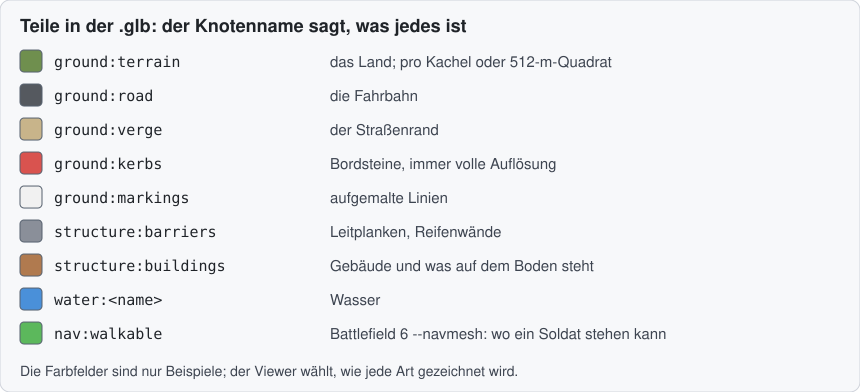

# Ausgabeformat {#output-format}

Eine `.glb` ist eine 3D-Datei: der Boden, die Gebäude und das Wasser einer Strecke oder eines Levels.
Du öffnest sie im Panel Hintergrund / Level des 3DHeat-Viewers.

Jeder Export (`course`, `courses`, `terrain`, `level`, `ue-map`, `enfusion-world`) schreibt eine
**binäre glTF-2.0-Datei** (`.glb`). Sie ist bewusst klein und flach gehalten und so angelegt, wie der
3DHeat-Viewer ein Level liest. Quelle:
[`glb.py`](https://github.com/Holdi601/3DHeat-GameFiles/blob/main/heat3d_gamefiles/glb.py).

## Aufbau {#structure}

```
scene 0
 ├─ node "ground:terrain x-2046 z1023"  -> mesh 0 -> 1 primitive, material 0
 ├─ node "ground:road x-2046 z1023"     -> mesh 1 -> 1 primitive, material 1
 ├─ node "ground:markings"               -> mesh 2 -> ...
 ├─ node "ground:kerbs road_gen_rum_..." -> ...
 ├─ node "structure:barriers bar_armco_bclr"
 └─ ...
```

- **Ein Node pro Teil**, alle an der Szenenwurzel, **ohne Transformationen**. Die ganze Geometrie liegt
  schon im Weltraum.
- Jeder Node hat sein eigenes Mesh mit **einem Primitive** und sein eigenes Material. Node, Mesh und
  Material tragen alle den Namen des Teils.
- Jedes Primitive hat **eigene kompakte Vertex-Arrays**, nur die Vertices, die dieses Teil benutzt. Ein
  gemeinsames Vertex-Array ist gültiges glTF, aber ein Leser, der die Accessoren jedes Primitives
  auflöst, würde dann jeden Vertex einmal pro Teil halten.
- `asset.generator` ist `heat3d_gamefiles`.
- Es werden **keine `extras`** geschrieben - keine eigenen Metadaten, keine Runde, kein Spiel- oder
  Streckenname -, mit einer Ausnahme: ein Battlefield-6-Teil eines zerstörbaren Meshes trägt
  `{"destructible": true}` an seinem Node. Alles, was der Viewer braucht, steht in den Node-Namen.

## Node-Namen: die Einordnung {#node-names-the-classification}



Der Viewer entnimmt die Klasse eines Teils dem **Node-Namen** (ersatzweise dem Mesh-Namen), und zwar nur,
wenn er zu

```
^(ground|structure|water)\s*[:|]
```

passt.

Alles andere wird nach einer Heuristik eingeordnet, die für Unreal-Landschaften geschrieben wurde. Jedes
Teil, das der Exporter schreibt, beginnt also mit einem dieser Präfixe oder mit `nav:` (unten):

| Präfix | Bedeutung | Geschriebene Teile |
|---|---|---|
| `ground:` | die Fahrfläche und das Land | `ground:road`, `ground:verge`, `ground:terrain`, `ground:gravel and dirt`, `ground:kerbs`, `ground:markings`, `ground:tyre marks` |
| `structure:` | was darauf steht | `structure:barriers`, `structure:props`, `structure:signs`, `structure:buildings`, `structure:infrastructure`, `structure:bridges`, `structure:rocks`, `structure:smashables`, `structure:trees` |
| `water:` | Wasser | `water:water`; `water:<map>` (`ue-map`), `water:<world>` (`enfusion-world`) |
| `nav:` | wo ein Soldat gehen kann (Battlefield 6, nur mit `--navmesh`) | `nav:walkable` |

`nav:` passt nicht auf das obige Muster des Viewers, daher sortiert ihn der Viewer über seine
Heuristik; es ist ein eigenes Teil, damit du es allein ein- und ausblenden kannst.
`ue-map` schreibt `ground:<map>`, `structure:<map>` und `water:<map>`; `enfusion-world` schreibt
`ground:<world>`, `structure:<world>` und `water:<world>`.

Nach der Art folgt, je nach Spiel:

| Beispiel | Bedeutung |
|---|---|
| `ground:road x-2046 z1023` | Forza-Boden in der Geländekachel `x-2046 z1023` (Rasterwerte, 1023 pro 512 m) |
| `ground:road 3_-2` | BeamNG-Boden im 512-m-Quadrat (3, -2) |
| `ground:road 3_-2 asphalt_light` | BeamNG-gemodellte Fahrfläche des Materials `asphalt_light` in diesem Quadrat |
| `ground:road 1_-4` | AC-Rally-Boden im 512-m-Quadrat (1, -4) des Unreal-Raums |
| `structure:barriers bar_armco_bclr` | Forza-platzierte Modelle mit einer gemeinsamen Textur (ihr Name ohne GUID) |
| `structure:barriers` | platzierte Modelle ohne Textur (Forza, AC Rally) |
| `structure:barriers armco_metal` | BeamNG-platzierte Modelle eines Materials |
| `ground:markings`, `water:water` | flache Teile, je eines für die ganze Datei |
| `ground:terrain` (Battlefield 6) | das Höhenfeld; `ground:terrain backdrop` die fernen Geländemeshes, `ground:terrain blend` Meshes, die ins Gelände übergehen |
| `nav:walkable` (Battlefield 6, `--navmesh`) | das Navigationsnetz des Levels für einen Soldaten: wo man stehen kann, flach grün |
| `ground:terrain x-512 z-512` (Battlefield 6, `--ground-texture`) | das Höhenfeld unter einer eingebackenen Decal-Kachel, benannt nach ihrer niedrigen Ecke in Metern |
| `structure:buildings t_concreteclean_01_cs` (Battlefield 6, `--textures`) | jede Oberfläche dieser Art, die diese Farbkarte zeigt; ohne `--textures` ein Teil pro Art, ohne Zusatz |
| `structure:buildings t_concreteclean_01_cs (destructible)` (Battlefield 6) | dasselbe, für Meshes, die ein Match zerstören kann: die mit einem Zerstörungs-Asset eigenen Namens (Wände, Häuser, Requisiten). Der Node trägt außerdem die glTF-Extras `{"destructible": true}`. Ihre zerstörten Zustände werden nicht exportiert |

Der Viewer kann nach diesen Namen filtern. Zum Beispiel ist "nur die Rennfläche" `ground:road` zusammen
mit `ground:kerbs`, in allen drei Spielen. Das Präfix bestimmt auch, wie der Viewer ein Teil zeichnet:
Boden als die Fläche, auf der die Wärme liegt, Struktur als das, was darauf steht.

## Einheiten, Achsen und Koordinatensystem {#units-axes-and-frame}

- **Meter, Y nach oben**, die Konvention von glTF, für jeden Export außer `ue-map`. Nichts wird skaliert
  oder neu zentriert: die Zahlen sind die Weltkoordinaten des Spiels, genau darum wird das Archiv gelesen
  statt etwas nachzubauen.
- **Unreal-5-Karten (`ue-map`): Zentimeter**, die eigene Einheit von Unreal, mit vertauschten Y- und
  Z-Achsen, damit Y nach oben zeigt - das Koordinatensystem, das der 3DHeat Unreal Exporter schreibt und
  die Telemetrie des Spiels benutzt. Der einzige Export, der nicht in Metern ist.
- **Arma Reforger (`enfusion-world`):** die eigenen Meter des Spiels, x nach Osten, y nach oben, z nach
  Norden. Das Koordinatensystem des Spiels ist linkshändig; die Option *Weltachse invertieren* des Viewers
  zeigt es ungespiegelt.
- **Forza:** die eigenen Weltkoordinaten des Spiels (x, y nach oben, z), unverändert. Dieselben wie seine
  Telemetrie, daher liegt eine aufgezeichnete Runde auf der Strecke.
- **BeamNG.drive:** `(x, z, -y)` des Z-up-Weltraums von BeamNG, die Drehung, die der Telemetrie-Recorder
  anwendet. Eine Drehung, keine Spiegelung.
- **Battlefield 6:** die eigenen Weltkoordinaten des Spiels (x, y nach oben, z), unverändert: die
  Instanztransformationen des Levels werden auf jedes Mesh angewendet, so wie gespeichert. Gespiegelte
  Kopien werden so umgedreht, dass ihre Normalen nach außen zeigen.
- **Assetto Corsa Rally:** das Koordinatensystem der Runde. Unreal-Zentimeter werden zu Metern, Unreal-Z
  wird y, und Unreal-X und -Y werden x und z, in welcher der acht Ausrichtungen die Runde passte (siehe
  [Assetto Corsa Rally](course-assetto-corsa-rally.md#which-stage-and-which-way-round)). Dreiecke werden
  dort umgedreht, wo diese Abbildung spiegelt.

Jeder Export behält die Achsen, die seine Telemetrie benutzt, damit Aufzeichnung und Level dasselbe
Koordinatensystem teilen. Ob dieses System in jedem Spiel links- oder rechtshändig ist, ist nicht
geprüft.

## Vertex-Daten {#vertex-data}

Der Standard ist die **quantisierte** Form (`quantize=True`). Sie braucht die Erweiterung
`KHR_mesh_quantization`, die sowohl in `extensionsUsed` als auch in `extensionsRequired` steht.

| Attribut | Quantisiert (Standard) | Volle Genauigkeit (`quantize=False`) |
|---|---|---|
| `POSITION` | float32 VEC3, mit min/max | float32 VEC3 |
| `NORMAL` | int8 VEC3 normalisiert, auf 4 Byte aufgefüllt (Schritt 4) | float32 VEC3 |
| `TEXCOORD_0` (nur texturierte Teile) | uint16 VEC2 normalisiert, auf 0-1 begrenzt; float32 VEC2, wo sich Texturen wiederholen (Battlefield 6) | float32 VEC2 |
| `COLOR_0` (ungetexturierte Teile, wenn ein Teil eine Farbe hat) | uint8 VEC3 normalisiert, auf 4 Byte aufgefüllt | float32 VEC3 |
| Indizes | uint16, wenn das Teil höchstens 65.535 Vertices hat, sonst uint32 | uint32 |

Ein Vertex ist 20 Byte statt 32 (24 statt 44 mit Farbe). Das spart ein Drittel jeder Datei, und das
entscheidet, ob eine Stadtstrecke in einem Browser-Tab lädt oder nicht. Der Preis ist weniger als ein
halbes Grad Normale und 1/65.535 einer UV (ein Fünfzehntel eines Texels bei 4.096 px). Die Kommandozeile
schreibt immer die quantisierte Form. `write_glb(..., quantize=False)` in Python schreibt die andere.

Normalen kommen vom Spiel, wo es sie speichert (Forza-Gelände und -Modelle, BeamNG-Shapes und -Gelände).
Sonst werden sie als flächengewichtete, glatte Normalen aus den Dreiecken berechnet. AC-Rally-Normalen
werden immer berechnet.

## Materialien, Farben und Texturen {#materials-colours-and-textures}

- Jedes Material hat `metallicFactor 0`, `roughnessFactor 1`.
- **Texturiertes Teil:** `baseColorTexture` mit dem Bild des Teils, den UVs und ohne Vertex-Farbe. glTF
  multipliziert beides, daher würde eine Fläche zweimal abgedunkelt.
- **Ungetexturiertes Teil:** Vertex-Farbe `COLOR_0` mit der flachen Farbe des Teils und einer weißen
  `baseColorFactor`. Hat kein Teil der Datei eine Farbe, gibt es kein `COLOR_0`. Teilen mehrere Teile
  Vertices, gewinnt die Farbe des späteren Teils, daher werden flache Teile in steigender Wichtigkeit
  geschrieben.
- **Bilder** sind als **JPEG** im Binär-Chunk eingebettet, Qualität 90, ohne Chroma-Unterabtastung, nur
  RGB (Alpha wird verworfen) - außer bei einer Battlefield-6-Ausschneidekarte (Blätter, Zäune), die
  **PNG** mit ihrem Alpha ist, auf einem Material mit `alphaMode` MASK, `alphaCutoff` 0,5 und
  `doubleSided` (siehe [Frostbite](reader-frostbite.md#textures-and-materials)). Der 3DHeat-Viewer
  verwirft Texel unterhalb des Grenzwerts. Ein 2048-px-Boden aus Gras und Baumkronen ist für einen
  verlustfreien Codec Rauschen: mehrere Megabyte pro Kachel als PNG, unter einem Megabyte als JPEG.
  Ein Bild, das mehrere Teile teilen, wird einmal gespeichert.
- Ein Sampler für alle Texturen: lineare Vergrößerung, linear-mipmap-lineare Verkleinerung, **Clamp to
  Edge** auf beiden Achsen, für die Streckenexporte, deren Texturen ihre Flächen genau einmal abdecken.
  BeamNG zeichnet wiederholende Modelltexturen als flache Farben (siehe
  [BeamNG.drive](course-beamng.md#placed-models)).
- Ein Battlefield-6-Export mit `--textures`, dessen Materialien sich kacheln, schreibt die eigenen
  Texturkoordinaten des Spiels, ungeklemmt, als float32 `TEXCOORD_0` auch in der quantisierten Form, mit
  einem Sampler, der sich auf beiden Achsen **wiederholt** (`write_glb(..., repeat=True)`): eine
  Ziegelwand ist ein Paar Dreiecke, dessen UV von 0 bis 40 läuft. Der 3DHeat-Viewer packt eine solche
  Textur in seinen Atlas ein (siehe seine Seite *Modell-Level*). Für einen Renderer, der eine Textur nicht
  wiederholen kann, zerschneidet `level --clamped-uvs` (`write_level(..., clamped=True)`) jedes Dreieck
  entlang der Linien, an denen sich seine Textur wiederholt, und verschiebt jedes Stück nach 0..1: dieselben
  Pixel auf derselben Fläche, etwa ein Fünftel mehr Dreiecke. Dreiecke, über die sich eine Textur mehr als
  16-mal wiederholt, behalten ihre Koordinaten. Ein Dreieck, das seine Textur in mehr als 4 Stücke
  schneiden würde - Rinde, die sich an jedem Ast eines Baumes wiederholt, wobei ein Schnitt die 1.099
  Dreiecke eines Baumes auf 51.735 brachte -, kommt in ein eigenes Teil `<part> (average colour)` in der
  durchschnittlichen Farbe seiner Textur; `level` sagt, wie viele es sind.

| Textur | Größe | Deckt ab |
|---|---|---|
| Boden (alle Spiele außer Battlefield 6) | `--texture-size`: 2048, 1024 oder 512 px | ein 512-m-Quadrat: 25, 50 oder 100 cm pro Pixel |
| Battlefield-6-Höhenfeld | die größte Mipmap der Farbkarte der Kulisse im Level, zugeschnitten | das Geländequadrat: 32 m pro Pixel im geprüften Level |
| Battlefield-6-Oberflächen | `--textures`: höchstens so viele px an einer Seite | die eigene Textur der Oberfläche, einmal pro Stück (geschnitten, wo sie sich wiederholt) |
| Battlefield-6-eingebackener Boden | `--ground-texture`: Meter pro Pixel, Kacheln von höchstens 4.096 px | eine Kachel der Ausdehnung der Decals: 2.048 m bei 0,5 m pro Pixel |
| Forza-platziertes Modell | höchstens 256 px | das eigene UV-Layout des Modells |
| BeamNG-platziertes Modell | höchstens 256 px | das eigene UV-Layout des Modells, nur wo es sich nicht wiederholt |
| AC-Rally-platziertes Modell | keine | flache Farben |

## Was der Schreiber ablehnt {#what-the-writer-refuses}

`write_glb` wirft einen Fehler, statt eine Datei zu schreiben, die ein Viewer falsch zeigen würde:

| Abgelehnt | Weil |
|---|---|
| Positionen, die nicht N x 3 sind oder nicht endlich | ein kaputtes Mesh |
| ein Index hinter dem Ende der Vertex-Liste | erscheint als Rauschen |
| ein texturiertes Teil, wenn die Datei keine UVs hat | erscheint als ein verschmierter Pixel |
| gar keine Dreiecke | erscheint als nichts |
| ein Normalen-, Farb- oder UV-Array mit falscher Länge oder nicht endlichen Werten | es braucht einen Wert pro Vertex |

## In anderen Viewern öffnen {#reading-it-elsewhere}

Jeder glTF-2.0-Viewer, der `KHR_mesh_quantization` unterstützt, sollte diese Dateien öffnen. Nur der
3DHeat-Viewer ist geprüft; andere Viewer sind nicht getestet. Ein Leser ohne diese Erweiterung lehnt die
Datei ab, weil sie als erforderlich markiert ist. Die Dateien können groß werden: etwa 80 MB für eine
Landstrecke, bis zu mehreren hundert MB für einen Stadtkurs mit dem automatischen Budget.

## In 3DHeat {#in-3dheat}

Lade die `.glb` im Panel Hintergrund / Level des [3DHeat](https://github.com/Holdi601/3DHeat)-Viewers.
Die Telemetrie, die du im selben Spiel aufzeichnest, liegt darauf, weil beide die Koordinaten des Spiels
behalten. Die eigene Dokumentation des Viewers
([holdi601.github.io/3DHeat](https://holdi601.github.io/3DHeat/)) behandelt das Panel Hintergrund / Level
und die Matchdateien, die die anderen Werkzeuge schreiben
([Eine Datei pro Match: `.3dheat`](https://holdi601.github.io/3DHeat/container.html)).
Ein Level wird nicht in jeder `.3dheat`-Datei gespeichert: ein Match nennt es in seinen `references`
(`kind: "level"`, Name und sha256), und die `.glb` bleibt neben den Matches liegen.
