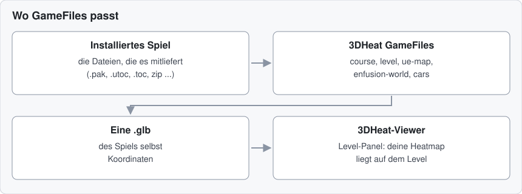

# Ganze Level {#whole-levels}

**Einfach gesagt:** Bei Shootern und anderen Spielen ohne Runden speichert das Werkzeug die ganze Karte als eine 3D-Datei, damit der Viewer zeichnen kann, wohin die Spieler auf ihr gegangen sind.

`course` schneidet den Boden um eine Runde aus. Bei Spielen ohne Runden exportiert das Werkzeug ein ganzes Level, eine Karte oder eine Welt auf einmal:

| Spiel oder Engine | Auflisten | Exportieren | Seite |
|---|---|---|---|
| Battlefield 6 (Frostbite) | `levels` | `level <level>` | [Battlefield-6-Level](level-battlefield.md) |
| Unreal-5-Spiele mit World Partition | `ue-maps <game>` | `ue-map <game> <map>` | [Unreal-5-Karten](level-unreal-world-partition.md) |
| Arma Reforger (Enfusion) | `enfusion-worlds` | `enfusion-world <world>` | [Arma-Reforger-Welten](level-arma-reforger.md) |

Jedes Paar funktioniert gleich: Der erste Befehl listet auf, was das installierte Spiel enthält, der zweite schreibt eines davon als eine einzige `.glb` in den eigenen Weltkoordinaten des Spiels, damit dort aufgenommene Positionen darauf liegen. Die Teile heißen `ground:`, `structure:` und `water:` wie bei jedem anderen Export (siehe [Ausgabeformat](output-format.md)). Lade die Datei im Level-Bereich des 3DHeat-Viewers.

