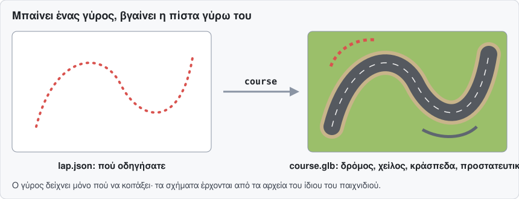
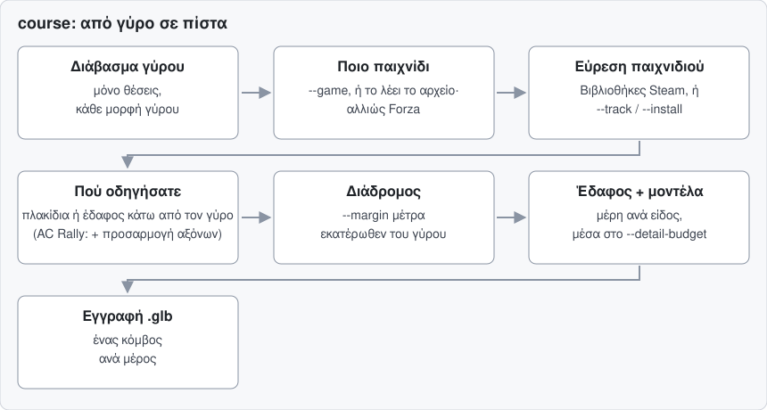

# Εξαγωγή πίστας {#course-export}

**Με απλά λόγια:** οδηγήσατε έναν γύρο· αυτό χτίζει την πίστα πάνω στην οποία οδηγήσατε, ως αρχείο 3D. Ο γύρος είναι μόνο μια γραμμή σημείων· ο δρόμος, το γρασίδι και τα κράσπεδα προέρχονται από τα δικά του αρχεία του παιχνιδιού.

`course` μετατρέπει έναν γύρο σε πίστα: το έδαφος σε μια ζώνη εκατέρωθεν του σημείου όπου πήγε το αυτοκίνητο, και ό,τι στέκεται σε εκείνο το έδαφος, ως ένα `.glb` για τον viewer. Αυτή η σελίδα καλύπτει ό,τι μοιράζονται και τα τρία υποστηριζόμενα παιχνίδια. Οι σελίδες από κάτω της καλύπτουν ό,τι διαφέρει:

- [Forza Horizon](course-forza-horizon.md): αρχεία `.minizip` του ForzaTech
- [BeamNG.drive](course-beamng.md): αρχεία zip, ύψη εδάφους, συμπιεσμένα σχήματα
- [Assetto Corsa Rally](course-assetto-corsa-rally.md): Unreal 5 IoStore, ένα στάδιο World Partition
- [Επίπεδα λεπτομέρειας και ο προϋπολογισμός](detail-budget.md): πόσα τρίγωνα παίρνουν τα τοποθετημένα μοντέλα, και ποια αντίγραφα μένουν

## Τα βήματα {#the-steps}

Λέξεις που χρησιμοποιούνται παρακάτω: ένα **πλαίσιο** (frame) είναι προς ποια κατεύθυνση δείχνουν οι άξονες· ο **διάδρομος** (corridor) είναι η ζώνη του εδάφους εκατέρωθεν του γύρου· ένα **πλακίδιο** (tile) είναι ένα τετράγωνο κομμάτι του εδάφους ενός παιχνιδιού· ένα **LOD** (επίπεδο λεπτομέρειας) είναι ένα από τα απλούστερα αντίγραφα ενός μοντέλου.

1. **Διαβάστε τον γύρο.** Μόνο θέσεις, από οποιοδήποτε από τα σχήματα του [Είσοδοι γύρων](lap-inputs.md). Η ταχύτητα και τα inputs δεν χρησιμοποιούνται. Ένας γύρος με λιγότερα από δύο δείγματα απορρίπτεται (`holds no driving`).
2. **Αποφασίστε το παιχνίδι.** Πρώτα το `--game`, μετά το πεδίο `game` του αρχείου γύρου, και τέλος το Forza (βλ. [Εντολές](commands.md#which-game)).
3. **Βρείτε το εγκατεστημένο παιχνίδι.** Και τα τρία ψάχνουν σε κάθε βιβλιοθήκη Steam που αναφέρεται στο `config\libraryfolders.vdf` του Steam. Το Forza ψάχνει επίσης στο `C:\XboxGames`. Το `--track` (Forza) ή το `--install` (BeamNG, AC Rally) παρακάμπτει την αναζήτηση.
4. **Βρείτε πού οδηγήθηκε ο γύρος.** Αυτό δεν αποφασίζεται ποτέ μόνο με βάση το όνομα. Το Forza διαλέγει την πίστα της οποίας τα πλακίδια εδάφους καλύπτουν τον γύρο. Το BeamNG διαλέγει το επίπεδο πάνω στο έδαφος (ή στους δρόμους) του οποίου πέφτουν τα δείγματα του γύρου. Το AC Rally δοκιμάζει κάθε στάδιο σε οκτώ προσανατολισμούς αξόνων και διαλέγει εκείνον που βάζει τον μεγαλύτερο μέρος του γύρου πάνω στον δρόμο.
5. **Κόψτε έναν διάδρομο** `--margin` μέτρα εκατέρωθεν της οδήγησης (παρακάτω).
6. **Χτίστε το έδαφος** μέσα στον διάδρομο, ταξινομημένο ως δρόμος, άκρη, χαλίκι και χώμα, έδαφος, σήμανση, ίχνη ελαστικών ή νερό, και ψήσε μια υφή εδάφους για κάθε τετράγωνο 512 m.
7. **Τοποθετήστε τα μοντέλα** που στέκονται στον διάδρομο, ανά κατηγορία, σε επίπεδο λεπτομέρειας που επιλέγεται από την απόσταση και έναν προϋπολογισμό τριγώνων.
8. **Γράψτε το `.glb`**: ένα ονομασμένο node για κάθε μέρος. Βλ. [Μορφή εξόδου](output-format.md).

Τι τυπώνει μια εκτέλεση, εδώ σε ένα συνθετικό εγκατεστημένο BeamNG.drive που φτιάχνουν τα τεστ, ένας γύρος 50 m σε μια λωρίδα δρόμου:

## Ο διάδρομος {#the-corridor}

Η κοπή είναι μια ζώνη γύρω από τη γραμμή οδήγησης, όχι το περιγεγραμμένο κουτί του γύρου. Για έναν κλειστό κύκλο τα δύο είναι σχεδόν ίδια. Για ένα σπριντ από το σημείο Α στο Β το κουτί είναι κυρίως πλαγιά στην οποία κανείς δεν οδηγά, και η ζώνη μπορεί να είναι το ένα δέκατο της έκτασής του. Πηγή: [`corridor.py`](https://github.com/Holdi601/3DHeat-GameFiles/blob/main/heat3d_gamefiles/corridor.py).

Πώς χτίζεται:

- Η οδήγηση προβάλλεται στο επίπεδο του εδάφους: τα x και z του γύρου (BeamNG: τα x και y του δικού του πλαισίου του παιχνιδιού).
- Σχεδιάζεται σε πλέγμα κελιών **4 m** (`CELL`). Κάθε κελί που αγγίζει η οδήγηση διευρύνεται με δίσκο ακτίνας `margin + 4 m` προς κάθε κατεύθυνση.
- Διαδοχικά δείγματα που απέχουν λιγότερο από **50 m** (`JOIN`) ενώνονται με σημεία κάθε 4 m, ώστε η ζώνη να μην έχει κενά. Δείγματα που απέχουν περισσότερο θεωρούνται ξεχωριστά τμήματα οδήγησης και δεν ενώνονται. Μια βιβλιοθήκη διαδρομών είναι πολλά αρχεία γύρων το ένα μετά το άλλο, και το τέλος ενός σπριντ και η αρχή του επόμενου δεν πρέπει να ζωγραφίζουν μια ζώνη πάνω στον χάρτη.
- Ένα τρίγωνο κρατιέται αν κάποια γωνία του, το μέσο κάποιας ακμής ή το κέντρο βάρους του βρίσκεται στη ζώνη. Τα μέσα σημεία πιάνουν ένα μεγάλο τρίγωνο που διασχίζει μια στενή ζώνη με όλες τις γωνίες του έξω.
- Το ύψος δεν μετράει ποτέ στην κοπή. Ένα κουτί που θα περιόριζε το υψόμετρο θα έκοβε το έδαφος κάτω από έναν λόφο που ανεβαίνει ο δρόμος.

Η κονσόλα αναφέρει την έκταση του διαδρόμου, για παράδειγμα `cutting 80 m either side of the driving: 1.53 km2 of a 6,000 by 3,600 m box`.

Το BeamNG και το AC Rally χτίζουν επίσης έναν ευρύτερο διάδρομο **reach** `margin + 60 m`. Ένα τοποθετημένο μοντέλο λαμβάνεται υπόψη αν η αρχή του βρίσκεται στον διάδρομο reach, και σχεδιάζεται μόνο αν το αποτύπωμά του αγγίζει τον πραγματικό διάδρομο. Έτσι ένα μακρύ αντικείμενο του οποίου η αρχή βρίσκεται λίγο έξω από τη ζώνη δεν χάνεται. Το BeamNG χρησιμοποιεί επίσης τον διάδρομο reach για να επιλέξει ποια decals δρόμου θα ζωγραφιστούν.

## Από τι είναι φτιαγμένο το έδαφος {#what-the-ground-is-made-of}

Κάθε εξαγωγή κατατάσσει τα τρίγωνα του εδάφους στα ίδια είδη, και κάθε είδος γράφεται ως δικό του μέρος ώστε ο viewer να μπορεί να το δείξει ή να το κρύψει:

| Είδος | Όνομα μέρους | Επίπεδο χρώμα (γραμμικό RGB) | Forza | BeamNG | AC Rally |
|---|---|---|---|---|---|
| δρόμος | `ground:road` | 0.22, 0.22, 0.23 | λωρίδες δρόμου: το τμήμα της άσφαλτου | επίπεδα τύπου `ASPHALT`, decals δρόμου, μοντελοποιημένος δρόμος | πλακίδια διαδρομής (`/MeshesTrack/`) |
| άκρη | `ground:verge` | 0.52, 0.47, 0.30 | λωρίδες δρόμου: ο ώμος | πεζοδρόμια και μοντέλα άκρης | - |
| χαλίκι και χώμα | `ground:gravel and dirt` | 0.50, 0.42, 0.30 | - | επίπεδα χώματος, χαλικιού, άμμου, λάσπης και decals | - |
| έδαφος | `ground:terrain` | 0.30, 0.44, 0.18 | όλα τα υπόλοιπα | όλα τα υπόλοιπα | πλακίδια `_Terrain` και μακρινό έδαφος |
| κράσπεδα | `ground:kerbs` | 0.60, 0.12, 0.10 (Forza) | props `road_gen_rum*` | μοντέλα κρασπέδων, πεζοδρομίων και ηχητικών λωρίδων | μοντέλα κρασπέδων |
| σήμανση | `ground:markings` | 0.90, 0.90, 0.88 | υποπλέγματα decal, ανυψωμένα 5 cm | ζωγραφισμένα στην υφή | - |
| ίχνη ελαστικών | `ground:tyre marks` | 0.20, 0.17, 0.16 | υποπλέγματα decal, ανυψωμένα 5 cm | ζωγραφισμένα στην υφή | - |
| νερό | `water:water` | 0.16, 0.34, 0.48 | υλικά νερού | επίπεδο θάλασσας, μπλοκ νερού, ποτάμια | - |

Τα επίπεδα χρώματα επιλέγονται ώστε να διαβάζονται με μια ματιά, όχι για να ταιριάζουν με το παιχνίδι. Χρησιμοποιούνται για μέρη χωρίς υφή και από viewers που αγνοούν τις υφές. Πηγή: [`surfaces.py`](https://github.com/Holdi601/3DHeat-GameFiles/blob/main/heat3d_gamefiles/surfaces.py).

Τα μέρη του εδάφους χωρίζονται ανά τετράγωνο 512 m, και κάθε τετράγωνο έχει τη δική του ψημένη εικόνα, οπότε τα ονόματα των μερών περιέχουν το τετράγωνο:

| Παιχνίδι | Όνομα μέρους εδάφους | Κλειδί τετραγώνου |
|---|---|---|
| Forza | `ground:road x-2046 z1023` | το όνομα του πλέγματος του πλακιδίου εδάφους (βήματα των 1023, βλ. [Forza Horizon](course-forza-horizon.md)) |
| BeamNG | `ground:road 3_-2` | `floor(x / 512)`, `floor(y / 512)` σε μέτρα BeamNG |
| AC Rally | `ground:road 1_-4` | `floor(x / 51200)`, `floor(y / 51200)` σε εκατοστόμετρα Unreal |

## Ό,τι στέκεται πάνω του {#what-stands-on-it}

Τα τοποθετημένα μοντέλα γράφονται σε μέρη με όνομα `structure:<category>`, ή `ground:kerbs` για τα κράσπεδα (και στα τρία παιχνίδια). Όταν ένα μέρος έχει τη δική του υφή, το όνομα της υφής ή του υλικού ακολουθεί την κατηγορία, για παράδειγμα `structure:barriers bar_armco_bclr`.

| Κατηγορία | Forza | BeamNG | AC Rally |
|---|---|---|---|
| εμπόδια | ναι | ναι | ναι |
| αντικείμενα (props) | ναι | ναι | ναι |
| πινακίδες | ναι | ναι | ναι |
| κτίρια | ναι (ολόκληρα κτίρια ως υποκατάστατα, όπου το παιχνίδι τα έχει) | ναι | ναι |
| υποδομή | ναι | ναι | ναι |
| γέφυρες | ναι | ναι | (ταξινομείται ως υποδομή) |
| βράχοι | ναι | ναι | ναι |
| κράσπεδα | ναι, ως έδαφος | ναι, ως έδαφος | ναι, ως έδαφος |
| δέντρα | με `--trees` | με `--trees` | με `--trees` |
| σπαστά αντικείμενα | με `--trees` | - | - |

Η κατανομή της λεπτομέρειας είναι η ίδια και στα τρία. Τα αντίγραφα μέσα σε 25 m από την οδήγηση ξεκινούν σε πλήρη λεπτομέρεια, τα αντίγραφα 25-60 m μακριά ένα επίπεδο πιο χονδρά, και τα πιο μακρινά στο χονδρότερο επίπεδο. Έπειτα τα πιο δαπανηρά μοντέλα υποβαθμίζονται μέχρι να χωρέσει ένας προϋπολογισμός τριγώνων, και όπου ακόμα και τα χονδρότερα επίπεδα δεν χωρούν σε προϋπολογισμό που δίνετε εσείς, τα αντίγραφα αφαιρούνται. Τα κράσπεδα δεν απλοποιούνται ποτέ και δεν αφαιρούνται. Βλ. [Επίπεδα λεπτομέρειας και ο προϋπολογισμός](detail-budget.md).

## Επιλογές που διαμορφώνουν το αποτέλεσμα {#options-that-shape-the-result}

| Θέλετε | Χρησιμοποιήστε |
|---|---|
| μικρότερο αρχείο | `--no-textures` (επίπεδα χρώματα), `--texture-size 1024` ή `512`, `--detail-budget N`, `--margin 40` |
| μόνο το έδαφος | `--no-placed` |
| και το σκηνικό | `--trees` |
| άλλη εποχή (Forza) | `--season winter` |
| παιχνίδι εκτός Steam | `--track` (Forza) ή `--install` (BeamNG, AC Rally) |
| γύρο που η αναζήτηση δεν τοποθετεί | `--level` (BeamNG, AC Rally), `--track` (Forza) |

## Συντεταγμένες {#coordinates}

Κάθε εξαγωγή γράφει μέτρα με Y προς τα πάνω, σε πλαίσιο με το οποίο ταιριάζει ένας καταγεγραμμένος γύρος του ίδιου παιχνιδιού:

| Παιχνίδι | Πλαίσιο που γράφεται |
|---|---|
| Forza | οι δικές του συντεταγμένες κόσμου του παιχνιδιού, αμετάβλητες |
| BeamNG | `(x, z, -y)` του κόσμου του BeamNG με Z προς τα πάνω, που είναι η περιστροφή που εφαρμόζει ο εγγραφέας τηλεμετρίας |
| AC Rally | το πλαίσιο του γύρου, βρεθέν με προσαρμογή: τα εκατοστόμετρα Unreal γίνονται μέτρα, και τα Unreal X και Y γίνονται τα x και z του γύρου, σε όποιον από τους οκτώ προσανατολισμούς ταιριάζει |

Βλ. [Μορφή εξόδου](output-format.md).
