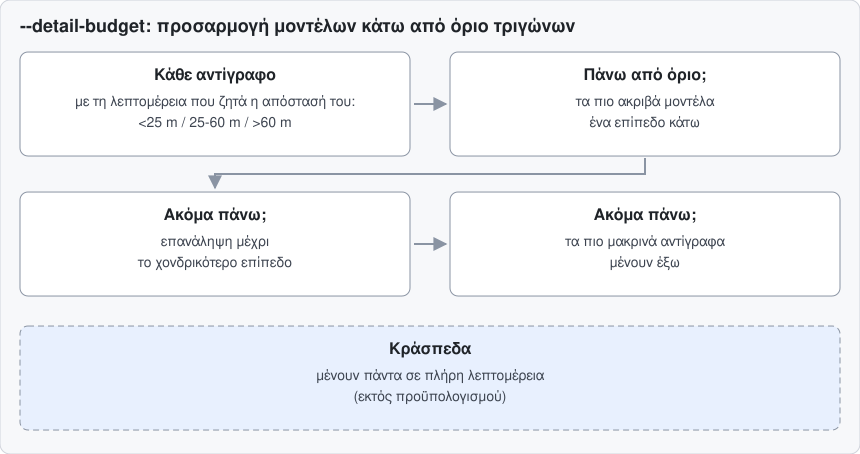

# Επίπεδα λεπτομέρειας και ο προϋπολογισμός {#levels-of-detail-and-the-budget}

Ένα **τρίγωνο** είναι ένα μικρό επίπεδο κομμάτι ενός 3D μοντέλου. Περισσότερα τρίγωνα σημαίνουν μεγαλύτερο, πιο αργό αρχείο. Ο **προϋπολογισμός** είναι ένα όριο για το πόσα. Ένα **επίπεδο λεπτομέρειας** είναι ένα απλούστερο αντίγραφο ενός μοντέλου, που χρησιμοποιείται όταν είναι μακριά.

Το πιο λεπτομερές επίπεδο όλων όσων τοποθετούνται γύρω από μια πίστα είναι αρκετά εκατομμύρια τρίγωνα. Για παράδειγμα, εκατοντάδες τμήματα κιγκλιδωμάτων και στοίβες ελαστικών με περίπου χίλια τρίγωνα το καθένα. Ένας αστικός διάδρομος περιέχει πάνω από εκατό χιλιάδες αντίγραφα. Γι' αυτό κάθε εξαγωγή πίστας δίνει στα τοποθετημένα μοντέλα έναν **προϋπολογισμό τριγώνων** και αποφασίζει, για κάθε μοντέλο, σε ποιο επίπεδο λεπτομέρειας θα σχεδιαστεί και, αν χρειάζεται, ποια αντίγραφα θα μείνουν έξω.

Το σχήμα γράφτηκε για το Forza ([`forzaplacement.py`](https://github.com/Holdi601/3DHeat-GameFiles/blob/main/heat3d_gamefiles/forzaplacement.py):
`choose_levels`, `auto_budget`, `_fit`), και το BeamNG και το AC Rally επαναχρησιμοποιούν τα μέρη του. Το έδαφος δεν μετράει στον προϋπολογισμό.

## Ζώνες απόστασης {#distance-bands}

Η απόσταση κάθε αντιγράφου από την οδήγηση μετράται στο επίπεδο του εδάφους, μέχρι το πλησιέστερο δείγμα του γύρου. Ο γύρος αραιώνεται πρώτα, στο πολύ 1.000 σημεία, που κοστίζει λίγα μέτρα ακρίβειας και τίποτα που έχει σημασία εδώ. Τα αντίγραφα έπειτα πέφτουν σε τρεις ζώνες, και κάθε ζεύγος (μοντέλο, ζώνη) προϋπολογίζεται χωριστά:

| Ζώνη | Απόσταση | Ξεκινά από |
|---|---|---|
| κοντινή | κάτω από 25 m (`NEAR`) | το λεπτότερο επίπεδο |
| μεσαία | 25-60 m (`FAR`) | ένα επίπεδο πιο χονδρό |
| μακρινή | 60 m και άνω | το χονδρότερο επίπεδο |

Χωρίς διαδρομή (Forza `terrain --box`), η απόσταση μετράται ως προς το μέσο του κουτιού.

## Υποβάθμιση για να χωρέσει {#stepping-down-to-fit}



Το κόστος ενός καταχωρίσματος (μοντέλο, ζώνη) είναι τα αντίγραφα επί τα τρίγωνα στο τρέχον επίπεδό του. Όσο το σύνολο ξεπερνά τον προϋπολογισμό, το καταχώρισμα με το μεγαλύτερο κόστος υποβαθμίζεται κατά ένα επίπεδο, και αυτό επαναλαμβάνεται μέχρι το σύνολο να χωρέσει ή να μην μπορεί άλλο να υποβαθμιστεί τίποτα. Τα καταχωρίσματα που έχουν καρφωθεί δεν υποβαθμίζονται ποτέ:

| Παιχνίδι | Καρφωμένα σε πλήρη λεπτομέρεια |
|---|---|
| Forza | κράσπεδα (`road_gen_rum*`) |
| BeamNG | κράσπεδα, και κάθε σχήμα που φέρει επιφάνεια οδήγησης |
| AC Rally | κράσπεδα |

Η σύνοψη του Forza το αναφέρει ως `N of M models drawn at a coarser level to fit the budget`.

## Ο αυτόματος προϋπολογισμός {#the-automatic-budget}

Χωρίς `--detail-budget`, ο προϋπολογισμός μεγαλώνει μόνος του ώστε **να μην αφαιρείται κανένα αντίγραφο**:

```
budget = max(1,500,000, 1.25 x sum(copies x coarsest level))
```

Τα καρφωμένα καταχωρίσματα μετρούν στο λεπτότερο επίπεδό τους. Το 25% (`HEADROOM`) αφήνει ό,τι βρίσκεται δίπλα στον δρόμο να κρατήσει λίγη λεπτομέρεια. Σε μια εθνική πίστα αυτό είναι το κατώφλι του 1,5 εκατομμυρίου (`DEFAULT_BUDGET`). Σε αστική διαδρομή, όπου ο διάδρομος περιέχει πάνω από εκατό χιλιάδες αντίγραφα, ξεπερνά τα δέκα εκατομμύρια, και το αρχείο γίνεται πολλά MB. Ο viewer το φορτώνει.

## Ένας προϋπολογισμός που δίνετε εσείς {#a-budget-you-give}

Το `--detail-budget N` είναι **ανώτατο όριο**. Τα επίπεδα υποβαθμίζονται όπως παραπάνω. Αν ακόμα και τα χονδρότερα επίπεδα δεν χωρούν, τα αντίγραφα αφαιρούνται:

| Παιχνίδι | Σειρά με την οποία αφαιρούνται αντίγραφα |
|---|---|
| Forza | πρώτα ό,τι βρίσκεται 25 m ή περισσότερο από την οδήγηση, και μετά ό,τι στέκεται δίπλα στον δρόμο· μέσα σε κάθε ομάδα, πρώτα ό,τι φαίνεται μικρότερο από τον δρόμο: το μεγαλύτερο ως προς απόσταση / μέγεθος (μέγεθος = η διαγώνιος του κουτιού του μοντέλου επί τη μεγαλύτερη κλίμακά του, τουλάχιστον 0,25 m) |
| BeamNG | πρώτα το πιο μακρινό από την οδήγηση |
| AC Rally | πρώτα το πιο μακρινό από την οδήγηση, όπως στο BeamNG |
| Battlefield 6 | πρώτα το μικρότερο: διαγώνιος κουτιού επί κλίμακα |

Τα κράσπεδα (και, στο BeamNG, τα μοντέλα επιφάνειας οδήγησης) δεν αφαιρούνται ποτέ, οπότε ένας προϋπολογισμός μικρότερος από το κόστος τους μόνο του ξεπερνιέται από αυτά και από τίποτα άλλο.

Το εργαλείο χρησιμοποιεί την απόσταση προς το μέγεθος για το Forza, γιατί, αν ταξινομούσε μόνο κατά απόσταση, μια μονάδα κλιματισμού σε έναν τοίχο εννέα μέτρα μακριά θα επιβίωνε από την πρόσοψη των είκοσι μέτρων στην οποία είναι κρεμασμένη, που βρίσκεται δώδεκα μέτρα μακριά. Ό,τι βρίσκεται δίπλα στον δρόμο πηγαίνει τελευταίο, ό,τι και να είναι το μέγεθός του, επειδή ένα εμπόδιο τριών μέτρων πέντε μέτρα από τη γραμμή είναι η άκρη της πίστας, ενώ ένα κτίριο πενήντα μέτρων που βρίσκεται εξήντα μέτρα πίσω είναι σκηνικό.

Η σύνοψη αναφέρει `N of M copies left out to fit the budget, the smallest and furthest from the driving first (--detail-budget raises it)` (Forza), ή `N copies left out to fit the budget, the furthest from the driving first (--detail-budget raises it)` (BeamNG, AC Rally).

## Ολόκληρα κτίρια (Forza) {#whole-buildings-forza}

Ένα υποκατάστατο ολόκληρου κτιρίου μετράει ως ένα αντίγραφο, σε απόσταση μετρημένη ως προς την πλησιέστερη άκρη του κτιρίου. Κρατιέται ή αφαιρείται ως ενιαία μονάδα. Τα αρθρωτά κομμάτια που αντικαθιστά δεν προϋπολογίζονται καθόλου. Βλ. [Forza Horizon](course-forza-horizon.md#buildings-drawn-whole).

## Τι είναι ένα επίπεδο λεπτομέρειας, ανά παιχνίδι {#what-a-level-of-detail-is-per-game}

| Παιχνίδι | Τα επίπεδα προέρχονται από |
|---|---|
| Forza | τη μάσκα επιπέδου ανά τρίγωνο των υποπλεγμάτων `Mesh` του μοντέλου (bit `level + 1`)· το `0xFFFF` για σπαστά κομμάτια μόνο για μοντέλο χωρίς σημειωμένο επίπεδο |
| BeamNG | τα `details` του σχήματος `.cdae` με μη αρνητικό μέγεθος, από το μεγαλύτερο· για `.dae`, τον αριθμό στο τέλος των ονομάτων των κόμβων του πλέγματος (`barrier75`, `barrier40`) |
| AC Rally | τα αποθηκευμένα επίπεδα λεπτομέρειας του στατικού μοντέλου, από το λεπτότερο |
| Battlefield 6 | τα επίπεδα λεπτομέρειας του MeshSet, από το λεπτότερο, μετρώντας μόνο τα τμήματα που σχεδιάζονται (όχι τα αντίγραφα σκιών και βάθους), και όχι ένα τελευταίο επίπεδο που είναι υποκατάστατο για μακρινή θέα (υλικά `M_LastLod`, `M_Billboard`, `M_Vista`: το δικτύωμα ενός πυλώνα γίνεται συμπαγής αιχμή) |

Το `level` του Battlefield 6 δεν έχει γύρο, οπότε δεν υπάρχουν ζώνες απόστασης: κάθε πλέγμα είναι ένα καταχώρισμα, με κάθε αντίγραφο στο ίδιο επίπεδο. Ο αυτόματος προϋπολογισμός είναι ο τύπος παραπάνω με το υπόβαθρο του εδάφους καρφωμένο· το ύψωμα εδάφους είναι εκτός προϋπολογισμού και καθορίζεται από το `--ground-spacing`. Με προϋπολογισμό που δίνετε εσείς, αφού κάθε μέσο είναι στο χονδρότερό του, τα αντίγραφα αφαιρούνται πρώτα τα μικρότερα, με μέγεθος τη διαγώνιο του κουτιού του μοντέλου επί την κλίμακα του αντιγράφου, αφού δεν υπάρχει οδήγηση από την οποία να μετρηθεί η απόσταση. Το υπόβαθρο του εδάφους δεν αφαιρείται ποτέ. Ένα επίπεδο φτάνει περίπου τα δέκα εκατομμύρια τρίγωνα αυτόματα.

## Επιλέγοντας έναν αριθμό {#choosing-a-number}

| Θέλετε | Δοκιμάστε |
|---|---|
| όλα, με πλήρη λεπτομέρεια κοντά στον δρόμο | αφήστε το αυτόματο |
| αρχείο μερικές φορές μικρότερο | `--detail-budget 500000` με `--texture-size 1024` |
| μόνο το έδαφος | `--no-placed` (δεν εμπλέκεται προϋπολογισμός) |
