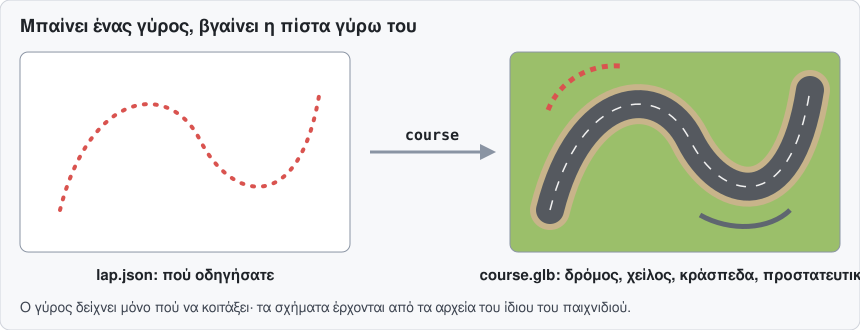
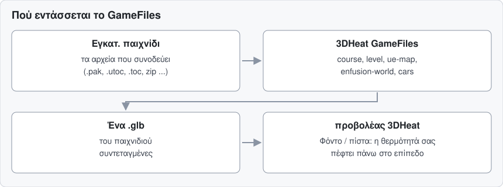

# 3DHeat GameFiles {#dheat-gamefiles}

**Τι είναι;** Ένα εργαλείο που φτιάχνει ένα τρισδιάστατο μοντέλο μιας πίστας αγώνων ή ενός επιπέδου παιχνιδιού
από τα αρχεία ενός παιχνιδιού που έχετε ήδη εγκατεστημένο.

**Γιατί να το χρησιμοποιήσω;** Ο προβολέας 3DHeat ζωγραφίζει ως θερμικό χάρτη πού οδηγήσατε ή παίξατε.
Με αυτό το εργαλείο τον ζωγραφίζει πάνω στην πραγματική πίστα ή στο πραγματικό επίπεδο, και όχι στο κενό.

**Παράδειγμα:** πάρτε έναν γύρο που οδηγήσατε. Το εργαλείο φτιάχνει τον δρόμο και το έδαφος γύρω του
σε ένα τρισδιάστατο αρχείο, ώστε ο προβολέας να ζωγραφίσει την ταχύτητα ή τις συγκρούσεις σας πάνω στην
πραγματική πίστα:



Δεν έχετε ξαναδουλέψει με τη γραμμή εντολών; Ξεκινήστε με το [Πριν ξεκινήσετε](before-you-start.md).

Πιο αναλυτικά: διαβάζει δεδομένα επιπέδου από τα αρχεία που συνοδεύουν ένα παιχνίδι και τα γράφει ως
δυαδικό αρχείο glTF (`.glb`). Η κύρια δουλειά του είναι η **εξαγωγή πίστας**: του δίνετε έναν γύρο, και γράφει
το έδαφος, τον δρόμο διαχωρισμένο από το χείλος και το γρασίδι, και τα κράσπεδα, τα προστατευτικά, τα τοιχία ελαστικών,
τις πινακίδες και τα κτίρια γύρω του.

Είναι μέρος του [3DHeat](https://github.com/Holdi601/3DHeat), ενός προβολέα για τηλεμετρία και θερμικούς χάρτες σε
πραγματικό χρόνο, ανάλυση αγώνα και επισκόπηση αγώνα
([τεκμηρίωση](https://holdi601.github.io/3DHeat/)). Τα αρχεία `.glb` που γράφει αυτό το εργαλείο είναι
τα επίπεδα πάνω στα οποία ζωγραφίζει ο προβολέας τη θερμότητα.



Είναι ένας από τους τρεις τρόπους να πάρετε τη γεωμετρία ενός επιπέδου μέσα στο 3DHeat:

| Τρόπος | Χρειάζεται | Δίνει |
|---|---|---|
| 3DHeat Unreal Exporter | το Unreal project ανοιχτό στον επεξεργαστή | ακριβή γεωμετρία |
| 3DHeat GameCapture | οθόνη και καταγραφή | εκτίμηση |
| **3DHeat GameFiles** | **το εγκατεστημένο παιχνίδι, όπως κυκλοφόρησε** | **ακριβή γεωμετρία, χωρίς project** |

Πακέτο Python: `heat3d_gamefiles`. Αποθετήριο:
[Holdi601/3DHeat-GameFiles](https://github.com/Holdi601/3DHeat-GameFiles). Άδεια: MIT.

## Τι μπορεί να κάνει {#what-it-can-do}

| Παιχνίδι ή μηχανή | Εξαγωγή πίστας (`course`) | Ανάγνωση αρχείων |
|---|---|---|
| Forza Horizon (ForzaTech) | ναι: έδαφος, δρόμος και χείλος, υφή εδάφους, τοποθετημένα μοντέλα με τις δικές τους υφές | `identify`, `list`, `extract` σε `.minizip`· `identify` σε `.modelbin`· μοντέλα, έδαφος και υφές μέσω `course` και `terrain` |
| BeamNG.drive | ναι: έδαφος, διακοσμήσεις δρόμου, μοντελοποιημένα κυκλώματα, τοποθετημένα μοντέλα, νερό | `identify`, `list`, `extract` σε zip επιπέδων· `identify` σε `.ter`, `.cdae`· `.dae` μέσω `course` |
| Assetto Corsa Rally (Unreal 5.6) | ναι: πλακίδια εδάφους σταδίου, χρωματισμένο έδαφος, τοποθετημένα μοντέλα σε επίπεδα χρώματα | `identify`, `list`, `extract` σε IoStore `.utoc`/`.ucas`· πακέτα zen, στατικά πλέγματα, υφές μέσω `course` |
| Unreal `.pak` (εκδόσεις 8-12) | όχι | `identify`, `list`, `extract` |
| Unity (μορφή 22 και νεότερες) | όχι | `identify`, `meshes` |
| Battlefield 6 (Frostbite `.toc`/`.cas`) | όχι γύρος· ολόκληρο επίπεδο με `level`: έδαφος, τοποθετημένα πλέγματα, οι χάρτες χρώματός τους με `--textures` | `identify`, `levels`· δέσμες, πλέγματα, έδαφος, υφές και τοποθέτηση μέσω `level` |
| Source 2 `.vpk` | όχι | `identify`, `list`, `extract` |
| Παιχνίδια Unreal 5 World Partition | όχι γύρος· ολόκληρος χάρτης με `ue-map` (καταγράφεται με `ue-maps`): τοπίο, κτίρια και αντικείμενα HLOD, νερό | - |
| Arma Reforger (Enfusion) | όχι γύρος· ολόκληρος κόσμος με `enfusion-world` (καταγράφεται με `enfusion-worlds`): έδαφος στα χρώματά του, η θάλασσα, κτίρια ως κουτιά | - |
| Forza (αυτοκίνητα) | `cars`: κάθε αυτοκίνητο σε χαμηλή λεπτομέρεια, για την καρτέλα Ανάλυση αγώνα του προβολέα | - |

Οι γύροι από το Assetto Corsa EVO και το iRacing απορρίπτονται με αιτιολογία. Δείτε
[Όρια και γνωστά κενά](limits-and-known-gaps.md).

## Εγκατάσταση {#install}

Δεν έχετε ξαναδουλέψει με τη γραμμή εντολών; Διαβάστε πρώτα το [Πριν ξεκινήσετε](before-you-start.md).

Χρειάζεστε **Python 3.10 ή νεότερη** (αναπτύχθηκε στην 3.13) και τα πακέτα που αναφέρονται στο
[`requirements.txt`](https://github.com/Holdi601/3DHeat-GameFiles/blob/main/requirements.txt).

```
git clone https://github.com/Holdi601/3DHeat-GameFiles.git
cd 3DHeat-GameFiles
pip install -r requirements.txt
```

Μετά ελέγξτε: `python -m heat3d_gamefiles --help`. Θα δείτε
`usage: heat3d_gamefiles [-h]` και τη λίστα των εντολών. Τρέχετε κάθε εντολή από τον φάκελο του αποθετηρίου,
ως `python -m heat3d_gamefiles <verb>`.

| Πακέτο | Χρησιμεύει για |
|---|---|
| numpy | όλα όσα αποκωδικοποιούν γεωμετρία |
| lz4 | αρχεία Forza (κυρίως μπλοκ LZ4), μερικές δέσμες Unity, μπλοκ LZ4 IoStore |
| Pillow | αποκωδικοποίηση υφών BC1-BC7, εγγραφή των υφών JPEG στο `.glb` |
| msgpack, zstandard | οι συμπιεσμένες μορφές του BeamNG (`.cdae`) |
| cryptography | μόνο για το άνοιγμα ενός κρυπτογραφημένου `.pak` με κλειδί που ήδη έχετε |
| pytest | τα τεστ |

Το περιεχόμενο Unreal που είναι συμπιεσμένο με **Oodle** χρειάζεται μια βιβλιοθήκη Oodle που υπάρχει ήδη στον
υπολογιστή σας. Ποτέ δεν συνοδεύει αυτό το εργαλείο. Δείτε [Oodle](reader-oodle.md).

Το εργαλείο είναι γραμμένο για Windows. Βρίσκει τα παιχνίδια μέσα από τη λίστα βιβλιοθηκών του Steam και το
`%LOCALAPPDATA%`, και φορτώνει το Oodle ως DLL των Windows. Άλλες πλατφόρμες δεν έχουν δοκιμαστεί.

## Γρήγορη εκκίνηση {#quick-start}

Ένα **αρχείο γύρου** είναι μια καταγραφή του πού πήγε το αυτοκίνητό σας: μια λίστα σημείων x, y, z.
Προέρχεται από το [3DHeat GameCapture](https://github.com/Holdi601/3DHeat-GameCapture) ή από τη βιβλιοθήκη γύρων
της εφαρμογής FH Companion· ένα CSV που γράφετε με το χέρι επίσης δουλεύει
([Είσοδοι γύρων](lap-inputs.md)).

```
# Forza: ένα αρχείο γύρου, ένας φάκελος γύρων, ή το όνομα μιας πίστας από τη βιβλιοθήκη του FH Companion
python -m heat3d_gamefiles course "Example Circuit"
python -m heat3d_gamefiles course path\to\lap.json -o course.glb

# BeamNG.drive ή Assetto Corsa Rally: ένα αρχείο heat3d-lap λέει από ποιο παιχνίδι προέρχεται
python -m heat3d_gamefiles course my_lap.json

# Κάθε πίστα της βιβλιοθήκης του FH Companion, ένα .glb για καθεμία
python -m heat3d_gamefiles courses -o courses

# Battlefield 6: δείτε τα επίπεδα, και μετά εξαγάγετε ένα (μεγάλο αρχείο· δείτε Εντολές)
python -m heat3d_gamefiles levels
python -m heat3d_gamefiles level <level> -o level.glb --textures

# Unreal 5 World Partition και Arma Reforger: λίστα, και μετά εξαγωγή
python -m heat3d_gamefiles ue-maps "<game>"
python -m heat3d_gamefiles ue-map "<game>" <map> -o map.glb
python -m heat3d_gamefiles enfusion-worlds
python -m heat3d_gamefiles enfusion-world <world> -o world.glb

# Κάθε αυτοκίνητο του Forza, για την καρτέλα Ανάλυση αγώνα του προβολέα
python -m heat3d_gamefiles cars -o forza.h3dcars

# Τι είναι αυτό το αρχείο;
python -m heat3d_gamefiles identify some_archive.pak
```

Ανοίξτε το `.glb` στον προβολέα 3DHeat. Οι δικές του συντεταγμένες κόσμου του παιχνιδιού διατηρούνται
(δείτε [Μορφή εξόδου](output-format.md)), άρα ένας καταγεγραμμένος γύρος ευθυγραμμίζεται με την πίστα.

## Χάρτης της τεκμηρίωσης {#map-of-this-documentation}

- [Πριν ξεκινήσετε](before-you-start.md): Python, τερματικό, η πρώτη εντολή.
- [Εντολές](commands.md): κάθε εντολή και επιλογή, με παραδείγματα.
- [Αναφορά εντολών](../cli-reference.md): το `--help` κάθε εντολής, παραγόμενο από τον κώδικα.
- [Επιθεώρηση αρχείων](inspecting-archives.md): `identify`, `list`, `extract`, `meshes`, βήμα προς βήμα.
- [Εξαγωγή πίστας](course-export.md): πώς γίνεται πίστα ένας γύρος, για όλα τα παιχνίδια.
  - [Forza Horizon](course-forza-horizon.md)
  - [BeamNG.drive](course-beamng.md)
  - [Assetto Corsa Rally](course-assetto-corsa-rally.md)
  - [Επίπεδα λεπτομέρειας και προϋπολογισμός](detail-budget.md)
- [Ολόκληρα επίπεδα](whole-levels.md): ένα επίπεδο, χάρτης ή κόσμος χωρίς γύρο.
  - [Επίπεδα του Battlefield 6](level-battlefield.md): `levels`, `level`
  - [Χάρτες του Unreal 5](level-unreal-world-partition.md): `ue-maps`, `ue-map`
  - [Κόσμοι του Arma Reforger](level-arma-reforger.md): `enfusion-worlds`, `enfusion-world`
- [Αυτοκίνητα Forza](forza-cars.md): `cars`, το αρχείο αυτοκινήτων για την καρτέλα Ανάλυση αγώνα του προβολέα.
- [Είσοδοι γύρων](lap-inputs.md): κάθε μορφή αρχείου γύρου που δέχεται το εργαλείο.
- [Μορφή εξόδου](output-format.md): τι υπάρχει μέσα στο `.glb`.
- [Αναγνώστες αρχείων](archive-readers.md): μία σελίδα ανά μορφή κοντέινερ, με το τι διαβάζει η κάθε μία, τι δεν διαβάζει, και γιατί.
- [Όρια και γνωστά κενά](limits-and-known-gaps.md)
- [Αντιμετώπιση προβλημάτων](troubleshooting.md): τα μηνύματα σφάλματος και τι να κάνετε.
- [Κανόνες και άδειες](rules-and-licences.md): χωρίς κλειδιά, τα δικά σας αρχεία, χωρίς αναδιανομή.
- [Ενημερώσεις](updates.md): ο έλεγχος ενημέρωσης και το `heat3d_update`.
- [Ανάπτυξη](development.md): χάρτης μονάδων και τεστ, συμπεριλαμβανομένων των τεστ που τρέχουν σε εγκατεστημένα παιχνίδια.
- [Συντήρηση](maintaining.md): η λίστα ελέγχου κυκλοφορίας για αυτές τις σελίδες.

## Μέρος του 3DHeat {#part-of-3dheat}

Το 3DHeat GameFiles είναι ένα από τα δωρεάν εργαλεία γύρω από τον προβολέα 3DHeat:

| Εργαλείο | Τι κάνει | Τεκμηρίωση |
|---|---|---|
| [3DHeat](https://github.com/Holdi601/3DHeat) | ο προβολέας: τρισδιάστατοι θερμικοί χάρτες, ανάλυση αγώνα και επισκόπηση αγώνα στον περιηγητή | [σελίδα](https://holdi601.github.io/3DHeat/) |
| [GameFiles](https://github.com/Holdi601/3DHeat-GameFiles) | πίστες και επίπεδα από τα αρχεία που κυκλοφορούν τα παιχνίδια, ως `.glb` | [σελίδα](https://holdi601.github.io/3DHeat-GameFiles/) |
| [GameCapture](https://github.com/Holdi601/3DHeat-GameCapture) | τηλεμετρία γύρων από αγώνες· επίπεδα ανακατασκευασμένα από βίντεο παιχνιδιού | [σελίδα](https://holdi601.github.io/3DHeat-GameCapture/) |
| [Unreal Exporter](https://github.com/Holdi601/3DHeat-UnrealExporter) | ένα πρόσθετο του Unreal Editor που αποθηκεύει ένα επίπεδο ως `.glb` | [σελίδα](https://holdi601.github.io/3DHeat-UnrealExporter/) |
| [CS2](https://github.com/Holdi601/3DHeat-CS2) | demo του Counter-Strike 2 σε αρχεία αγώνων· χάρτες σε `.glb` | [σελίδα](https://holdi601.github.io/3DHeat-CS2/) |
| [Watcher](https://github.com/Holdi601/3DHeat-Watcher) | καταγράφει το παιχνίδι σας στο παρασκήνιο, από όσα δημοσιεύουν τα παιχνίδια | [σελίδα](https://holdi601.github.io/3DHeat-Watcher/) |
| [Ext-WarThunder](https://github.com/Holdi601/3DHeat-Ext-WarThunder) | replay του War Thunder σε αρχεία αγώνων | [σελίδα](https://holdi601.github.io/3DHeat-Ext-WarThunder/) |
| [Ext-WoT](https://github.com/Holdi601/3DHeat-Ext-WoT) | replay του World of Tanks σε αρχεία αγώνων | [σελίδα](https://holdi601.github.io/3DHeat-Ext-WoT/) |
| [Ext-WoWs](https://github.com/Holdi601/3DHeat-Ext-WoWs) | replay του World of Warships σε αρχεία αγώνων | [σελίδα](https://holdi601.github.io/3DHeat-Ext-WoWs/) |
| [Ext-Squad](https://github.com/Holdi601/3DHeat-Ext-Squad) | demo από servers του Squad σε αρχεία αγώνων | [σελίδα](https://holdi601.github.io/3DHeat-Ext-Squad/) |
| [Ext-DCS](https://github.com/Holdi601/3DHeat-Ext-DCS) | χάρτες του DCS World σε επίπεδα `.glb` | [σελίδα](https://holdi601.github.io/3DHeat-Ext-DCS/) |
| [Ext-IL2](https://github.com/Holdi601/3DHeat-Ext-IL2) | χάρτες του IL-2 Sturmovik σε επίπεδα `.glb` | [σελίδα](https://holdi601.github.io/3DHeat-Ext-IL2/) |

Κάθε αναγνώστης παιχνιδιού είναι ένα δικό του μικρό έργο, με δικό του αρχείο άδειας, δικές του εκδόσεις και δικό του σύστημα αναφορών, ώστε να μπορεί να εγκατασταθεί, να ενημερωθεί, να συντηρηθεί - ή να αποσυρθεί κατόπιν αιτήματος ενός δικαιούχου - αυτόνομα, χωρίς να επηρεάζει τον προβολέα ή τα άλλα εργαλεία.

Τα αρχεία αγώνων του προβολέα περιγράφονται στο
[Ένα αρχείο ανά αγώνα: `.3dheat`](https://holdi601.github.io/3DHeat/container.html)·
ένα επίπεδο που φτιάχνεται εδώ φορτώνεται δίπλα τους, στο πάνελ «Φόντο / πίστα» του προβολέα.
