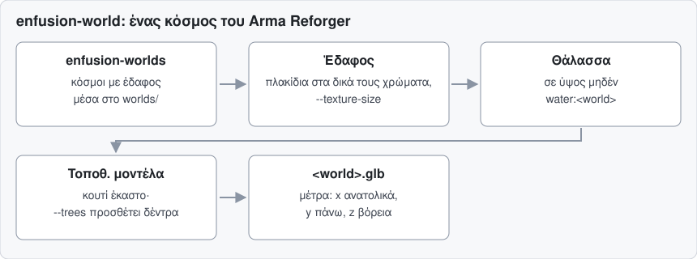

# Κόσμοι του Arma Reforger: `enfusion-worlds` και `enfusion-world` {#arma-reforger-worlds-enfusion-worlds-and-enfusion-world}

**Τι είναι;** Ένας ολόκληρος κόσμος του Arma Reforger σε ένα τρισδιάστατο αρχείο. **Γιατί;** Για να έχει η θερμότητα από το παιχνίδι το έδαφος και τα κτίρια κάτω της. (*Enfusion* είναι η μηχανή με την οποία φτιάχνεται το Arma Reforger· ένας *κόσμος* (world) είναι αυτό που το παιχνίδι λέει χάρτη.)

Εξάγει έναν ολόκληρο κόσμο Enfusion του εγκατεστημένου Arma Reforger: το έδαφος με τα χρώματα των δικών του πλακιδίων supertexture, τη θάλασσα, και κάθε τοποθετημένο μοντέλο ως κουτί, σε μέτρα του ίδιου του παιχνιδιού.



## Βήμα προς βήμα {#step-by-step}

1. **Παραθέστε τους κόσμους** που έχουν έδαφος:

   ```
   python -m heat3d_gamefiles enfusion-worlds
   python -m heat3d_gamefiles enfusion-worlds --install "D:\Games\Arma Reforger"
   ```

2. **Εξάγετε έναν**, με το όνομα του φακέλου του κάτω από το `worlds/` όπως φαίνεται στη λίστα:

   ```
   python -m heat3d_gamefiles enfusion-world <world> -o world.glb
   ```

3. **Παραλλαγές:**

   ```
   python -m heat3d_gamefiles enfusion-world <world> --trees               # βλάστηση επίσης, ως κουτιά
   python -m heat3d_gamefiles enfusion-world <world> --texture-size 0      # επίπεδο χρώμα, μικρό αρχείο
   python -m heat3d_gamefiles enfusion-world <world> --ground-spacing 4 --no-structures
   ```

4. **Ανοίξτε το `world.glb`** στο πάνελ Φόντο / πίστα του προβολέα του 3DHeat ([φόρτωση πίστας](https://holdi601.github.io/3DHeat/levels.html)).

## Επιλογές {#options}

| Επιλογή | Προεπιλογή | Σημασία |
|---|---|---|
| `<world>` | απαιτείται | ένας κόσμος όπως τον τυπώνει το `enfusion-worlds` |
| `-o`, `--out FILE` | `<world>.glb` (στο `$HEAT3D_LEVELS/<game>/` όταν αυτό είναι ορισμένο) | το αρχείο που γράφεται |
| `--install FOLDER` | η βιβλιοθήκη Steam που περιέχει το παιχνίδι | ο φάκελος του παιχνιδιού |
| `--ground-spacing METRES` | 2 (του ίδιου του εδάφους) | η απόσταση κορυφών του εδάφους στο αρχείο |
| `--texture-size PIXELS` | 4096 | η μεγαλύτερη πλευρά της εικόνας χρωμάτων εδάφους· 0 για επίπεδο χρώμα |
| `--no-structures` | | αφήνει έξω τα τοποθετημένα μοντέλα |
| `--trees` | κλειστή | τοποθετεί και δέντρα και άλλη βλάστηση, ως κουτιά |

## Παράδειγμα εξόδου {#example-output}

```text
<world> -> world.glb
  ground      <n> triangles, <w> x <h> m; <n> of <n> tile-edge vertices disagree; colour <w> x <h>
  structure   <n> boxes from <n> entities
  water       <n> triangles (the sea)
  left out    <what>: <n>, ...
```

## Τα μέρη {#the-parts}

`ground:<world>` (το έδαφος), `water:<world>` (η θάλασσα, στο ύψος μηδέν) και `structure:<world>` (τα κουτιά). Οι συντεταγμένες είναι του ίδιου του παιχνιδιού: x ανατολικά, y πάνω, z βόρεια, σε μέτρα - αυτό που αναφέρει μια εγγραφή μέσα στο παιχνίδι. Το σύστημα του παιχνιδιού είναι αριστερόστροφο· η επιλογή *Αντιστροφή άξονα κόσμου* στον προβολέα το δείχνει χωρίς καθρέφτισμα.

## Πώς διαβάζεται και ελέγχεται {#how-it-is-read-and-checked}

Δεν χρειάζεται Workbench και τίποτα δεν είναι κρυπτογραφημένο.

| Μορφή | Τι είναι | Ελέγχεται με |
|---|---|---|
| `.pak` | ένα τμήμα δεδομένων και ένα δέντρο καταλόγου, εγγραφές αποθηκευμένες ή zlib | το δέντρο χρησιμοποιεί ακριβώς το τμήμα του· δειγματοληπτικά zlib αποσυμπιέζονται ακριβώς στο δηλωμένο μέγεθός τους |
| `.edds` | μια κεφαλίδα DDS, μετά ανά επίπεδο mip τμήματα `COPY` ή `LZ4 ` | τα τμηματοποιημένα επίπεδα αποκωδικοποιούνται ακριβώς στο μέγεθός τους χρησιμοποιώντας ακριβώς τα bytes τους |
| `.terr` / `.ttile` | μια κεφαλίδα και πλακίδια από ύψη 16 bit | κάθε κοινή άκρη πλακιδίων συμφωνεί ακριβώς |
| supertexture | το χρώμα εδάφους κάθε πλακιδίου, περίπου ένα μέτρο ανά εικονοστοιχείο | ταιριάζει με τη θάλασσα στα ύψη· καμία αναστροφή ή transpose δεν ταιριάζει εξίσου καλά |
| `.ent` | ονόματα, GUID πόρων, και μετά οντότητες ως τυπωμένες τιμές | ένα αρχείο κόσμου αναλύεται μέχρι το τελευταίο του byte |
| `resourceDatabase.rdb` | GUID σε διαδρομή | σχεδόν κάθε GUID που χρησιμοποιεί ένας κόσμος ονομάζει ένα αρχείο που υπάρχει |

Τα αντικείμενα που σημειώνονται ότι στέκονται σε απόλυτο ύψος βρίσκονται σε εκατοστά από το αποκωδικοποιημένο έδαφος (με το πλέγμα ανεστραμμένο θα ήταν μέτρα μακριά). Δεν σχεδιάζονται: τα ίδια τα τρίγωνα των μοντέλων, τα δέντρα προεπιλογής (το `--trees` τα προσθέτει ως κουτιά), οι θυγατρικές οντότητες, λίμνες και ποτάμια, και υφές με κεφαλίδες πριν από το DX10.

**Όροι:** η άδεια του παιχνιδιού επιτρέπει μη εμπορική χρήση και απαγορεύει την αντίστροφη μηχανική των αρχείων του παιχνιδιού. Η ανάγνωση της δικής σας εγκατάστασης είναι δική σας απόφαση μέσα σε αυτήν· το αποτέλεσμα είναι για δική σας χρήση και δεν προορίζεται να μοιραστεί.
