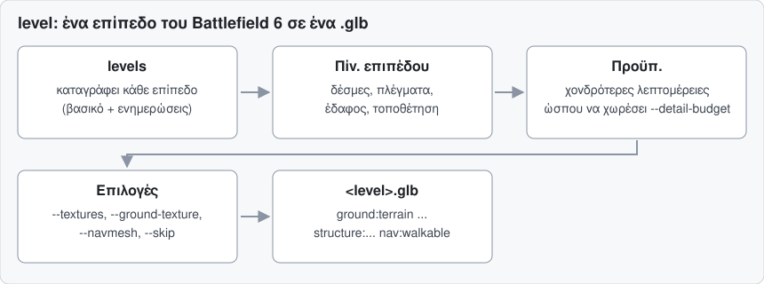

# Πίστες του Battlefield 6: `levels` και `level` {#battlefield-6-levels-levels-and-level}

**Τι είναι;** Μία ολόκληρη πίστα του Battlefield 6 σε ένα τρισδιάστατο αρχείο. **Γιατί;** Για να έχει η θερμότητα από τους αγώνες σας το έδαφος και τα κτίρια κάτω της. (*Frostbite* είναι η μηχανή με την οποία φτιάχνεται το Battlefield· ένα *heightfield* είναι το έδαφος αποθηκευμένο ως πλέγμα από ύψη.)

Εξάγει μια ολόκληρη πίστα Frostbite του εγκατεστημένου παιχνιδιού: τον χάρτη ύψους του εδάφους, κάθε mesh που τοποθετούν οι ομάδες στατικών μοντέλων της, τα αντικείμενα τοποθετημένα ένα προς ένα, το φόντο εδάφους γύρω από τον χάρτη, και κατ' αίτηση τους χάρτες χρωμάτων των επιφανειών, τις διακοσμήσεις εδάφους ψημένες πάνω στο έδαφος, και τις επιφάνειες πάνω στις οποίες περπατούν οι στρατιώτες.



## Βήμα προς βήμα {#step-by-step}

1. **Παραθέστε τις πίστες** που έχει το παιχνίδι:

   ```
   python -m heat3d_gamefiles levels
   python -m heat3d_gamefiles levels --install "D:\Games\<game folder>"
   ```

   Κάθε γραμμή είναι ένας πίνακας πίστας (`levels/<level>/<level>.toc`) με το μέγεθός του και από πού προέρχεται: `Data` για το βασικό παιχνίδι, `Update/<pack>` για ενημέρωση.

2. **Εξάγετε μία**, με το όνομά της, ένα μοναδικό μέρος του, ή τη διαδρομή του `.toc` της. Ξεκινήστε χωρίς υφές για να δείτε το σχήμα και το μέγεθος:

   ```
   python -m heat3d_gamefiles level <level> -o level.glb
   ```

3. **Προσθέστε χρώμα** όταν φαίνεται σωστή:

   ```
   python -m heat3d_gamefiles level <level> -o level.glb --textures 512 --ground-texture 0.5
   ```

4. **Προσθέστε τις επιφάνειες όπου περπατούν οι στρατιώτες**, ή μικρύνετε το αρχείο:

   ```
   python -m heat3d_gamefiles level <level> --textures 512 --ground-texture 0.5 --navmesh
   python -m heat3d_gamefiles level <level> --textures 256 --detail-budget 3000000 --ground-spacing 8
   ```

5. **Ανοίξτε το `level.glb`** στο πάνελ Φόντο / πίστα του προβολέα του 3DHeat ([φόρτωση πίστας](https://holdi601.github.io/3DHeat/levels.html)).

## Επιλογές {#options}

| Επιλογή | Προεπιλογή | Σημασία |
|---|---|---|
| `<level>` | απαιτείται | ένα όνομα όπως το τυπώνει το `levels`, ένα μοναδικό μέρος του, ή το `.toc` μιας πίστας |
| `-o`, `--out FILE` | `<level>.glb` (στο `$HEAT3D_LEVELS/<game>/` όταν αυτό είναι ορισμένο) | το αρχείο που γράφεται |
| `--install FOLDER` | βρίσκεται στις βιβλιοθήκες του Steam | ο φάκελος του παιχνιδιού |
| `--textures [PIXELS]` | κλειστή· 512 χωρίς μέγεθος | ο χάρτης χρωμάτων κάθε επιφάνειας, το πολύ PIXELS σε πλευρά |
| `--ground-texture [METRES]` | κλειστή· 0,5 χωρίς μέγεθος | ψήνει δρόμους, πλατφόρμες και σήμανση μέσα στο χρώμα του εδάφους, METRES ανά εικονοστοιχείο |
| `--navmesh` | κλειστή | προσθέτει το πλέγμα πλοήγησης του στρατιώτη ως `nav:walkable` |
| `--ground-spacing METRES` | 4 | η πιο λεπτή απόσταση του χάρτη ύψους· 0 τον αφήνει έξω |
| `--detail-budget N` | τα πιο χονδρικά αντίγραφα, συν ένα τέταρτο, τουλάχιστον 1.500.000 | ανώτατο όριο τριγώνων (το έδαφος δεν χονδρίζεται ποτέ) |
| `--skip TEXT` | | αφήνει έξω ομάδες μοντέλων των οποίων το όνομα τμήματος περιέχει το TEXT· επαναλαμβάνεται |
| `--by-mesh` | κλειστή | ένα τμήμα ανά mesh πηγής και υλικό, για να βρείτε τι είναι ένα τμήμα |
| `--clamped-uvs` | κλειστή | για απεικονιστές που δεν μπορούν να επαναλάβουν υφή |

Ο πλήρης πίνακας, με τα μεγέθη που να περιμένετε (ολόκληρη πίστα είναι εκατοντάδες MB), είναι στις [Εντολές](commands.md#levels-and-level-frostbite). Πώς διαβάζονται οι πίνακες, τα bundles, τα mesh και το έδαφος είναι στο [Frostbite](reader-frostbite.md).

## Παράδειγμα εξόδου {#example-output}

Αυτό που τυπώνει το `level`, με τη γενική μορφή (οι γραμμές όπως τις γράφει ο κώδικας· τα `<n>` και τα ονόματα αλλάζουν ανά πίστα):

```text
<n> copies of <n> meshes, from <n> static model groups
      <n>  <group>
      <n>  placed one by one (object and prefab references)
<n> meshes left out: <why>
<n> triangles, budget <n>; <n> meshes drawn at a coarser level to fit
           <n>  ground:terrain
           <n>  structure:buildings, <n> textures
           ...
<n> of <n> drawn sections carry their colour map; the rest are flat colours
Ground: <what the ground is>.
Navigation mesh: <tiles read>.
-> level.glb (<n> MB)
```

## Τα μέρη {#the-parts}

`ground:terrain` (ο χάρτης ύψους), `ground:terrain backdrop` και `ground:terrain blend`, `structure:<kind>` ανά είδος mesh (ανά χάρτη χρωμάτων με `--textures`, με ` (destructible)` για ό,τι μπορεί να καταστραφεί σε αγώνα), και `nav:walkable` με `--navmesh`. Δείτε [Μορφή εξόδου](output-format.md).

Το αρχείο περιέχει περιεχόμενο του παιχνιδιού: προορίζεται για τον υπολογιστή όπου έγινε, και όχι για να το μοιράζεστε ([Κανόνες και άδειες](rules-and-licences.md)).
