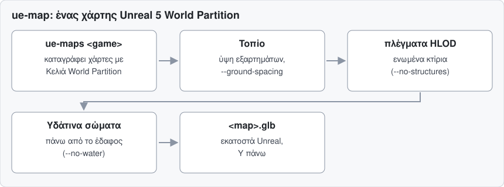

# Χάρτες Unreal 5 με World Partition: `ue-maps` και `ue-map` {#unreal-5-world-partition-maps-ue-maps-and-ue-map}

**Τι είναι;** Ένας ολόκληρος χάρτης ενός παιχνιδιού του Unreal 5 σε ένα τρισδιάστατο αρχείο: το έδαφος, τα κτίρια και το νερό. **Γιατί;** Για να έχει η θερμότητα από αυτό το παιχνίδι τον χάρτη κάτω της. (*World Partition* είναι ο τρόπος που το Unreal 5 χωρίζει έναν μεγάλο χάρτη σε κομμάτια· *HLOD* είναι ένα απλοποιημένο υποκατάστατο μιας ομάδας κτιρίων, αυτό που σχεδιάζει το παιχνίδι μακριά.)

Εξάγει έναν ολόκληρο χάρτη ενός παιχνιδιού του Unreal 5 των οποίων οι χάρτες είναι κομμένοι ως κελιά World Partition: το τοπίο, τα συγχωνευμένα HLOD mesh του χάρτη (τα κτίρια και τα αντικείμενά του όπως τα σχεδιάζει το παιχνίδι σε απόσταση) και τα σώματα νερού του. Δεν χρειάζονται ο επεξεργαστής ούτε ένα έργο, μόνο το εγκατεστημένο παιχνίδι.



## Βήμα προς βήμα {#step-by-step}

1. **Παραθέστε τους χάρτες.** Το `<game>` είναι ο φάκελος του παιχνιδιού, το `Content/Paks` του, ή το όνομα του φακέλου του σε μια βιβλιοθήκη Steam:

   ```
   python -m heat3d_gamefiles ue-maps "<Steam game folder name>"
   python -m heat3d_gamefiles ue-maps "D:\Games\<game>"
   ```

   Κάθε χάρτης με κομμένα κελιά World Partition τυπώνεται με τη διαδρομή του πακέτου του.

2. **Εξάγετε έναν** με το όνομά του ή ένα μοναδικό μέρος του:

   ```
   python -m heat3d_gamefiles ue-map "<game>" <map> -o map.glb
   ```

3. **Μόνο έδαφος, ή πιο χονδρικά:**

   ```
   python -m heat3d_gamefiles ue-map "<game>" <map> --no-structures --no-water
   python -m heat3d_gamefiles ue-map "<game>" <map> --ground-spacing 4
   ```

4. **Ανοίξτε το `map.glb`** στο πάνελ Φόντο / πίστα του προβολέα του 3DHeat ([φόρτωση πίστας](https://holdi601.github.io/3DHeat/levels.html)).

## Επιλογές {#options}

| Επιλογή | Προεπιλογή | Σημασία |
|---|---|---|
| `<game>` | απαιτείται | ο φάκελος του παιχνιδιού, το `Content/Paks` του, ή το όνομα του φακέλου του στο Steam |
| `<map>` | απαιτείται | ένα όνομα όπως το τυπώνει το `ue-maps`, ή ένα μοναδικό μέρος του |
| `-o`, `--out FILE` | `<map>.glb` (στο `$HEAT3D_LEVELS/<game>/` όταν αυτό είναι ορισμένο) | το αρχείο που γράφεται |
| `--ground-spacing METRES` | 2 | η απόσταση κορυφών του τοπίου, στρογγυλοποιημένη σε ακέραιο πλήθος των δικών του τετραγώνων |
| `--no-structures` | | αφήνει έξω τα κτίρια και τα αντικείμενα HLOD |
| `--no-water` | | αφήνει έξω τα σώματα νερού |

Το περιεχόμενο συμπιεσμένο με Oodle χρειάζεται μια βιβλιοθήκη Oodle ήδη στον υπολογιστή (δείτε [Oodle](reader-oodle.md)).

## Παράδειγμα εξόδου {#example-output}

```text
<map> -> map.glb
  ground      <n> triangles from <n> landscape components; <n> of <n> vertices stored twice disagree
  structure   <n> triangles in <n> HLOD meshes
  water       <n> triangles from <n> water bodies
```

Το πλήθος των διαφωνιών είναι ένας αυτοέλεγχος: γειτονικά συστατικά τοπίου αποθηκεύουν δύο φορές την κοινή τους άκρη, και οι δύο πρέπει να ταιριάζουν. Ένας χάρτης 3 km σε 2 m είναι περίπου 4,6 εκατομμύρια τρίγωνα εδάφους.

## Τα μέρη {#the-parts}

`ground:<map>` (το τοπίο), `structure:<map>` (τα HLOD mesh) και `water:<map>` (νερό που στέκεται πάνω από το έδαφος).

**Μονάδες:** αυτή είναι η μόνη εξαγωγή που **δεν είναι σε μέτρα**: εκατοστά της Unreal, με τους άξονες Y και Z ανταλλαγμένους (το Y πάνω), το σύστημα που γράφει ο Unreal Exporter του 3DHeat. Η τηλεμετρία από το ίδιο παιχνίδι χρησιμοποιεί το ίδιο σύστημα, οπότε πέφτει πάνω στον χάρτη.

## Πώς διαβάζεται και ελέγχεται {#how-it-is-read-and-checked}

| Μέρος | Διαβάζεται από | Ελέγχεται με |
|---|---|---|
| έδαφος | τον 16-bit χάρτη ύψους κάθε συστατικού τοπίου, τοποθετημένο από τη βάση του τμήματός του στον μετασχηματισμό του τοπίου | κάθε κορυφή που αποθηκεύεται δύο φορές (σε ραφή ή άκρη συστατικού) πρέπει να συμφωνεί· οι διαφωνίες μετρώνται και τυπώνονται, δεν λειαίνονται |
| κατασκευή | τα συγχωνευμένα HLOD mesh του χάρτη, που τα χτίζει η μηχανή στον κόσμο | ένα mesh κρατιέται μόνο αν τα όρια που έχει αποθηκεύσει το συστατικό του περιγράφουν τις δικές του κορυφές |
| νερό | το mesh κάθε σώματος νερού, τοποθετημένο στο πλέγμα εδάφους, κρατιέται όπου στέκεται πάνω από το έδαφος | το νερό στέκεται μερικά μέτρα πάνω από το έδαφος κάτω του, όπως ένα ποτάμι πάνω από την κοίτη του |

Οι ιδιότητες του τοπίου βρίσκονται από το σχήμα, όχι από τον αριθμό της θέσης (οι θέσεις μετακινούνται μεταξύ εκδόσεων της μηχανής). Οι κατασκευές είναι τα απλοποιημένα υποκατάστατα, όχι τα μοντέλα πλήρους λεπτομέρειας. Η βλάστηση, οι διακοσμήσεις και τα υλικά τοπίου δεν εξάγονται· το έδαφος είναι χωρίς υφή και το σκιάζει ο προβολέας. Λεπτομέρειες αρχείου: [Unreal 5 IoStore](reader-unreal-iostore.md).

**Τα δικά σας αρχεία:** ο χάρτης διαβάζεται από το παιχνίδι που είναι εγκατεστημένο στον υπολογιστή σας και γράφεται στον δίσκο σας, για τη δική σας ανάλυση· τίποτα από το παιχνίδι δεν διανέμεται με αυτό το εργαλείο.
