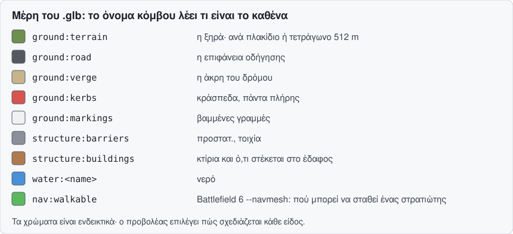

# Μορφή αρχείου {#output-format}

Ένα `.glb` είναι ένα τρισδιάστατο αρχείο: το έδαφος, τα κτίρια και το νερό μιας διαδρομής ή μιας πίστας, που το ανοίγετε στο panel Φόντο / πίστα του viewer του 3DHeat.

Κάθε εξαγωγή (`course`, `courses`, `terrain`, `level`, `ue-map`, `enfusion-world`) γράφει ένα **δυαδικό glTF 2.0**
αρχείο (`.glb`). Είναι σκόπιμα μικρό και επίπεδο, και είναι διατεταγμένο όπως το διαβάζει ο viewer του 3DHeat για μια πίστα.
Πηγή:
[`glb.py`](https://github.com/Holdi601/3DHeat-GameFiles/blob/main/heat3d_gamefiles/glb.py).

## Δομή {#structure}

```
scene 0
 ├─ node "ground:terrain x-2046 z1023"  -> mesh 0 -> 1 primitive, material 0
 ├─ node "ground:road x-2046 z1023"     -> mesh 1 -> 1 primitive, material 1
 ├─ node "ground:markings"               -> mesh 2 -> ...
 ├─ node "ground:kerbs road_gen_rum_..." -> ...
 ├─ node "structure:barriers bar_armco_bclr"
 └─ ...
```

- **Ένας κόμβος ανά τμήμα**, όλοι στη ρίζα της σκηνής, **χωρίς μετασχηματισμούς**. Όλη η γεωμετρία είναι ήδη σε συντεταγμένες κόσμου.
- Κάθε κόμβος έχει το δικό του πλέγμα με **ένα primitive** και το δικό του υλικό. Ο κόμβος, το πλέγμα και το υλικό φέρουν όλα το όνομα του τμήματος.
- Κάθε primitive έχει **τους δικούς του συμπαγείς πίνακες κορυφών**, μόνο τις κορυφές που χρησιμοποιεί το τμήμα. Ένας κοινός πίνακας κορυφών είναι έγκυρο glTF, αλλά ένας αναγνώστης που ανοίγει τους accessors κάθε primitive θα κρατούσε κάθε κορυφή μία φορά ανά τμήμα.
- Το `asset.generator` είναι `heat3d_gamefiles`.
- **Λίγα `extras`**, και κανένα όνομα διαδρομής, παιχνιδιού ή πίστας:
  - ένα τμήμα Battlefield 6 από καταστρεπτό πλέγμα φέρει `{"destructible": true}` στον κόμβο του.
  - μια διαδρομή Forza λέει τι περιέχει στο `asset.extras` (έκδοση μορφής, id της ταιριασμένης διαδρομής, πόσα αντίγραφα του δικού επιπέδου του αγώνα, χώροι· δείτε
    [Διαδρομές Forza Horizon](course-forza-horizon.md#writing-the-file)), και τα ανοιχτά τμήματά της φέρουν το επίπεδό τους στον κόμβο: `{"layer": "event", "route": <id>}`
    για το δικό επίπεδο του αγώνα, `{"layer": "layer"}` για άλλο ανοιχτό επίπεδο, `{"layer": "venue"}` για το έδαφος ενός χώρου.

  Ό,τι άλλο χρειάζεται ο viewer βρίσκεται στα ονόματα των κόμβων.

## Ονόματα κόμβων: η ταξινόμηση {#node-names-the-classification}



Ο viewer παίρνει την κλάση ενός τμήματος από το όνομα του **κόμβου** (και, αν λείπει, από το όνομα του πλέγματος), και μόνο όταν ταιριάζει με

```
^(ground|structure|water)\s*[:|]
```

Οτιδήποτε άλλο ταξινομείται με μια ευρετική που γράφηκε για τοπία Unreal. Άρα κάθε τμήμα που γράφει ο εξαγωγέας αρχίζει με ένα από αυτά τα προθέματα, ή με `nav:` (παρακάτω):

| Πρόθεμα | Σημασία | Τμήματα που γράφονται |
|---|---|---|
| `ground:` | η επιφάνεια οδήγησης και η γη | `ground:road`, `ground:verge`, `ground:terrain`, `ground:gravel and dirt`, `ground:kerbs`, `ground:markings`, `ground:tyre marks`, `ground:venue`, `ground:plinths` |
| `structure:` | ό,τι στέκεται πάνω της | `structure:barriers`, `structure:props`, `structure:signs`, `structure:buildings`, `structure:infrastructure`, `structure:bridges`, `structure:rocks`, `structure:smashables`, `structure:trees`· τα επίπεδα Forza `structure:event_<category>` και `structure:layer_<category>` |
| `water:` | νερό | `water:water`· `water:<map>` (`ue-map`), `water:<world>` (`enfusion-world`) |
| `nav:` | όπου μπορεί να περπατήσει ένας στρατιώτης (Battlefield 6, μόνο με `--navmesh`) | `nav:walkable` |

Το `nav:` δεν ταιριάζει με το παραπάνω μοτίβο του viewer, οπότε ο viewer το ταξινομεί με την ευρετική του· είναι ξεχωριστό τμήμα ώστε να το εμφανίζετε ή να το κρύβετε μόνο του.
Το `ue-map` γράφει `ground:<map>`, `structure:<map>` και `water:<map>`· το `enfusion-world` γράφει `ground:<world>`, `structure:<world>` και `water:<world>`.

Μετά το είδος έρχεται, ανάλογα με το παιχνίδι:

| Παράδειγμα | Σημασία |
|---|---|
| `ground:road x-2046 z1023` | έδαφος Forza στο πλακίδιο εδάφους με όνομα `x-2046 z1023` (μονάδες πλέγματος, 1023 ανά 512 m) |
| `ground:road 3_-2` | έδαφος BeamNG στο τετράγωνο 512 m (3, -2) |
| `ground:road 3_-2 asphalt_light` | μοντελοποιημένη επιφάνεια οδήγησης BeamNG του υλικού `asphalt_light` σε αυτό το τετράγωνο |
| `ground:road 1_-4` | έδαφος AC Rally στο τετράγωνο 512 m (1, -4) του χώρου Unreal |
| `structure:barriers bar_armco_bclr` | τοποθετημένα μοντέλα Forza που μοιράζονται μία υφή (το όνομά της χωρίς το GUID) |
| `structure:barriers` | τοποθετημένα μοντέλα χωρίς υφή (Forza, AC Rally) |
| `structure:event_barriers bar_example_bclr` | Forza: ό,τι βγάζει ο ταιριασμένος αγώνας για τον εαυτό του, χωριστά από τον ελεύθερο κόσμο (extras του κόμβου `{"layer": "event", "route": <id>}`) |
| `structure:layer_props` | Forza: ένα επίπεδο που ανοίγει το παιχνίδι για κάτι άλλο από αυτόν τον αγώνα (δραστηριότητα, συλλεκτικό, επίπεδο χρόνου εκτέλεσης) |
| `ground:venue`, `ground:plinths` | Forza: μοντέλα που είναι ήδη σε συντεταγμένες κόσμου: το δικό έδαφος ενός χώρου (το δάπεδο ενός σταδίου), και το έδαφος με το οποίο στολίζεται ένας δρόμος |
| `structure:barriers armco_metal` | τοποθετημένα μοντέλα BeamNG ενός υλικού |
| `ground:markings`, `water:water` | επίπεδα τμήματα, ένα για ολόκληρο το αρχείο |
| `ground:terrain` (Battlefield 6) | το ύψωμα· `ground:terrain backdrop` τα μακρινά πλέγματα εδάφους, `ground:terrain blend` τα πλέγματα που ενώνονται με το έδαφος |
| `nav:walkable` (Battlefield 6, `--navmesh`) | το πλέγμα πλοήγησης της πίστας για έναν στρατιώτη: πού μπορεί κανείς να σταθεί, επίπεδο πράσινο |
| `ground:terrain x-512 z-512` (Battlefield 6, `--ground-texture`) | το ύψωμα κάτω από ένα ψημένο πλακίδιο διακόσμησης, με το όνομα της κάτω γωνίας του σε μέτρα |
| `structure:buildings t_concreteclean_01_cs` (Battlefield 6, `--textures`) | κάθε επιφάνεια αυτού του είδους που δείχνει τον συγκεκριμένο χάρτη χρώματος· χωρίς `--textures`, ένα τμήμα ανά είδος, χωρίς κατάληξη |
| `structure:buildings t_concreteclean_01_cs (destructible)` (Battlefield 6) | το ίδιο, για πλέγματα που μπορεί να καταστρέψει ένας αγώνας: εκείνα που έχουν asset καταστροφής με το δικό τους όνομα (τοίχοι, σπίτια, αντικείμενα). Ο κόμβος φέρει επίσης τα extras `{"destructible": true}`. Οι καταστραμμένες καταστάσεις τους δεν εξάγονται |

Ο viewer μπορεί να φιλτράρει με αυτά τα ονόματα. Για παράδειγμα, "μόνο η επιφάνεια του αγώνα" είναι το `ground:road` μαζί με το `ground:kerbs`, και στα τρία παιχνίδια· "ο κόσμος χωρίς τα δικά αντικείμενα του αγώνα" είναι όλα εκτός από τα `structure:event_*`. Το πρόθεμα είναι επίσης ο τρόπος με τον οποίο ο viewer σχεδιάζει ένα τμήμα: το έδαφος ως την επιφάνεια πάνω στην οποία στέκεται η θερμότητα, και η δομή ως ό,τι στέκεται πάνω της.

## Μονάδες, άξονες και πλαίσιο {#units-axes-and-frame}

- **Μέτρα, Y προς τα πάνω**, η σύμβαση του glTF, για κάθε εξαγωγή εκτός από το `ue-map`. Τίποτα δεν επαναυπολογίζεται ούτε μετακινείται: οι αριθμοί είναι οι συντεταγμένες κόσμου του ίδιου του παιχνιδιού, που είναι και ο λόγος που διαβάζουμε το αρχείο αντί να το ανασυνθέτουμε.
- **Χάρτες Unreal 5 (`ue-map`): εκατοστά**, η δική μονάδα του Unreal, με τα Y και Z ανταλλαγμένα ώστε το Y να είναι προς τα πάνω· το πλαίσιο που γράφει ο 3DHeat Unreal Exporter και που χρησιμοποιεί η τηλεμετρία του παιχνιδιού. Η μόνη εξαγωγή που δεν είναι σε μέτρα.
- **Arma Reforger (`enfusion-world`):** τα μέτρα του ίδιου του παιχνιδιού, x ανατολικά, y πάνω, z βόρεια. Το πλαίσιο του παιχνιδιού είναι αριστερόστροφο· η επιλογή *Αντιστροφή άξονα κόσμου* του viewer το δείχνει χωρίς καθρέφτισμα.
- **Forza:** οι συντεταγμένες κόσμου του ίδιου του παιχνιδιού (x, y πάνω, z), αμετάβλητες. Ίδιες με την τηλεμετρία του, οπότε ένας καταγεγραμμένος γύρος πέφτει πάνω στη διαδρομή.
- **BeamNG.drive:** `(x, z, -y)` του κόσμου BeamNG με Z προς τα πάνω, δηλαδή η περιστροφή που εφαρμόζει ο εγγραφέας τηλεμετρίας. Περιστροφή, όχι καθρέφτισμα.
- **Battlefield 6:** οι συντεταγμένες κόσμου του ίδιου του παιχνιδιού (x, y πάνω, z), αμετάβλητες: οι μετασχηματισμοί στιγμιοτύπων της πίστας εφαρμόζονται σε κάθε πλέγμα όπως είναι αποθηκευμένο. Τα καθρεφτισμένα αντίγραφα ξαναγυρίζονται ώστε τα κάθετα διανύσματά τους να δείχνουν προς τα έξω.
- **Assetto Corsa Rally:** το πλαίσιο του γύρου. Τα εκατοστά του Unreal γίνονται μέτρα, το Z του Unreal γίνεται y, και τα X και Y του Unreal γίνονται x και z με όποιον από τους οχτώ προσανατολισμούς ταίριαξε ο γύρος (δείτε
  [Assetto Corsa Rally](course-assetto-corsa-rally.md#which-stage-and-which-way-round)). Τα τρίγωνα ξαναγυρίζονται εκεί που η αντιστοίχιση καθρεφτίζει.

Κάθε εξαγωγή κρατά τους άξονες που χρησιμοποιεί η τηλεμετρία της, ώστε η εγγραφή και η πίστα να μοιράζονται το ίδιο πλαίσιο. Το αν αυτό το πλαίσιο είναι αριστερόστροφο ή δεξιόστροφο σε κάθε παιχνίδι
δεν έχει ελεγχθεί.

## Δεδομένα κορυφών {#vertex-data}

Η προεπιλογή είναι η **κβαντισμένη** μορφή (`quantize=True`). Χρειάζεται την επέκταση `KHR_mesh_quantization`, που αναγράφεται και στο `extensionsUsed` και στο `extensionsRequired`.

| Χαρακτηριστικό | Κβαντισμένο (προεπιλογή) | Πλήρης ακρίβεια (`quantize=False`) |
|---|---|---|
| `POSITION` | float32 VEC3, με min/max | float32 VEC3 |
| `NORMAL` | int8 VEC3 κανονικοποιημένο, γεμισμένο σε 4 bytes (βήμα 4) | float32 VEC3 |
| `TEXCOORD_0` (μόνο τμήματα με υφή) | uint16 VEC2 κανονικοποιημένο, περιορισμένο στο 0-1· float32 VEC2 όπου οι υφές επαναλαμβάνονται (Battlefield 6) | float32 VEC2 |
| `COLOR_0` (τμήματα χωρίς υφή, όταν κάποιο τμήμα έχει χρώμα) | uint8 VEC3 κανονικοποιημένο, γεμισμένο σε 4 bytes | float32 VEC3 |
| δείκτες | uint16 όταν το τμήμα έχει έως 65.535 κορυφές, αλλιώς uint32 | uint32 |

Μια κορυφή είναι 20 bytes αντί για 32 (24 αντί για 44 με χρώμα). Αυτό αφαιρεί το ένα τρίτο από κάθε αρχείο, και είναι η διαφορά ανάμεσα σε μια πόλη που φορτώνεται σε καρτέλα browser και σε μία που δεν. Το κόστος είναι λιγότερο από μισή μοίρα κάθετου και 1/65.535 ενός UV (το ένα δέκατο πέμπτο ενός texel σε 4.096 px). Η γραμμή εντολών γράφει πάντα την κβαντισμένη μορφή. Το `write_glb(..., quantize=False)` σε Python γράφει την άλλη.

Τα κάθετα διανύσματα προέρχονται από το παιχνίδι όπου εκείνο τα αποθηκεύει (Forza για έδαφος και μοντέλα, σχήματα και έδαφος BeamNG). Αλλιώς υπολογίζονται ως ομαλά κάθετα με στάθμιση εμβαδού από τα τρίγωνα. Τα κάθετα του AC Rally υπολογίζονται πάντα.

## Υλικά, χρώματα και υφές {#materials-colours-and-textures}

- Κάθε υλικό είναι `metallicFactor 0`, `roughnessFactor 1`.
- **Τμήμα με υφή:** `baseColorTexture` με την εικόνα του τμήματος, τις UV του, και χωρίς χρώμα κορυφής. Το glTF πολλαπλασιάζει τα δύο, οπότε μια επιφάνεια θα έβγαινε σκουρότερη δύο φορές.
- **Τμήμα χωρίς υφή:** χρώμα κορυφής `COLOR_0` με το επίπεδο χρώμα του τμήματος, και ένα λευκό `baseColorFactor`. Αν κανένα τμήμα του αρχείου δεν έχει χρώμα, δεν υπάρχει `COLOR_0`. Όπου τα τμήματα μοιράζονται κορυφές, κερδίζει το χρώμα του μεταγενέστερου τμήματος, οπότε τα επίπεδα τμήματα γράφονται με σειρά αυξανόμενης σημασίας.
- **Εικόνες** ενσωματώνονται στο δυαδικό τμήμα ως **JPEG**, ποιότητα 90, χωρίς υποδειγματοληψία χρώματος, μόνο RGB (το άλφα απορρίπτεται) — εκτός από έναν χάρτη κομμένων τμημάτων του Battlefield 6 (φύλλα, φράχτες), που είναι **PNG** με το άλφα του, σε υλικό με `alphaMode` MASK, `alphaCutoff` 0.5 και `doubleSided` (δείτε [Frostbite](reader-frostbite.md#textures-and-materials)). Ο viewer του 3DHeat πετάει τα texels κάτω από το όριο. Ένα έδαφος 2048 px από χλόη και στέμματα δέντρων είναι θόρυβος για έναν συμπιεστή χωρίς απώλειες: αρκετά megabytes ανά πλακίδιο ως PNG, κάτω από ένα ως JPEG. Μια εικόνα που μοιράζονται πολλά τμήματα αποθηκεύεται μία φορά.
- **Ένας sampler** για όλες τις υφές: γραμμική μεγέθυνση, γραμμικό-mipmap-γραμμική σμίκρυνση, **clamp to edge** και στους δύο άξονες, για τις εξαγωγές διαδρομών, των οποίων οι υφές καλύπτουν τις επιφάνειες τους μία φορά. Το BeamNG σχεδιάζει τις επαναλαμβανόμενες υφές μοντέλων ως επίπεδα χρώματα (δείτε [BeamNG.drive](course-beamng.md#placed-models)).
- Μια εξαγωγή Battlefield 6 με `--textures`, των οποίων τα υλικά πλακιδιώνονται, γράφει τις δικές του συντεταγμένες υφής του παιχνιδιού, χωρίς περιορισμό, ως float32 `TEXCOORD_0` ακόμη και στην κβαντισμένη μορφή, με sampler που **επαναλαμβάνει** και στους δύο άξονες (`write_glb(..., repeat=True)`): ένας τοίχος από τούβλα είναι ένα ζεύγος τριγώνων του οποίου το UV φτάνει από 0 έως 40. Ο viewer του 3DHeat τυλίγει μια τέτοια υφή μέσα στον άτλαντά του (δείτε τη σελίδα του *Model levels*). Για έναν renderer που δεν μπορεί να επαναλάβει μια υφή, το `level --clamped-uvs` (`write_level(..., clamped=True)`) κόβει κάθε τρίγωνο κατά τις γραμμές όπου επαναλαμβάνεται η υφή του και μεταφέρει κάθε κομμάτι στο 0..1: τα ίδια εικονοστοιχεία στην ίδια επιφάνεια, με περίπου ένα πέμπτο περισσότερα τρίγωνα. Τρίγωνα πάνω από τα οποία η υφή τους επαναλαμβάνεται περισσότερο από 16 φορές κρατούν τις συντεταγμένες τους. Ένα τρίγωνο που η υφή του θα το έκοβε σε περισσότερα από 4 κομμάτια (φλοιός που επαναλαμβάνεται σε κάθε κλαδί ενός δέντρου, και που το κόψιμο έκανε 1.099 τρίγωνα ενός δέντρου σε 51.735) μπαίνει σε τμήμα δικό του, `<part> (average colour)`, στο μέσο χρώμα της υφής· το `level` λέει πόσα.

| Υφή | Μέγεθος | Καλύπτει |
|---|---|---|
| έδαφος (όλα εκτός από Battlefield 6) | `--texture-size`: 2048, 1024 ή 512 px | ένα τετράγωνο 512 m: 25, 50 ή 100 cm το εικονοστοιχείο |
| ύψωμα Battlefield 6 | το μεγαλύτερο mip του χάρτη χρώματος του φόντου στην πίστα, περικομμένο | το τετράγωνο εδάφους: 32 m το εικονοστοιχείο στην πίστα που ελέγχθηκε |
| επιφάνειες Battlefield 6 | `--textures`: το πολύ τόσα px σε πλευρά | η δική υφή της επιφάνειας, μία φορά ανά κομμάτι (κομμένη εκεί που επαναλαμβάνεται) |
| ψημένο έδαφος Battlefield 6 | `--ground-texture`: μέτρα ανά εικονοστοιχείο, πλακίδια έως 4.096 px | ένα πλακίδιο της έκτασης των διακοσμήσεων: 2.048 m σε 0,5 m το εικονοστοιχείο |
| τοποθετημένο μοντέλο Forza | έως 256 px | η δική διάταξη UV του μοντέλου |
| τοποθετημένο μοντέλο BeamNG | έως 256 px | η δική διάταξη UV του μοντέλου, μόνο όπου δεν επαναλαμβάνεται |
| τοποθετημένο μοντέλο AC Rally | καμία | επίπεδα χρώματα |

## Τι αρνείται ο εγγραφέας {#what-the-writer-refuses}

Το `write_glb` σηκώνει σφάλμα αντί να γράψει ένα αρχείο που ένας viewer θα άνοιγε και θα έδειχνε λάθος:

| Αρνείται | Επειδή |
|---|---|
| θέσεις που δεν είναι N x 3, ή μη πεπερασμένες | ένα χαλασμένο πλέγμα |
| δείκτης πέρα από το τέλος της λίστας κορυφών | αποδίδεται ως θόρυβος |
| τμήμα με υφή όταν το αρχείο δεν έχει UV | αποδίδεται ως ένα θολό εικονοστοιχείο |
| κανένα τρίγωνο | αποδίδεται ως τίποτα |
| πίνακας κάθετων, χρωμάτων ή UV με λάθος μήκος, ή μη πεπερασμένος | χρειάζεται ένα για κάθε κορυφή |

## Ανάγνωση αλλού {#reading-it-elsewhere}

Οποιοσδήποτε glTF 2.0 viewer που υποστηρίζει το `KHR_mesh_quantization` πρέπει να ανοίγει αυτά τα αρχεία. Μόνο ο viewer του 3DHeat έχει ελεγχθεί· οι άλλοι viewers δεν έχουν επαληθευτεί. Ένας αναγνώστης χωρίς την επέκταση αρνείται το αρχείο, επειδή αυτή σημειώνεται ως απαιτούμενη. Τα αρχεία μπορεί να είναι μεγάλα: περίπου 80 MB για ένα κύκλωμα εξοχής, μέχρι αρκετές εκατοντάδες MB για μια διαδρομή πόλης με τον αυτόματο προϋπολογισμό.

## Στο 3DHeat {#in-3dheat}

Φόρτωσε το `.glb` στο panel Φόντο / πίστα του viewer του [3DHeat](https://github.com/Holdi601/3DHeat)· η τηλεμετρία που καταγράφετε στο ίδιο παιχνίδι πέφτει πάνω του, επειδή και τα δύο κρατούν τις συντεταγμένες του παιχνιδιού. Η δική τους τεκμηρίωση του viewer
([holdi601.github.io/3DHeat](https://holdi601.github.io/3DHeat/)) καλύπτει το panel Φόντο / πίστα και τα αρχεία αγώνων που γράφουν τα άλλα εργαλεία
([Ένα αρχείο ανά αγώνα: `.3dheat`](https://holdi601.github.io/3DHeat/container.html)).
Μια πίστα δεν αποθηκεύεται σε κάθε αρχείο `.3dheat`: ένας αγώνας την ονομάζει στο `references` του (`kind: "level"`, όνομα και sha256) και το `.glb` μένει δίπλα στους αγώνες.
