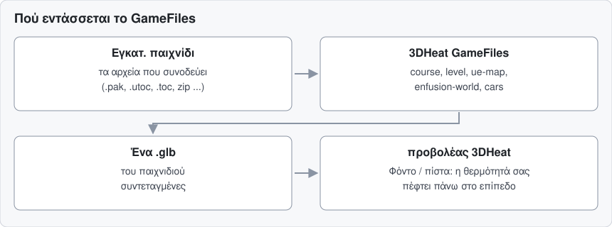

# Ολόκληρα επίπεδα {#whole-levels}

**Με απλά λόγια:** για shooters και άλλα παιχνίδια χωρίς γύρους, το εργαλείο αποθηκεύει ολόκληρο τον χάρτη ως ένα τρισδιάστατο αρχείο, ώστε ο προβολέας να σχεδιάζει πού πήγαν οι παίκτες.

Το `course` κόβει το έδαφος γύρω από έναν γύρο. Για παιχνίδια χωρίς γύρους το εργαλείο εξάγει ένα ολόκληρο επίπεδο, χάρτη ή κόσμο ταυτόχρονα:

| Παιχνίδι ή μηχανή | Λίστα | Εξαγωγή | Σελίδα |
|---|---|---|---|
| Battlefield 6 (Frostbite) | `levels` | `level <level>` | [Επίπεδα Battlefield 6](level-battlefield.md) |
| Παιχνίδια Unreal 5 World Partition | `ue-maps <game>` | `ue-map <game> <map>` | [Χάρτες Unreal 5](level-unreal-world-partition.md) |
| Arma Reforger (Enfusion) | `enfusion-worlds` | `enfusion-world <world>` | [Κόσμοι Arma Reforger](level-arma-reforger.md) |

Κάθε ζεύγος δουλεύει με τον ίδιο τρόπο: η πρώτη εντολή καταγράφει ό,τι έχει το εγκατεστημένο παιχνίδι, και η δεύτερη γράφει ένα από αυτά ως ένα μόνο `.glb` στις δικές του συντεταγμένες κόσμου, ώστε οι θέσεις που καταγράφηκαν σε εκείνο το παιχνίδι να πέφτουν πάνω του. Τα μέρη ονομάζονται `ground:`, `structure:` και `water:` όπως κάθε άλλη εξαγωγή (βλ. [Μορφή εξόδου](output-format.md))· φορτώστε το αρχείο στο πάνελ Φόντο / πίστα του προβολέα 3DHeat.

