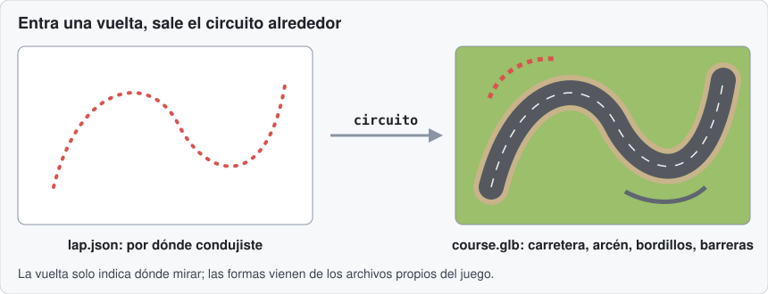
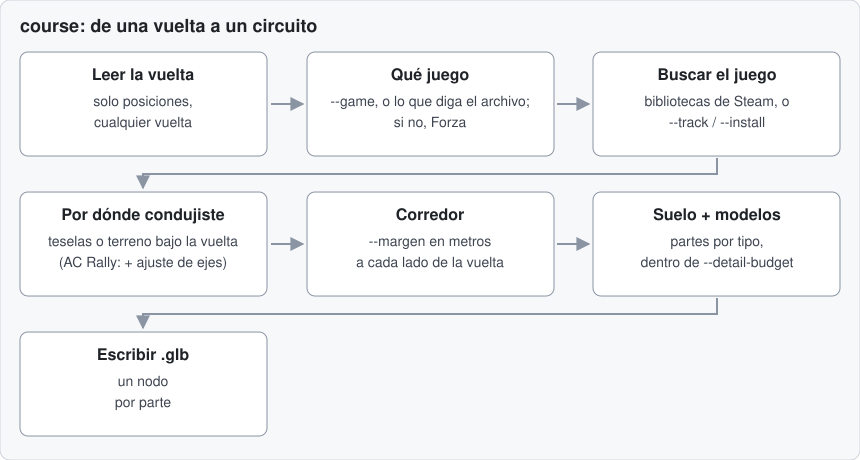

# Exportación de circuito {#course-export}

**En pocas palabras:** has dado una vuelta; esto construye el circuito por el que has conducido, como un archivo 3D. La vuelta es solo una línea de puntos; la carretera, la hierba y los bordillos vienen de los propios archivos del juego.

`course` convierte una vuelta en un circuito: el suelo en una franja a cada lado de por dónde fue el coche, y lo que está sobre ese suelo, todo en un único `.glb` para el visor. Esta página cubre lo que comparten los tres juegos compatibles. Las páginas que cuelgan de ella cubren lo que se diferencia:

- [Forza Horizon](course-forza-horizon.md): archivos `.minizip` de ForzaTech
- [BeamNG.drive](course-beamng.md): archivos zip, un campo de alturas del terreno, formas compiladas
- [Assetto Corsa Rally](course-assetto-corsa-rally.md): Unreal 5 IoStore, una etapa World Partition
- [Niveles de detalle y presupuesto](detail-budget.md): cuántos triángulos reciben los modelos colocados, y qué copias se quedan

## Los pasos {#the-steps}

Palabras que se usan abajo: un **marco** es hacia dónde apuntan los ejes; el **corredor** es la franja de suelo a cada lado de la vuelta; una **loseta** es una pieza cuadrada del terreno de un juego; un **LOD** (nivel de detalle) es una de las copias más simples de un modelo.

1. **Leer la vuelta.** Solo posiciones, de cualquiera de las formas de [Entradas de vuelta](lap-inputs.md). La velocidad y los controles no se usan. Una vuelta con menos de dos muestras se rechaza (`holds no driving`).
2. **Decidir el juego.** `--game`, luego el campo `game` del archivo de la vuelta, luego Forza (ver [Comandos](commands.md#which-game)).
3. **Encontrar el juego instalado.** Los tres buscan en cada biblioteca de Steam que aparece en `config\libraryfolders.vdf` de Steam. Forza también busca en `C:\XboxGames`. `--track` (Forza) o `--install` (BeamNG, AC Rally) saltan la búsqueda.
4. **Encontrar dónde se condujo la vuelta.** Esto nunca se decide solo por el nombre. Forza elige el circuito cuyas losetas de terreno cubren la vuelta. BeamNG elige el nivel sobre cuyo terreno (o carreteras) caen las muestras de la vuelta. AC Rally prueba cada etapa en ocho orientaciones de ejes y elige la que pone más parte de la vuelta sobre la carretera.
5. **Cortar un corredor** de `--margin` metros a cada lado de la conducción (abajo).
6. **Construir el suelo** dentro del corredor, clasificado como carretera, arcén, grava y tierra, terreno, marcas, huellas de neumáticos o agua, y hornear una textura de suelo para cada cuadrado de 512 m.
7. **Colocar los modelos** que están en el corredor, por categoría, con un nivel de detalle elegido por distancia y un presupuesto de triángulos.
8. **Escribir el `.glb`**: un nodo con nombre por parte. Ver [Formato de salida](output-format.md).

Lo que imprime una ejecución (aquí, sobre una instalación sintética de BeamNG.drive que crean las pruebas, una vuelta de 50 m por una franja de carretera):

## El corredor {#the-corridor}

El corte es una banda alrededor de la línea conducida, no la caja que envuelve la vuelta. En un circuito cerrado las dos son casi iguales. En un sprint de punto a punto, la caja es sobre todo ladera que nadie recorre, y la banda puede ser una décima parte de su área. Fuente:
[`corridor.py`](https://github.com/Holdi601/3DHeat-GameFiles/blob/main/heat3d_gamefiles/corridor.py).

Cómo se construye:

- La conducción se proyecta al plano del suelo: x y z de la vuelta (BeamNG: x e y del marco propio del juego).
- Se rasteriza en una rejilla de celdas de **4 m** (`CELL`). Cada celda que toca la conducción se ensancha con un disco de radio `margin + 4 m` en todas las direcciones.
- Las muestras consecutivas a menos de **50 m** (`JOIN`) se unen con puntos cada 4 m, para que la banda no tenga huecos. Las muestras más separadas se tratan como tramos de conducción distintos y no se unen. Una biblioteca de circuitos son muchos archivos de vuelta seguidos, y la llegada de un sprint y la salida del siguiente no deben trazar una banda a través del mapa.
- Un triángulo se conserva si cualquier esquina, el punto medio de cualquier arista o su centroide cae en la banda. Los puntos medios atrapan un triángulo grande que cruza una banda estrecha con todas sus esquinas fuera.
- La altura nunca forma parte del corte. Una caja que acotara la altitud cortaría el suelo debajo de una colina que sube la carretera.

La consola informa del área del corredor, por ejemplo `cutting 80 m either side of the driving: 1.53 km2 of a 6,000 by 3,600 m box`.

BeamNG y AC Rally construyen además un corredor de **alcance** más ancho, de `margin + 60 m`. Se considera un modelo colocado si su origen cae en el corredor de alcance, y solo se dibuja si su huella toca el corredor real. Así no se pierde un objeto largo cuyo origen está justo fuera de la banda. BeamNG también usa el corredor de alcance para elegir qué calcomanías de carretera pintar.

## De qué está hecho el suelo {#what-the-ground-is-made-of}

Cada exportación clasifica sus triángulos de suelo en los mismos tipos, y cada tipo se escribe como su propia parte para que el visor pueda mostrarla u ocultarla:

| Tipo | Nombre de la parte | Color plano (RGB lineal) | Forza | BeamNG | AC Rally |
|---|---|---|---|---|---|
| carretera | `ground:road` | 0.22, 0.22, 0.23 | franjas de carretera: parte de asfalto | tipos de capa `ASPHALT`, calcomanías de carretera, carretera modelada | losetas de pista (`/MeshesTrack/`) |
| arcén | `ground:verge` | 0.52, 0.47, 0.30 | franjas de carretera: el arcén | aceras y modelos de arcén | - |
| grava y tierra | `ground:gravel and dirt` | 0.50, 0.42, 0.30 | - | capas de tierra, grava, arena y barro, y calcomanías | - |
| terreno | `ground:terrain` | 0.30, 0.44, 0.18 | todo lo demás | todo lo demás | losetas `_Terrain` y terreno lejano |
| bordillos | `ground:kerbs` | 0.60, 0.12, 0.10 (Forza) | objetos `road_gen_rum*` | modelos de bordillo, cuneta y vibrador | modelos de bordillo y cuneta |
| marcas | `ground:markings` | 0.90, 0.90, 0.88 | submallas de calcomanía, elevadas 5 cm | pintadas en la textura | - |
| huellas de neumáticos | `ground:tyre marks` | 0.20, 0.17, 0.16 | submallas de calcomanía, elevadas 5 cm | pintadas en la textura | - |
| agua | `water:water` | 0.16, 0.34, 0.48 | materiales de agua | plano del mar, bloques de agua, ríos | - |

Los colores planos se eligen para leerse de un vistazo, no para parecerse al juego. Se usan en las partes sin textura y en los visores que ignoran las texturas. Fuente:
[`surfaces.py`](https://github.com/Holdi601/3DHeat-GameFiles/blob/main/heat3d_gamefiles/surfaces.py).

Las partes del suelo se separan por cuadrado de 512 m, y cada cuadrado lleva su propia imagen horneada, así que el nombre de la parte incluye el cuadrado:

| Juego | Nombre de la parte del suelo | Clave del cuadrado |
|---|---|---|
| Forza | `ground:road x-2046 z1023` | el nombre de rejilla de la loseta de terreno (pasos de 1023, ver [Forza Horizon](course-forza-horizon.md)) |
| BeamNG | `ground:road 3_-2` | `floor(x / 512)`, `floor(y / 512)` en metros de BeamNG |
| AC Rally | `ground:road 1_-4` | `floor(x / 51200)`, `floor(y / 51200)` en centímetros de Unreal |

## Lo que está sobre el suelo {#what-stands-on-it}

Los modelos colocados se escriben en partes llamadas `structure:<category>`, o `ground:kerbs` para los bordillos (en los tres juegos). Cuando una parte tiene su propia textura, el nombre de la textura o del material sigue a la categoría, por ejemplo `structure:barriers bar_armco_bclr`.

| Categoría | Forza | BeamNG | AC Rally |
|---|---|---|---|
| barreras | sí | sí | sí |
| objetos (props) | sí | sí | sí |
| señales | sí | sí | sí |
| edificios | sí (sustitutos de edificio entero donde el juego los tiene) | sí | sí |
| infraestructura | sí | sí | sí |
| puentes | sí | sí | (se clasifican como infraestructura) |
| rocas | sí | sí | sí |
| bordillos | sí, como suelo | sí, como suelo | sí, como suelo |
| árboles | con `--trees` | con `--trees` | con `--trees` |
| objetos destrozables | con `--trees` | - | - |

El reparto del detalle es igual en los tres. Las copias a 25 m o menos de la conducción empiezan con el detalle completo, las copias a 25-60 m un nivel más grosero, y las que están más lejos, en el nivel más grosero. Luego los modelos más costosos bajan de nivel hasta que encaja un presupuesto de triángulos, y donde ni los niveles más gruesos encajan en un presupuesto que tú das, se dejan fuera copias. Los bordillos nunca se simplifican ni se dejan fuera. Ver [Niveles de detalle y presupuesto](detail-budget.md).

## Opciones que cambian el resultado {#options-that-shape-the-result}

| Quieres | Usa |
|---|---|
| un archivo más pequeño | `--no-textures` (colores planos), `--texture-size 1024` o `512`, `--detail-budget N`, `--margin 40` |
| solo el suelo | `--no-placed` |
| también el paisaje | `--trees` |
| otra temporada (Forza) | `--season winter` |
| un juego fuera de Steam | `--track` (Forza) o `--install` (BeamNG, AC Rally) |
| una vuelta que la búsqueda no ubica | `--level` (BeamNG, AC Rally), `--track` (Forza) |

## Coordenadas {#coordinates}

Cada exportación escribe metros con Y hacia arriba, en un marco con el que se alinea una vuelta grabada del mismo juego:

| Juego | Marco escrito |
|---|---|
| Forza | las propias coordenadas del mundo del juego, sin cambios |
| BeamNG | `(x, z, -y)` del mundo de BeamNG con Z hacia arriba, que es la rotación que aplica el grabador de telemetría |
| AC Rally | el marco de la vuelta, hallado por ajuste: los centímetros de Unreal pasan a metros, y las X e Y de Unreal pasan a ser la x y la z de la vuelta, en la de las ocho orientaciones que encaje |

Ver [Formato de salida](output-format.md).
